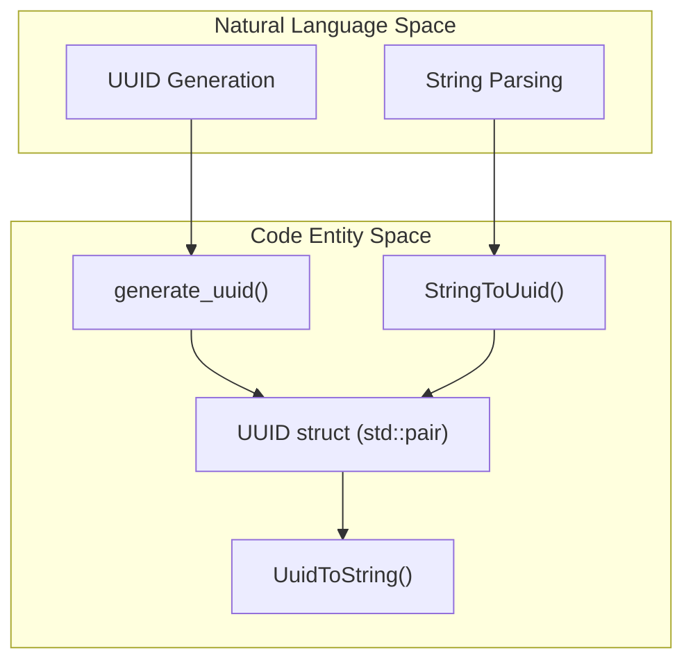
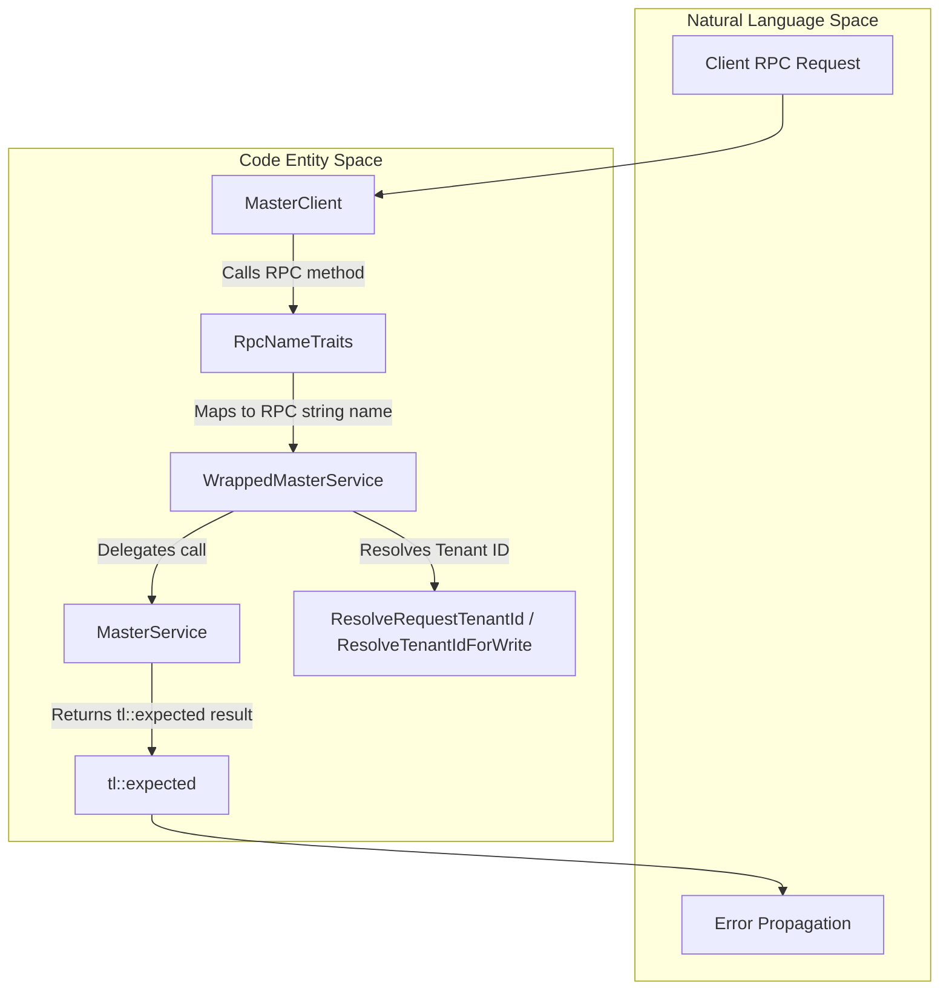
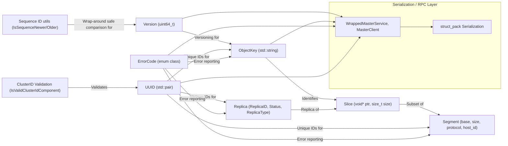

<!-- source: DeepWiki mcp.deepwiki.com · repo kvcache-ai/Mooncake · page 5.9 Types and Error Handling · fetched 2026-11-11 -->

# Types and Error Handling

<details>
<summary>Relevant source files</summary>

The following files were used as context for generating this wiki page:

- [docs/source/deployment/mooncake-store-deployment-guide.md](docs/source/deployment/mooncake-store-deployment-guide.md)
- [mooncake-store/benchmarks/CMakeLists.txt](mooncake-store/benchmarks/CMakeLists.txt)
- [mooncake-store/benchmarks/group_index_contention_bench.cpp](mooncake-store/benchmarks/group_index_contention_bench.cpp)
- [mooncake-store/include/dynamic_replication_lease_table.h](mooncake-store/include/dynamic_replication_lease_table.h)
- [mooncake-store/include/group_index.h](mooncake-store/include/group_index.h)
- [mooncake-store/include/ha/standby_controller.h](mooncake-store/include/ha/standby_controller.h)
- [mooncake-store/include/ha/standby_metadata_store.h](mooncake-store/include/ha/standby_metadata_store.h)
- [mooncake-store/include/hot_standby_service.h](mooncake-store/include/hot_standby_service.h)
- [mooncake-store/include/master_config.h](mooncake-store/include/master_config.h)
- [mooncake-store/include/metadata/tenant.h](mooncake-store/include/metadata/tenant.h)
- [mooncake-store/include/metadata/tenant_registry.h](mooncake-store/include/metadata/tenant_registry.h)
- [mooncake-store/include/object_entry.h](mooncake-store/include/object_entry.h)
- [mooncake-store/include/object_index.h](mooncake-store/include/object_index.h)
- [mooncake-store/include/replica.h](mooncake-store/include/replica.h)
- [mooncake-store/include/types.h](mooncake-store/include/types.h)
- [mooncake-store/src/ha/leadership/master_service_supervisor.cpp](mooncake-store/src/ha/leadership/master_service_supervisor.cpp)
- [mooncake-store/src/ha/standby_controller.cpp](mooncake-store/src/ha/standby_controller.cpp)
- [mooncake-store/src/ha/standby_metadata_store.cpp](mooncake-store/src/ha/standby_metadata_store.cpp)
- [mooncake-store/src/hot_standby_service.cpp](mooncake-store/src/hot_standby_service.cpp)
- [mooncake-store/src/master.cpp](mooncake-store/src/master.cpp)
- [mooncake-store/tests/dynamic_replication_lease_table_test.cpp](mooncake-store/tests/dynamic_replication_lease_table_test.cpp)
- [mooncake-store/tests/group_index_test.cpp](mooncake-store/tests/group_index_test.cpp)
- [mooncake-store/tests/ha/master_service_ha_test.cpp](mooncake-store/tests/ha/master_service_ha_test.cpp)
- [mooncake-store/tests/ha/standby/hot_standby_service_test.cpp](mooncake-store/tests/ha/standby/hot_standby_service_test.cpp)
- [mooncake-store/tests/ha/standby/hot_standby_snapshot_bootstrap_test.cpp](mooncake-store/tests/ha/standby/hot_standby_snapshot_bootstrap_test.cpp)
- [mooncake-store/tests/master_service_config_test.cpp](mooncake-store/tests/master_service_config_test.cpp)
- [mooncake-store/tests/object_entry_test.cpp](mooncake-store/tests/object_entry_test.cpp)
- [mooncake-store/tests/object_index_test.cpp](mooncake-store/tests/object_index_test.cpp)

</details>


## Purpose and Scope

This document provides a detailed technical reference for the core type system and error handling mechanisms utilized throughout the Mooncake Store and Transfer Engine subsystems. It covers fundamental types (`ObjectKey`, `Version`, `Segment`, `Slice`), the taxonomy of `ErrorCode`s, serialization formats, sequence ID wrap-around safety, and cluster ID validation.

Sources: `[mooncake-store/include/types.h:21-160]()`

## Core Type Definitions

Mooncake Store employs essential types that identify objects, manage memory regions, and maintain distributed state consistency. These types form the foundation of the system design and provide key abstractions for the storage and transfer layers.

---

### Core Data Entities

- **ObjectKey**: A string used as the unique identifier for an object stored within Mooncake. Typically represents the user or tenant key namespace.

- **Version**: A `uint64_t` integer serving as a concurrency control mechanism and versioning for objects. The sentinel value `WRONG_VERSION` is defined as 0 to indicate invalid or unset versions.

- **SegmentId**: A UUID type uniquely identifying a memory segment (or storage segment). Implemented as a pair of `uint64_t` values for global uniqueness and efficient storage.

- **ObjectDataType**: An `enum class` that classifies the data stored for each object. Types include:

  - `UNKNOWN` (default)
  - `KVCACHE`
  - `TENSOR`
  - `WEIGHT`
  - `SAMPLE`
  - `ACTIVATION`
  - `GRADIENT`
  - `OPTIMIZER_STATE`
  - `METADATA`
  - `GENERAL`

These classifications enable type-aware policies such as eviction priority and replication strategies within Mooncake.

Sources: `[mooncake-store/include/types.h:23-27]()` `[mooncake-store/include/types.h:147-157]()`

---

### UUID Type and Code Entity Mapping

The UUID type used in Mooncake is a pair of 64-bit unsigned integers (`std::pair<uint64_t, uint64_t>`) uniquely identifying entities like objects, clients, and segments. This design provides efficiency in storage and lookup while allowing global uniqueness without full GUID structures.

UUIDs are generated and parsed with dedicated utility functions:

- `generate_uuid()`: Returns a new UUID value.
- `StringToUuid()`: Parses string representation to UUID.
- `UuidToString()`: Converts UUID to string.

These utilities provide consistent creation and interoperability across distributed components.

**UUID Generation and Type Mapping Architecture:**



Sources: `[mooncake-store/include/types.h:14-20]()` `[mooncake-store/include/types.h:147-157]()`

---

### Segments and Allocation

Memory management in Mooncake is built around `Segment` abstractions which represent contiguous memory regions on different resource types (DRAM, GPU VRAM, CXL, SSD).

- **Segment**: Holds metadata like `base` address, `size`, `protocol` type, and `host_id` denoting the physical machine. Segments are the atomic units for memory contribution by client nodes.

- **SegmentStatus**: An enum representing lifecycle phases of segment mounting and draining:

  - `OK`
  - `DRAINING`
  - `DRAINED`
  - `GRACEFULLY_UNMOUNTING`
  - `UNMOUNTING`

- **MountedSegment**: Associates a segment with its active allocator instance, tracking resource usage and availability for allocations.

Segments and their status are central to managing distributed memory resources safely and efficiently.

Sources: `[mooncake-store/include/types.h:23-50]()` `[mooncake-store/include/replica.h:19-80]()` (implied) `[mooncake-store/src/master.cpp:1-162]()` (for usage context and constants)

---

### Slices and Replicas

Data is transferred and stored using `Slice` and `Replica` abstractions which enable zero-copy and redundancy:

- **Slice**: A raw pointer and size pair (`void* ptr`, `size_t size`) describing a contiguous memory buffer region. Used in transfer operations and allocation granularity.

- **Replica**: Represents one physical copy of a slice on a storage medium. Replicas transition through replication states (`ALLOCATING`, `PROCESSING`, `COMPLETE`, `EVICTED`) representing stages in object lifecycle and consistency.

These abstractions enable parallelism and fault tolerance through replication and efficient memory operations.

Sources: `[mooncake-store/include/types.h:193-196]()` `[mooncake-store/include/replica.h:21-99]()`

---

## Sequence ID Safety & Cluster ID Validation

Mooncake handles sequence IDs as `uint64_t` which can wrap-around upon reaching the maximum value (`UINT64_MAX`). To maintain consistent ordering semantics despite wrap-around, Mooncake uses specialized sequence ID comparison utilities that treat the difference between IDs as signed integers.

- **IsSequenceNewer(a, b)**: Returns true if `a` is newer than `b`. Internally, `(int64_t)(a - b) > 0` ensures safe wrap-around logic.
  `[mooncake-store/include/types.h:39-43]()`
- **IsSequenceOlder(a, b)**: Returns true if `a` is older than `b`.
  `[mooncake-store/include/types.h:46-47]()`
- **IsSequenceEqual(a, b)**: Tests equality.
  `[mooncake-store/include/types.h:50]()`
- **IsSequenceNewerOrEqual(a, b)** and **IsSequenceOlderOrEqual(a, b)** variants include equality.
  `[mooncake-store/include/types.h:52-58]()`

This safe comparison approach assumes sequence IDs never differ by more than 2^63, a reasonable assumption in distributed systems to avoid ambiguity.

Additionally, **Cluster ID validation** ensures that cluster identifiers used in etcd key prefixes are restricted to a safe alphanumeric character set plus underscore `_`, dash `-`, and dot `.`. Cluster IDs must be between 1 and 128 characters to:

- Avoid key-prefix injection risks
- Prevent accidental cross-cluster key overlap

The validation is strict and rejects empty or overly long cluster IDs.

```cpp
inline bool IsValidClusterIdComponent(const std::string& cluster_id) {
    if (cluster_id.empty() || cluster_id.size() > 128) {
        return false;
    }
    for (unsigned char c : cluster_id) {
        const bool ok = (c >= '0' && c <= '9') || (c >= 'A' && c <= 'Z') ||
                        (c >= 'a' && c <= 'z') || c == '_' || c == '-' || c == '.';
        if (!ok) return false;
    }
    return true;
}
```

Sources: `[mooncake-store/include/types.h:28-83]()`

---

## RPC, Serialization, and Response Types

Mooncake Store employs RPC mechanisms with serialization protocols built on `ylt/struct_pack` and `ylt/struct_json`. These handle structured data efficiently across process boundaries and for network transport.

- `WrappedMasterService` encapsulates tenant ID resolution and validation, RPC request routing, and metrics collection.
- Responses often use `tl::expected<T, ErrorCode>` to unify success/failure propagation with typed results.
- Client calls use `RpcNameTraits` to map function calls to RPC strings, facilitating detailed logging.
- Serialization uses `struct_pack::serialize()` for compact binary protocol messages.

**Request Dispatch and Error Handling Flow:**



This structure provides robust error propagation, tenant isolation, and metrics collection central to Mooncake scalability and observability.

Sources: `[mooncake-store/include/rpc_service.h:40-162]()` `[mooncake-store/include/master_client.h:92]()` `[mooncake-store/src/rpc_service.cpp:21-42]()` `[mooncake-store/include/master_service.h:125]()`

---

## Error Handling Taxonomy

Mooncake defines a comprehensive `ErrorCode` enumeration used consistently across the C++ codebase, bindings (Python), and RPC communications:

- **Success and Generic Codes**: `OK`, `INVALID_PARAMS`, `INTERNAL_ERROR`.
- **Segment Errors**: e.g., `SEGMENT_NOT_FOUND`, `SEGMENT_ALREADY_EXISTS`.
- **Object Errors**: e.g., `OBJECT_NOT_FOUND`, `LEASE_EXPIRED`, `REPLICA_IS_GONE`.
- **Tenancy Errors**: e.g., `TENANT_QUOTA_EXCEEDED`, `TENANT_NOT_REGISTERED`.

The system interfaces typically return `tl::expected<T, ErrorCode>` to allow callers to check for both the presence of a valid result and the specific error that occurred.

| Category   | Examples                                  | Source                           |
|------------|-------------------------------------------|---------------------------------|
| **Success**| `ErrorCode::OK` (numeric 0)               | `[mooncake-store/include/types.h:24-27]()` |
| **System** | `INTERNAL_ERROR`, `BUFFER_OVERFLOW`, `INVALID_PARAMS` | `[mooncake-store/include/types.h:26-27]()` |
| **Segment**| `SEGMENT_NOT_FOUND`, `SEGMENT_ALREADY_EXISTS`          | `[mooncake-store/include/master_service.h:153-191]()` |
| **Object** | `OBJECT_NOT_FOUND`, `LEASE_EXPIRED`, `REPLICA_IS_GONE` | `[mooncake-store/include/master_service.h:40-162]()` |
| **Tenancy**| `TENANT_QUOTA_EXCEEDED`, `TENANT_NOT_REGISTERED`       | `[mooncake-store/src/rpc_service.cpp:21-42]()` |

This taxonomy facilitates clear diagnostics and robust error handling throughout all system interactions.

Sources: `[mooncake-store/include/types.h:21-160]()` `[mooncake-store/include/master_service.h:27]()` `[mooncake-store/src/rpc_service.cpp:21-42]()`

---

## System Constants and Defaults

Mooncake maintains various constants for configuration defaults, timeouts, and operational parameters distributed across core headers and the master service implementation.

| Constant                           | Value                                  | Description                                         | Source                     |
|----------------------------------|--------------------------------------|-----------------------------------------------------|----------------------------|
| `WRONG_VERSION`                  | 0                                    | Sentinel for invalid object versions                | `[mooncake-store/include/types.h:24]()`     |
| `DEFAULT_DEFAULT_KV_LEASE_TTL`  | 10000 ms (10 seconds)                 | Default lease time for KV objects                    | `[mooncake-store/include/types.h:84-85]()`  |
| `DEFAULT_KV_SOFT_PIN_TTL_MS`    | 1800000 ms (30 minutes)               | Default soft pin TTL for objects                     | `[mooncake-store/include/types.h:86-87]()`  |
| `DEFAULT_CLIENT_LIVE_TTL_SEC`    | 10 seconds                          | Client liveness TTL                                   | `[mooncake-store/include/types.h:102]()`    |
| `DEFAULT_MAX_RETRY_ATTEMPTS`     | 10                                   | Max retries for background operations                | `[mooncake-store/include/types.h:138]()`    |
| `DEFAULT_CLUSTER_ID`             | "mooncake_cluster"                   | Default cluster ID prefix for storage keys           | `[mooncake-store/include/types.h:114]()`    |
| `DEFAULT_EVICTION_HIGH_WATERMARK_RATIO` | 0.90                         | Ratio of high watermark triggering eviction in Memory| `[mooncake-store/include/types.h:92]()`     |
| `DEFAULT_TENANT_EVICTION_HIGH_WATERMARK_RATIO` | 0.90                 | Per-tenant eviction high watermark ratio             | `[mooncake-store/include/types.h:98]()`     |
| `kDefaultKvLeaseTtlFlagValue`   | "10000" (string)                    | Default KV lease TTL as gflags string                 | `[mooncake-store/src/master.cpp:50]()`       |
| `kDefaultKvSoftPinTtlFlagValue` | "1800000" (string)                  | Default KV soft pin TTL as gflags string              | `[mooncake-store/src/master.cpp:51]()`       |

These defaults provide safe and practical baseline operational behavior. System administrators may override them via configuration files or command-line flags.

Sources: `[mooncake-store/include/types.h:24-138]()` `[mooncake-store/src/master.cpp:49-51]()`

---

## Summary Diagram: Core Types in the Mooncake Store System



This diagram illustrates the relationships and roles of the critical types and their integration into RPC serialization layers.

Sources: `[mooncake-store/include/types.h:21-160]()` `[mooncake-store/include/replica.h:19-99]()` `[mooncake-store/include/rpc_service.h:40-162]()` `[mooncake-store/src/rpc_service.cpp:21-42]()`

---

# End of 5.9 Types and Error Handling

---

