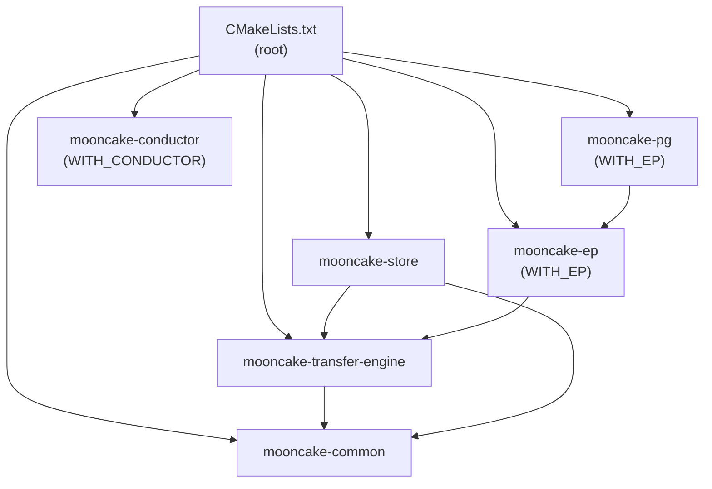
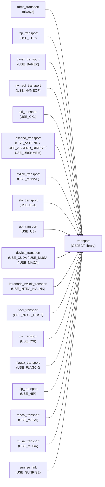
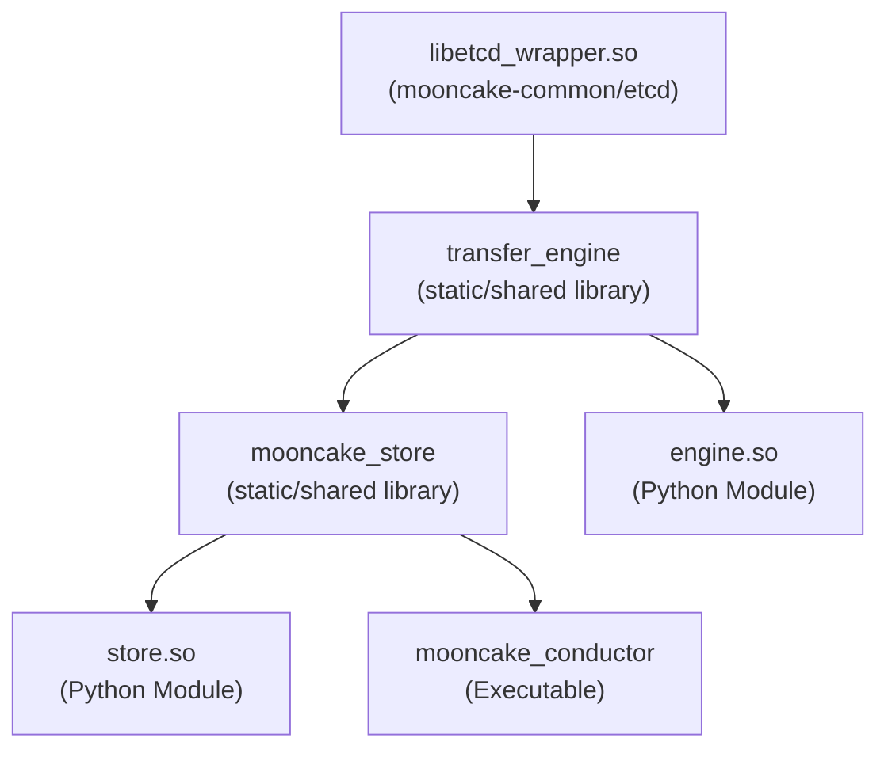
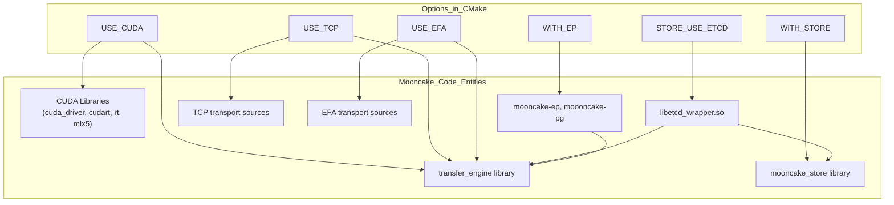

<!-- source: DeepWiki mcp.deepwiki.com · repo kvcache-ai/Mooncake · page 6.2 CMake Build System · fetched 2026-11-11 -->

# CMake Build System

<details>
<summary>Relevant source files</summary>

The following files were used as context for generating this wiki page:

- [.gitignore](.gitignore)
- [README.md](README.md)
- [docs/source/getting_started/build.md](docs/source/getting_started/build.md)
- [docs/source/getting_started/quick-start.md](docs/source/getting_started/quick-start.md)
- [docs/source/getting_started/supported-protocols.md](docs/source/getting_started/supported-protocols.md)
- [docs/source/index.md](docs/source/index.md)
- [docs/source/zh_archive/build.md](docs/source/zh_archive/build.md)
- [docs/source/zh_archive/run-examples.md](docs/source/zh_archive/run-examples.md)
- [mooncake-common/common.cmake](mooncake-common/common.cmake)
- [mooncake-common/etcd/CMakeLists.txt](mooncake-common/etcd/CMakeLists.txt)
- [mooncake-common/etcd/go.mod](mooncake-common/etcd/go.mod)
- [mooncake-common/etcd/go.sum](mooncake-common/etcd/go.sum)
- [mooncake-common/include/environment_variables.h](mooncake-common/include/environment_variables.h)
- [mooncake-common/src/environ.cpp](mooncake-common/src/environ.cpp)
- [mooncake-common/tests/environ_test.cpp](mooncake-common/tests/environ_test.cpp)
- [mooncake-store/CMakeLists.txt](mooncake-store/CMakeLists.txt)
- [mooncake-store/include/transfer_task.h](mooncake-store/include/transfer_task.h)
- [mooncake-store/include/version.h.in](mooncake-store/include/version.h.in)
- [mooncake-store/src/CMakeLists.txt](mooncake-store/src/CMakeLists.txt)
- [mooncake-store/src/transfer_task.cpp](mooncake-store/src/transfer_task.cpp)
- [mooncake-store/tests/CMakeLists.txt](mooncake-store/tests/CMakeLists.txt)
- [mooncake-store/tests/transfer_task_test.cpp](mooncake-store/tests/transfer_task_test.cpp)
- [mooncake-transfer-engine/CMakeLists.txt](mooncake-transfer-engine/CMakeLists.txt)
- [mooncake-transfer-engine/include/cuda_alike.h](mooncake-transfer-engine/include/cuda_alike.h)
- [mooncake-transfer-engine/src/CMakeLists.txt](mooncake-transfer-engine/src/CMakeLists.txt)
- [mooncake-transfer-engine/src/transport/CMakeLists.txt](mooncake-transfer-engine/src/transport/CMakeLists.txt)
- [mooncake-transfer-engine/tests/rdma_large_mr_test.cpp](mooncake-transfer-engine/tests/rdma_large_mr_test.cpp)

</details>


This page documents the CMake build system structure for Mooncake, covering the key CMake options such as `USE_CUDA`, `WITH_STORE`, `WITH_EP`, key compiler flags, build variants, and the shared configuration in `common.cmake`. It explains their roles in controlling compilation, linking, and enabling hardware or subsystem features. For build instructions, see [6.3 Building from Source](). For Python packaging details, see [6.4 Python Package Building](). For prerequisite libraries and tools, see [6.1 Dependencies and Prerequisites]().

---

## Module Hierarchy and Component Relationships

Mooncake's CMake build is organized across several modules, controlled by various options to enable or disable features and subsystems. The main subdirectories include:

- `mooncake-common`: Shared utilities and configuration (including `common.cmake`)
- `mooncake-transfer-engine`: High-performance data movement library and transports
- `mooncake-store`: Distributed object storage system
- `mooncake-ep`: Elastic Expert Parallelism subsystem (build with `WITH_EP=ON`)
- `mooncake-pg`: Process Group extension built if `WITH_EP=ON`
- `mooncake-conductor`: Indexer and coordination service (built if `WITH_CONDUCTOR=ON`)

The top-level `CMakeLists.txt` includes these modules conditionally and handles global options.



`mooncake-transfer-engine` can also be built standalone if `GLOBAL_CONFIG` is unset, independently including `mooncake-common` resources [mooncake-transfer-engine/CMakeLists.txt:6-32]().

Sources:
* [mooncake-transfer-engine/CMakeLists.txt:6-32]()

---

## common.cmake — Shared Core Build Configuration

`mooncake-common/common.cmake` defines the global compiler standards, flags, and important options that impact all Mooncake components. It is included early in the build process to provide a unified set of defaults [mooncake-common/common.cmake:1-177]().

### Language Standards and Compiler Flags

- C standard: `C99`
- C++ standard: `C++20`
- CUDA standard: `C++20`

Basic compilation flags across C and C++ add:
- `-Wall`, `-Wextra`, `-Wno-unused-parameter`: Enable warnings while ignoring unused parameters (common in callback-heavy code)
- `-fPIC`: Position-independent code for shared object compatibility
- GCC-specific: `-fcoroutines`, disable tree SLP vectorization for performance consistency
- Clang-specific: `-Werror=thread-safety` to enforce thread safety annotations as errors
- `RelWithDebInfo` is the default build type, mixing optimizations with debug symbols

AddressSanitizer is optionally enabled via `ENABLE_ASAN` [mooncake-common/common.cmake:32-39]().

Other notable compile-time definitions:
- `CONFIG_ERDMA` macro is defined unconditionally to support Alibaba Cloud eRDMA features [mooncake-common/common.cmake:49]()
- `GLOG_USE_GLOG_EXPORT` for proper visibility of glog symbols [mooncake-common/common.cmake:69]()

```plaintext
| Setting                    | Value / Flags                                             |
|----------------------------|-----------------------------------------------------------|
| C standard                 | 99                                                        |
| C++ standard               | 20                                                        |
| CUDA standard              | 20                                                        |
| Base C/C++ flags            | -Wall -Wextra -Wno-unused-parameter -fPIC                 |
| GCC flags                  | -fcoroutines, disable tree SLP vectorization               |
| Clang flags                | -Werror=thread-safety                                      |
| Release build flags         | -O3                                                       |
| Debug build flags           | -O0                                                       |
| Default build type          | RelWithDebInfo                                            |
| Address Sanitizer (ASAN)    | -fsanitize=address, -fsanitize=leak (if ENABLE_ASAN ON)   |
| Default defines            | CONFIG_ERDMA, GLOG_USE_GLOG_EXPORT                         |
```

Sources:
* [mooncake-common/common.cmake:1-52]()
* [mooncake-common/common.cmake:32-39]()
* [mooncake-common/common.cmake:69]()

### Key Build Options in common.cmake

- `ENABLE_DEBUG_SYMBOLS` (default ON): Controls inclusion of debug symbols to add the `-g` flag [mooncake-common/common.cmake:5]()
- `ENABLE_ASAN` (default OFF): Enable AddressSanitizer for debugging memory issues [mooncake-common/common.cmake:32]()
- `ENABLE_SCCACHE` (default OFF): Enable `sccache` compiler caching launcher if available [mooncake-common/common.cmake:56-67]()
- `BUILD_EXAMPLES` (default ON): Build example binaries [mooncake-common/common.cmake:72]()
- `BUILD_UNIT_TESTS` (default ON): Build unit tests and link GTest dependencies [mooncake-common/common.cmake:75-77]()
- `BUILD_BENCHMARK` (default ON): Build benchmark targets [mooncake-common/common.cmake:78]()
- `USE_CUDA` (default OFF): Enable NVIDIA GPU support and linked CUDA toolkits [mooncake-common/common.cmake:79]()
- Several other hardware/platform flags (detailed in the transport section) [mooncake-common/common.cmake:80-132]()

Sources:
* [mooncake-common/common.cmake:5-132]()

---

## Enable Flags: USE_CUDA, WITH_STORE, WITH_EP and Others

Several build-time flags select which subsystems, hardware support, and features are compiled.

| Flag | Default | Purpose / Comment |
|---|---|---|
| `USE_CUDA` | OFF | Enables NVIDIA GPU acceleration support; links CUDA libraries and compiles CUDA-dependent sources [mooncake-common/common.cmake:79](), [mooncake-transfer-engine/src/CMakeLists.txt:105-118]() |
| `WITH_STORE` | ON | Enables inclusion of Mooncake Store subsystem |
| `WITH_EP` | OFF | Builds Elastic Expert Parallelism support (`mooncake-ep` and `mooncake-pg`) |
| `WITH_CONDUCTOR` | OFF | Builds Mooncake Conductor service |
| `WITH_P2P_STORE` | OFF | Enables P2P store library, used for checkpoint distribution |
| `WITH_STORE_RUST` | ON | Builds Rust binding libraries for Mooncake Store |
| `WITH_STORE_C_SHARED` | OFF | Builds the C ABI shared library `libmooncake_store.so` |
| `USE_NOF` | OFF | Enables NVMe-oF SSD pool support in Mooncake Store |
| `MOONCAKE_ENABLE_TEST_FAILPOINTS` | OFF | Enables failpoints for fault injection in integration tests |
| `MOONCAKE_ENABLE_OPLOG_PERF_METRICS` | OFF | Enables OpLog batching performance metrics |

These flags control the inclusion of source files, compilation of optional features, and linking of dependencies.

Sources:
* [docs/source/getting_started/build.md:60-63]()
* [docs/source/getting_started/build.md:70-73]()
* [docs/source/getting_started/build.md:94-99]()

---

## Transport Build Flags and Their Impact

Mooncake transfer engine supports a rich set of transport protocols, each controlled by build flags `USE_*`. The transport implementations are compiled as OBJECT libraries and linked into the main `transfer_engine` library.



### Summary Flags and Effects

| CMake Flag | Default | Notes |
|---|---|---|
| `USE_TCP` | ON | TCP transport (default fallback if no RDMA fabric) [mooncake-common/common.cmake:105]() |
| `USE_CUDA` | OFF | NVIDIA CUDA GPU features, links CUDA libs, enables `device_transport` [mooncake-common/common.cmake:79](), [mooncake-transfer-engine/src/CMakeLists.txt:105-118]() |
| `USE_MUSA` | OFF | Moore Threads GPU transport, links musa libs [mooncake-common/common.cmake:84](), [mooncake-transfer-engine/src/CMakeLists.txt:136-139]() |
| `USE_HIP` | OFF | AMD GPU transport, HIP compile and optional dmabuf MR registration [mooncake-common/common.cmake:86](), [mooncake-transfer-engine/src/CMakeLists.txt:151-176]() |
| `USE_MACA` | OFF | MUXI GPU features, links maca runtimes [mooncake-common/common.cmake:85](), [mooncake-transfer-engine/src/CMakeLists.txt:128-134]() |
| `USE_MLU` | OFF | Cambricon MLU GPU transport [mooncake-common/common.cmake:83]() |
| `USE_NVMEOF` | OFF | NVMe-over-Fabrics transport with cufile support [mooncake-common/common.cmake:104](), [mooncake-transfer-engine/src/CMakeLists.txt:115-117]() |
| `USE_MNNVL` | OFF | Multi-Node NVLink transport [mooncake-common/common.cmake:112]() |
| `USE_ASCEND_DIRECT` & `USE_UBSHMEM` | OFF | Huawei Ascend NPU transports with ADXL or shmem [mooncake-common/common.cmake:108-109]() |
| `USE_EFA` | OFF | AWS EFA transport, with libfabric dependency [mooncake-common/common.cmake:140-165]() |
| `USE_CXI` | OFF | HPE Slingshot transport, libfabric-based [mooncake-common/common.cmake:166-177]() |
| `USE_UB` | OFF | UB protocol transport linked with `urma` library [mooncake-common/common.cmake:115,134-138]() |
| `USE_NCCL_DEVICE`/`USE_NCCL_HOST` | OFF | NCCL-based GPU collective transport support [mooncake-common/common.cmake:80-82]() |
| `USE_HYGON` | OFF | Hygon DCU GPU features [mooncake-common/common.cmake:87]() |
| `USE_COREX` | OFF | Iluvatar CoreX GPU features [mooncake-common/common.cmake:88]() |
| `USE_SUPA` | OFF | Biren GPU features [mooncake-common/common.cmake:89]() |
| `USE_INTRA_NVLINK` | OFF | Intra-node NVLink P2P transport, often used with CUDA |
| `USE_SUNRISE` | OFF | Sunrise GPU with Tang runtime [mooncake-common/common.cmake:116-117]() |
| `USE_TPU` | OFF | TPU PJRT staging support in TENT backend [mooncake-common/common.cmake:118-121]() |
| `USE_XPU` | OFF | Intel XPU oneAPI SYCL staging support in TENT backend [mooncake-common/common.cmake:122-125]() |

Sources:
* [mooncake-transfer-engine/src/transport/CMakeLists.txt:1-126]()
* [mooncake-common/common.cmake:79-177]()
* [mooncake-transfer-engine/src/CMakeLists.txt:105-176]()

---

## Mooncake Store and Metadata Options

Mooncake Store subsystem has its own set of build options to enable metadata backends and runtime features.

| Flag | Default | Description |
|---|---|---|
| `STORE_USE_ETCD` | OFF | Enable etcd-based high availability backend for persistent metadata |
| `STORE_USE_REDIS` | OFF | Use Redis as a metadata HA backend |
| `STORE_USE_K8S_LEASE` | OFF | Kubernetes Lease-based leader election wrapper for HA |
| `ENABLE_KV_EVENTS` | OFF | Enable master store key-value event publishing via ZMQ (requires libzmq) [mooncake-store/tests/CMakeLists.txt:70-71]() |
| `STORE_USE_JEMALLOC` | OFF | Use jemalloc memory allocator in store master and clients |

The store build also parses the Python packaging manifest to extract version information and embed Git commit hashes during build [mooncake-store/CMakeLists.txt:1-89]().

Sources:
* [mooncake-store/tests/CMakeLists.txt:70-71]()
* [mooncake-store/CMakeLists.txt:1-89]()

---

## Core Build Artifacts and Linking Relationships

The Mooncake build outputs various libraries and executables arranged by subsystem and usage:



- `libetcd_wrapper.so` provides the etcd API and links into transfer engine and store if `USE_ETCD`/`STORE_USE_ETCD` is enabled [mooncake-transfer-engine/src/CMakeLists.txt:55-58]().
- `transfer_engine` is the core data movement library, linking transports, vendor SDKs, and protocol implementations [mooncake-transfer-engine/src/CMakeLists.txt:69-91]().
- `mooncake_store` provides the distributed object store, metadata management, replication, and client operations [mooncake-store/src/CMakeLists.txt:6-157]().
- Python extension modules build on these C++ libraries to expose APIs in Python.
- The conductor binary depends on the store library and is optional.

Sources:
* [mooncake-transfer-engine/src/CMakeLists.txt:55-91]()
* [mooncake-store/src/CMakeLists.txt:6-157]()

---

## Hardware-Specific Build Details for GPU and Accelerator Support

### CUDA (NVIDIA GPU) Support (`USE_CUDA`)

- When `USE_CUDA=ON`, CMake sets `CMAKE_CUDA_STANDARD` to 20 and includes CUDA Toolkit headers and libraries:
  - Links to `CUDA::cuda_driver`, `CUDA::cudart`, and `rt`
  - If `USE_NVMEOF` is enabled, links `nvmeof_transport` and `cufile`
  - Detects if the installed MLX5 RDMA headers support DMA-BUF UMEM; if so, defines `MOONCAKE_HAVE_MLX5_DMABUF_UMEM` to enable GPU-VA registration facility [mooncake-transfer-engine/CMakeLists.txt:34-57]()

### Other GPU / Accelerator Vendors

- **MUSA** (Moore Threads GPU), activated by `USE_MUSA`; adds relevant include paths and links to `musa`, `musart`, and `rt` libraries [mooncake-transfer-engine/src/CMakeLists.txt:136-139]()
- **HIP** (AMD GPU), enabled by `USE_HIP`:
  - Runs `hipify` to convert CUDA sources to HIP equivalents
  - Supports optional `USE_HIP_DMABUF` to enable DMA-BUF GPU memory registration using `hsa-runtime64`
  - Links to `hip::host` and `rt` libraries [mooncake-transfer-engine/src/CMakeLists.txt:151-176]()
- **MACA** (MUXI GPU) enabled by `USE_MACA`, with default linking to runtime libs `mcruntime`, `mxc-runtime64`, and `rt` [mooncake-transfer-engine/src/CMakeLists.txt:128-134]()
- **MLU** (Cambricon MLU) support enabled by `USE_MLU` [mooncake-common/common.cmake:83]()
- **Ascend NPU** enabled via `USE_ASCEND`, `USE_UBSHMEM`, and `USE_ASCEND_HETEROGENEOUS`; configures include directories for the Ascend CANN Toolkit and links runtime libraries for ADXL/HIXL [mooncake-transfer-engine/CMakeLists.txt:58-84]()

### Fabric Memory Allocators

- `nvlink-allocator` is included whenever CUDA or certain GPU vendors or Multi-Node NVLink (`USE_MNNVL`) are enabled, providing a fabric allocator for GPU memory [mooncake-transfer-engine/CMakeLists.txt:103-107]()
- `ubshmem-allocator` supports memory registration for Huawei NPU fabric with `USE_UBSHMEM` [mooncake-transfer-engine/CMakeLists.txt:110-112]()

Sources:
* [mooncake-common/common.cmake:79-177]()
* [mooncake-transfer-engine/CMakeLists.txt:34-84]()
* [mooncake-transfer-engine/CMakeLists.txt:103-112]()
* [mooncake-transfer-engine/src/CMakeLists.txt:25]()
* [mooncake-transfer-engine/src/CMakeLists.txt:105-176]()

---

## Compiler Flag Flow and Conditional Logic

The shared `common.cmake` centrally defines compiler flags which are inherited by all targets. Key implementation details include:

- `ENABLE_DEBUG_SYMBOLS` controls if `-g` debug info is included [mooncake-common/common.cmake:5-14]()
- Build type specific flags:
  - Release mode uses `-O3` optimization [mooncake-common/common.cmake:22-23]()
  - Debug mode falls back to `-O0` [mooncake-common/common.cmake:26-27]()
- GCC compiler: adds coroutine support via `-fcoroutines` and disables `-ftree-slp-vectorize` for better performance or correctness [mooncake-common/common.cmake:16-20]()
- Clang compiler: imposes `-Werror=thread-safety` on the build [mooncake-common/common.cmake:28-30]()
- Sanitizer flags activated if `ENABLE_ASAN` is ON: `-fsanitize=address` and `-fsanitize=leak` [mooncake-common/common.cmake:32-39]()
- Use of `sccache` as a compiler launcher is optional if the binary is found and enabled [mooncake-common/common.cmake:56-67]()

The build system thus ensures consistent, robust, and optimized compilation settings across subsystems and architectures.

Sources:
* [mooncake-common/common.cmake:5-67]()

---

## Build Variants and Conditional Inclusion Summary

| Variant / Option | Effect on Build |
|------------------|-----------------|
| `WITH_STORE=ON`   | Compiles the Mooncake Store subsystem and related clients |
| `WITH_EP=ON`      | Enables Elastic Expert Parallelism backend, building `mooncake-ep` and `mooncake-pg` modules |
| `BUILD_UNIT_TESTS=ON` | Includes unit test targets and dependencies for testing [mooncake-common/common.cmake:75](), [mooncake-transfer-engine/CMakeLists.txt:91-93]() |
| `BUILD_BENCHMARK=ON` | Includes benchmarking executables [mooncake-common/common.cmake:78](), [mooncake-transfer-engine/CMakeLists.txt:122-124]() |
| `ENABLE_SCCACHE=ON` | Uses `sccache` as a compiler launcher to speed up rebuilds [mooncake-common/common.cmake:56-67]() |
| `USE_CUDA=ON`     | Enables CUDA GPU backend and links runtime libraries [mooncake-transfer-engine/src/CMakeLists.txt:105-118]() |
| `USE_TCP=ON`      | Includes TCP transport source files in the build |
| `USE_EFA=ON`      | Enables AWS EFA transport, resolves libfabric libraries and include paths [mooncake-common/common.cmake:140-165]() |
| `STORE_USE_ETCD=ON` | Enables etcd metadata backend support for Mooncake Store |
| `STORE_USE_REDIS=ON` | Enables Redis metadata backend |

Sources:
* [mooncake-common/common.cmake:32-90]()
* [mooncake-common/common.cmake:56-67]()
* [mooncake-common/common.cmake:140-165]()
* [mooncake-transfer-engine/CMakeLists.txt:91-93]()
* [mooncake-transfer-engine/CMakeLists.txt:122-124]()
* [mooncake-transfer-engine/src/CMakeLists.txt:105-118]()

---

## Summary Mermaid Diagram: CMake Options to Code Entities

This diagram illustrates how key CMake `USE_*` and `WITH_*` options map to code entities and build artifacts within Mooncake.



Sources:
* [mooncake-common/common.cmake:79-176]()
* [mooncake-transfer-engine/src/CMakeLists.txt:55-91]()
* [mooncake-store/src/CMakeLists.txt:6-157]()

---

# Summary

Mooncake's CMake build system is modular and flexible, with a rich set of compile-time options to support various hardware backends, transport protocols, and subsystem features. The `common.cmake` file centralizes the compiler standards, warnings, optimization levels, and feature flags ensuring consistent builds.

The build system supports standalone and integrated builds of the high-performance transfer engine, the distributed storage backend Mooncake Store, the Elastic Expert Parallelism extensions, and conductor services. Transport protocols are compiled as OBJECT libraries gated by dedicated flags, facilitating lean and custom builds for different deployment environments.

This design ensures Mooncake can be built for CPU-only, GPU-accelerated (via CUDA, HIP, MUSA, MACA, MLU, Ascend, etc.), and specialized hardware like TPU and Intel XPU, while optionally including distributed metadata backends, failure injection, tests, benchmarks, and Python bindings.

---

# References and Sources

- `mooncake-common/common.cmake:1-177`
- `mooncake-transfer-engine/CMakeLists.txt:6-177`
- `mooncake-transfer-engine/src/CMakeLists.txt:25`
- `mooncake-transfer-engine/src/CMakeLists.txt:55-176`
- `mooncake-store/CMakeLists.txt:1-89`
- `mooncake-store/src/CMakeLists.txt:6-157`
- `mooncake-store/tests/CMakeLists.txt:70-71`
- `docs/source/getting_started/build.md:60-63`
- `docs/source/getting_started/build.md:70-73`
- `docs/source/getting_started/build.md:94-99`

---

