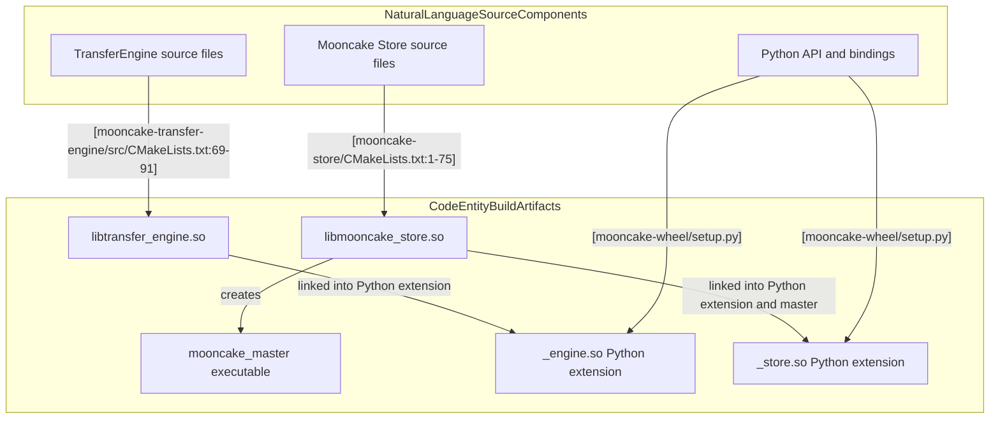
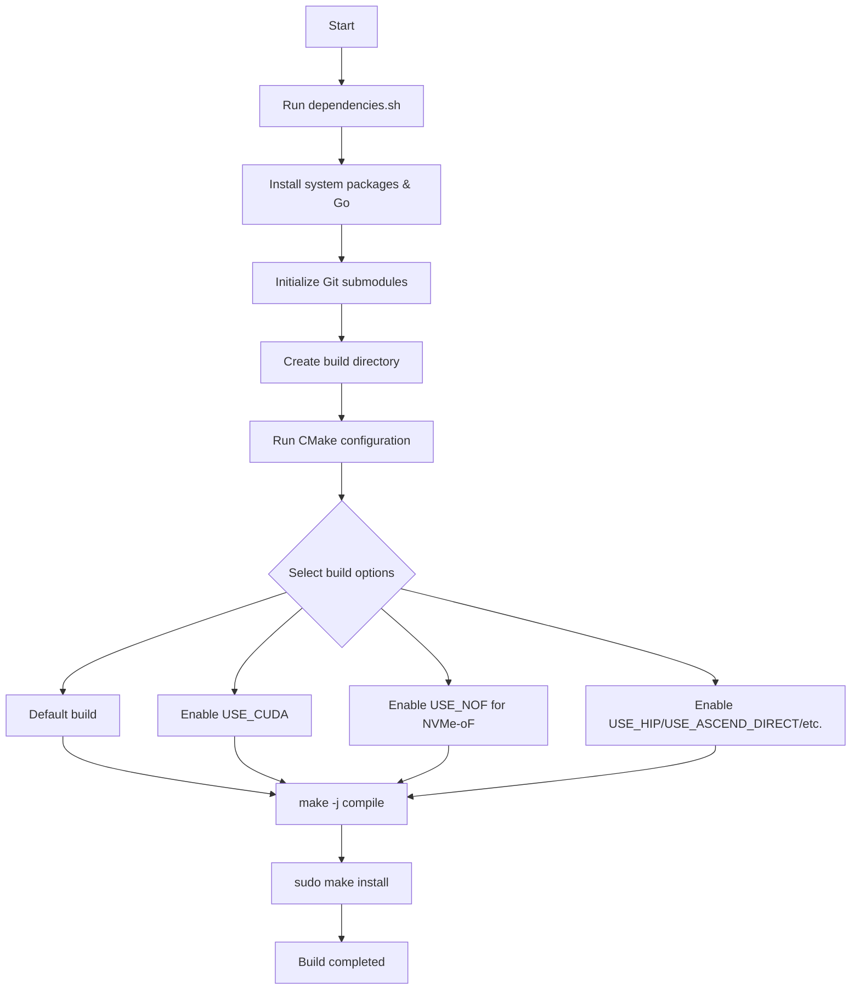

<!-- source: DeepWiki mcp.deepwiki.com · repo kvcache-ai/Mooncake · page 6.3 Building from Source · fetched 2026-11-11 -->

# Building from Source

<details>
<summary>Relevant source files</summary>

The following files were used as context for generating this wiki page:

- [.github/workflows/ci.yml](.github/workflows/ci.yml)
- [.github/workflows/pre-release.yaml](.github/workflows/pre-release.yaml)
- [.github/workflows/release-cuda13.yaml](.github/workflows/release-cuda13.yaml)
- [.github/workflows/release-non-cuda.yaml](.github/workflows/release-non-cuda.yaml)
- [.github/workflows/release-npu.yaml](.github/workflows/release-npu.yaml)
- [.github/workflows/release.yaml](.github/workflows/release.yaml)
- [.gitmodules](.gitmodules)
- [CMakeLists.txt](CMakeLists.txt)
- [README.md](README.md)
- [dependencies.sh](dependencies.sh)
- [docker/mooncake.Dockerfile](docker/mooncake.Dockerfile)
- [docker/musa.Dockerfile](docker/musa.Dockerfile)
- [docs/source/getting_started/build.md](docs/source/getting_started/build.md)
- [docs/source/getting_started/quick-start.md](docs/source/getting_started/quick-start.md)
- [docs/source/getting_started/supported-protocols.md](docs/source/getting_started/supported-protocols.md)
- [docs/source/index.md](docs/source/index.md)
- [docs/source/zh_archive/build.md](docs/source/zh_archive/build.md)
- [docs/source/zh_archive/run-examples.md](docs/source/zh_archive/run-examples.md)
- [mooncake-common/common.cmake](mooncake-common/common.cmake)
- [mooncake-store/CMakeLists.txt](mooncake-store/CMakeLists.txt)
- [mooncake-store/include/version.h.in](mooncake-store/include/version.h.in)
- [mooncake-transfer-engine/CMakeLists.txt](mooncake-transfer-engine/CMakeLists.txt)
- [mooncake-transfer-engine/include/cuda_alike.h](mooncake-transfer-engine/include/cuda_alike.h)
- [mooncake-transfer-engine/src/CMakeLists.txt](mooncake-transfer-engine/src/CMakeLists.txt)
- [mooncake-transfer-engine/src/transport/CMakeLists.txt](mooncake-transfer-engine/src/transport/CMakeLists.txt)
- [mooncake-wheel/tests/test_distributed_object_store.py](mooncake-wheel/tests/test_distributed_object_store.py)
- [mooncake-wheel/tests/test_release_wheel_tags.py](mooncake-wheel/tests/test_release_wheel_tags.py)
- [scripts/run_tests.sh](scripts/run_tests.sh)

</details>


This page provides a comprehensive, step-by-step technical guide for building Mooncake from source. It covers prerequisite environment preparation via the `dependencies.sh` installer script, CMake configuration details, compilation workflows, installation commands, and platform-specific build options for various hardware backends. The instructions apply to core components including the Transfer Engine, Mooncake Store, Python bindings, and hardware-accelerated transports.

---

## Prerequisites and Automated Dependency Installation

Prior to building Mooncake, the host system must have all required system packages, development libraries, build tools, and external dependencies installed. The repository includes a dedicated bash script `dependencies.sh` which automates detection of the Linux distribution and installs the necessary components for supported operating systems such as Ubuntu, Debian, CentOS, RHEL, Rocky, AlmaLinux, EulerOS, openEuler, and Kylin [dependencies.sh:79-159]().

### Using `dependencies.sh` 

Run the following command with root privileges to install dependencies, set up Git submodules, and install the Go toolchain (default Go version is 1.25.9):

```bash
sudo bash dependencies.sh
```

The script performs:

- **Linux OS Detection**: Reads `/etc/os-release` to identify the OS and version, supporting mainstream distributions [dependencies.sh:66-84]().
- **Repository Update**: Updates package lists via `apt-get` or `yum/dnf` depending on OS [dependencies.sh:147-156]().
- **Package Installation**: Installs build essentials such as `build-essential`, `cmake`, `ninja-build`, and libraries including `libibverbs-dev`, `libgoogle-glog-dev`, `libhiredis-dev`, `liburing-dev`, `libjemalloc-dev`, and networking/storage dependencies [dependencies.sh:162-202]().
- **Special Handling for ScaleFabric SHCA Systems**: Adjusts packages when `shca-tools` is installed to avoid conflicts [dependencies.sh:202-206]().
- **Go Runtime Installation**: Installs Go binaries and configures environment to support components that interface with etcd or Kubernetes leader election backends [dependencies.sh:270-294]().
- **Submodule Initialization**: Initializes Git submodules including `extern/pybind11` for Python bindings.

---

## Standard Build Procedure with CMake

Mooncake uses a standard CMake-based build system. The root CMakeLists.txt handles configuration options, conditionally enables components, and orchestrates the build of the Transfer Engine, Store, Python bindings, and optional plugins [CMakeLists.txt:1-143]().

### Step 1: Create Build Directory & Run CMake

```bash
mkdir build
cd build
cmake ..
```

This generates build files with sane defaults: Release build with Debug info enabled.

**Custom CMake options** (covered below) allow enabling GPU backends, advanced transport protocols, and platform-specific features.

### Step 2: Compile

Compile the project using all available CPU cores in parallel:

```bash
make -j
```

Mooncake's `common.cmake` module implements memory-aware job scheduling that optimizes compilation parallelism to reduce out-of-memory risks on low-RAM machines [mooncake-common/common.cmake:53-54]().

### Step 3: Install

Install compiled binaries, libraries, and Python modules into system-defined paths:

```bash
sudo make install
```

---

## Source Components to Build Targets Mapping

The following diagram shows how Mooncake's natural language system components map onto C++ and Python build targets. This helps bridge user understanding from system parts (Transfer Engine, Store, Python API) to compiled artifacts (`libtransfer_engine.so`, `mooncake_master`, Python extension modules):



Sources:  
- [mooncake-transfer-engine/src/CMakeLists.txt:69-91]()  
- [mooncake-store/CMakeLists.txt:1-75]()  
- [mooncake-wheel/setup.py]()  
- [mooncake-common/common.cmake:1-54]()

---

## Advanced Compile Configuration via CMake Flags

Mooncake provides numerous options to customize build outputs to the target environment or hardware backend. Most flags are defined in `mooncake-common/common.cmake` and the root `CMakeLists.txt` [mooncake-common/common.cmake:79-178](), [CMakeLists.txt:19-40]().

| Flag                   | Default | Description                                                                                      |
|------------------------|---------|------------------------------------------------------------------------------------------------|
| `-DUSE_CUDA=ON`        | OFF     | Enable NVIDIA GPU features and GPUDirect support                                               |
| `-DUSE_ASCEND_DIRECT=ON`| OFF    | Enable Huawei Ascend NPU Direct Transport with ADXL engine                                     |
| `-DUSE_UBSHMEM=ON`     | OFF     | Enable Ascend NPU transport via shared memory CANN VMM                                        |
| `-DUSE_HIP=ON`         | OFF     | Enable AMD ROCm HIP GPU support                                                                |
| `-DUSE_MUSA=ON`        | OFF     | Enable Moore Threads MUSA GPU support                                                          |
| `-DUSE_VRAM_SEGMENT=ON`| OFF     | Enable VRAM segment support for GPU memory pooling                                             |
| `-DUSE_ETCD=ON`        | OFF     | Enable etcd metadata service integration                                                       |
| `-DUSE_TENT=ON`        | OFF     | Enable TENT (Transfer Engine Next) architecture                                                |
| `-DUSE_RISCV=ON`       | OFF     | Enable 64-bit RISC-V build compatibility                                                      |
| `-DUSE_NOF=ON`         | OFF     | Enable NVMe-oF SSD pool support (requires SPDK dependencies)                                   |
| `-DUSE_MNNVL=ON`       | OFF     | Enable NVIDIA Multi-Node NVLink transport (requires CUDA)                                     |
| `-DUSE_NCCL_DEVICE=ON` | OFF     | Enable NCCL DeviceTransport for NVIDIA GPUs                                                   |

For any given backend, it is common to enable multiple related flags, e.g. `-DUSE_CUDA=ON -DUSE_MNNVL=ON` for GPU + NVLink. Flags are additive and control compilation units, link libraries, and source inclusion.

---

## Transfer Engine Build Linkage and Transport Backend Selection

The Transfer Engine library `libtransfer_engine.so` is composed of modular transport protocol implementations and SDK bindings based on the enabled CMake flags. Below is a detailed graph that connects configuration flags to external libraries and the final transfer engine build target, illustrating the data flow from compile-time options to the linked transports and libraries:

```mermaid
graph TD
    subgraph "ConfigFlags"
        CudaFlag["USE_CUDA"]
        HipFlag["USE_HIP"]
        AscendDirectFlag["USE_ASCEND_DIRECT"]
        EtcdFlag["USE_ETCD"]
        MusaFlag["USE_MUSA"]
        MlpFlag["USE_MACA"]
        MluFlag["USE_MLU"]
        HygFlag["USE_HYGON"]
        CorexFlag["USE_COREX"]
        UbshmemFlag["USE_UBSHMEM"]
        NvmeOfFlag["USE_NVMEOF"]
        BarexFlag["USE_BAREX"]
        CxlFlag["USE_CXL"]
        EfaFlag["USE_EFA"]
        UbFlag["USE_UB"]
        NcclDeviceFlag["USE_NCCL_DEVICE"]
        SupaFlag["USE_SUPA"]
    end

    subgraph "Libraries"
        TransferMetadataPlugin["transfer_metadata_plugin"]
        TransferEngineLib["transfer_engine"]
        TransportLib["transport"]
        CudaDriverLib["CUDA::cuda_driver"]
        CudaRuntimeLib["CUDA::cudart"]
        Mlx5Lib["mlx5"]
        HipHostLib["hip::host"]
        HsaRuntimeLib["hsa-runtime64::hsa-runtime64"]
        MusaLib["musa"]
        MusartLib["musart"]
        MacaRuntimeLib["mcruntime"]
        NcclLib["NCCL::nccl"]
        CufileLib["cufile"]
        FabricLib["fabric"] 
        UrmaLib["urma"]
        AscendTransportLib["ascend_transport"]
        HipTransportLib["hip_transport"]
        MacaTransportLib["maca_transport"]
        MusaTransportLib["musa_transport"]
        NvlinkTransportLib["nvlink_transport"]
        EfaTransportLib["efa_transport"]
        DeviceTransportLib["device_transport"]
        SupaLibs["${SUPA_LIBRARIES}"]
    end

    EtcdFlag --> TransferMetadataPlugin
    TransferMetadataPlugin --> TransferEngineLib

    TransportLib --> TransferEngineLib

    CudaFlag --> CudaDriverLib
    CudaFlag --> CudaRuntimeLib
    CudaDriverLib --> TransferEngineLib
    CudaRuntimeLib --> TransferEngineLib
    Mlx5Lib --> TransferEngineLib

    HipFlag --> HipHostLib
    HipHostLib --> TransferEngineLib
    HipFlag --> HsaRuntimeLib
    HsaRuntimeLib --> TransferEngineLib
    HipFlag --> HipTransportLib
    HipTransportLib --> TransportLib

    MusaFlag --> MusaLib
    MusaFlag --> MusartLib
    MusaLib --> TransferEngineLib
    MusartLib --> TransferEngineLib
    MusaFlag --> MusaTransportLib
    MusaTransportLib --> TransportLib

    MlpFlag --> MacaRuntimeLib
    MacaRuntimeLib --> TransferEngineLib
    MlpFlag --> MacaTransportLib
    MacaTransportLib --> TransportLib

    NvmeOfFlag --> CufileLib
    CufileLib --> TransferEngineLib

    AscendDirectFlag --> AscendTransportLib
    UbshmemFlag --> AscendTransportLib
    AscendTransportLib --> TransportLib

    EfaFlag --> EfaTransportLib
    EfaFlag --> FabricLib
    EfaTransportLib --> TransportLib
    FabricLib --> TransferEngineLib

    UbFlag --> UrmaLib
    UrmaLib --> TransferEngineLib

    NcclDeviceFlag --> NcclLib
    NcclLib --> TransferEngineLib

    CudaFlag --> DeviceTransportLib
    DeviceTransportLib --> TransportLib

    CudaFlag --> NvlinkTransportLib
    NvlinkTransportLib --> TransportLib

    SupaFlag --> SupaLibs
    SupaLibs --> TransferEngineLib
```



This linkage ensures that the `transfer_engine` library integrates exactly the transports and platform SDKs selected via compile-time flags, enabling flexible deployments.

Sources:  
- [mooncake-transfer-engine/src/CMakeLists.txt:1-177]()  
- [mooncake-transfer-engine/CMakeLists.txt:1-124]()  
- [mooncake-common/common.cmake:75-178]()

---

## Platform-Specific Build Instructions

Below are guidelines for enabling hardware-specific features and their associated SDKs via the build system.

### NVIDIA CUDA GPUs

- **Prerequisites**: Install CUDA Toolkit 12.1+ and enable NVIDIA GPUDirect support for RDMA.
- **CMake flag**: Enable GPU support with

```bash
cmake .. -DUSE_CUDA=ON
```

- For multi-node NVLink support:

```bash
cmake .. -DUSE_CUDA=ON -DUSE_MNNVL=ON
```

- Proper CUDA directories must be on `LIBRARY_PATH` and `LD_LIBRARY_PATH` to link against `CUDA::cuda_driver` and `CUDA::cudart`.
- Mooncake transfer engine automatically links necessary CUDA and MLX5 libraries [mooncake-transfer-engine/src/CMakeLists.txt:104-114]().

### Huawei Ascend NPU

- Two supported transport modes:
  1. **ADXL Direct Transport (recommended):** Enable with `-DUSE_ASCEND_DIRECT=ON`.
  2. **Shared Memory Transport (UBSHMEM):** Enable with `-DUSE_UBSHMEM=ON`.

- Source the Ascend CANN environment before building:

```bash
source /usr/local/Ascend/cann/set_env.sh
```

- The include paths and libraries are configured automatically for Ascend [docs/source/getting_started/build.md:125-133]().

### AMD ROCm / HIP

- Ensure ROCm SDK and `hipcc` compiler are installed and on PATH.
- Enable HIP GPU support:

```bash
cmake .. -DUSE_HIP=ON
```

- Mooncake tries to find `hsa-runtime64` for optional dmabuf registered memory support improving RDMA performance [mooncake-transfer-engine/src/CMakeLists.txt:151-176]().

### RISC-V 64-bit Linux

- RISC-V cross/ native builds are supported with disabled interprocedural optimization for Python extensions (avoids huge memory use).
- Configure CMake:

```bash
cmake .. -DUSE_RISCV=ON -DWITH_STORE_GO=OFF -DWITH_P2P_STORE=OFF -DUSE_ETCD=OFF -DSTORE_USE_ETCD=OFF -DSTORE_USE_K8S_LEASE=OFF -DBUILD_UNIT_TESTS=OFF -DBUILD_EXAMPLES=OFF -DBUILD_BENCHMARK=OFF
```

- Build with Ninja or your preferred generator, limiting parallelism to available memory resources [docs/source/getting_started/build.md:80-104]().

---

## NVMe-oF SSD Pool Integration

Mooncake optionally supports NVMe-oF SSD pools, which require:

- Installing SPDK dependencies via `dependencies.sh --with-spdk`:

```bash
sudo bash dependencies.sh --with-spdk
```

- Enabling `USE_NOF` at build time:

```bash
mkdir build
cd build
cmake .. -DUSE_NOF=ON
make -j
sudo make install
```

The build pulls in SPDK libraries and NVMe support, including GPU-aware cuFile libraries if CUDA is enabled [mooncake-transfer-engine/src/CMakeLists.txt:115-117]().

---

## Summary Workflow Diagram

Below is an overview flowchart showing the build system's key steps and their interrelations:



---

# Final Notes

- While `dependencies.sh` automates common dependency installation, some platform SDKs or proprietary runtimes (CUDA Toolkit, Ascend CANN, ROCm) must be installed manually.
- Build flags can be combined to tailor Mooncake for complex heterogeneous deployments.
- Consult individual backend transport documentation for runtime environment variables and supported versions.
- The build process supports both shared and static linking; debug symbols and sanitizers can be toggled via CMake options.

By following this guide, developers can reliably build Mooncake source tailored to their infrastructure, including advanced hardware accelerators, protocol transports, and disaggregated storage backends.

---

*End of "6.3 Building from Source"*

---

### Sources

- [dependencies.sh:26-294]()  
- [docs/source/getting_started/build.md:1-131]()  
- [mooncake-transfer-engine/src/CMakeLists.txt:1-177]()  
- [mooncake-common/common.cmake:1-178]()  
- [mooncake-transfer-engine/src/transport/CMakeLists.txt:1-130]()  
- [mooncake-store/CMakeLists.txt:1-75]()  
- [mooncake-wheel/setup.py]()

---

