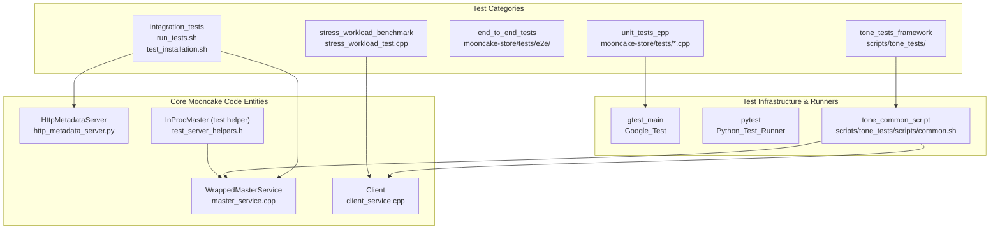
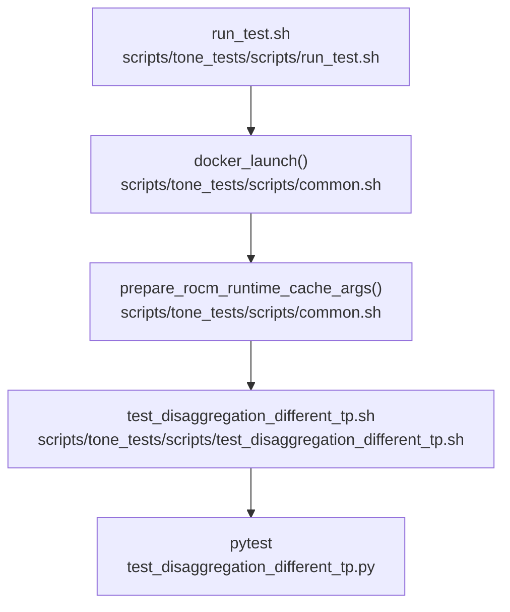
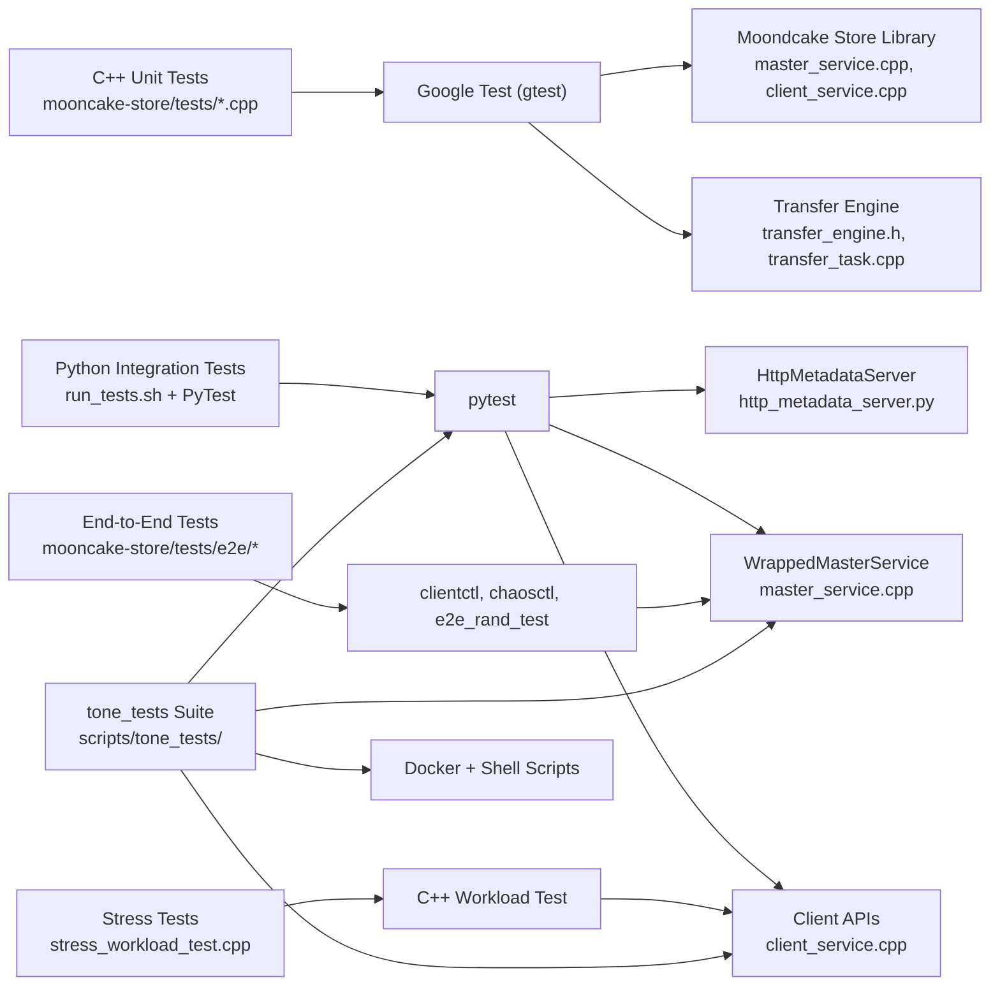

<!-- source: DeepWiki mcp.deepwiki.com · repo kvcache-ai/Mooncake · page 6.6 Testing Infrastructure · fetched 2026-11-11 -->

# Testing Infrastructure

Relevant source files

The following files were used as context for generating this wiki page:

- [.github/workflows/integration-test-rocm.yml](.github/workflows/integration-test-rocm.yml)
- [mooncake-store/go/build.sh](mooncake-store/go/build.sh)
- [mooncake-store/go/examples/basic/main.go](mooncake-store/go/examples/basic/main.go)
- [mooncake-store/go/go.mod](mooncake-store/go/go.mod)
- [mooncake-store/go/mooncakestore/config.go](mooncake-store/go/mooncakestore/config.go)
- [mooncake-store/go/mooncakestore/errors.go](mooncake-store/go/mooncakestore/errors.go)
- [mooncake-store/go/mooncakestore/store.go](mooncake-store/go/mooncakestore/store.go)
- [mooncake-store/go/tests/integration_test.go](mooncake-store/go/tests/integration_test.go)
- [mooncake-store/include/store_c.h](mooncake-store/include/store_c.h)
- [mooncake-store/rust/CMakeLists.txt](mooncake-store/rust/CMakeLists.txt)
- [mooncake-store/rust/Cargo.lock](mooncake-store/rust/Cargo.lock)
- [mooncake-store/rust/Cargo.toml](mooncake-store/rust/Cargo.toml)
- [mooncake-store/rust/build.rs](mooncake-store/rust/build.rs)
- [mooncake-store/rust/examples/basic_usage.rs](mooncake-store/rust/examples/basic_usage.rs)
- [mooncake-store/rust/src/error.rs](mooncake-store/rust/src/error.rs)
- [mooncake-store/rust/src/generated/ffi_dlopen_bindings.rs](mooncake-store/rust/src/generated/ffi_dlopen_bindings.rs)
- [mooncake-store/rust/src/lib.rs](mooncake-store/rust/src/lib.rs)
- [mooncake-store/rust/src/store.rs](mooncake-store/rust/src/store.rs)
- [mooncake-store/src/store_c.cpp](mooncake-store/src/store_c.cpp)
- [mooncake-store/tests/e2e/CMakeLists.txt](mooncake-store/tests/e2e/CMakeLists.txt)
- [mooncake-store/tests/e2e/client_wrapper.cpp](mooncake-store/tests/e2e/client_wrapper.cpp)
- [mooncake-store/tests/e2e/client_wrapper.h](mooncake-store/tests/e2e/client_wrapper.h)
- [mooncake-store/tests/e2e/storage_backend_e2e_test.cpp](mooncake-store/tests/e2e/storage_backend_e2e_test.cpp)
- [mooncake-store/tests/stress_workload_test.cpp](mooncake-store/tests/stress_workload_test.cpp)
- [mooncake-wheel/tests/test_replicated_distributed_object_store.py](mooncake-wheel/tests/test_replicated_distributed_object_store.py)
- [scripts/ci/run_store_go_integration.sh](scripts/ci/run_store_go_integration.sh)
- [scripts/ci/services.sh](scripts/ci/services.sh)
- [scripts/ci/tests/test_services.py](scripts/ci/tests/test_services.py)
- [scripts/ci/tests/test_store_go_integration.py](scripts/ci/tests/test_store_go_integration.py)
- [scripts/e2e/scripts/test_1p1d_erdma.sh](scripts/e2e/scripts/test_1p1d_erdma.sh)
- [scripts/e2e/scripts/test_disaggregation_different_tp.sh](scripts/e2e/scripts/test_disaggregation_different_tp.sh)
- [scripts/tone_tests/README_en.md](scripts/tone_tests/README_en.md)
- [scripts/tone_tests/README_zh.md](scripts/tone_tests/README_zh.md)
- [scripts/tone_tests/scripts/common.sh](scripts/tone_tests/scripts/common.sh)
- [scripts/tone_tests/scripts/run_test.sh](scripts/tone_tests/scripts/run_test.sh)
- [scripts/tone_tests/tests/test_common_cleanup.sh](scripts/tone_tests/tests/test_common_cleanup.sh)
- [scripts/tone_tests/tests/test_hicache_model_selection.py](scripts/tone_tests/tests/test_hicache_model_selection.py)

This page documents the comprehensive testing infrastructure supporting Mooncake. It covers C++ unit tests and integration tests, Python-based validation through `run_tests.sh`, distributed stress tests, the end-to-end (E2E) test suites, Go and Rust integration smoke tests, and the `tone_tests` framework specialized for LLM serving validation.

---

## Test Organization and Types

Mooncake employs a layered testing strategy combining:

- **Google Test (gtest)** for thorough C++ unit and integration tests targeting core subsystems such as Mooncake Store and Transfer Engine.
- **Python PyTest** for validating Python API correctness and integration with metadata and transfer components.
- **Shell scripts and Docker automation** for distributed framework tests, especially those validating multi-node and multi-process functionality.
- **Custom stress tests** to simulate heavy concurrency and validate system robustness.
- **The tone_tests framework** to validate LLM integration across hardware platforms and serving engines.

### Test Suite Hierarchy Overview

*Figure 1: Test Suite Hierarchy linking test category domains, test runners, and core Mooncake components.*

Sources: `[scripts/tone_tests/scripts/common.sh:1-191]`, `[mooncake-store/tests/e2e/client_wrapper.h:1-99]`, `[mooncake-store/tests/e2e/client_wrapper.cpp:1-132]`, `[mooncake-store/tests/e2e/CMakeLists.txt:1-99]`

---

## Unit and Integration Tests

### C++ Unit and Integration Testing

Mooncake's C++ tests utilize Google Test (`gtest`) to verify module correctness and interactions across Mooncake Store and Transfer Engine:

- Test targets are defined in `mooncake-store/tests/e2e/CMakeLists.txt` by creating executable test binaries linked against core libraries (e.g., `mooncake_store`, `transfer_engine`, `cachelib_memory_allocator`) and `gtest` `[mooncake-store/tests/e2e/CMakeLists.txt:1-99]`.
- These tests cover allocators, replica allocation strategies, segment pools, eviction policies, scheduling, and tenancy features.
- Scenario-based HA tests like `master_service_evict_scenario_test` and `master_service_scenario_test` are linked to the scenario DSL test framework.
- Specialized transfer engine tests validate memcpy state machines and fragmented buffer transfers.
- An `InProcMaster` test helper provides in-process master server management for integration without external dependencies `[mooncake-store/tests/e2e/client_wrapper.h:21-58]`.

### Python Integration Tests

The `run_tests.sh` script is the top-level orchestrator for integration tests implemented primarily in Python:

| Test Phase                    | Component/Binding            | Key Test Script/Module                |
|------------------------------|-----------------------------|-------------------------------------|
| Metadata Server              | HTTP Metadata Service       | `mooncake_http_metadata_server`      |
| Transfer Engine              | `TransferEnginePy`           | `transfer_engine_initiator_test.py`  |
| Mooncake Store Distributed    | `MooncakeDistributedStore`   | `test_distributed_object_store.py`   |
| Dummy Client (IPC/Shared Mem) | IPC Mock Client             | `test_dummy_client.py`                |
| Tensor API (Safetensor)       | Tensor Operations           | `test_put_get_tensor.py`              |
| SSD Eviction / Offload        | `FileStorage` Eviction      | `test_ssd_offload_in_evict.py`       |

These tests validate the integration of metadata, transfer, and storage layers by exercising the Python bindings, facilitating verification of correctness end-to-end.

Sources: `[mooncake-store/tests/e2e/CMakeLists.txt:1-99]`, `[mooncake-store/tests/e2e/client_wrapper.cpp:1-132]`

---

## Stress Testing and Benchmarking

### C++ Stress Workload Test

The `stress_workload_test.cpp` implements a multi-threaded stress test focused on stressing the Mooncake Store client and underlying storage mechanisms:

- Configurable via gflags for protocol selection (e.g., "rdma", "tcp"), device names, master server addresses, number of threads, operation counts per thread, and value sizes `[mooncake-store/tests/stress_workload_test.cpp:20-33]`.
- The test initializes a client and mounts a large memory segment backed by an allocator (`SimpleAllocator`).
- Multiple threads concurrently perform randomized `Put` and `Get` operations using replicated keys. Latency and success statistics are collected for throughput and robustness assessment `[mooncake-store/tests/stress_workload_test.cpp:64-197]`.
- The test logs errors for allocation failures, mounting issues, and data operation errors.

This stress benchmark provides a realistic workload scenario simulating high-concurrency KV cache usage and transfer demands.

Sources: `[mooncake-store/tests/stress_workload_test.cpp:20-197]`

---

## End-to-End (E2E) Test Suites

The Mooncake Store E2E tests perform comprehensive system-level validations under realistic deployment and load scenarios:

- Executables and tests include:
  - `clientctl`: a CLI tool supporting manual interaction, useful for debugging and interactive testing.
  - `chaosctl`: facilitates chaos induction such as fault injection and restarts.
  - `e2e_rand_test`: a long-running randomized test exercising normal cluster operations.
  - `chaos_test`, `chaos_rand_test`: designed to test system behavior under fault conditions.
  - `storage_backend_e2e_test`: tests integration with storage backends.
  - `oplog_ha_client`, `oplog_batch_e2e_test`: testing high-availability and replication with oplog batch semantics.
- Test executables are linked against `gtest` and core Mooncake libraries, and registered as CMake tests for automated runs `[mooncake-store/tests/e2e/CMakeLists.txt:1-99]`.
- Comprehensive Python-based E2E scenarios coordinating metadata server readiness, client setups, protocols, and duration are also included in the test suite directories.

Sources: `[mooncake-store/tests/e2e/CMakeLists.txt:1-99]`, `[mooncake-store/tests/e2e/readme.md:1-148]`

---

## Go and Rust Integration Smoke Tests

Mooncake provides integration smoke tests for Go and Rust bindings to ensure inter-language compatibility and simple correctness:

- The Go integration smoke test is automated via the script `scripts/ci/run_store_go_integration.sh` which:
  - Starts a master service with appropriate ports and eviction watermark configs.
  - Builds and runs the Go test binaries.
  - Sets and exports necessary CGO environment variables including include paths and linker flags to link against `mooncake_store`, `transfer_engine`, and dependencies `[scripts/ci/run_store_go_integration.sh:1-103]`.
- The Go build script `mooncake-store/go/build.sh` specifies compilation flags for CGO including OpenSSL for OSS adapters, CUDA for GPU support, and ZMQ when available, ensuring binary correctness linking `[mooncake-store/go/build.sh:1-99]`.
- Rust tests invoke the Rust client bindings inside the store folder, and a detailed example usage program demonstrates API usage with error handling and replication configuration `[mooncake-store/rust/src/store.rs:145-182]`, `[mooncake-store/rust/examples/basic_usage.rs:1-166]`.

These tests validate the Mooncake client API behavior and ensure language bindings remain functional and compatible.

Sources: `[scripts/ci/run_store_go_integration.sh:1-103]`, `[mooncake-store/go/build.sh:1-99]`, `[mooncake-store/rust/src/store.rs:145-182]`, `[mooncake-store/rust/examples/basic_usage.rs:1-166]`

---

## The tone_tests Framework

The `tone_tests` framework is specialized for validating Mooncake's integration with LLM-serving frameworks across multiple hardware backends and transport protocols:

### Overview and Flow

- Orchestrated primarily by shell scripts under `scripts/tone_tests/scripts/`, with `run_test.sh` as the main entrypoint.
- `docker_launch()` sets up Docker containers with privileged access, GPU support, IPC, network configurations, volume mounts for model cache and source code, and installs ERDMA drivers and Mooncake Python wheels dynamically `[scripts/tone_tests/scripts/common.sh:5-102]`.
- Tests cover multi-transport disaggregation scenarios (`test_disaggregation_different_tp.sh`), HiCache backend storage validation, MoE (Mixture of Experts) models, and vLLM framework integration.
- The framework leverages pytest inside containers to execute test scripts validating KVCache correctness and disaggregation performance.
- Dependency handling checks for `sglang-router` python package presence and installs necessary evaluator versions for LLM evaluation.

### Example Execution Flow Diagram

*Figure 2: tone_tests framework execution flow from shell orchestration, container launch, to pytest entry.*

Sources: `[scripts/tone_tests/scripts/run_test.sh:1-179]`, `[scripts/tone_tests/scripts/common.sh:5-102]`, `[scripts/e2e/scripts/test_disaggregation_different_tp.sh:7-53]`

---

## Summary Diagram: Testing Domains and Code Entities

This diagram maps high-level testing types to Mooncake core libraries and runtime components:

*Figure 3: Relationship of testing types to Mooncake core libraries and runtime services.*

---

## References and Sources

- Unit and Integration Tests: `[mooncake-store/tests/e2e/CMakeLists.txt:1-99]`, `[mooncake-store/tests/e2e/client_wrapper.h:1-99]`, `[mooncake-store/tests/e2e/client_wrapper.cpp:1-132]`
- Stress Test: `[mooncake-store/tests/stress_workload_test.cpp:20-197]`
- Tone Tests Framework: `[scripts/tone_tests/scripts/run_test.sh:1-179]`, `[scripts/tone_tests/scripts/common.sh:1-191]`, `[scripts/e2e/scripts/test_disaggregation_different_tp.sh:7-53]`
- E2E Tests: `[mooncake-store/tests/e2e/readme.md:1-148]`
- Go Integration: `[scripts/ci/run_store_go_integration.sh:1-103]`, `[mooncake-store/go/build.sh:1-99]`
- Rust Integration and Example: `[mooncake-store/rust/src/store.rs:145-182]`, `[mooncake-store/rust/examples/basic_usage.rs:1-166]`
- HTTP Metadata Server: `[python/mooncake/http_metadata_server.py:1-200]` (mentioned as context)

---

This detailed testing infrastructure ensures Mooncake's reliability, interoperability, and performance across multiple languages, platforms, and deployment topologies.

---

