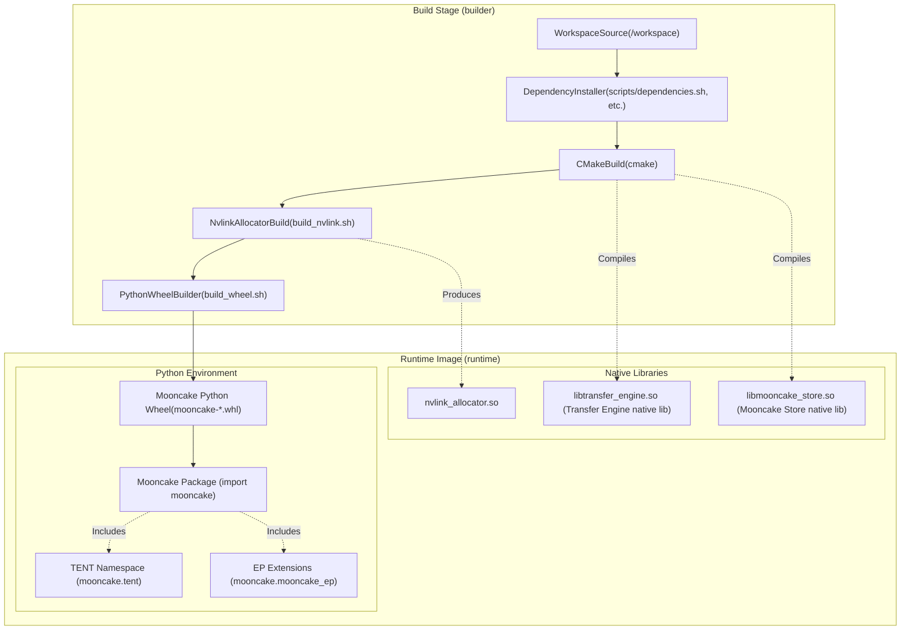
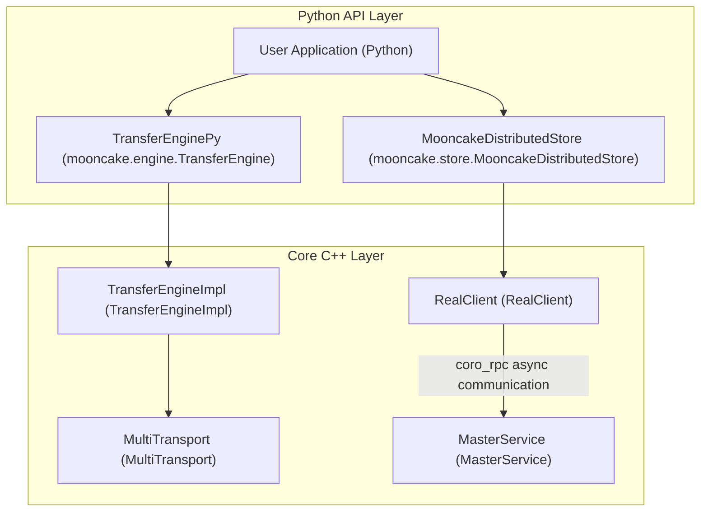

<!-- source: DeepWiki mcp.deepwiki.com · repo kvcache-ai/Mooncake · page 6.7 Docker Deployment · fetched 2026-11-11 -->

# Docker Deployment

<details>
<summary>Relevant source files</summary>

The following files were used as context for generating this wiki page:

- [.devcontainer/Dockerfile](.devcontainer/Dockerfile)
- [.devcontainer/README.md](.devcontainer/README.md)
- [.devcontainer/devcontainer.json](.devcontainer/devcontainer.json)
- [.github/actions/free-disk-space/action.yml](.github/actions/free-disk-space/action.yml)
- [.github/workflows/ci_ascend.yml](.github/workflows/ci_ascend.yml)
- [.github/workflows/e2e-ci.yml](.github/workflows/e2e-ci.yml)
- [.github/workflows/integration-test.yml](.github/workflows/integration-test.yml)
- [.github/workflows/publish-master-image.yaml](.github/workflows/publish-master-image.yaml)
- [docker/master-cuda13.Dockerfile](docker/master-cuda13.Dockerfile)
- [docker/master.Dockerfile](docker/master.Dockerfile)
- [scripts/ascend/dependencies_ascend.sh](scripts/ascend/dependencies_ascend.sh)
- [scripts/ascend/dependencies_ascend_installation.sh](scripts/ascend/dependencies_ascend_installation.sh)
- [scripts/ascend/dependencies_openeuler.sh](scripts/ascend/dependencies_openeuler.sh)

</details>


This page documents the Docker build process and deployment strategies for Mooncake. It covers the multi-stage Docker build architecture, variant Dockerfiles for CUDA, MUSA, and Ascend hardware platforms, container runtime configuration, multi-node orchestration with Docker Compose, and the devcontainer setup for development environments.

---

## 1. Docker Image Architecture and Multi-Stage Build

Mooncake employs a multi-stage Docker build process to produce optimized runtime images. The build stage compiles native libraries and packages a Python wheel inside a full development container. The runtime stage produces lean production images containing only necessary shared libraries and the Mooncake wheel.

### Docker Build Artifact Data Flow

The following diagram maps the Docker build artifacts to code entities, showing the transformation from source code to deployable components.



This delineation cleanly separates the build dependencies from the runtime environment, minimizing deployed image size and attack surface.

**Sources:**  
[docker/master.Dockerfile:1-55](), [docker/master-cuda13.Dockerfile:1-55]()

---

## 2. Supported Dockerfiles and Hardware Variants

Mooncake provides specialized Dockerfiles tailored for different hardware backends: NVIDIA CUDA GPUs, Moore Threads MUSA GPUs, and Huawei Ascend NPUs.

### CUDA Dockerfiles

Mooncake maintains two synchronized Dockerfiles to support CUDA 12 and CUDA 13 runtimes:

- `docker/master.Dockerfile` — For CUDA 12 (nvidia/cuda:12.8.1-devel-ubuntu22.04).
- `docker/master-cuda13.Dockerfile` — For CUDA 13 (nvidia/cuda:13.0.3-devel-ubuntu22.04).

They differ only in CUDA base image, CUDA runtime library versions (`libcudart.so`), and the pip package name to install:

- System libraries installed include RDMA (`libibverbs1` and `ibverbs-providers`), NUMA (`libnuma1`), libc URL, and `tini` for init [lines 30-32].

- Stub copies of CUDA runtime libraries (`libcuda.so.1`, `libcudart.so.*`) are copied from the build image for runtime linking [lines 35-37].

- Mooncake Python wheel is installed via pip, with EP/PG extensions removed and ownership changed to a non-root user (UID 65532) [lines 40-44].

- Container runs as user 65532 with Tini as PID 1 for proper signal forwarding [lines 46-55].

### MUSA Dockerfile

The `docker/musa.Dockerfile` targets Moore Threads GPUs with MUSA support:

- Base image is the official Moore Threads PyTorch development container.

- System dependencies installed include ETCD and HTTP backend related packages.

- The build uses CMake with the `-DUSE_MUSA=ON` flag to enable MUSA transport and device support.

- Native libs and the Python wheel are built in the container.

- MUSA-specific CUDA variants are handled via build flags.

### Ascend NPU Deployment

Huawei Ascend deployment requires additional environment setup and SDK integrations:

- The Ascend CANN toolkit is sourced (`/usr/local/Ascend/cann-9.0.0/set_env.sh`) to set environment variables for compilation and runtime [scripts/ascend/dependencies_ascend_installation.sh:135].

- CMake is configured with `-DUSE_ASCEND_DIRECT=ON` to enable Ascend Direct Transport.

- Ascend CI uses a custom container image with necessary device access and ulimit settings [`.github/workflows/ci_ascend.yml:16-20`].

**Sources:**  
[docker/master.Dockerfile:8-55](),  
[docker/master-cuda13.Dockerfile:8-55](),  
[docker/musa.Dockerfile:1-82](),  
[scripts/ascend/dependencies_ascend_installation.sh:135-135](),  
[.github/workflows/ci_ascend.yml:16-20]()

---

## 3. Container Configuration and Multi-Node Orchestration

### Build Variants and Feature Flags

Mooncake employs modular CMake flags to generate variant-specific binaries and wheels:

| Variant  | CMake Flag             | Description               |
|----------|------------------------|---------------------------|
| CUDA     | `-DUSE_CUDA=ON`         | NVIDIA GPU support         |
| MUSA     | `-DUSE_MUSA=ON`         | Moore Threads GPU support  |
| Ascend   | `-DUSE_ASCEND_DIRECT=ON`| Huawei Ascend NPU support  |
| Non-CUDA | `-DUSE_CUDA=OFF`        | CPU-only fallback          |

These flags enable or disable hardware-specific code paths and dependencies, producing optimized builds for the target platform.

### Container Runtime Permissions

For network and device access, Mooncake containers require privileged runtime flags:

- Devices for RDMA (InfiniBand verbs, RDMA CM sockets) must be exposed with `--device` options.

- Memory locking limits should be set to unlimited (`--ulimit memlock=-1`) for zero-copy RDMA buffers.

- Network is typically configured as `--net=host` to utilize host network directly.

Example launch command snippet:

```bash
sudo docker run --net=host \
  --device=/dev/infiniband/uverbs0 \
  --device=/dev/infiniband/rdma_cm \
  --ulimit memlock=-1 \
  -it mooncake:latest /bin/bash
```

### Multi-Node Orchestration with Docker Compose

While specific compose files are not included in the repository, Mooncake is designed for multi-node deployment using Docker Compose or similar tools. A typical setup involves:

- **Mooncake Master nodes:** Running `mooncake_master` to provide metadata services and orchestrate the cluster.

- **Mooncake Client nodes:** Running agent containers that interact with the transfer engine and manage KVCache segmented storage.

- Network configurations are tuned to provide low-latency and high-throughput communication between nodes, often via host networking or overlay networking drivers.

---

## 4. Natural Language to Code Entity Deployment Flow

This diagram maps user-level concepts to the relevant code entities invoked during a typical Dockerized Mooncake deployment.



- The user application interfaces through Python bindings: `TransferEnginePy` and `MooncakeDistributedStore`.

- Internally, the `TransferEngineImpl` class manages transport protocols via `MultiTransport`.

- The distributed store client `RealClient` asynchronously communicates with the `MasterService` metadata manager via coroutine-based RPC.

**Sources:**  
[docker/master.Dockerfile:40-44]()

---

## 5. Devcontainer Setup for Development

Mooncake provides a `.devcontainer` directory to facilitate development using VSCode Remote - Containers.

### Key Features

- **Base Image:** `ubuntu:22.04` with essential system packages including development libraries for RDMA, protobuf, gRPC, jemalloc, and Python headers [`.devcontainer/Dockerfile:1-44`].

- **Go Toolchain:** Automatically installs Go 1.23.8 to support ETCD and gRPC components.

- **VSCode Integration:** The `.devcontainer/devcontainer.json` defines container runtime arguments for extended capabilities (e.g., `SYS_PTRACE`, `NET_ADMIN`), volume bindings, and host networking [`.devcontainer/devcontainer.json:1-27`].

- **Testing Workflow:** Instructions are included to start the HTTP metadata server and run tests inside the container environment, supporting rapid iterative development [`.devcontainer/README.md:20-34`].

Developers can open Mooncake projects directly in VSCode containers with consistent and reproducible build and runtime environments.

**Sources:**  
[`.devcontainer/Dockerfile`:1-44](),  
[`.devcontainer/devcontainer.json`:1-27](),  
[`.devcontainer/README.md`:20-34]()

---

## 6. Runtime Stage and Lean Production Images

The runtime Docker images are designed to be minimal and secured by:

- Including essential runtime dependencies only: `libibverbs1`, `ibverbs-providers`, `librdmacm1` for RDMA; `libnuma1` for NUMA affinity; `liburing2` for async IO; HTTP libraries like `libcurl4` and configuration libs like `libyaml-0-2`.

- Copying CUDA runtime stubs to support dynamic linking without the full CUDA toolkit.

- Installing the Mooncake Python wheel and removing development-only artifacts.

- Running as a non-root user with Tini as the PID 1 init proxy.

This reduces image size and attack surface, facilitating secure and efficient deployment for production clusters.

**Sources:**  
[docker/master.Dockerfile:30-32]()

---

# Summary Table: Dockerfiles and Build Variants

| Dockerfile                    | Hardware Target           | Key Features/Flags                  | Base Image                         | Source Lines                    |
|------------------------------|--------------------------|-----------------------------------|----------------------------------|--------------------------------|
| `docker/master.Dockerfile`      | NVIDIA CUDA 12 GPUs        | `-DUSE_CUDA=ON`, EP enabled       | nvidia/cuda:12.8.1-devel + python:3.12-slim-trixie | [docker/master.Dockerfile:1-55]()     |
| `docker/master-cuda13.Dockerfile` | NVIDIA CUDA 13 GPUs        | CUDA 13 libs, pinned pip package  | nvidia/cuda:13.0.3-devel + python:3.12-slim-trixie | [docker/master-cuda13.Dockerfile:1-55]() |
| `docker/musa.Dockerfile`        | Moore Threads GPUs          | `-DUSE_MUSA=ON`, ETCD, HTTP backend | Moore Threads PyTorch Dev image  | [docker/musa.Dockerfile:1-82]()         |
| `.devcontainer/Dockerfile`      | Development environment    | Build essentials, Go toolchain    | ubuntu:22.04                     | [`.devcontainer/Dockerfile`:1-44]()     |

---

# Conclusion

Mooncake’s Docker deployment infrastructure supports heterogeneous hardware backends via variant-specific Dockerfiles and modular build flags. Multi-stage builds separate build-time dependencies from production runtime environments, resulting in slim, secure images.

The devcontainer setup enables seamless development with reproducible builds inside VSCode Remote - Containers.

Multi-node production deployments leverage Docker Compose or Kubernetes orchestration (covered in later sections) to form distributed KVCache clusters with high-performance RDMA and GPU device support.

---

**Sources:**  
[docker/master.Dockerfile:1-55](),  
[docker/master-cuda13.Dockerfile:1-55](),  
[docker/musa.Dockerfile:1-82](),  
[`.devcontainer/Dockerfile`:1-44](),  
[`.devcontainer/devcontainer.json`:1-27](),  
[`.devcontainer/README.md`:20-34](),  
[scripts/ascend/dependencies_ascend_installation.sh:135-135](),  
[.github/workflows/ci_ascend.yml:16-20]()

---

