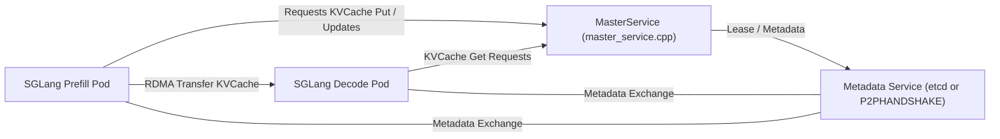

<!-- source: DeepWiki mcp.deepwiki.com · repo kvcache-ai/Mooncake · page 6.9 Kubernetes Deployment · fetched 2026-11-11 -->

# Kubernetes Deployment

<details>
<summary>Relevant source files</summary>

The following files were used as context for generating this wiki page:

- [docs/source/deployment/mooncake-store-deployment-guide.md](docs/source/deployment/mooncake-store-deployment-guide.md)
- [mooncake-common/etcd/etcd_wrapper.go](mooncake-common/etcd/etcd_wrapper.go)
- [mooncake-store/include/etcd_helper.h](mooncake-store/include/etcd_helper.h)
- [mooncake-store/include/ha/leadership/backends/etcd/etcd_leader_coordinator.h](mooncake-store/include/ha/leadership/backends/etcd/etcd_leader_coordinator.h)
- [mooncake-store/include/ha/leadership/leader_coordinator.h](mooncake-store/include/ha/leadership/leader_coordinator.h)
- [mooncake-store/include/ha/leadership/master_service_supervisor.h](mooncake-store/include/ha/leadership/master_service_supervisor.h)
- [mooncake-store/include/ha/standby_controller.h](mooncake-store/include/ha/standby_controller.h)
- [mooncake-store/include/ha/standby_metadata_store.h](mooncake-store/include/ha/standby_metadata_store.h)
- [mooncake-store/include/hot_standby_service.h](mooncake-store/include/hot_standby_service.h)
- [mooncake-store/include/master_config.h](mooncake-store/include/master_config.h)
- [mooncake-store/include/replica.h](mooncake-store/include/replica.h)
- [mooncake-store/include/types.h](mooncake-store/include/types.h)
- [mooncake-store/src/etcd_helper.cpp](mooncake-store/src/etcd_helper.cpp)
- [mooncake-store/src/ha/leadership/backends/etcd/etcd_leader_coordinator.cpp](mooncake-store/src/ha/leadership/backends/etcd/etcd_leader_coordinator.cpp)
- [mooncake-store/src/ha/leadership/master_service_supervisor.cpp](mooncake-store/src/ha/leadership/master_service_supervisor.cpp)
- [mooncake-store/src/ha/standby_controller.cpp](mooncake-store/src/ha/standby_controller.cpp)
- [mooncake-store/src/ha/standby_metadata_store.cpp](mooncake-store/src/ha/standby_metadata_store.cpp)
- [mooncake-store/src/hot_standby_service.cpp](mooncake-store/src/hot_standby_service.cpp)
- [mooncake-store/src/master.cpp](mooncake-store/src/master.cpp)
- [mooncake-store/tests/ha/leadership/high_availability_test.cpp](mooncake-store/tests/ha/leadership/high_availability_test.cpp)
- [mooncake-store/tests/ha/master_service_ha_test.cpp](mooncake-store/tests/ha/master_service_ha_test.cpp)
- [mooncake-store/tests/ha/standby/hot_standby_service_test.cpp](mooncake-store/tests/ha/standby/hot_standby_service_test.cpp)
- [mooncake-store/tests/ha/standby/hot_standby_snapshot_bootstrap_test.cpp](mooncake-store/tests/ha/standby/hot_standby_snapshot_bootstrap_test.cpp)
- [mooncake-store/tests/master_service_config_test.cpp](mooncake-store/tests/master_service_config_test.cpp)

</details>


This document details the architecture, deployment patterns, and operational tuning guidelines for deploying Mooncake on Kubernetes. It covers the store cluster setup using Deployments and StatefulSets, SGLang Prefill/Decode disaggregation, k8s-lease leader coordination, Role-Based Group (RBG) operator integration, and `llm-d` integration.


---

## 1. Kubernetes Architecture & Components

Deploying Mooncake in Kubernetes involves coordinating three primary tiers: the **Mooncake Master** control plane, the **Mooncake Store** nodes that contribute memory and storage, and **Inference Workers** executing disaggregated prefill and decode workloads.

| Component          | K8s Object Type               | Role / Code Entity                                                                    |
|--------------------|------------------------------|---------------------------------------------------------------------------------------|
| **Mooncake Master** | `Deployment` / `StatefulSet` | Central coordinator managing metadata shards, segment leases, and eviction policies (`mooncake_master` / `MasterService`) [mooncake-store/include/master_service.h:127-147]() |
| **Mooncake Store**  | `Deployment` / `DaemonSet`   | Hosts contiguous memory pools for distributed KV cache (`Client` class as store server) [docs/source/deployment/mooncake-store-deployment-guide.md:10-16]() |
| **Inference Workers** | `Deployment` / `RoleBasedGroup` | SGLang or vLLM pods performing prefill and decode workloads, interfacing with `TransferEngine` for zero-copy KVCache transfers |

### Kubernetes Component Architecture and Code Mapping

The following diagram maps Kubernetes components to their code representation, bridging natural language descriptions with core code entities.

```mermaid
graph TD
    subgraph "K8s_Cluster_Namespace"
        MasterPod["\"mooncake_master Pod (MasterConfig)\""] -->|"RPC / REST"| AdminServer["\"MasterAdminServer (master_admin_service.cpp)\""]
        AdminServer -->|"Health / Metrics"| Metrics["\"/metrics/summary Endpoint\""]
        
        Supervisor["\"MasterServiceSupervisor (master_service_supervisor.h)\""] -->|"TryAcquireLeadership()"| Coordinator["\"LeaderCoordinator (EtcdLeaderCoordinator)\""]
        Coordinator -->|"Lease / Txn"| Etcd["\"EtcdHelper (etcd_helper.h)\""]
        
        Supervisor -->|"SetLeader(true/false)"| Reconciler["\"LeaderLabelReconciler\""]
        Reconciler -->|"Patch Pod Labels"| K8sAPI["\"Kubernetes API Server (Lease/Labels)\""]
    end

    subgraph "Storage_and_Inference_Plane"
        StoreClient["\"mooncake_store_service (MasterClient)\""] -->|"Put / Get / Remove RPC"| WrappedSvc["\"WrappedMasterService (rpc_service.h)\""]
        WrappedSvc --> MasterSvc["\"MasterService (master_service.cpp)\""]
        PrefillWorker["\"SGLang/vLLM Prefill Worker\""] -->|"RDMA Transfer KVCache"| DecodeWorker["\"SGLang/vLLM Decode Worker\""]
    end
    
    StoreClient -.->|"P2PHANDSHAKE / Metadata"| Etcd
```

Sources:  
[mooncake-store/include/master_service.h:127-147](), [mooncake-store/include/master_config.h:94-185](), [mooncake-store/include/rpc_service.h:22-38](), [mooncake-store/src/ha/leadership/master_service_supervisor.cpp:36-52](), [mooncake-store/include/ha/leadership/master_service_supervisor.h]()


---

## 2. Store Cluster Setup & Configuration

The Mooncake Store cluster forms a distributed KVCache by having client nodes contribute memory segments alongside the central master service managing metadata and cluster orchestration.

### Master Deployment Configuration

- The master service runs as a standalone process or in HA mode (cluster of masters coordinated by etcd or Kubernetes leases).
- Configured through `MasterConfig` [mooncake-store/include/master_config.h:94-185](), key flags include:
  - `--rpc_port` using `coro_rpc` (default: `50051`) [mooncake-store/src/master.cpp:121-125]()
  - `--enable_ha` to activate high availability [mooncake-store/include/master_config.h:119]()
  - `--ha_backend_type` set to `"etcd"` or `"k8s"` for leadership coordination [mooncake-store/include/master_config.h:121]()

### Store Node Deployment

- Store nodes contribute DRAM/SSD to the cluster as `Client` servers.
- Deployment options:
  - Embedded in inference pods (sharing same process or container)
  - Standalone store service running `mooncake_store_service` as a daemonset.
- Key container requirements for RDMA and memory locking:
  - `hostNetwork: true` (avoid container network namespaces to enable direct NIC access) [docs/source/deployment/mooncake-store-deployment-guide.md:60]()
  - Linux capabilities `CAP_SYS_RESOURCE` and `CAP_IPC_LOCK` for `mlock()` usage to support zero-copy buffers [mooncake-store/tests/master_service_test.cpp:137-143]()

### Minimal Client Setup Example (Python)

```python
from mooncake.store import MooncakeDistributedStore

store = MooncakeDistributedStore()
store.setup(
    local_hostname="localhost",
    metadata_server="P2PHANDSHAKE",           # decentralized, no external metadata service
    global_segment_size=3200 * 1024 * 1024,   # memory contributed to cluster
    local_buffer_size=512 * 1024 * 1024,      # Transfer Engine buffer size
    protocol="tcp",
    rdma_devices="",
    master_server_addr="127.0.0.1:50051",
)
```

Sources:  
[docs/source/deployment/mooncake-store-deployment-guide.md:10-65](), [mooncake-store/include/master_config.h:94-185](), [mooncake-store/src/master.cpp:121-125](), [mooncake-store/tests/master_service_test.cpp:137-143]()


---

## 3. Leadership Coordination and RBG Operator Integration

Mooncake supports Kubernetes-native high availability by integrating:

- **Leader elections** via either etcd coordination or Kubernetes Lease APIs.
- **Role-Based Group (RBG) operators** that manage custom object topologies and pod roles.
- **MasterServiceSupervisor** component (`master_service_supervisor.h`) which handles leader election, lease acquisition, renewal, and releasing leadership [mooncake-store/src/ha/leadership/master_service_supervisor.cpp:1-176]().

### k8s Lease-based Leader Coordination

- If `ha_backend_type` is `"k8s"`, leadership is managed by periodically renewing a Lease on the Kubernetes API server. The `HABackendType::K8S` enum value represents this backend type [mooncake-store/include/ha/ha_types.h:26]().
- The leader pod sets a pod label `"mooncake.io/store-role=leader"` to identify itself and steer client traffic.
- This label reconciliation is managed by the `LeaderLabelReconciler` class to patch the pod metadata on the Kubernetes API server [mooncake-store/src/ha/leadership/master_service_supervisor.cpp:40-52]().

### High Availability & Leadership State Machine

The `LeaderCoordinator` interface [mooncake-store/include/ha/leadership/leader_coordinator.h:21-52]() defines the contract for leadership management, with `EtcdLeaderCoordinator` [mooncake-store/include/ha/leadership/backends/etcd/etcd_leader_coordinator.h:16-75]() being one implementation. The `EtcdHelper` [mooncake-store/include/etcd_helper.h:19-31]() class provides the C++ interface to the Go `libetcd_wrapper` [mooncake-common/etcd/etcd_wrapper.go:166-208]() for etcd operations.

**Leader election flow managed by `MasterServiceSupervisor`:**

```mermaid
sequenceDiagram
    participant Master as "MasterServiceSupervisor"
    participant Coordinator as "LeaderCoordinator (Etcd or k8s)"
    participant EtcdHelper as "EtcdHelper (Go libetcd_wrapper)"
    participant K8sAPI as "Kubernetes API Server"

    Master->>Coordinator: TryAcquireLeadership(leader_address)
    alt If Etcd Backend (HABackendType::ETCD)
        Coordinator->>EtcdHelper: AcquireMaintenanceSession(key, lease_ttl)
        EtcdHelper->>EtcdHelper: NewSession() (Go)
        EtcdHelper-->>Coordinator: session_handle, lease_id, create_revision
    else If K8s Backend (HABackendType::K8S)
        Coordinator->>K8sAPI: Create or Renew Lease
        K8sAPI-->>Coordinator: Lease acquisition succeeded
    end
    Coordinator-->>Master: LeadershipSession returned
    
    Master->>LeaderLabelReconciler: SetLeader(true)
    LeaderLabelReconciler->>K8sAPI: Patch pod label "mooncake.io/store-role=leader"
    K8sAPI-->>LeaderLabelReconciler: Updated label
    
    note over Master: MasterServiceSupervisor activates serving state
    
    loop Lease Renew
      Master->>Coordinator: RenewLeadership(session)
      alt If Etcd Backend
          Coordinator->>EtcdHelper: KeepAlive(lease_id) or MaintenanceSessionAlive(session_handle)
          EtcdHelper-->>Coordinator: Lease alive confirmation
      else If K8s Backend
          Coordinator->>K8sAPI: Renew Lease
      end
    end
    
    alt Lease expires or error
        Coordinator--xMaster: Leadership lost (LeadershipLossReason)
        Master->>LeaderLabelReconciler: SetLeader(false)
        LeaderLabelReconciler->>K8sAPI: Remove leader pod label
        Master->>Master: Deactivate serving state
    end
```



Sources:  
[mooncake-store/src/ha/leadership/master_service_supervisor.cpp:27-121](), [mooncake-store/include/etcd_helper.h:19-31](), [mooncake-store/include/ha/ha_types.h:26](), [mooncake-store/include/ha/leadership/leader_coordinator.h:21-52](), [mooncake-store/include/ha/leadership/backends/etcd/etcd_leader_coordinator.h:16-75](), [mooncake-common/etcd/etcd_wrapper.go:166-208](), [mooncake-store/src/etcd_helper.cpp:119-147]()


---

## 4. SGLang P/D Disaggregation on Kubernetes & LLM Integration

Mooncake supports disaggregated LLM serving with separation of prefill and decode workloads (P/D disaggregation). Key aspects include:

- **SGLang and vLLM** frameworks operate distinct prefill and decode pods, connected over the Mooncake Store cluster.
- The **Transfer Engine** handles zero-copy transfers of KVCache segments between prefill and decode pods efficiently.
- Consistent environment setup across pods is crucial:
  - `PYTHONHASHSEED` must be fixed across pods so that content hashing for KVCache keys is stable and consistent.
  - Metadata services must resolve identically across worker pools — can use `P2PHANDSHAKE` or etcd metadata backend for peer discovery.
- The `WrappedMasterService` RPC layer interfaces Mooncake Store with worker instances for querying and updating metadata about cached tensors and weights.
- Disaggregation enables elastic resource allocation, better GPU utilization, and higher throughput for inference workloads.

### Data Flow for KVCache Transfer



Sources:  
[docs/source/deployment/mooncake-store-deployment-guide.md:10-16](), [mooncake-store/include/rpc_service.h:22-38](), [mooncake-store/src/master.cpp:78-85](), [mooncake-store/include/etcd_helper.h:19-31]()


---

## 5. Operational Tuning & Best Practices

### Memory and NUMA-Aware Placement

- Mooncake Store allocates segments with consideration for NUMA locality to minimize bottlenecks on multi-socket servers.
- Use `numactl` or Kubernetes node affinity to pin store pods to specific NUMA nodes matching network device locality, optimizing RDMA throughput.
- Enable huge pages (`MAP_HUGETLB`) when mounting DRAM segments to reduce TLB misses.
- Use `madvise(MADV_DONTFORK)` on mapped memory to prevent child processes inheriting large caches during Kubernetes pod restarts or scaling.

### Network and Security Requirements

- When deploying RDMA-enabled store services, pods require:
  - `hostNetwork: true` to allow direct NIC access and avoid network namespace translation.
  - Linux capabilities `CAP_SYS_RESOURCE` and `CAP_IPC_LOCK` for memory locking.
- For multi-NIC or multi-transport setups, set environment variables controlling NIC selection (e.g., `MC_MS_AUTO_DISC` and `MC_MS_FILTERS`).

### Monitoring, Health, and Metrics

- The master service exposes HTTP endpoints for:
  - `/metrics`: Prometheus metrics (storage, transfers, leases)
  - `/metrics/summary`: cluster-wide metrics summary
  - `/health`: readiness/liveness probes
- Regularly monitor lease renewal latencies and eviction watermark metrics to ensure cluster health.
- Use standard Kubernetes readiness probes to ensure `mooncake_master` and store pods only receive requests when ready.

Sources:  
[docs/source/deployment/mooncake-store-deployment-guide.md:111](), [mooncake-store/src/master_service.cpp:180-186](), [mooncake-store/tests/master_service_test.cpp:137-143]()


---

# Summary

This page covers the core Kubernetes deployment model for Mooncake, detailing cluster setup, control plane HA via k8s leases or etcd, RBG operator integration, LLM framework P/D disaggregation, and key operational tuning considerations. For complete instructions on configuring individual components, service flags, and scaling policies, refer to the Mooncake Store Deployment Guide and the HA subsystem documentation.

Sources:  
- [mooncake-store/include/master_service.h:127-147]()  
- [docs/source/deployment/mooncake-store-deployment-guide.md:1-151]()  
- [mooncake-store/include/master_config.h:94-185]()  
- [mooncake-store/src/ha/leadership/master_service_supervisor.cpp:1-184]()  
- [mooncake-store/include/etcd_helper.h:1-184]()  
- [mooncake-store/src/master.cpp:1-162]()  
- [mooncake-store/include/rpc_service.h:22-38]()  
- [mooncake-store/tests/master_service_test.cpp:137-143]()  
- [mooncake-store/include/ha/ha_types.h:26]()  
- [mooncake-store/include/ha/leadership/leader_coordinator.h:21-52]()  
- [mooncake-store/include/ha/leadership/backends/etcd/etcd_leader_coordinator.h:16-75]()  
- [mooncake-common/etcd/etcd_wrapper.go:166-208]()  
- [mooncake-store/src/etcd_helper.cpp:119-147]()

---

