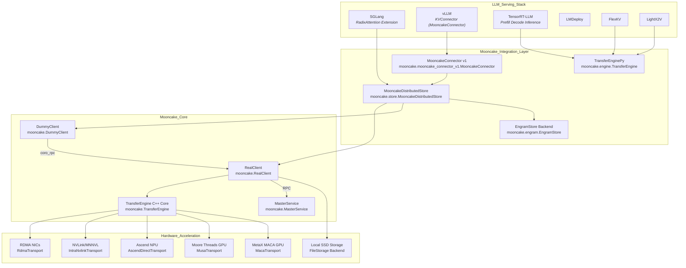
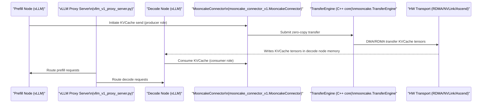

<!-- source: DeepWiki mcp.deepwiki.com · repo kvcache-ai/Mooncake · page 7 LLM Framework Integration · fetched 2026-11-11 -->

# LLM Framework Integration

Relevant source files

The following files were used as context for generating this wiki page:

- [mooncake-wheel/mooncake/README.md](mooncake-wheel/mooncake/README.md)
- [mooncake-wheel/mooncake/mooncake_connector_v1.py](mooncake-wheel/mooncake/mooncake_connector_v1.py)
- [mooncake-wheel/mooncake/vllm_v1_proxy_server.py](mooncake-wheel/mooncake/vllm_v1_proxy_server.py)

This page provides a high-level overview of how Mooncake integrates with leading Large Language Model (LLM) serving frameworks to enable KVCache disaggregation and prefill-decode (PD) compute separation. It outlines the main integration components and patterns, illustrating how Mooncake’s Transfer Engine and Store facilitate efficient KVCache sharing, hierarchical caching, and scaling across diverse LLM deployments.

Mooncake forms the foundation for next-generation LLM services, such as Kimi, where it enables up to a 75% improvement in request throughput by leveraging KVCache-centric disaggregated architectures. This integration allows for separating prefill and decode computations, optimizing memory usage, and maximizing cluster resource efficiency.

**Scope:** This parent page covers core concepts and architectural integration touchpoints at a system level. Detailed technical guidance, API references, and in-depth implementation details are available in the child pages linked below.

---

## Overview of Integration Architecture

Mooncake’s integration with LLM serving frameworks is primarily realized through two layers:

- **Data Plane:** The Transfer Engine, responsible for zero-copy, RDMA-capable high-throughput transfer of KVCache tensor chunks directly between GPU and CPU memory across nodes. This enables low-latency disaggregated prefill-decode workflows and efficient KVCache sharing between LLM model stages.

- **Storage Plane:** The Mooncake Store serves as a distributed object storage backend that provides multi-tier caching (GPU, host DRAM, SSD) and lease-based object lifecycle management. It supports hierarchical global caching, persistent KVCache pooling, and seamless SSD offload for capacity scaling.

These components form Mooncake’s KVCache-centric disaggregation architecture, enabling LLM frameworks to reduce redundant computation by reusing KVCache states and optimize inference throughput.

The schematic below associates key system components with their codebase entities and framework roles:

This layered design enables flexible deployment modes such as:

- Disaggregated prefill-decode clusters using the Transfer Engine to shuttle KVCache tensors.
- Hierarchical multi-tier caching via Mooncake Store to reduce redundant token computations.
- Elastic expert parallelism for Mixture-of-Experts (MoE) models integrating Mooncake’s EP backend.

Sources: [mooncake-wheel/mooncake/mooncake_connector_v1.py:1-132](), [mooncake-wheel/mooncake/README.md:1-32](), [mooncake-wheel/mooncake/vllm_v1_proxy_server.py:1-212]()

---

## Integration Patterns

### KVCache Transfer for Disaggregated Prefill-Decode

Prefill-Decode (PD) disaggregation splits the LLM inference into two stages: a prefill phase that computes key/value caches, and a decode phase that consumes them for autoregressive generation.

Mooncake exposes its Transfer Engine to LLM frameworks via dedicated adaptor interfaces to enable zero-copy, RDMA-capable transfer of these KVCache slices over the network:

- **vLLM Integration:** Implements `MooncakeConnector` (in `mooncake_connector_v1.py`), which subclasses from `KVConnectorBase_V1` and supports hybrid memory allocators. This connector handles the transfer logic between prefill (producer) and decode (consumer) roles. It relies on a proxy server (`vllm_v1_proxy_server.py`) that routes requests between these roles, orchestrating KVCache transfers and decoding [mooncake-wheel/mooncake/mooncake_connector_v1.py:121-132](), [mooncake-wheel/mooncake/vllm_v1_proxy_server.py:1-212]().

- **Mechanism:** Memory registered with the Transfer Engine’s transport layers (RDMA, NVLink, Ascend, MACA GPUs) enables zero-copy data paths between host and GPU memory across nodes. This minimizes latency and CPU overhead critical for maintaining inference SLAs.

---

### Hierarchical KVCache Storage and Caching

Mooncake Store underpins hierarchical KVCache storage with multi-tier cache pools:

- **SGLang HiCache Integration:** Builds on Mooncake Store to provide multi-tier GPU, CPU, and SSD caching layers with elastic prefill-decode disaggregation (EPD). Extensions such as `RadixAttention` and page-first memory layout optimize memory usage and KV cache sharing [details in child page 7.2].

- **Lease-based Lifecycle:** Objects and KVCache segments managed by the Mooncake Store support leasing and soft-pinning semantics, enabling coordinated caching and eviction policies to optimize throughput and consistency.

- **SSD Offloading:** The distributed store scales capacity via persistent SSD layers with asynchronous I/O backends.

---

### Elastic Expert Parallelism (EP)

Mooncake also supports elastic expert parallelism for MoE models:

- **Dynamic Expert Routing:** EP backends use Mooncake’s `mooncake_ep_buffer` and process group extensions (`mooncake-pg`) to enable dynamic workload routing with fault tolerance and collective communication support.

- **Hardware Support:** Integration with advanced transports like mlx5gda InfiniBand enables high-speed expert state transfers.

This feature is described further in the dedicated child page on Elastic Expert Parallelism (#7.6).

---

## Supported Frameworks and Integration Highlights

| Framework                | Integration Type                      | Highlights                                                              |
|--------------------------|-------------------------------------|-------------------------------------------------------------------------|
| **vLLM**                 | KVConnector v1, Disaggregated Store | `MooncakeConnector` implements seamless KV cache transfer for PD. Proxy server enables transparent request routing between prefill and decode nodes. |
| **SGLang**               | HiCache Multi-tier Cache, EPD, EP   | Uses Mooncake Store for hierarchical KV cache. Elastic prefill-decode with RadixAttention extension. MoE elastic expert parallelism.              |
| **TensorRT LLM**         | Engine KVCache transfer              | KVCache transfer integration for PD disaggregation.                   |
| **LMDeploy**             | Engine KVCache transfer              | Leverages Transfer Engine for KVCache sharding and reuse.               |
| **FlexKV**               | Engine KVCache reuse                 | Distributed KVCache reuse over Transfer Engine.                         |
| **LightX2V**             | Encoder/Transformer Decoupling      | Uses Mooncake Transfer Engine for high-performance KVCache transfer.   |
| **Hardware & Transport** | RDMA (Infiniband), NVLink, Ascend, MUSA, MACA | Mooncake Transfer Engine provides unified transport abstraction supporting multiple hardware accelerators and interconnects. |

Mooncake’s modular architecture and robust transport stack enable broad applicability across LLM serving environments, including novel RL training workflows and checkpoint distribution via P2P Store.

Sources: [mooncake-wheel/mooncake/mooncake_connector_v1.py:4-132](), [mooncake-wheel/mooncake/README.md:1-32]()

---

## Data Plane Workflow: KVCache Transfer via MooncakeConnector

The diagram below illustrates the data and control flow for KVCache transfer during disaggregated inference using vLLM integration and MooncakeConnector:

This pipeline minimizes overheads by leveraging zero-copy transfers between GPUs and CPUs, enabling efficient separation of prefill and decode computations essential for scaling large models.

Sources: [mooncake-wheel/mooncake/mooncake_connector_v1.py:121-132](), [mooncake-wheel/mooncake/vllm_v1_proxy_server.py:1-212]()

---

## Next Steps & Child Page Links

For detailed implementation, API usage, and configuration guidance, see these child pages:

- [Integration Overview](#7.1) — Detailed architecture of KVCache transfer, disaggregated prefill-decode workflows, hierarchical caching, and the C++ adaptor layer for vLLM and SGLang.

- [SGLang HiCache Integration](#7.2) — Examines SGLang’s HiCache multi-tier cache system, elastic prefill-decode disaggregation (EPD), RadixAttention extension, and elastic expert parallelism.

- [vLLM Integration](#7.3) — Step-by-step guide on integrating Mooncake with vLLM, covering KV Connector v1, disaggregated prefill, Store backend, and proxy server deployment.

- [Other Framework Integrations](#7.4) — Covers integrations with TensorRT LLM, LMDeploy, FlexKV, LMCache, xLLM, LightX2V, P2P Store checkpoint distribution, and RL training workflows.

- [Prefill-Decode Disaggregation](#7.5) — Comprehensive explanation of PD compute separation, KVCache transfer workflows, performance insights, XpYd deployment patterns, and early rejection policies.

- [Elastic Expert Parallelism](#7.6) — Details on the MoE elastic expert backend, including collective communications, fault tolerance, and Mooncake process group extensions.

---

This overview outlines how Mooncake’s modular Transfer Engine and distributed Store enable seamless, high-performance integration with multiple LLM serving frameworks, powering advanced disaggregated and hierarchical KVCache management to efficiently scale inference workloads.

Sources:  
[mooncake-wheel/mooncake/mooncake_connector_v1.py:1-132](), [mooncake-wheel/mooncake/vllm_v1_proxy_server.py:1-212](), [mooncake-wheel/mooncake/README.md:1-32]()

---

