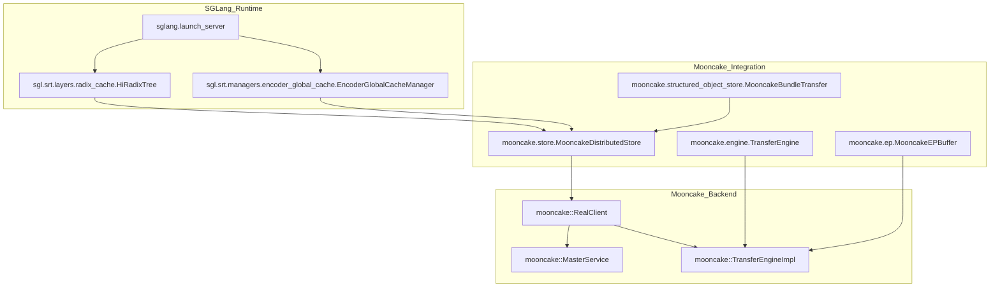
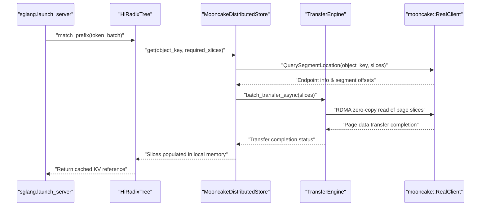

<!-- source: DeepWiki mcp.deepwiki.com · repo kvcache-ai/Mooncake · page 7.2 SGLang HiCache Integration · fetched 2026-11-11 -->

# SGLang HiCache Integration

Relevant source files

The following files were used as context for generating this wiki page:

- [.github/workflows/integration-test-rocm.yml](.github/workflows/integration-test-rocm.yml)
- [README.md](README.md)
- [docs/source/getting_started/build.md](docs/source/getting_started/build.md)
- [docs/source/getting_started/quick-start.md](docs/source/getting_started/quick-start.md)
- [docs/source/getting_started/supported-protocols.md](docs/source/getting_started/supported-protocols.md)
- [docs/source/index.md](docs/source/index.md)
- [docs/source/zh_archive/build.md](docs/source/zh_archive/build.md)
- [docs/source/zh_archive/run-examples.md](docs/source/zh_archive/run-examples.md)
- [mooncake-common/common.cmake](mooncake-common/common.cmake)
- [mooncake-store/CMakeLists.txt](mooncake-store/CMakeLists.txt)
- [mooncake-store/include/version.h.in](mooncake-store/include/version.h.in)
- [mooncake-transfer-engine/CMakeLists.txt](mooncake-transfer-engine/CMakeLists.txt)
- [mooncake-transfer-engine/include/cuda_alike.h](mooncake-transfer-engine/include/cuda_alike.h)
- [mooncake-transfer-engine/src/CMakeLists.txt](mooncake-transfer-engine/src/CMakeLists.txt)
- [mooncake-transfer-engine/src/transport/CMakeLists.txt](mooncake-transfer-engine/src/transport/CMakeLists.txt)
- [scripts/e2e/scripts/test_1p1d_erdma.sh](scripts/e2e/scripts/test_1p1d_erdma.sh)
- [scripts/e2e/scripts/test_disaggregation_different_tp.sh](scripts/e2e/scripts/test_disaggregation_different_tp.sh)
- [scripts/tone_tests/README_en.md](scripts/tone_tests/README_en.md)
- [scripts/tone_tests/README_zh.md](scripts/tone_tests/README_zh.md)
- [scripts/tone_tests/scripts/common.sh](scripts/tone_tests/scripts/common.sh)
- [scripts/tone_tests/scripts/run_test.sh](scripts/tone_tests/scripts/run_test.sh)
- [scripts/tone_tests/tests/test_common_cleanup.sh](scripts/tone_tests/tests/test_common_cleanup.sh)
- [scripts/tone_tests/tests/test_hicache_model_selection.py](scripts/tone_tests/tests/test_hicache_model_selection.py)

## Purpose and Scope

This document provides a comprehensive technical overview of the integration between **SGLang** and **Mooncake**, focusing on the **HiCache** hierarchical KV caching system, **Encode-Prefill-Decode (EPD)** disaggregation, **Elastic Expert Parallelism (EP)**, the **RadixAttention** extension (`HiRadixTree`), and the **page-first memory layout**.

The integration combines SGLang's runtime extensions and distributed caching capabilities with Mooncake Store’s distributed KV cache pool and Transfer Engine’s zero-copy RDMA-accelerated data plane for scalable and efficient LLM serving.

Key features covered:

- Multi-tier caching architecture extending from GPU VRAM to distributed cluster storage.
- Coordination of remote KV cache data fetches aligned with zero-copy RDMA transfers.
- EPD disaggregation for decoupling compute-heavy encoding from language model decoding.
- Elastic expert parallelism for scalable Mixture-of-Experts processing.
- Page-first memory layout for efficient block-level page transfers and alignment.

This integration enables SGLang to leverage Mooncake as a backend for global hierarchical caching and zero-copy multi-node KV cache sharing, dramatically improving throughput and resource utilization in large-scale LLM deployments [README.md:40-57](), [docs/source/index.md:60-62]().

Sources: [README.md:40-41, 47-57](), [docs/source/index.md:60-62]()

---

## Integration Architecture

### Component Overview

The integration connects SGLang’s runtime and cache management layers with Mooncake’s distributed storage and transfer subsystems as follows:

| Natural Language Component              | Mooncake Code Entity / Class                 | Description                                                                                   |
|---------------------------------------|---------------------------------------------|-----------------------------------------------------------------------------------------------|
| **SGLang Server**                     | `sglang.launch_server`                       | Core SGLang runtime launching inference and pipeline servers.                               |
| **RadixAttention Extension**          | `sgl.srt.layers.radix_cache.HiRadixTree`    | Prefix tree-based KV cache layer extending local caching to hierarchical remote access.      |
| **Encoder Global Cache Manager**      | `sgl.srt.managers.encoder_global_cache.EncoderGlobalCacheManager` | Manages sharing and caching of large multimodal embeddings across nodes.                      |
| **Mooncake Distributed Store Wrapper** | `mooncake.store.MooncakeDistributedStore`   | Python/C++ wrapper exposing Mooncake distributed object store APIs to SGLang layers.         |
| **Mooncake Transfer Engine Python API** | `mooncake.engine.TransferEngine`             | High-performance RDMA/TCP transfer engine for zero-copy data movement.                        |
| **Elastic Expert Parallelism Backend** | `mooncake.ep.MooncakeEPBuffer` and `mooncake-pg` process group | Memory buffer and process group extensions enabling elastic MoE expert communication.         |
| **Mooncake Store Backend**            | `mooncake::MasterService`, `mooncake::RealClient`, `mooncake::TransferEngineImpl` | Core distributed storage master and client implementations in C++ backend.                  |

### Architecture Diagram: Mapping Natural Language Concepts to Mooncake Code Entities

*Diagram: SGLang execution layers and cache managers interface with Mooncake distributed store and transfer engine code entities.*

Sources: [README.md:47-53](), [docs/source/index.md:60-62](), [docs/source/getting_started/quick-start.md:28-30]()

---

## HiCache: Multi-Tier KV Caching & Page-First Layout

### Hierarchical Storage Model

HiCache implements a strict three-level hierarchy for KV cache blocks:

| Cache Level | Description                                               | Managed By                   |
|-------------|-----------------------------------------------------------|------------------------------|
| **L1 (Device VRAM)** | Local GPU-resident KV cache blocks                      | RadixAttention on single GPU  |
| **L2 (Host DRAM)**   | Host paging layer for evicted or pre-allocated prefixes | RadixAttention / local host   |
| **L3 (Distributed Pool)** | Remote cluster-wide distributed pool of KV cache segments | Mooncake Store backend        |

This hierarchy provides transparent, scalable, and fault-tolerant cache tiering for huge KV cache state beyond single-node GPU memory limits [docs/source/index.md:60-62]().

### Page-First Memory Layout and Transfer Flow

HiCache uses a **page-first layout** where KV cache blocks are internally divided into fixed-size pages matching the memory registration granularity of Mooncake Transfer Engine's zero-copy RDMA paths.

This alignment enables:

- Batch asynchronous transfer of page slices from distributed remote segments.
- Overlapping of metadata queries and RDMA transfer tasks.
- Efficient zero-copy data movement without CPU memory copies.

### Execution Flow Diagram for Cache Retrieval

*Diagram: Data flow from SGLang HiRadixTree cache miss through Mooncake Store to TransferEngine zero-copy RDMA of KV cache pages.*

Sources: [docs/source/index.md:60-62](), [docs/source/getting_started/quick-start.md:28-30]()

---

## Encode-Prefill-Decode (EPD) Disaggregation

### Overview

The **Encode-Prefill-Decode** disaggregation pattern implemented in SGLang using Mooncake enables:

- Decoupling **encoders** (often heavy Vision Transformer modules) from language model **prefill/decode** clusters.
- Use of Mooncake Transfer Engine for high-performance zero-copy RDMA transfers of large multimodal embedding tensors from encoder nodes to language model nodes.
- Efficient cross-instance sharing of precomputed embeddings, reducing redundant encoder computations.

### Key Implementation Details

- `EncoderGlobalCacheManager` manages a global cache of multimodal embeddings shared across inference request workflows.
- Mooncake handles large tensor transfers by registering GPU memory buffers and executing asynchronous RDMA for low latency.
- EPD disaggregation uses explicit object keys and versioned segments to cache and fetch encoder outputs efficiently.

Sources: [README.md:47-53]()

---

## Elastic Expert Parallelism (EP)

### Purpose

To support large-scale **Mixture-of-Experts (MoE)** based LLMs, SGLang integrates with Mooncake’s Elastic Expert Parallelism backend. This architecture enables fine-grained fault tolerance and dynamic routing in expert communication beyond standard static tensor parallelism.

### Components

| Component | Description |
|-----------|-------------|
| `mooncake_ep_buffer` | Pinned memory buffers optimized for aggregating and dispatching tokens to experts efficiently. |
| `mooncake-pg` process group | PyTorch-distributed extension integrating Mooncake transport for resilient expert communication. |
| IBGDA / `mlx5gda` backend | High-performance InfiniBand GPU-Direct Async transport, lowering latency for expert shard communication on NVIDIA hardware. |

This elastic EP infrastructure is implemented within the Mooncake Transfer Engine and common GPU RDMA stack extensions.

Sources: [mooncake-transfer-engine/CMakeLists.txt:34-56](), [mooncake-common/common.cmake:79-81]()

---

## Deployment and Verification

### Integration Validation Scripts

Mooncake provides dedicated test scripts in the `scripts/tone_tests/` and `scripts/e2e/scripts/` directories specifically tailored to validate SGLang HiCache integration and related disaggregation features.

| Test Script Name                   | Functionality                              | Reference Location                                  |
|----------------------------------|-------------------------------------------|----------------------------------------------------|
| `test_hicache_storage_mooncake_backend.sh` | Validates HiCache L3 storage with Mooncake backend | [scripts/tone_tests/README_en.md:19-20]()           |
| `test_disaggregation_different_tp.sh`       | Tests P/D disaggregation with mismatched tensor parallelism | [scripts/e2e/scripts/test_disaggregation_different_tp.sh:1-2]() |
| `test_epd_sglang.sh`                        | Validates full EPD pipeline and ViT embedding sharing | [scripts/tone_tests/scripts/run_test.sh:49]()        |
| `test_moe_mooncake.sh`                      | Validates Elastic EP backend correctness for MoE models | [scripts/tone_tests/scripts/run_test.sh:50]()        |

These scripts ensure proper functional correctness and performance profiling of distributed hierarchical caching, EPD disaggregation, and elastic MoE execution workflows.

Sources: [scripts/tone_tests/scripts/run_test.sh:49-50, 68-80](), [scripts/tone_tests/README_en.md:19-20](), [scripts/e2e/scripts/test_disaggregation_different_tp.sh:1-2]()

---

## Summary of Performance Characteristics

| Feature                       | Benefit to SGLang Integration                               | Reference Source            |
|-------------------------------|--------------------------------------------------------------|-----------------------------|
| **RDMA Weight Updates**       | 7x faster P2P RDMA weight transfer for 1 trillion parameter models | [README.md:40-41]()          |
| **Multimodal Embedding Sharing** | Cross-instance sharing of large ViT embeddings via global cache | [README.md:47-48]()          |
| **Increased Request Throughput** | Up to 75% higher request capacity under production loads        | [README.md:32-33]()          |
| **Hierarchical Cache Extension** | RadixAttention extended to distributed L3 cache with Mooncake backend | [docs/source/index.md:60-62]() |

Sources: [README.md:32-33, 40-48](), [docs/source/index.md:60-62]()

---

# References

- [README.md:40-57]()
- [docs/source/index.md:60-62]()
- [scripts/tone_tests/scripts/run_test.sh:49-50, 68-80]()
- [scripts/tone_tests/README_en.md:19-20]()
- [scripts/e2e/scripts/test_disaggregation_different_tp.sh:1-2]()
- [mooncake-transfer-engine/CMakeLists.txt:34-56]()
- [mooncake-common/common.cmake:79-81]()
- [docs/source/getting_started/quick-start.md:28-30]()

---

