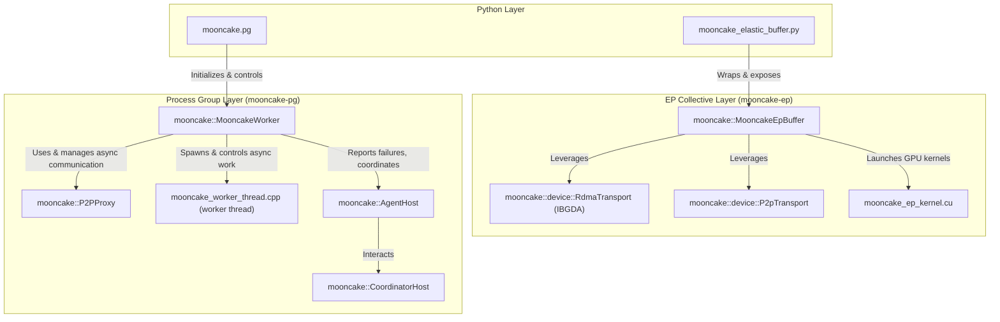
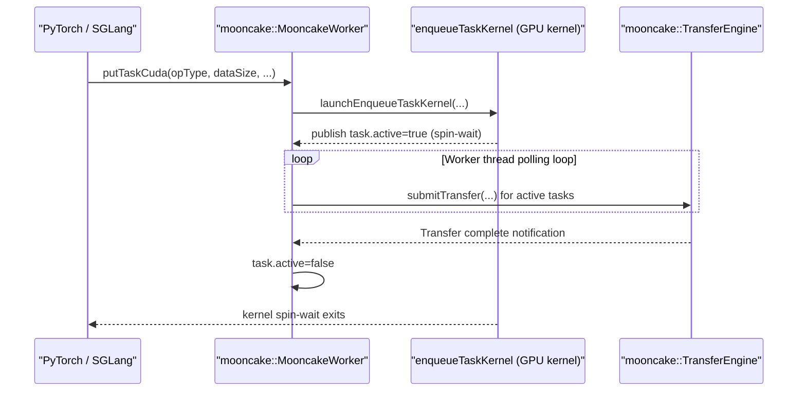

<!-- source: DeepWiki mcp.deepwiki.com · repo kvcache-ai/Mooncake · page 7.6 Elastic Expert Parallelism · fetched 2026-11-11 -->

# Elastic Expert Parallelism

Relevant source files

The following files were used as context for generating this wiki page:

- [mooncake-ep/include/mooncake_ep_api.cuh](mooncake-ep/include/mooncake_ep_api.cuh)
- [mooncake-ep/include/mooncake_ep_buffer.h](mooncake-ep/include/mooncake_ep_buffer.h)
- [mooncake-ep/include/mooncake_ep_configs.cuh](mooncake-ep/include/mooncake_ep_configs.cuh)
- [mooncake-ep/include/mooncake_ep_device.h](mooncake-ep/include/mooncake_ep_device.h)
- [mooncake-ep/src/CMakeLists.txt](mooncake-ep/src/CMakeLists.txt)
- [mooncake-ep/src/ep_py.cpp](mooncake-ep/src/ep_py.cpp)
- [mooncake-ep/src/mooncake_ep_buffer.cpp](mooncake-ep/src/mooncake_ep_buffer.cpp)
- [mooncake-ep/src/mooncake_ep_kernel.cu](mooncake-ep/src/mooncake_ep_kernel.cu)
- [mooncake-pg/include/mooncake_worker.cuh](mooncake-pg/include/mooncake_worker.cuh)
- [mooncake-pg/include/mooncake_worker_kernels.cuh](mooncake-pg/include/mooncake_worker_kernels.cuh)
- [mooncake-pg/include/p2p_progress_timeout.h](mooncake-pg/include/p2p_progress_timeout.h)
- [mooncake-pg/include/p2p_proxy.h](mooncake-pg/include/p2p_proxy.h)
- [mooncake-pg/src/CMakeLists.txt](mooncake-pg/src/CMakeLists.txt)
- [mooncake-pg/src/mooncake_communicator.cpp](mooncake-pg/src/mooncake_communicator.cpp)
- [mooncake-pg/src/mooncake_worker.cu](mooncake-pg/src/mooncake_worker.cu)
- [mooncake-pg/src/mooncake_worker_host.cpp](mooncake-pg/src/mooncake_worker_host.cpp)
- [mooncake-pg/src/mooncake_worker_thread.cpp](mooncake-pg/src/mooncake_worker_thread.cpp)
- [mooncake-pg/src/p2p_proxy.cpp](mooncake-pg/src/p2p_proxy.cpp)
- [mooncake-pg/tests/pg_test_utils.py](mooncake-pg/tests/pg_test_utils.py)
- [mooncake-pg/tests/test_pg_collectives.py](mooncake-pg/tests/test_pg_collectives.py)
- [mooncake-pg/tests/test_pg_elastic.py](mooncake-pg/tests/test_pg_elastic.py)
- [mooncake-pg/tests/test_pg_p2p.py](mooncake-pg/tests/test_pg_p2p.py)
- [mooncake-pg/torch/include/work_handles.h](mooncake-pg/torch/include/work_handles.h)
- [mooncake-pg/torch/src/mooncake_backend.cpp](mooncake-pg/torch/src/mooncake_backend.cpp)
- [mooncake-pg/torch/src/work_handles.cpp](mooncake-pg/torch/src/work_handles.cpp)
- [mooncake-transfer-engine/include/gpu_vendor/maca.h](mooncake-transfer-engine/include/gpu_vendor/maca.h)
- [mooncake-transfer-engine/include/transport/device/ibgda_device.cuh](mooncake-transfer-engine/include/transport/device/ibgda_device.cuh)
- [mooncake-transfer-engine/include/transport/device/maca/maca_ops.cuh](mooncake-transfer-engine/include/transport/device/maca/maca_ops.cuh)
- [mooncake-transfer-engine/src/transport/device/p2p_device_transport.cpp](mooncake-transfer-engine/src/transport/device/p2p_device_transport.cpp)
- [python/mooncake/mooncake_ep_buffer.py](python/mooncake/mooncake_ep_buffer.py)
- [python/tests/ep/test_ep_grid.py](python/tests/ep/test_ep_grid.py)
- [python/tests/ep/test_mooncake_ep.py](python/tests/ep/test_mooncake_ep.py)

## Purpose and Scope

This document describes Mooncake's Elastic Expert Parallelism (EP) capabilities tailored for Mixture-of-Experts (MoE) model inference. Elastic EP introduces fault tolerance, dynamic token routing, and elastic resource management techniques to support robust and scalable MoE deployments. This ensures continuous operation despite worker failures, dynamic membership changes, and enables efficient communication in elastic process groups.

**Key capabilities include:**

- **Fault Tolerance**: Detection and handling of faulty ranks through the control plane entities `CoordinatorHost` and `AgentHost`, enabling dynamic rank recovery [mooncake-pg/src/mooncake_worker_thread.cpp:8-120]().
- **Dynamic Routing**: Token dispatch and combine operations that respect the current active rank mask, supporting elastic scaling of expert ranks and dynamic group membership [mooncake-ep/include/mooncake_ep_buffer.h:122-142]().
- **Collective Communication & Buffers**: GPU-accelerated kernels implemented in `MooncakeEpBuffer` and memory layouts for high throughput dispatch/combine [mooncake-ep/include/mooncake_ep_buffer.h:67-142]().
- **Advanced Transport Support**: Utilization of NVIDIA NVLink P2P intra-node, and Mellanox IBGDA (mlx5gda) for RDMA-based GPU Direct Async inter-node communication, plus platform support for MUSA/MACA accelerators [mooncake-ep/src/mooncake_ep_buffer.cpp:12-94,131-157](), [mooncake-transfer-engine/src/transport/device/ibgda_device_transport.cpp:118-185]().
- **Mooncake-PG Process Group Integration**: Leveraging a low-latency PyTorch backend extension with background worker threads, credit-based P2P protocols, and elastic membership changes [mooncake-pg/include/mooncake_worker.cuh:27-81](), [mooncake-pg/src/mooncake_worker_thread.cpp:14-160]().

---

## Architecture Overview

The Elastic EP subsystem integrates several foundational components to provide elastic MoE expert parallelism:

- **MooncakeEpBuffer**: Core GPU buffer manager and kernel launcher for MoE dispatch/combine operations with RDMA/P2P memory layouts [mooncake-ep/include/mooncake_ep_buffer.h:67-113]().
- **MooncakeWorker**: Dedicated asynchronous worker thread managing task scheduling, failure detection, and transfer submissions in Mooncake-PG [mooncake-pg/src/mooncake_worker_thread.cpp:23-160]().
- **MooncakeCommunicator and P2PProxy**: Facilities for peer-to-peer communication, credit-based RDMA pull protocols, and collective coordination [mooncake-pg/include/p2p_proxy.h:58-80](), [mooncake-pg/src/p2p_proxy.cpp:61-158]().

### System Components & Code Entities

This diagram correlates major system concepts to their code implementations, bridging natural language and codebases:

Sources: `[mooncake-ep/include/mooncake_ep_buffer.h:67-113]()`, `[mooncake-pg/src/mooncake_worker_thread.cpp:14-160]()`, `[mooncake-pg/include/mooncake_worker.cuh:27-81]()`, `[python/mooncake/mooncake_elastic_buffer.py]()`

### Memory Layout and Buffer Management

`MooncakeEpBuffer` manages a large GPU Direct RDMA buffer (`gdr_buffer`) allocated through a P2P transport interface, typically across NVLink or IBGDA. The buffer is divided into multiple logical regions for signaling and data staging:

| Buffer Region              | Description                                      | Type      |
|----------------------------|------------------------------------------------|-----------|
| `rdma_send_signal_buffer`  | Signaling integers to indicate readiness to send data to peers [mooncake-ep/include/mooncake_ep_buffer.h:25]() | `int*`    |
| `rdma_recv_signal_buffer`  | Signals indicating data reception completion [mooncake-ep/include/mooncake_ep_buffer.h:26]()               | `int*`    |
| `rdma_send_data_buffer`    | Flat buffer staging tokens dispatched to experts [mooncake-ep/include/mooncake_ep_buffer.h:27]()            | `void*`   |
| `rdma_recv_data_buffer`    | Flat buffer staging expert results for combine operations [mooncake-ep/include/mooncake_ep_buffer.h:28]()   | `void*`   |

Allocation and layout take into account the number of ranks, experts, and max dispatch tokens per rank, reflected in the `BufferPair` structure [mooncake-ep/include/mooncake_ep_buffer.h:31-66]().

Shadow slots (`topk_shadow`) ensure that dispatch metadata tensors are isolated per subbatch dispatch to prevent overwrites [mooncake-ep/src/mooncake_ep_buffer.cpp:62-72]().

Sources: `[mooncake-ep/include/mooncake_ep_buffer.h:24-65]()`, `[mooncake-ep/src/mooncake_ep_buffer.cpp:138-141]()`

---

## Dynamic Routing and Expert Parallel Operations

### Dispatch and Combine APIs

`MooncakeEpBuffer` exposes two core operations implemented as high-performance CUDA/MUSA/MACA kernels:

- **`dispatch(...)`**: Dynamically routes input tokens to expert ranks based on top-k gate outputs and active rank masks; supports FP8 token formats and asynchronous execution on a dedicated `comm_stream` [mooncake-ep/include/mooncake_ep_buffer.h:122-132]().

- **`combine(...)`**: Aggregates expert outputs back to source tokens, optionally zero-copy writing combined results directly into GPU output buffers [mooncake-ep/include/mooncake_ep_buffer.h:133-142]().

Both operations return an optional `EventHandle` to allow caller synchronization on communication and computation completion [mooncake-ep/include/mooncake_ep_buffer.h:123]().

Internally, these kernels utilize the `CommCtx` abstraction for transport dispatching and advanced GPU-side RDMA signaling (`mc_route_put`, `mc_signal`) [mooncake-ep/src/mooncake_ep_kernel.cu:44-142]().

### Dynamic Routing with Active Ranks Masking

Elastic EP leverages an `active_ranks` mask per collective to dynamically exclude faulty or removed experts from participation. Kernels respect this mask to route only to active ranks for fault tolerance and extension scenarios [mooncake-ep/include/mooncake_ep_buffer.h:124-142]().

> This enables elastic scaling and fault-tolerant behavior without halting the entire expert parallelism when ranks fail or join dynamically.

Sources: `[mooncake-ep/include/mooncake_ep_buffer.h:122-142]()`, `[mooncake-ep/src/mooncake_ep_buffer.cpp:56-72]()`, `[mooncake-ep/src/mooncake_ep_kernel.cu:44-142]()`

---

## Transport Layer and mlx5gda IBGDA Integration

Elastic EP supports multiple transport layers and dynamically selects the optimal fast path depending on hardware availability:

### IBGDA (mlx5gda) for RDMA GPU Direct Async

Mooncake's IBGDA transport leverages Mellanox mlx5gda for GPU kernel-initiated RDMA operations, bypassing CPU involvement:

- The RDMA transport is represented by `device::RdmaTransport` objects in EP buffers [mooncake-ep/include/mooncake_ep_buffer.h:89-91]().
- Initialization (`initRdmaTransport`) involves registering the GDR buffer, allocating control buffers, and creating Queue Pairs (QPs) [mooncake-ep/src/mooncake_ep_buffer.cpp:78-92]().
- Active QPs per rank are tuned with hardware-awareness to avoid contention on CUDA RoCE, but MUSA uses a single active QP for verified protocols [mooncake-ep/src/mooncake_ep_buffer.cpp:12-33]().

The connectivity between peers, including QP numbers and LIDs (local IDs), is established via `sync_ibgda_peers` to support both traditional InfiniBand and RoCE fabrics [mooncake-ep/include/mooncake_ep_buffer.h:163-168]().

### NVLink P2P Transport

The intra-node GPU-to-GPU communication is facilitated via `p2p_transport_` implementing NVLink or platform-specific shared IPC transport with peer memory mappings [mooncake-ep/src/mooncake_ep_buffer.cpp:130-141]().

### Platform-Specific Integrations

- **MUSA and MACA**: FPGA-like architectures supported with platform-specific atomic fences and memory semantics integrated optionally through macros (`MOONCAKE_EP_USE_MUSA`, `MOONCAKE_EP_USE_MACA`) [mooncake-ep/src/mooncake_ep_buffer.cpp:88-94]() and integrated into the kernel launch wrappers and arithmetic semantics [mooncake-pg/src/mooncake_worker.cu:68-78]().

Sources: `[mooncake-ep/include/mooncake_ep_buffer.h:89-168]()`, `[mooncake-ep/src/mooncake_ep_buffer.cpp:12-33,78-92,130-141]()`, `[mooncake-transfer-engine/src/transport/device/ibgda_device_transport.cpp:118-185]()`, `[mooncake-pg/src/mooncake_worker.cu:68-77]()`

---

## Mooncake-PG Process Group and Elastic Buffer

`mooncake-pg` provides an extension to PyTorch's distributed runtime, facilitating elastic, low-latency collective and P2P tensor operations for MoE inference.

### Core Components

- **MooncakeWorker**: Runs a dedicated worker thread to asynchronously manage collective tasks, track task completion, and orchestrate transfer execution [mooncake-pg/src/mooncake_worker_thread.cpp:23-160]().

- **P2PProxy**: Enforces a credit-based RDMA pull protocol using ring buffers of `CreditSlot` and `AckSlot` structs that guarantee ordered, reliable P2P transfers without deadlocks [mooncake-pg/include/p2p_proxy.h:58-75](), [mooncake-pg/src/p2p_proxy.cpp:60-158]().

- **P2PChunkPool**: Manages fixed-size buffer chunks for send/recv staging during P2P operations to prevent resource exhaustion and avoid blocking [mooncake-pg/src/p2p_proxy.cpp:37-59]().

### Collective Extension States

Communicators move through well-defined local states to manage dynamic group membership:

- `Isolated`: Local-only collectives for new joiners before active group synchronization.
- `Quiescing`: Intermediate draining state disallowing new collectives while waiting for group reconfiguration.
- `Normal`: Full active collectives aligned with global membership.

These states are represented via `CollectiveExtensionState` enum in `TransferGroupMeta` and help orchestrate elastic joins and fault recovery [mooncake-pg/include/mooncake_worker.cuh:78-81]().

### Collective Execution Flow

This flow enables asynchronous task submission, failure tracking, retransmits on failures, and fine-grained active rank masking for elastic behaviors [mooncake-pg/include/mooncake_worker.cuh:27-81](), [mooncake-pg/src/mooncake_worker_thread.cpp:14-160]().

Sources: `[mooncake-pg/include/mooncake_worker.cuh:27-81]()`, `[mooncake-pg/src/mooncake_worker_thread.cpp:14-160]()`, `[mooncake-pg/src/p2p_proxy.cpp:60-158]()`

---

## Fault Tolerance and Elastic Recovery

Elastic Expert Parallelism fully supports fault-tolerant distributed operation with dynamic rank extension and failure recovery.

### Control Plane Coordination

- **CoordinatorHost** (rank 0) maintains global cluster membership state and processes join/recover proposals.
- **AgentHost** runs on each node, reporting rank health and participating in control plane messaging [mooncake-pg/src/mooncake_worker_thread.cpp:8-50]().

### Dynamic Group Extension Protocol

Joining ranks start in the isolated mode executing local-only collectives. Once transport readiness is confirmed:

1. Metadata for the joining rank is published.
2. The group recovers ranks via `recover_ranks()`, committing the extended membership.
3. All ranks switch to a normal collective mode, fully participating elastically [mooncake-pg/tests/test_pg_elastic.py:27-153]().

This process ensures consistent state during group changes and tolerates faults without application interruption.

### Fault Detection and Rank Exclusion

`MooncakeWorker` maintains per-task rank failure sets (`failedRanks`) and attempts (`attemptedRanks`), bypassing failed ranks in transfers to continue progress [mooncake-pg/src/mooncake_worker_thread.cpp:109-120]().

Sources: `[mooncake-pg/src/mooncake_worker_thread.cpp:8-120]()`, `[mooncake-pg/include/mooncake_worker.cuh:47-51]()`, `[mooncake-pg/tests/test_pg_elastic.py:27-153]()`

---

# Summary

Elastic Expert Parallelism in Mooncake offers a highly optimized backend for MoE inference that supports:

- Efficient GPU-based token routing and expert results aggregation via `MooncakeEpBuffer`.
- Fault-tolerance through dynamic membership and rank recovery, coordinated by Mooncake-PG worker threads and control plane hosts.
- Low-latency, credit-based P2P communication leveraging IBGDA `mlx5gda` and NVLink transport layers.
- Dynamic collective communication with active rank masks enabling elastic scaling and robustness.

This layered approach from GPU kernels through transport and process group technologies enables robust, elastic expert parallelism essential for serving large distributed MoE LLMs.

---

Sources:  
`[mooncake-ep/include/mooncake_ep_buffer.h:67-142]()`,  
`[mooncake-ep/src/mooncake_ep_buffer.cpp:12-94,131-157]()`,  
`[mooncake-ep/src/mooncake_ep_kernel.cu:44-142]()`,  
`[mooncake-pg/include/mooncake_worker.cuh:27-81]()`,  
`[mooncake-pg/src/mooncake_worker_thread.cpp:8-160]()`,  
`[mooncake-pg/src/p2p_proxy.cpp:60-158]()`,  
`[mooncake-pg/tests/test_pg_elastic.py:27-153]()`,  
`[mooncake-transfer-engine/src/transport/device/ibgda_device_transport.cpp:118-185]()`

---

