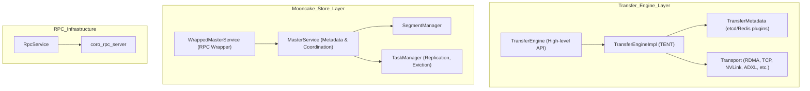
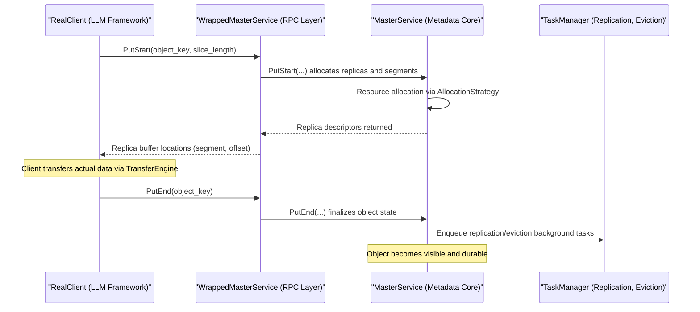

<!-- source: DeepWiki mcp.deepwiki.com · repo kvcache-ai/Mooncake · page 8 Glossary · fetched 2026-11-11 -->

# Glossary

Relevant source files

The following files were used as context for generating this wiki page:

- [README.md](README.md)
- [docs/source/getting_started/build.md](docs/source/getting_started/build.md)
- [docs/source/getting_started/quick-start.md](docs/source/getting_started/quick-start.md)
- [docs/source/getting_started/supported-protocols.md](docs/source/getting_started/supported-protocols.md)
- [docs/source/index.md](docs/source/index.md)
- [docs/source/zh_archive/build.md](docs/source/zh_archive/build.md)
- [docs/source/zh_archive/run-examples.md](docs/source/zh_archive/run-examples.md)
- [mooncake-common/common.cmake](mooncake-common/common.cmake)
- [mooncake-store/CMakeLists.txt](mooncake-store/CMakeLists.txt)
- [mooncake-store/include/master_client.h](mooncake-store/include/master_client.h)
- [mooncake-store/include/master_metric_manager.h](mooncake-store/include/master_metric_manager.h)
- [mooncake-store/include/master_service.h](mooncake-store/include/master_service.h)
- [mooncake-store/include/rpc_service.h](mooncake-store/include/rpc_service.h)
- [mooncake-store/include/version.h.in](mooncake-store/include/version.h.in)
- [mooncake-store/src/master_client.cpp](mooncake-store/src/master_client.cpp)
- [mooncake-store/src/master_metric_manager.cpp](mooncake-store/src/master_metric_manager.cpp)
- [mooncake-store/src/master_service.cpp](mooncake-store/src/master_service.cpp)
- [mooncake-store/src/rpc_service.cpp](mooncake-store/src/rpc_service.cpp)
- [mooncake-store/tests/master_metrics_test.cpp](mooncake-store/tests/master_metrics_test.cpp)
- [mooncake-store/tests/master_service_test.cpp](mooncake-store/tests/master_service_test.cpp)
- [mooncake-transfer-engine/CMakeLists.txt](mooncake-transfer-engine/CMakeLists.txt)
- [mooncake-transfer-engine/include/cuda_alike.h](mooncake-transfer-engine/include/cuda_alike.h)
- [mooncake-transfer-engine/src/CMakeLists.txt](mooncake-transfer-engine/src/CMakeLists.txt)
- [mooncake-transfer-engine/src/transport/CMakeLists.txt](mooncake-transfer-engine/src/transport/CMakeLists.txt)
- [mooncake-transfer-engine/tent/include/tent/runtime/transfer_engine_impl.h](mooncake-transfer-engine/tent/include/tent/runtime/transfer_engine_impl.h)
- [mooncake-transfer-engine/tent/src/runtime/transfer_engine_impl.cpp](mooncake-transfer-engine/tent/src/runtime/transfer_engine_impl.cpp)
- [mooncake-transfer-engine/tent/tests/CMakeLists.txt](mooncake-transfer-engine/tent/tests/CMakeLists.txt)
- [mooncake-transfer-engine/tent/tests/engine_failover_e2e_test.cpp](mooncake-transfer-engine/tent/tests/engine_failover_e2e_test.cpp)

## Purpose and Scope
This glossary defines codebase-specific terms, jargon, abbreviations, and architectural concepts used across the Mooncake platform. It serves as an onboarding reference for engineers to bridge high-level architectural concepts with concrete C++ classes, functions, and data structures in the codebase.

Sources: [README.md:1-54]()

---

## Core System Components

| Term | Definition | Key Code Entities |
|:---|:---|:---|
| **Transfer Engine** | The high-performance data movement subsystem that abstracts multiple transport protocols (RDMA, TCP, NVLink, Ascend Direct, etc.) into a unified, zero-copy transfer interface with batch and slice scheduling. | `mooncake::tent::TransferEngineImpl` [mooncake-transfer-engine/tent/src/runtime/transfer_engine_impl.cpp:15-180](), `mooncake::tent::Transport` [mooncake-transfer-engine/tent/src/runtime/transport.h:36-36]() |
| **Mooncake Store** | A distributed object storage system optimized for KVCache. Manages object lifecycle, metadata sharding, replication (memory, NoF SSD, file system), eviction policies, and multi-tier storage segments (DRAM, GPU, CXL, SSD). | `mooncake::MasterService` [mooncake-store/include/master_service.h:127-185](), `mooncake::WrappedMasterService` [mooncake-store/include/rpc_service.h:22-163]() |
| **TENT** | "Transfer Engine Next". The next-generation Transfer Engine implementation featuring declarative JSON configurations, telemetry-driven path selection, dynamic failure handling, admission queues, and proxy/progress workers for robust data transfers. | `mooncake::tent::TransferEngineImpl` [mooncake-transfer-engine/tent/src/runtime/transfer_engine_impl.cpp:15-180]() |
| **Master Service** | Centralized metadata and coordination service in the Mooncake Store cluster. It performs resource allocation, eviction triggering, lease management, snapshotting for HA, and task scheduling including replication and background offloading. | `mooncake::MasterService` [mooncake-store/src/master_service.cpp:1-185](), `mooncake::WrappedMasterService` [mooncake-store/include/rpc_service.h:22-163]() |

### System Entity Mapping
The following diagram maps high-level system components to corresponding C++ classes and namespaces, bridging natural language concepts to code entities.

**System Architecture to Code Mapping**

Sources: [mooncake-transfer-engine/tent/src/runtime/transfer_engine_impl.cpp:15-180](), [mooncake-store/include/master_service.h:127-185](), [mooncake-store/include/rpc_service.h:22-163](), [mooncake-store/src/master_service.cpp:1-185]()

---

## Transfer Engine Terminology

- **Segment**  
  Logical memory registration unit representing a contiguous memory region registered for remote access. Segments are identified by `SegmentID` and "opened" on remote nodes to enable RDMA or zero-copy transfers.  
  *Implementation*: `SegmentID`, `SegmentHandle` [mooncake-transfer-engine/tent/include/tent/runtime/segment.h:30-50](), `registerLocalMemory` [mooncake-transfer-engine/tent/src/transfer_engine.cpp:156-162]()

- **Batch**  
  A logical grouping of one or more transfer tasks submitted atomically to the Transfer Engine for scheduling and execution. Batches aggregate multiple transfers to reduce overhead and support enforced completion notifications.  
  *Implementation*: `BatchID` [mooncake-transfer-engine/tent/include/tent/transfer_engine.h:213-214](), `Batch` struct managing sub-batches and notifications [mooncake-transfer-engine/tent/src/runtime/transfer_engine_impl.cpp:62-89]()

- **Transport**  
  A pluggable abstraction exposing a specific data transport protocol or hardware. Examples include RDMA, TCP, NVLink, Ascend Direct (ADXL), HP-TCP, EFA. They implement a common interface for memory registration, connection setup, and transfer operations.  
  *Implementation*: `mooncake::tent::Transport` base class [mooncake-transfer-engine/tent/src/runtime/transport.h:36-60](), `installTransport` factory function [mooncake-transfer-engine/tent/src/transfer_engine.cpp:125-128]()

- **Notification (Notify)**  
  Asynchronous signaling mechanism to alert endpoints about completed transfers or custom events, enabling event-driven workflows and transfer completion callbacks. Notifications can be submitted alongside transfer batches.  
  *Implementation*: `Notification` [mooncake-transfer-engine/tent/src/runtime/transfer_engine_impl.cpp:84-86](), `submitTransferWithNotify` [mooncake-transfer-engine/tent/src/transfer_engine.cpp:173-177]()

- **Handshake**  
  The protocol step where nodes exchange connection parameters such as queue pair info, GIDs, or other protocol-specific metadata necessary for establishing direct communication paths.  
  *Implementation*: handshake logic seen in metadata plugin implementations (not fully excerpted here).

- **P2PHANDSHAKE**  
  A decentralized metadata mode where peer discovery and handshake occur directly between nodes without a centralized metadata store such as etcd or Redis. This enables direct peer-to-peer connection establishment.  
  *Mentioned in deployment docs* [docs/source/deployment/mooncake-store-deployment-guide.md:26-26]()

- **Slice**  
  The smallest unit of data transfer, representing a contiguous chunk of memory within a segment. Transfers operate on slices to allow fine-grained parallelism and slicing-based scheduling.  
  *Implementation*: `struct Slice` [mooncake-store/include/types.h:46-49]()

Sources: [mooncake-transfer-engine/tent/include/tent/transfer_engine.h:60-90](), [mooncake-transfer-engine/tent/src/runtime/transfer_engine_impl.cpp:62-89](), [mooncake-transfer-engine/tent/src/runtime/transport.h:36-60](), [mooncake-transfer-engine/tent/src/runtime/transfer_engine.cpp:125-177](), [mooncake-store/include/types.h:46-49](), [docs/source/deployment/mooncake-store-deployment-guide.md:26-26]()

---

## Mooncake Store Terminology

- **ObjectKey**  
  Unique string identifier representing a stored object or cached tensor in the Mooncake Store. Objects are the primary entities stored and replicated.  
  *Implementation*: `using ObjectKey = std::string` [mooncake-store/include/types.h:180]()

- **Replica**  
  A copy of an object placed on a specific storage segment (memory, NoF SSD, file segment). Mooncake supports multiple replicas per object to provide durability and availability.  
  *Implementation*: `mooncake::Replica` class [mooncake-store/include/replica.h:18-50](), `Replica::Descriptor` used in RPC responses [mooncake-store/include/rpc_types.h:51-53]()

- **Lease**  
  A time-to-live (TTL) mechanism that guards the lifetime of cached objects temporarily on behalf of clients. If a lease expires without renewal, the object may be evicted.  
  *Default Lease TTL*: 10,000 ms (10s) — `default_kv_lease_ttl_` [mooncake-store/src/master_service.cpp:189](), constant in [mooncake-store/include/types.h:84-85]()

- **Soft Pin**  
  A transient protection mechanism that prevents eviction of an object shortly after access, e.g., while being read by a client. Soft pins have a longer TTL than leases.  
  *Default Soft Pin TTL*: 30 minutes (1800000 ms) — `default_kv_soft_pin_ttl_` [mooncake-store/src/master_service.cpp:190](), constant in [mooncake-store/include/types.h:86-87]()

- **Eviction**  
  The process of removing objects or segments from memory or storage tiers once capacity watermarks are exceeded. Supports gradual eviction, offload to SSD, and per-tenant quota enforcement.  
  *Implementation*: eviction ratio configurable [mooncake-store/include/types.h:91](), eviction triggered in MasterService background workers [mooncake-store/src/master_service.cpp:1-185]()

- **NoF (NVMe-over-Fabrics)**  
  A protocol and segment type for remote SSD storage integration over fabric protocols (e.g., RDMA). In Mooncake, used for SSD-backed KVCache segments with remote block device access.  
  *Implementation*: APIs such as `MountNoFSegment` [mooncake-store/include/master_service.h:160-161]()

- **Snapshot**  
  Persistence of master metadata state (segments, leases, replication, tasks) for high availability and crash recovery. Snapshots can be stored embedded or in Redis.  
  *Implementation*: `MasterSnapshotManager` and `MasterSnapshotRepository` [mooncake-store/src/master_service.cpp:62-64](), snapshot catalog backends [mooncake-store/src/master_service.cpp:85-101]()

- **EngramStore**  
  Specialized backend in Mooncake Store for managing embedding tables with a per-head layout and efficient row-ID based lookup, commonly used for model KVCache embedding management.  
  *Implementation*: `mooncake::engram::EngramStore` (referenced broadly in MasterService components)

- **Tenant Quota**  
  A policy mechanism ensuring fair allocation of KVCache resources per tenant to prevent noisy neighbor effects in multi-tenant deployments. Includes admission control and invoice ledger.  
  *Implementation*: TenantQuotaLedger and related APIs in MasterService [mooncake-store/include/master_service.h:40](), quota mutations [mooncake-store/src/master_service.cpp:149-159]()

### Object Lifecycle Data Flow & Code Entities
This diagram connects the lifecycle of a stored object to specific calls and classes in the Store stack:

**Object Put Lifecycle Mapping**

Sources: [mooncake-store/include/master_service.h:180-205](), [mooncake-store/src/master_service.cpp:169-191](), [mooncake-store/src/rpc_service.cpp:80-86]()

---

## Serving and Deployment Jargon

- **PD Disaggregation**  
  Prefill-Decode disaggregation architecture that separates the prefill (compute-intensive) and decode (latency-sensitive) phases in LLM serving, allowing independent scaling and resource specialization.  
  *Details*: Described in overview [docs/source/index.md:30-30]()

- **XpYd Notation**  
  A cluster deployment notation where X is the number of nodes dedicated to Prefill, and Y denotes nodes dedicated to Decode, used widely in PD-disaggregated architectures.  
  *Mentioned in*: [docs/source/index.md:30-30]()

- **KVCache Disaggregation**  
  Practice of storing large KVCache objects on remote or distributed storage pools rather than local GPU memory to increase effective capacity and share caches across inference instances.  
  *Mentioned in*: [docs/source/index.md:30-30]()

- **Cluster ID**  
  A string identifier used to namespace master service metadata keys in distributed metadata stores like etcd or Redis, ensuring isolation among multiple deployments.  
  *Implementation*: `DEFAULT_CLUSTER_ID` constant [mooncake-store/include/types.h:114](), validation function `IsValidClusterIdComponent` [mooncake-store/include/types.h:67-82]()

- **Promotion-on-Hit**  
  An eviction and caching policy that promotes objects from slower storage tiers (e.g., SSD or backing files) to faster tiers (e.g., DRAM) upon frequent access to reduce latency.  
  *Related Test*: `deadline_promotion_bench` [mooncake-transfer-engine/tent/tests/CMakeLists.txt:87-92]()

- **Flexible Dual-Replica**  
  A replica write mode where replication spans different media types (e.g. DRAM + NoF SSD). The put succeeds if at least one media type replica allocation succeeds, improving robustness under resource pressure.  
  *Implementation*: Enum value `ReplicaWriteMode::FLEXIBLE_DUAL_REPLICA` and function `HasExpectedReplicaAllocation` [mooncake-store/src/master_service.cpp:136-147]()

Sources: [docs/source/index.md:30-30](), [mooncake-store/include/types.h:67-82](), [mooncake-transfer-engine/tent/tests/CMakeLists.txt:87-92](), [mooncake-store/src/master_service.cpp:136-147]()

---

## Common Abbreviations

| Abbreviation | Full Name | Context and Code Entities |
|:---|:---|:---|
| **TE** | Transfer Engine | Core data movement component. See `TransferEngineImpl` [mooncake-transfer-engine/tent/src/runtime/transfer_engine_impl.cpp:15-180]() |
| **TENT** | Transfer Engine Next | Next-gen transfer engine implementation. See `TransferEngineImpl` [mooncake-transfer-engine/tent/src/runtime/transfer_engine_impl.cpp:15-180]() |
| **SID** | Segment ID | Unique identifier for registered memory segments. See `SegmentID` [mooncake-transfer-engine/tent/include/tent/runtime/segment.h:30-50]() |
| **BID** | Batch ID | Identifier for grouped transfer tasks. See `BatchID` [mooncake-transfer-engine/tent/include/tent/transfer_engine.h:213-214]() |
| **WMS** | Wrapped Master Service | RPC-enabled wrapper around metadata `MasterService`. See `WrappedMasterService` [mooncake-store/include/rpc_service.h:22-163]() |
| **MS** | Master Service | Core metadata and coordination service. See `MasterService` [mooncake-store/include/master_service.h:127-185]() |
| **HA** | High Availability | Master failover and persistence via etcd or Redis with hot-standby oplogs. See `OpLogBatchStorage` and `OrderedOpLogWriter` [mooncake-store/src/master_service.cpp:40-50]() |
| **NoF** | NVMe over Fabrics | Remote SSD protocol integration. See `MountNoFSegment` [mooncake-store/include/master_service.h:160-161]() |
| **OpLog** | Operation Log | Write-ahead logging of metadata changes for replication and HA. See `OrderedOpLogWriter` [mooncake-store/include/ha/oplog/ordered_oplog_writer.h:40-60]() |
| **EP** | Expert Parallelism | Elastic routing backend for MoE models with collective communication. [README.md:50-56]() |

Sources: [mooncake-transfer-engine/tent/src/runtime/transfer_engine_impl.cpp:15-180](), [mooncake-transfer-engine/tent/include/tent/runtime/segment.h:30-50](), [mooncake-transfer-engine/tent/include/tent/transfer_engine.h:213-214](), [mooncake-store/include/rpc_service.h:22-163](), [mooncake-store/include/master_service.h:127-185](), [mooncake-store/src/master_service.cpp:40-50](), [mooncake-store/include/ha/oplog/ordered_oplog_writer.h:40-60](), [README.md:50-56]()

---

This glossary links high-level natural language architecture concepts to their corresponding code entities and data flow, helping engineers navigate and extend the Mooncake codebase efficiently.