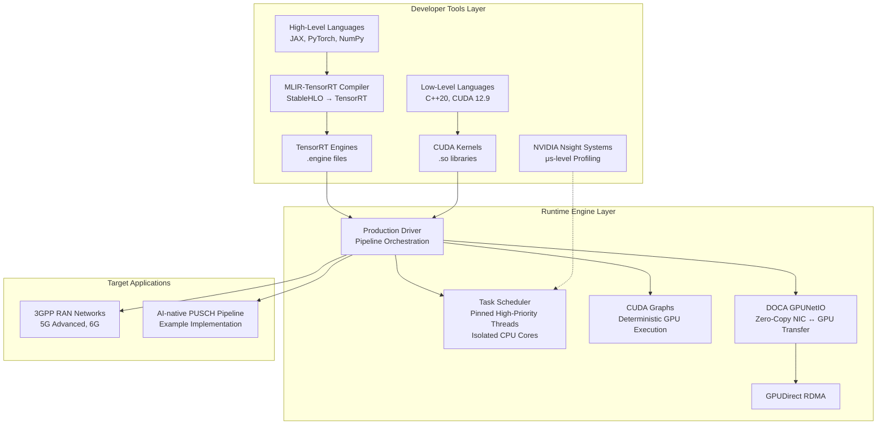
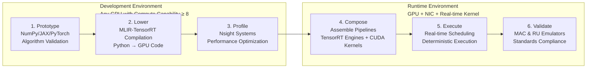
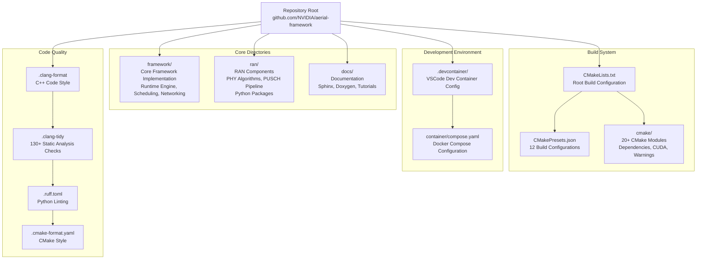
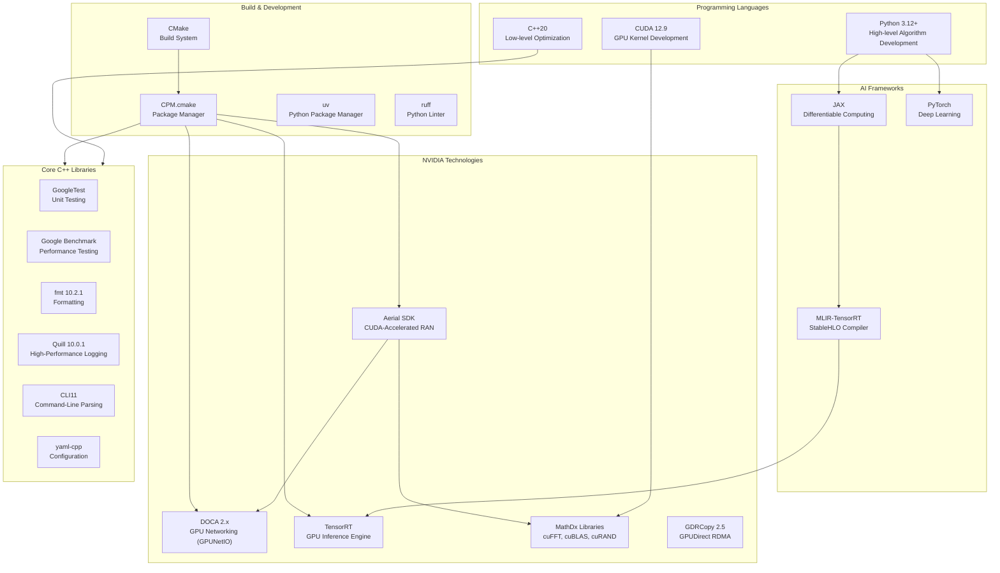

<!-- source: DeepWiki mcp.deepwiki.com · repo NVIDIA/aerial-framework · page 1 Overview · fetched 2026-11-11 -->

# Overview

<details>
<summary>Relevant source files</summary>

The following files were used as context for generating this wiki page:

- [README.md](README.md)
- [VERSION](VERSION)

</details>


## Purpose and Scope

This document provides a high-level introduction to the NVIDIA Aerial Framework, a real-time signal processing framework designed specifically for 3GPP Radio Access Networks (RAN) with microsecond-level latency requirements. The framework enables developers to prototype algorithms in high-level languages (Python, JAX, PyTorch) and deploy them to production environments with deterministic, real-time execution guarantees.

This overview covers:
- Framework architecture and core components
- Two-tier design philosophy (Developer Tools and Runtime Engine)
- Development-to-deployment workflow
- Repository organization and key technologies

For detailed setup instructions, see [Getting Started](#2). For in-depth architectural details, see [Framework Architecture](#3). For build system configuration, see [Build System](#4).

**Current Version:** 0.1.0 ([VERSION:1]())

Sources: [README.md:1-178](), [VERSION:1]()

---

## Framework Overview

The NVIDIA Aerial Framework is a single platform that unites research, testbeds, and production deployments for signal processing workloads with strict latency requirements. It addresses the fundamental challenge of 3GPP RAN development: bridging the gap between development productivity (high-level languages, rapid prototyping) and runtime performance (microsecond-level determinism, real-time scheduling).

### Key Features

| Feature | Description |
|---------|-------------|
| **Python → Real-time** | Prototype in Python/JAX/PyTorch and compile to high-performance GPU code |
| **Clean Separation** | Decouples algorithm development from runtime execution concerns |
| **Modular Pipelines** | Compose end-to-end pipelines from compiled, executable modules |
| **Observability** | Built-in profiling and monitoring hooks throughout development lifecycle |
| **Single Codebase** | Reuse components across prototyping, simulation, testing, and deployment |
| **Modern Toolchain** | Python 3.12+, C++20, CUDA 12.9, CMake, JAX, PyTorch, uv, ruff |
| **Developer-Friendly** | Prototype on local machines, scale to production deployments |
| **Guided Tutorials** | Jupyter notebooks in Docker containers |
| **5G Advanced & 6G** | Ships with AI-native PUSCH pipeline example |

Sources: [README.md:22-33]()

---

## Two-Tier Architecture

The Aerial Framework combines two distinct components that address different phases of the development lifecycle:



**Diagram: Two-Tier Architecture - Developer Tools and Runtime Engine**

### Developer Tools Layer

The Developer Tools layer ([README.md:50-54]()) provides the compilation pipeline from high-level algorithms to GPU-executable code:

- **Multi-Language Support**: Algorithms can be authored in JAX, PyTorch, NumPy, C++20, or CUDA 12.9
- **MLIR-TensorRT Compiler**: Converts JAX programs to StableHLO intermediate representation, then lowers to optimized TensorRT engines
- **Profiling Infrastructure**: NVIDIA Nsight Systems integration for microsecond-level optimization
- **AI-Native**: Seamless integration with AI frameworks enables end-to-end differentiability

The output of this layer consists of:
- TensorRT engine files (`.engine`)
- Compiled CUDA kernel libraries (`.so`)
- Performance profiles for optimization

### Runtime Engine Layer

The Runtime Engine layer ([README.md:56-60]()) provides deterministic execution infrastructure:

- **CUDA Graphs**: GPU operations encapsulated as CUDA graphs with TensorRT integration for deterministic execution paths
- **Task Scheduler**: Pinned, high-priority threads on isolated CPU cores enforce microsecond-precision slot timing
- **DOCA GPUNetIO**: Zero-copy packet transfer between NIC and GPU memory via GPUDirect RDMA
- **Production Driver**: Orchestrates pipeline execution, manages memory pools, and coordinates multi-cell operations

This layer ensures that compiled algorithms meet real-time latency requirements when deployed to production environments.

Sources: [README.md:46-60]()

---

## Development Workflow

The Aerial Framework implements a six-stage workflow that bridges development and deployment environments:



**Diagram: Six-Stage Development-to-Deployment Workflow**

### Stage Descriptions

| Stage | Description | Environment | Key Activities |
|-------|-------------|-------------|----------------|
| **Prototype** | Write and validate algorithms using NumPy/JAX/PyTorch | Development | Algorithm correctness, functional testing |
| **Lower** | Compile Python code to GPU executables using MLIR-TensorRT | Development | Code generation, compilation |
| **Profile** | Optimize performance using Nsight Systems profiling | Development | Bottleneck identification, optimization |
| **Compose** | Assemble TensorRT engines and CUDA kernels into modular pipelines | Runtime | Pipeline configuration, module integration |
| **Execute** | Run with real-time task scheduling and networking | Runtime | Production execution, timing validation |
| **Validate** | Test PHY applications using MAC and RU emulators | Runtime | Standards compliance, integration testing |

### Environment Requirements

**Development Environment** ([README.md:76-77]()):
- Any NVIDIA GPU with compute capability ≥ 8
- Standard Linux distribution
- Docker container support
- Focuses on algorithm development and optimization

**Runtime Environment** ([README.md:79]()):
- NVIDIA GPU with compute capability ≥ 8
- Compatible NIC (for DOCA GPUNetIO)
- Real-time Linux kernel (for deterministic scheduling)
- Focuses on latency validation and production deployment

This two-environment approach enables:
- **Development Productivity**: High-level languages with rich ecosystems
- **Runtime Performance**: Speed and determinism of optimized C++/CUDA
- **Low Latency Requirements**: Microsecond-level timing constraints

Sources: [README.md:63-124]()

---

## Repository Structure

The repository is organized into three primary directories that reflect the architectural separation of concerns:



**Diagram: Repository Directory Structure and Organization**

### Directory Mapping

| Directory | Purpose | Key Components |
|-----------|---------|----------------|
| `framework/` | Core runtime engine implementation | Task scheduler, CUDA graphs, DOCA integration, memory management |
| `ran/` | RAN-specific components | PHY algorithms, PUSCH receiver, Python packages, example pipelines |
| `docs/` | Documentation and tutorials | Sphinx documentation, Jupyter notebooks, API references |
| `cmake/` | Build system modules | Dependency management, CUDA configuration, compiler warnings, testing |
| `.devcontainer/` | Containerized development environment | VSCode integration, Docker configuration |
| `.clang-format`, `.clang-tidy`, `.ruff.toml` | Code quality enforcement | Style guides, linters, static analyzers |

For detailed build system information, see [Build System](#4). For code quality standards, see [Development Guide](#6). For development environment setup, see [Development Environment Setup](#2.1).

Sources: [README.md:1-178]()

---

## Key Technologies and Dependencies

The Aerial Framework integrates a comprehensive set of technologies to enable high-performance, real-time signal processing:



**Diagram: Technology Stack and Dependencies**

### Technology Categories

**Programming Languages** ([README.md:6-7]()):
- Python 3.12+ for algorithm prototyping and AI integration
- C++20 for high-performance runtime components
- CUDA 12.9 for GPU kernel development

**NVIDIA Technologies**:
- **Aerial SDK**: CUDA-accelerated RAN libraries
- **DOCA**: Data center infrastructure for GPU networking (GPUNetIO)
- **TensorRT**: High-performance inference engine
- **MathDx**: Optimized mathematical libraries (cuFFT, cuBLAS, cuRAND, cuSOLVER)
- **GDRCopy**: GPUDirect RDMA for zero-copy memory transfers

**AI Frameworks**:
- **JAX**: Differentiable computing and automatic differentiation
- **PyTorch**: Deep learning framework
- **MLIR-TensorRT**: Compiler infrastructure for lowering StableHLO to TensorRT

**Build Tools** ([README.md:8-10]()):
- **CMake**: Cross-platform build system generator
- **CPM.cmake**: CMake package manager for dependency management
- **uv**: Fast Python package manager
- **ruff**: Fast Python linter and formatter

For comprehensive dependency information, see [Dependencies and Integration](#5). For NVIDIA-specific integrations, see [NVIDIA Technologies](#5.1).

Sources: [README.md:5-10](), [README.md:19]()

---

## Target Applications

The Aerial Framework is designed for 3GPP RAN signal processing applications with strict latency requirements, targeting 5G Advanced and 6G networks:

### Primary Use Cases

**3GPP RAN Networks** ([README.md:14]()):
- Physical layer (PHY) signal processing
- Microsecond-level latency requirements
- Real-time slot timing (e.g., 125 μs for 5G NR)
- Multi-cell coordination
- Fronthaul and backhaul processing

**AI-Native PHY** ([README.md:32]()):
- End-to-end differentiable signal processing pipelines
- Neural network integration for channel estimation, filtering, equalization
- Training and inference within latency constraints
- Adaptive algorithms with online learning

### Example Implementation: PUSCH Pipeline

The framework ships with a complete AI-native Physical Uplink Shared Channel (PUSCH) receiver pipeline as a reference implementation. This demonstrates:

- Multi-stage signal processing (synchronization, channel estimation, equalization, decoding)
- Hybrid TensorRT/CUDA implementation
- Integration with MAC and RU emulators
- Fronthaul testing with DOCA GPUNetIO
- Standards-compliant O-RAN interfaces

The PUSCH pipeline is documented in the tutorials:
- PUSCH Receiver: Algorithm design in NumPy
- MLIR-TensorRT: Compilation to TensorRT engines
- Lowering PUSCH: Complete receiver compilation
- Full PUSCH Pipeline: End-to-end execution
- Fronthaul Testing: O-RAN fronthaul with DOCA GPUNetIO
- PHY Integration: Full PHY with MAC/RU emulators

Sources: [README.md:12-19](), [README.md:32](), [README.md:148-158]()

---

## Audience and Intended Users

The Aerial Framework is designed for:

**RAN System Engineers** ([README.md:18]()):
- Developing and optimizing PHY layer algorithms
- Integrating signal processing pipelines with network interfaces
- Validating latency and throughput requirements
- Deploying to production RAN environments

**Signal Processing Specialists**:
- Prototyping advanced receiver algorithms
- Optimizing kernel-level performance
- Profiling and tuning GPU execution
- Balancing algorithm complexity with real-time constraints

**AI Researchers** ([README.md:18]()):
- Designing neural network-based signal processing
- Training models with end-to-end differentiability
- Integrating AI frameworks (JAX, PyTorch) into real-time systems
- Exploring AI-native PHY architectures for 6G

Sources: [README.md:18]()

---

## Quick Reference

### Getting Started

```bash
# Configure (release preset)
cmake --preset clang-release

# Build
cmake --build out/build/clang-release

# Install Python package (5G RAN)
cd ran/py && uv sync
```

([README.md:130-139]())

### Key Resources

| Resource | Location |
|----------|----------|
| Documentation | [docs.nvidia.com/aerial/framework](https://docs.nvidia.com/aerial/framework/latest/index.html) |
| Tutorials | Step-by-step Jupyter notebooks |
| Source Repository | [github.com/NVIDIA/aerial-framework](https://github.com/NVIDIA/aerial-framework) |
| License | Apache 2.0 ([LICENSE]()) |
| Version | 0.1.0 ([VERSION:1]()) |

### Related Projects

The Aerial Framework is part of the [NVIDIA AI Aerial™](https://developer.nvidia.com/industries/telecommunications/ai-aerial) portfolio:
- NVIDIA Aerial™ Framework (this repository)
- [NVIDIA Aerial™ CUDA-Accelerated RAN](https://github.com/NVIDIA/aerial-cuda-accelerated-ran)

For software releases, events, and technical training, visit the [NVIDIA 6G Developer Program](https://developer.nvidia.com/6g-program).

Sources: [README.md:126-172]()

---

## License and Attribution

The Aerial Framework is licensed under **Apache License 2.0** ([LICENSE]()). Some dependencies may have different licenses - see [ATTRIBUTION.md]() for third-party attributions.

For detailed license information, see [License and Attribution](#9.1). For security policies, see [Security Policy](#9.3).

Sources: [README.md:174-177]()

---

