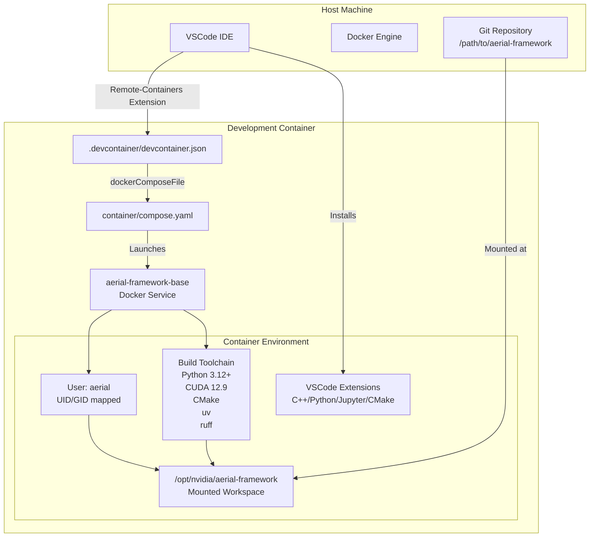
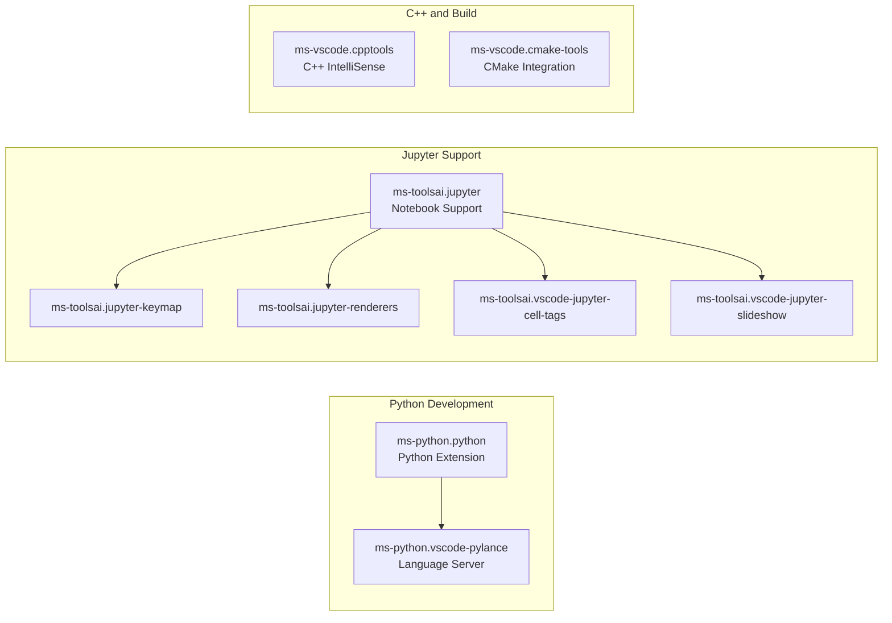
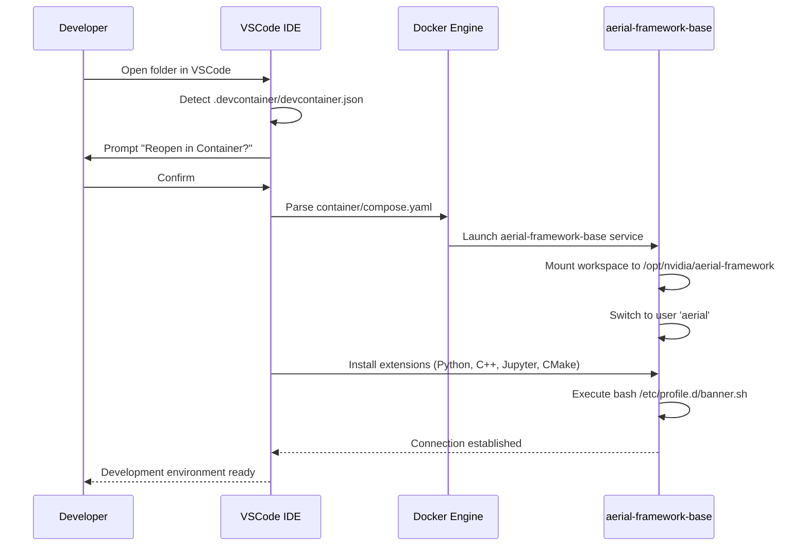
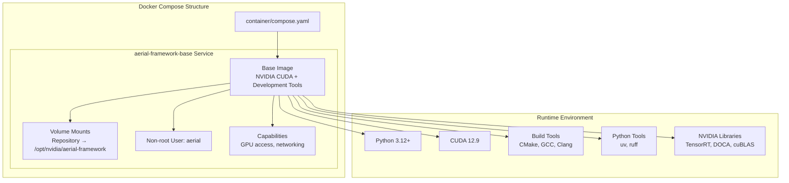
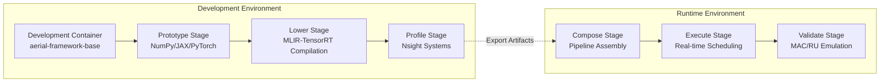

<!-- source: DeepWiki mcp.deepwiki.com · repo NVIDIA/aerial-framework · page 2.1 Development Environment Setup · fetched 2026-11-11 -->

# Development Environment Setup

<details>
<summary>Relevant source files</summary>

The following files were used as context for generating this wiki page:

- [.devcontainer/devcontainer.json](.devcontainer/devcontainer.json)
- [README.md](README.md)

</details>


## Purpose and Scope

This document explains the containerized development environment for the NVIDIA Aerial Framework, including Docker container configuration, VSCode integration via devcontainer, and the standardized build toolchain. The environment provides a consistent, reproducible setup across all developer workstations with pre-configured tools for C++, CUDA, and Python development.

For instructions on building the project after environment setup, see [Building the Project](#2.2). For details on the CMake build system itself, see [Build System](#4).

---

## Overview

The Aerial Framework uses a Docker-based development container approach to ensure consistent builds and eliminate "works on my machine" issues. The development environment is defined declaratively in [.devcontainer/devcontainer.json:1-31]() and orchestrated via Docker Compose at [container/compose.yaml]().

Key characteristics:
- **Container service**: `aerial-framework-base` 
- **Workspace path**: `/opt/nvidia/aerial-framework`
- **Non-root user**: `aerial` (security best practice)
- **IDE integration**: VSCode Dev Containers with pre-installed extensions
- **Tools included**: Python 3.12+, CUDA 12.9, CMake, uv, ruff



**Sources**: [.devcontainer/devcontainer.json:1-31](), [README.md:1-178]()

---

## Devcontainer Configuration

The devcontainer specification at [.devcontainer/devcontainer.json:1-31]() defines the development environment:

### Basic Configuration

| Property | Value | Purpose |
|----------|-------|---------|
| `name` | `"Aerial Framework"` | Display name in VSCode |
| `dockerComposeFile` | `"../container/compose.yaml"` | Points to Docker Compose configuration |
| `service` | `"aerial-framework-base"` | Selects container service to use |
| `workspaceFolder` | `"/opt/nvidia/aerial-framework"` | Container path for mounted repository |
| `remoteUser` | `"aerial"` | Non-root user for security |

The configuration specifies `"overrideCommand": false` at [.devcontainer/devcontainer.json:6]() to preserve the container's default entrypoint, and `"shutdownAction": "none"` at [.devcontainer/devcontainer.json:7]() to keep the container running when VSCode disconnects.

### Post-Attach Hook

The `postAttachCommand` at [.devcontainer/devcontainer.json:30]() executes a banner script on each connection:
```json
"postAttachCommand": "bash /etc/profile.d/banner.sh"
```
This displays system information and environment status to the user upon connection.

**Sources**: [.devcontainer/devcontainer.json:1-31]()

---

## VSCode Integration

### Installed Extensions

The devcontainer automatically installs VSCode extensions at [.devcontainer/devcontainer.json:12-21]() for a complete development experience:



**Extension Categories**:

| Category | Extensions | Purpose |
|----------|-----------|---------|
| **Python** | `ms-python.python`, `ms-python.vscode-pylance` | Python IntelliSense, linting, debugging |
| **Jupyter** | `ms-toolsai.jupyter` (5 extensions) | Interactive notebook development for tutorials |
| **C++** | `ms-vscode.cpptools` | C++ IntelliSense, debugging, code navigation |
| **Build** | `ms-vscode.cmake-tools` | CMake project configuration and building |

### VSCode Settings

Custom settings at [.devcontainer/devcontainer.json:23-26]() configure the container environment:

```json
"settings": {
    "jupyter.kernels.filter": [],
    "terminal.integrated.cwd": "/opt/nvidia/aerial-framework"
}
```

- `jupyter.kernels.filter: []` - Shows all available Jupyter kernels without filtering
- `terminal.integrated.cwd` - Sets default terminal directory to workspace root

**Sources**: [.devcontainer/devcontainer.json:10-28]()

---

## Environment Specifications

### Toolchain Versions

As specified in [README.md:5-10](), the development container includes:

| Tool | Version | Purpose |
|------|---------|---------|
| **Python** | 3.12+ | High-level algorithm development, JAX/PyTorch integration |
| **C++** | C++20 | Core framework and CUDA kernel development |
| **CUDA** | 12.9 | GPU programming and TensorRT integration |
| **CMake** | Latest | Build system orchestration |
| **uv** | Latest | Fast Python package installer (pip replacement) |
| **ruff** | Latest | Python linting and formatting |

### Workspace Layout

The container mounts the repository at `/opt/nvidia/aerial-framework` as defined in [.devcontainer/devcontainer.json:5](), providing access to:

```
/opt/nvidia/aerial-framework/
├── framework/          # Core framework C++ code
├── ran/               # RAN components and Python packages
├── docs/              # Documentation
├── cmake/             # CMake modules
├── container/         # Docker configuration
├── .devcontainer/     # VSCode devcontainer config
├── CMakeLists.txt     # Root build configuration
└── CMakePresets.json  # Build presets
```

**Sources**: [README.md:5-10](), [.devcontainer/devcontainer.json:5]()

---

## Getting Started

### Prerequisites

Before using the devcontainer:
1. **Docker Engine** installed and running
2. **VSCode** with Remote-Containers extension
3. **Git** for repository cloning
4. **NVIDIA GPU** with compute capability ≥ 8 (for GPU development)
5. **NVIDIA Container Toolkit** (for GPU access in containers)

### Opening the Devcontainer



**Steps**:
1. Clone the repository: `git clone https://github.com/NVIDIA/aerial-framework.git`
2. Open the repository in VSCode
3. When prompted, select "Reopen in Container" (or use Command Palette: "Remote-Containers: Reopen in Container")
4. Wait for container build and extension installation (first-time setup may take several minutes)
5. Verify environment by opening an integrated terminal - you should see the banner and be in `/opt/nvidia/aerial-framework`

### Verifying the Environment

After the container starts, verify installation:

```bash
# Check Python version
python --version  # Should show 3.12+

# Check CUDA availability
nvidia-smi

# Check CMake
cmake --version

# Check uv package manager
uv --version

# Check ruff linter
ruff --version

# Verify workspace location
pwd  # Should output: /opt/nvidia/aerial-framework
```

**Sources**: [README.md:126-139](), [.devcontainer/devcontainer.json:1-31]()

---

## Container Service Architecture

The `aerial-framework-base` service referenced in [.devcontainer/devcontainer.json:4]() is defined in `container/compose.yaml`. While the compose file is not shown in the provided files, the devcontainer configuration reveals its structure:



The service provides:
- **GPU acceleration** via NVIDIA runtime
- **Volume mounting** of the source repository for live code editing
- **User mapping** to avoid permission issues with host filesystem
- **Pre-installed dependencies** including NVIDIA SDKs (TensorRT, DOCA, MathDx) and third-party libraries

**Sources**: [.devcontainer/devcontainer.json:3-4](), [README.md:19]()

---

## Development Workflow Integration

The development container integrates with the broader Aerial Framework workflow described in [README.md:63-124]():



The development container is specifically designed for the **Development** stages (Prototype, Lower, Profile), providing:
- Jupyter notebooks for interactive prototyping
- MLIR-TensorRT compiler for lowering Python to GPU code
- Nsight Systems for profiling and optimization

For the **Runtime** stages (Compose, Execute, Validate), additional hardware and configuration is required as documented in the deployment guides.

**Sources**: [README.md:63-124](), [README.md:146-158]()

---

## Next Steps

After setting up the development environment:
1. **Build the project** using CMake presets - see [Building the Project](#2.2)
2. **Explore tutorials** in Jupyter notebooks at `docs/` directory
3. **Review code quality tools** - see [C++ Code Formatting](#6.1), [Python Code Quality](#6.3)
4. **Understand the build system** - see [CMake Configuration](#4.1)

The development container provides everything needed to start contributing to the Aerial Framework, from writing Python prototypes to compiling optimized GPU code.

**Sources**: [README.md:126-158]()

---

