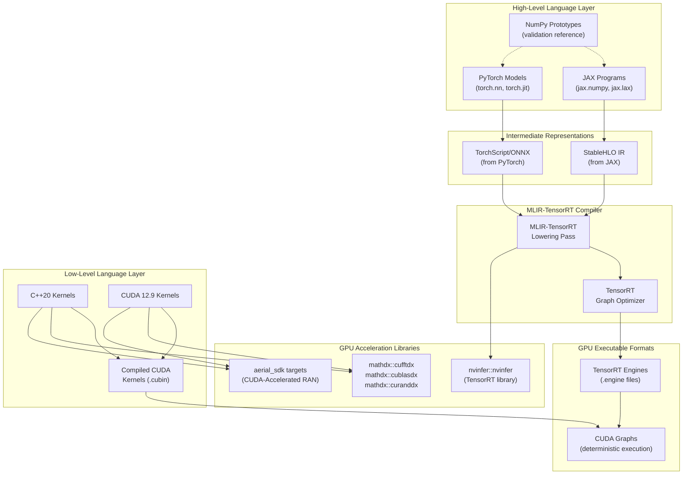
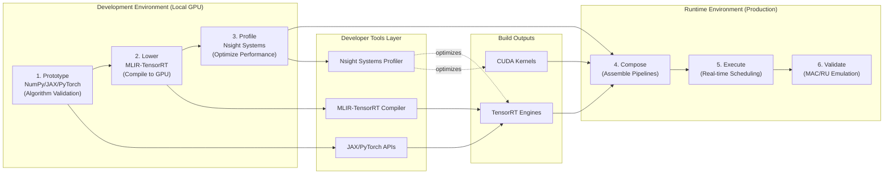
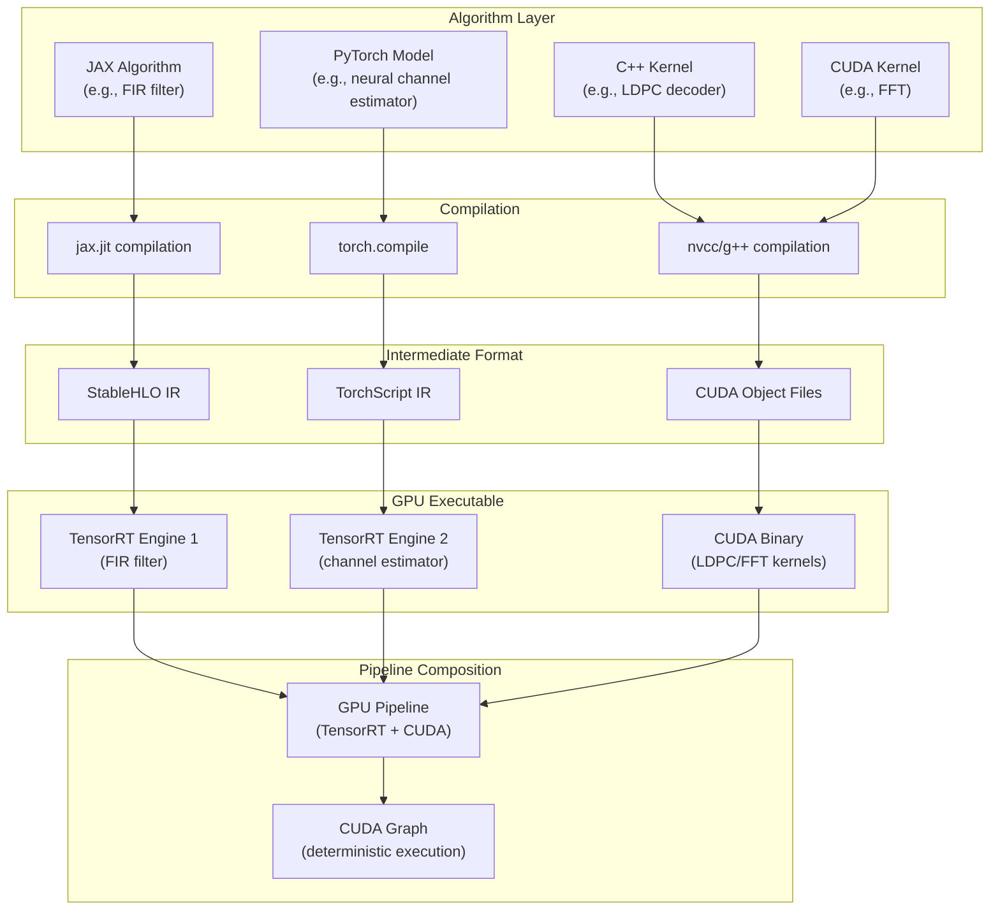
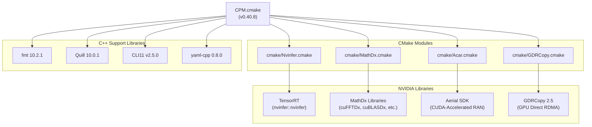

<!-- source: DeepWiki mcp.deepwiki.com · repo NVIDIA/aerial-framework · page 3.1 Developer Tools · fetched 2026-11-11 -->

# Developer Tools

<details>
<summary>Relevant source files</summary>

The following files were used as context for generating this wiki page:

- [README.md](README.md)
- [cmake/Dependencies.cmake](cmake/Dependencies.cmake)

</details>


## Overview

The Developer Tools layer provides the foundational infrastructure for developing, compiling, and optimizing signal processing algorithms for real-time execution on GPUs. This layer enables developers to prototype algorithms in high-level languages (JAX, PyTorch, NumPy) and low-level languages (C++20, CUDA 12.9), then compile them to optimized GPU code through the MLIR-TensorRT compiler pipeline. The tools also provide microsecond-level profiling capabilities through NVIDIA Nsight Systems.

This page covers the first three stages of the development workflow: **Prototype**, **Lower**, and **Profile** (see [Development Workflow](#3.3) for complete workflow details). For information about runtime execution, see [Runtime Engine](#3.2). For build system configuration, see [Build System](#4).

**Sources:** [README.md:46-60](), [README.md:82-124]()

---

## Language Support Architecture

The Aerial Framework supports a dual-language development model that separates algorithm prototyping from performance optimization:

### High-Level Languages

| Language | Version | Purpose | Compilation Path |
|----------|---------|---------|------------------|
| **Python** | 3.12+ | Development environment, package management | Interpreted |
| **NumPy** | Latest | Algorithm prototyping and validation | Via JAX/PyTorch |
| **JAX** | Latest | Functional ML framework, XLA compiler | StableHLO → MLIR-TensorRT → TensorRT |
| **PyTorch** | Latest | Imperative ML framework | TorchScript/ONNX → TensorRT |

### Low-Level Languages

| Language | Version | Purpose | Compilation Path |
|----------|---------|---------|------------------|
| **C++** | C++20 | Performance-critical kernels, framework code | nvcc/g++/clang++ → CUDA kernels |
| **CUDA** | 12.9 | GPU kernel implementation | nvcc → PTX/CUBIN |

**Sources:** [README.md:5-8](), [README.md:19](), [README.md:29]()

---

## Compilation Pipeline

The following diagram shows how high-level algorithm code is lowered to GPU-executable formats:



**Compilation Pipeline Stages:**

1. **Algorithm Prototyping** - Developers write algorithms in JAX or PyTorch, using NumPy-compatible APIs for validation
2. **IR Generation** - JAX exports to StableHLO; PyTorch exports to TorchScript or ONNX
3. **MLIR-TensorRT Lowering** - The compiler transforms high-level operations to TensorRT-compatible graph operations
4. **TensorRT Optimization** - TensorRT's graph optimizer performs fusion, precision selection, and memory optimization
5. **Engine Serialization** - Optimized graphs are serialized to `.engine` files for runtime execution
6. **CUDA Graph Integration** - TensorRT engines and custom CUDA kernels are integrated into CUDA graphs for deterministic execution

**Sources:** [README.md:51-54](), [README.md:96-103]()

---

## GPU Acceleration Library Stack

The developer tools integrate multiple GPU-accelerated libraries for mathematical operations and signal processing:

### TensorRT Integration

TensorRT provides GPU inference optimization for deep learning models compiled from JAX and PyTorch.

**CMake Integration:**
- Module: [cmake/Nvinfer.cmake]()
- Target: `nvinfer::nvinfer`
- Usage: Linked via `target_link_nvinfer()` macro

The TensorRT library is configured as a required dependency and must be available in the system library paths.

**Sources:** [cmake/Dependencies.cmake:175-179]()

### MathDx Library Suite

MathDx provides header-only GPU-accelerated mathematical operations:

| Component | Target | Purpose |
|-----------|--------|---------|
| **cuFFTDx** | `mathdx::cufftdx` | Fast Fourier Transform operations |
| **cuBLASDx** | `mathdx::cublasdx` | Basic Linear Algebra Subprograms |
| **cuRANDDx** | `mathdx::curanddx` | Random number generation |
| **cuSOLVERDx** | `mathdx::cusolverDx` | Linear system solvers |

**CMake Integration:**
- Module: [cmake/MathDx.cmake]()
- Usage: Link with `target_link_mathdx(your_target COMPONENTS cufftdx cublasdx)` with explicit component arguments

These are header-only libraries that generate optimized GPU code at compile time.

**Sources:** [cmake/Dependencies.cmake:168-173]()

### Aerial SDK (ACAR)

The CUDA-Accelerated RAN (ACAR) library provides pre-optimized signal processing kernels for 3GPP RAN operations.

**CMake Integration:**
- Module: [cmake/Acar.cmake]()
- Source download: `download_acar_source()`
- LDPC decoder CUBIN: `download_ldpc_decoder_cubin()`
- Target setup: `setup_acar_targets()`

The Aerial SDK is integrated as a subdirectory after its dependencies (fmt, fmtlog) are configured.

**Sources:** [cmake/Dependencies.cmake:33](), [cmake/Dependencies.cmake:286-296]()

---

## Profiling and Optimization

### NVIDIA Nsight Systems

Nsight Systems provides microsecond-level profiling for GPU workloads, enabling developers to optimize individual kernels and end-to-end pipelines.

**Profiling Capabilities:**
- **Timeline Visualization** - View CPU and GPU activity on a unified timeline
- **Kernel Performance** - Measure kernel execution time, occupancy, and memory bandwidth
- **API Tracing** - Track CUDA API calls, memory transfers, and synchronization points
- **CUDA Graph Profiling** - Analyze CUDA graph execution and identify bottlenecks
- **TensorRT Engine Profiling** - Inspect layer-by-layer execution in TensorRT engines

**Debug Configuration:**

Debug builds include `--generate-line-info` flag for source-level profiling in Nsight Systems. This enables line-by-line performance attribution within kernels.

**Build Configuration:**
- Debug builds: `-g -O0` with line info generation
- Release builds: `-O3 -DNDEBUG` for maximum performance
- See [Build Presets](#4.2) for detailed compiler flags

**Workflow Integration:**

The **Profile** stage in the development workflow occurs after the **Lower** stage. Developers use Nsight Systems to:
1. Identify performance bottlenecks in compiled TensorRT engines
2. Optimize custom CUDA kernel implementations
3. Validate that latency requirements (microsecond-level) are met
4. Compare performance between different algorithm implementations

**Sources:** [README.md:53](), [README.md:100-103]()

---

## Development Workflow Integration

The developer tools support the first three stages of the six-stage development-to-deployment workflow:



**Stage Descriptions:**

### 1. Prototype Stage
- **Environment:** Any machine with Python 3.12+ and a GPU (compute capability ≥ 8)
- **Languages:** NumPy, JAX, PyTorch
- **Purpose:** Develop and validate algorithm correctness
- **Outputs:** Python implementations ready for lowering

### 2. Lower Stage
- **Tool:** MLIR-TensorRT compiler
- **Input:** JAX/PyTorch programs
- **Process:** StableHLO → MLIR → TensorRT graph → Engine serialization
- **Output:** `.engine` files (compiled TensorRT engines)

### 3. Profile Stage
- **Tool:** NVIDIA Nsight Systems
- **Input:** TensorRT engines, CUDA kernels
- **Process:** Execute and measure performance on GPU
- **Output:** Performance data, bottleneck identification
- **Goal:** Achieve microsecond-level timing requirements

**Environment Requirements:**

| Requirement | Development | Runtime |
|-------------|-------------|---------|
| **Python** | 3.12+ | Optional |
| **C++ Compiler** | C++20 (GCC/Clang) | C++20 (GCC/Clang) |
| **CUDA** | 12.9 | 12.9 |
| **GPU Compute Capability** | ≥ 8.0 | ≥ 8.0 |
| **Real-time Kernel** | No | Yes |
| **NIC** | No | Yes (ConnectX) |

**Sources:** [README.md:74-124]()

---

## Python Development Environment

### Package Management with `uv`

The Aerial Framework uses `uv` for fast, reliable Python package management. Example Python packages are located in the `ran/py/` directory.

**Installation:**
```bash
cd ran/py && uv sync
```

This creates an isolated virtual environment with all Python dependencies for RAN examples.

**Sources:** [README.md:10](), [README.md:138-139]()

### Python Code Quality with Ruff

Python code quality is enforced using Ruff, a fast Python linter and formatter.

**Configuration File:** [.ruff.toml]()

**Key Checks:**
- PEP 8 enforcement
- Type annotation validation
- Docstring conventions
- Cyclomatic complexity limits

See [Python Code Quality](#6.3) for detailed configuration.

**Sources:** [README.md:9]()

---

## C++ Development Environment

### Language Standard: C++20

The framework requires C++20 for modern C++ features:
- Concepts and constraints
- Ranges library
- Coroutines
- Three-way comparison operator (`<=>`)
- Modules (where supported)

### CUDA 12.9 Integration

CUDA kernels are compiled using nvcc with C++20 compatibility mode.

**CMake Configuration:**
- Module: [cmake/Cuda.cmake]()
- CUDA architecture detection
- `target_link_cuda()` macro for linking CUDA libraries

See [CUDA and GPU Configuration](#4.4) for detailed build settings.

**Sources:** [README.md:6-7](), [README.md:19]()

---

## Multi-Language Integration

The developer tools enable seamless integration between high-level and low-level code:



**Integration Points:**

1. **Python ↔ C++:** Python code is lowered to TensorRT engines that execute alongside C++/CUDA kernels
2. **JAX ↔ TensorRT:** JAX programs export to StableHLO, then lower to TensorRT via MLIR-TensorRT
3. **PyTorch ↔ TensorRT:** PyTorch models export to TorchScript or ONNX, then convert to TensorRT
4. **TensorRT ↔ CUDA:** TensorRT engines and custom CUDA kernels compose into unified CUDA graphs
5. **End-to-End Differentiability:** JAX's automatic differentiation extends through the entire pipeline

**Example Use Case:**

A PUSCH (Physical Uplink Shared Channel) receiver pipeline might combine:
- **JAX-compiled TensorRT engine** for channel estimation
- **PyTorch-compiled TensorRT engine** for neural network-based filtering
- **C++ CUDA kernel** for LDPC decoding (using Aerial SDK)
- **cuFFTDx-based kernel** for FFT operations (using MathDx)

All components execute within a single CUDA graph for deterministic, microsecond-level timing.

**Sources:** [README.md:52](), [README.md:54]()

---

## CMake Integration

### Dependency Management

All developer tools dependencies are managed through the CPM (CMake Package Manager):



**CMake Functions:**

| Function | Purpose | Example |
|----------|---------|---------|
| `setup_dependencies()` | Initialize all dependencies | Called from root CMakeLists.txt |
| `target_link_nvinfer()` | Link TensorRT library | `target_link_nvinfer(my_target)` |
| `target_link_mathdx()` | Link MathDx components | `target_link_mathdx(my_target COMPONENTS cufftdx)` |
| `download_acar_source()` | Download Aerial SDK source | Called before ACAR setup |
| `setup_acar_targets()` | Configure Aerial SDK targets | Called after fmt/fmtlog setup |

**CPM Cache:**

By default, CPM caches downloaded packages in `~/.cache/CPM`. Override with:
```bash
export CPM_SOURCE_CACHE=/custom/path
```
or
```bash
cmake -DCPM_SOURCE_CACHE=/custom/path ...
```

**Sources:** [cmake/Dependencies.cmake:18-29](), [cmake/Dependencies.cmake:31](), [cmake/Dependencies.cmake:37-410]()

---

## Testing Integration

### Google Benchmark for Performance Testing

The developer tools integrate Google Benchmark for microbenchmarking compiled kernels and TensorRT engines.

**CMake Integration:**
```cmake
CPMAddPackage(
    NAME benchmark
    GITHUB_REPOSITORY google/benchmark
    GIT_TAG v1.9.4
    OPTIONS
        "BENCHMARK_ENABLE_TESTING OFF"
        "BENCHMARK_ENABLE_GTEST_TESTS OFF"
)
```

**Usage:**
- Module: [cmake/Benchmarks.cmake]()
- Function: `add_benchmark(target_name source_files...)`
- Output: JSON results in `benchmark_results/` directory

See [Testing and Benchmarking](#4.6) for detailed usage.

**Sources:** [cmake/Dependencies.cmake:56-69]()

---

## Summary

The Developer Tools layer provides a comprehensive toolchain for developing real-time signal processing applications:

- **Multi-Language Support:** Seamless integration between high-level (JAX/PyTorch) and low-level (C++/CUDA) languages
- **MLIR-TensorRT Compilation:** Automated lowering from Python to optimized GPU code
- **GPU Acceleration:** Integrated TensorRT, MathDx, and Aerial SDK libraries
- **Profiling:** Microsecond-level optimization with Nsight Systems
- **CMake Integration:** Managed dependencies via CPM with modular CMake configuration

These tools enable the first three stages of the development workflow (Prototype, Lower, Profile) and produce compiled outputs (TensorRT engines, CUDA kernels) that integrate with the [Runtime Engine](#3.2) for deterministic execution.

**Sources:** [README.md:46-60](), [README.md:74-124]()

---

