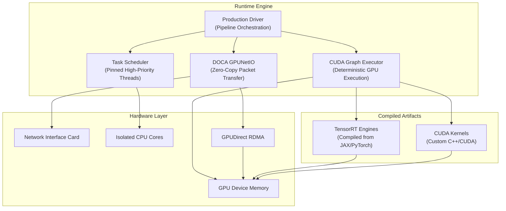
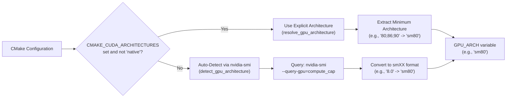
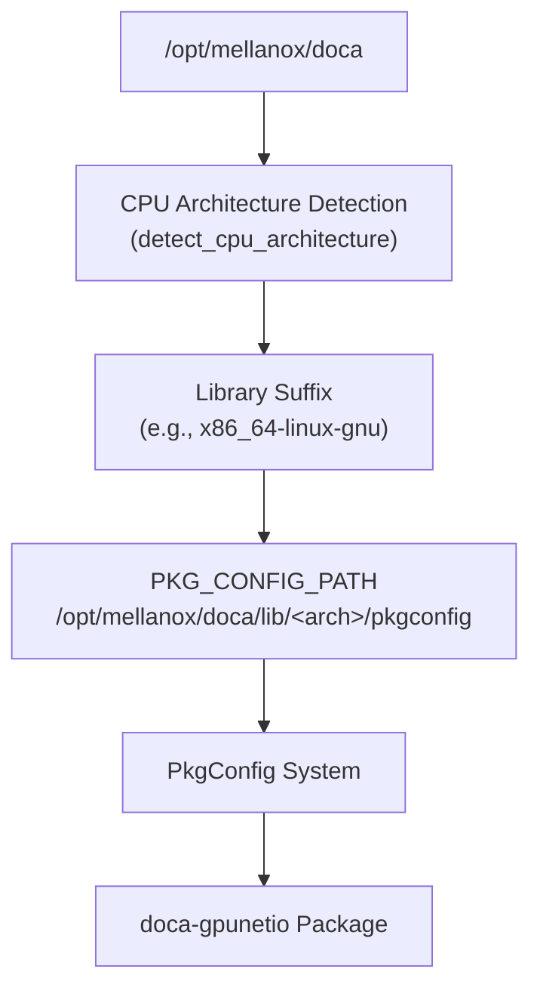
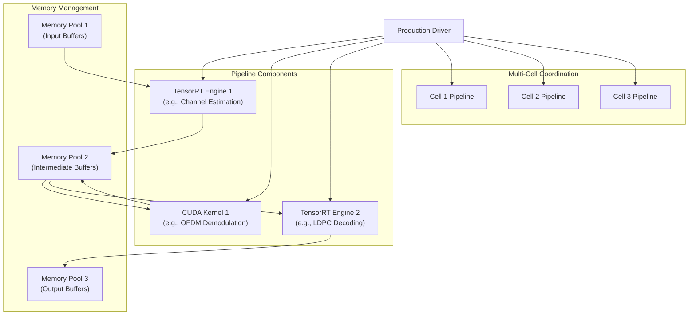
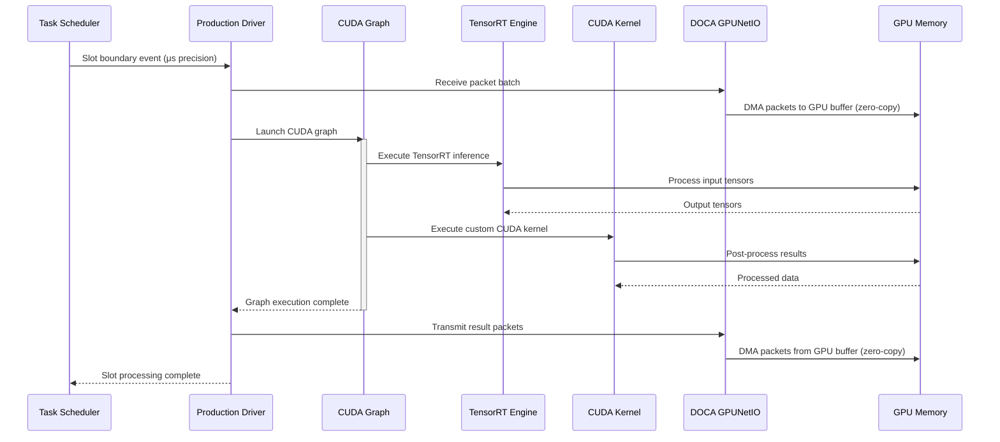

<!-- source: DeepWiki mcp.deepwiki.com · repo NVIDIA/aerial-framework · page 3.2 Runtime Engine · fetched 2026-11-11 -->

# Runtime Engine

Relevant source files

The following files were used as context for generating this wiki page:

- [README.md](README.md)
- [cmake/Cuda.cmake](cmake/Cuda.cmake)
- [cmake/Doca.cmake](cmake/Doca.cmake)

## Purpose and Scope

The Runtime Engine is the production execution layer of the Aerial Framework, responsible for orchestrating GPU pipelines with deterministic microsecond-level timing and high-performance networking. It executes compiled TensorRT engines and CUDA kernels in real-time environments with strict latency requirements typical of 3GPP RAN applications.

This page covers the runtime execution components: CUDA graph execution, task scheduling, GPU networking via DOCA GPUNetIO, and pipeline orchestration. For information about compiling Python/JAX code to TensorRT engines, see [Developer Tools](#3.1). For the overall development-to-deployment workflow, see [Development Workflow](#3.3).

**Sources:** [README.md:46-61]()

## Architecture Overview

The Runtime Engine consists of four primary subsystems that work together to achieve deterministic, low-latency execution:

**Sources:** [README.md:56-61]()

## CUDA Graph Execution

The Runtime Engine uses CUDA graphs to ensure deterministic execution of GPU operations. CUDA graphs capture the entire execution topology as a directed acyclic graph, eliminating kernel launch overhead and enabling replay with minimal CPU involvement.

### Configuration for CUDA Graphs

CUDA targets in the framework are configured with specific compilation properties to support graph execution:

| Property | Value | Purpose |
|----------|-------|---------|
| `CUDA_SEPARABLE_COMPILATION` | `ON` | Enables separate compilation of device code for modular kernels |
| `CUDA_RESOLVE_DEVICE_SYMBOLS` | `ON` | Resolves device symbols when linking static libraries |
| `POSITION_INDEPENDENT_CODE` | `ON` | Required for shared library integration |

### Compilation Flags

Debug builds include line-level information for profiling:

- `--generate-line-info` flag is automatically added for `Debug` and `RelWithDebInfo` configurations
- Enables microsecond-level profiling with NVIDIA Nsight Systems
- Allows correlation between GPU kernels and source code lines

Relaxed constexpr support is enabled for CUDA 10.2+ to support modern C++ patterns in device code:

- `--expt-relaxed-constexpr` flag enables constexpr functions in CUDA kernels

**Sources:** [cmake/Cuda.cmake:22-72](), [README.md:57]()

### GPU Architecture Detection

The `resolve_gpu_architecture()` function determines the target GPU architecture for runtime execution:

- **Explicit mode**: If `CMAKE_CUDA_ARCHITECTURES` is set (e.g., `"80;86;90"`), uses the lowest common denominator (`sm80`)
- **Auto-detect mode**: Uses `nvidia-smi` to query the compute capability of the first GPU and converts to `smXX` format
- Architecture suffix stripping: Removes `-real` and `-virtual` suffixes from architecture specifications

**Sources:** [cmake/Cuda.cmake:159-195]()

## Task Scheduler

The task scheduler enforces microsecond-level timing by using pinned, high-priority threads on isolated CPU cores. This design eliminates scheduling jitter and ensures deterministic execution of time-critical operations.

### Scheduler Design Characteristics

| Characteristic | Implementation | Purpose |
|----------------|----------------|---------|
| Thread Affinity | Pinned to isolated CPU cores | Prevents context switching and CPU migration |
| Thread Priority | High-priority real-time threads | Ensures scheduler priority over other processes |
| Timing Precision | Microsecond-level slot timing | Meets 3GPP RAN timing requirements |
| Execution Model | Deterministic graph replay | Predictable latency for each slot |

The scheduler coordinates:
- **Slot timing**: Enforces 3GPP slot boundaries (typically 125μs or 250μs depending on numerology)
- **Pipeline orchestration**: Triggers CUDA graph launches at precise intervals
- **Memory pool management**: Coordinates buffer recycling for zero-copy operations
- **Multi-cell coordination**: Synchronizes execution across multiple cells in distributed deployments

**Sources:** [README.md:58]()

## DOCA GPUNetIO Networking

DOCA GPUNetIO enables inline GPU networking with zero-copy packet transfer directly between the NIC and GPU memory, bypassing CPU and system memory.

### DOCA Integration

The framework integrates DOCA through CMake configuration:

**Sources:** [cmake/Doca.cmake:19-35]()

### DOCA Libraries

The `target_link_doca()` function configures targets with the following DOCA libraries:

| Library | Purpose |
|---------|---------|
| `doca_gpunetio` | GPU network I/O operations, packet processing on GPU |
| `doca_gpunetio_device` | GPU device-side networking code (linked with `WHOLE_ARCHIVE`) |
| `doca_common` | Common DOCA utilities and infrastructure |
| `doca_argp` | Argument parsing for DOCA applications |
| `doca_eth` | Ethernet layer operations |
| `doca_dpdk_bridge` | Integration with DPDK packet processing |
| `doca_flow` | Flow steering and packet classification |
| `doca_rdma` | RDMA operations for direct memory access |

### DOCA Compilation Flags

Targets using DOCA are configured with:
- `ALLOW_EXPERIMENTAL_API`: Enables experimental DOCA API features
- `DOCA_ALLOW_EXPERIMENTAL_API`: DOCA-specific experimental API flag
- `CUDA_SEPARABLE_COMPILATION ON`: Required for device-side networking code
- `CUDA_RESOLVE_DEVICE_SYMBOLS ON`: Resolves symbols in `doca_gpunetio_device`

The `doca_gpunetio_device` library is linked with `WHOLE_ARCHIVE` to ensure all GPU-side networking code is included in the final binary, even if not directly referenced.

**Sources:** [cmake/Doca.cmake:49-101]()

### GPUDirect RDMA

GPUDirect RDMA enables direct data transfer between GPU memory and the NIC without CPU involvement:

- **Zero-copy packet transfer**: Packets are DMA'd directly into GPU buffers allocated in device memory
- **Reduced latency**: Eliminates PCIe round-trips through CPU/system memory
- **CPU offload**: Frees CPU cycles for control plane and non-critical operations

The framework integrates GDRCopy for efficient CPU access to GPU memory regions when needed (see [NVIDIA Technologies](#5.1) for GDRCopy details).

**Sources:** [README.md:59](), [cmake/Doca.cmake:1-101]()

## Production Driver

The production driver orchestrates the complete pipeline execution, managing:

### Pipeline Orchestration

### Driver Responsibilities

| Responsibility | Description |
|----------------|-------------|
| **Pipeline Composition** | Assembles TensorRT engines and CUDA kernels into executable pipelines |
| **Memory Pool Management** | Allocates and recycles GPU memory buffers for zero-copy operation |
| **Graph Launch Coordination** | Triggers CUDA graph replays at precise timing intervals |
| **Multi-Cell Synchronization** | Coordinates execution across multiple RAN cells in production |
| **Error Handling** | Manages error conditions and recovery mechanisms |
| **Performance Monitoring** | Collects metrics and telemetry for runtime analysis |

The driver interfaces with:
- **Task Scheduler**: To receive slot timing events and trigger pipeline execution
- **DOCA GPUNetIO**: To coordinate packet reception/transmission with pipeline execution
- **CUDA Graph Executor**: To launch pre-recorded CUDA graphs for deterministic execution
- **Memory Pools**: To manage buffer allocation, recycling, and synchronization

**Sources:** [README.md:60]()

## Integration with Compiled Artifacts

The Runtime Engine executes artifacts produced by the Developer Tools layer:

### TensorRT Engine Integration

TensorRT engines are loaded and executed within CUDA graphs:
- Engines are compiled offline using MLIR-TensorRT from JAX/PyTorch code
- At runtime, engines are deserialized and integrated into CUDA graphs
- Input/output tensors are mapped to pre-allocated GPU memory pools
- Engine execution is captured in CUDA graphs for deterministic replay

### CUDA Kernel Integration

Custom C++/CUDA kernels are linked into the runtime:
- Kernels compiled with `target_link_cuda()` macro configuration
- Separable compilation enables modular kernel composition
- Kernels can be invoked directly or captured in CUDA graphs
- Device symbol resolution handles cross-module kernel calls

### Execution Flow

**Sources:** [README.md:46-61]()

## Runtime Configuration Requirements

The Runtime Engine requires specific system configuration for optimal performance:

| Requirement | Configuration | Purpose |
|-------------|---------------|---------|
| GPU Compute Capability | ≥ 8.0 (Ampere or newer) | TensorRT and CUDA graph support |
| Real-time Kernel | Linux RT kernel patches | Microsecond-level deterministic scheduling |
| CPU Isolation | `isolcpus` kernel parameter | Dedicated cores for task scheduler |
| DOCA Installation | `/opt/mellanox/doca` | GPU networking capabilities |
| NIC | NVIDIA ConnectX with GPUDirect support | Zero-copy packet transfer |
| PCIe Configuration | Gen4 or Gen5 for GPU-NIC | Sufficient bandwidth for fronthaul traffic |

**Sources:** [README.md:77-79](), [cmake/Doca.cmake:23-26]()

## Performance Characteristics

The Runtime Engine is designed to meet stringent 3GPP RAN timing requirements:

- **Slot timing precision**: Microsecond-level accuracy for slot boundaries
- **Packet processing latency**: Sub-millisecond end-to-end processing (NIC → GPU → NIC)
- **Jitter**: Minimal jitter through deterministic CUDA graph execution
- **Throughput**: Supports high cell counts through efficient memory pooling and multi-cell coordination
- **CPU overhead**: Minimal CPU usage due to GPU-centric execution and zero-copy networking

Profiling with NVIDIA Nsight Systems enables validation and optimization of these characteristics during the [Development Workflow](#3.3).

**Sources:** [README.md:56-61]()

---

