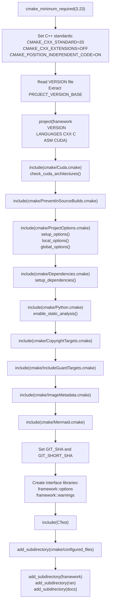
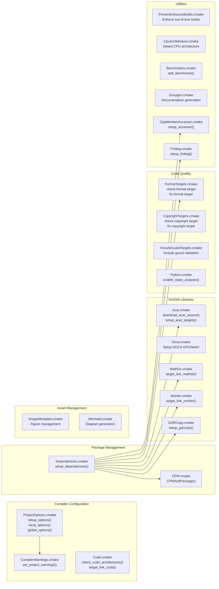
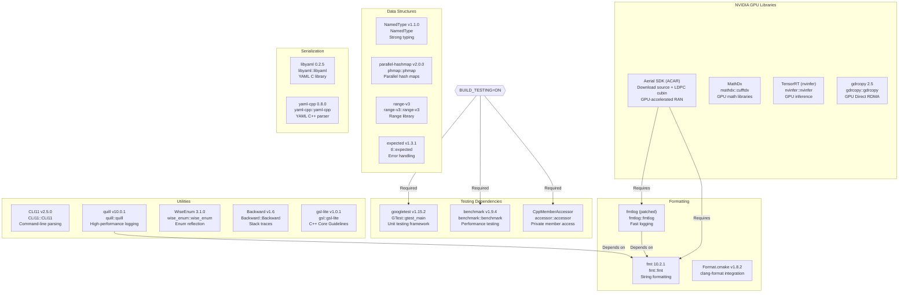
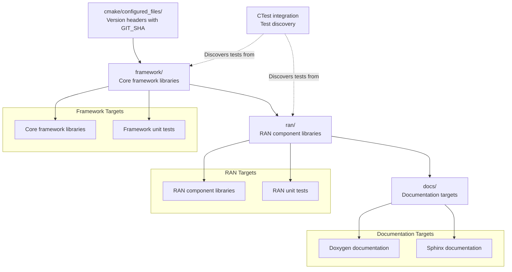

<!-- source: DeepWiki mcp.deepwiki.com · repo NVIDIA/aerial-framework · page 4 Build System · fetched 2026-11-11 -->

# Build System

<details>
<summary>Relevant source files</summary>

The following files were used as context for generating this wiki page:

- [CMakeLists.txt](CMakeLists.txt)
- [cmake/Dependencies.cmake](cmake/Dependencies.cmake)

</details>


## Purpose and Scope

This document describes the CMake-based build system architecture for the NVIDIA Aerial Framework. The build system orchestrates compilation of C++20 and CUDA code, manages 20+ external dependencies through CPM (CMake Package Manager), provides 12 build configurations via CMakePresets.json, and enforces code quality standards through integrated formatting and validation tools.

For detailed information on specific subsystems:
- CMake project structure and global settings: see [CMake Configuration](#4.1)
- Build configuration selection (debug/release, sanitizers): see [Build Presets and Configurations](#4.2)
- External library integration: see [Dependency Management with CPM](#4.3)
- GPU compilation settings: see [CUDA and GPU Configuration](#4.4)
- Warning configurations and quality checks: see [Compiler Warnings and Code Quality](#4.5)
- Performance testing infrastructure: see [Testing and Benchmarking](#4.6)

## Build System Architecture

The build system is structured around a root [CMakeLists.txt:1-112]() that coordinates 20+ specialized CMake modules located in the `cmake/` directory. The system uses CMakePresets.json to define build configurations and CPM to fetch dependencies from GitHub and other sources.

### Build System Component Hierarchy

```mermaid
graph TB
    subgraph "Entry Points"
        RootCMake["CMakeLists.txt<br/>Root build configuration"]
        Presets["CMakePresets.json<br/>12 build configurations"]
        UserPresets["CMakeUserPresets.json<br/>User overrides (optional)"]
    end
    
    subgraph "Core Setup Modules"
        PreventInSource["PreventInSourceBuilds.cmake<br/>Enforce out-of-tree builds"]
        ProjectOpts["ProjectOptions.cmake<br/>setup_options(), local_options(), global_options()"]
        Warnings["CompilerWarnings.cmake<br/>set_project_warnings()"]
        Cuda["Cuda.cmake<br/>check_cuda_architectures(), target_link_cuda()"]
    end
    
    subgraph "Dependency System"
        CPM["CPM.cmake v0.40.8<br/>Package manager"]
        Deps["Dependencies.cmake<br/>setup_dependencies()"]
        
        subgraph "NVIDIA Integration Modules"
            Acar["Acar.cmake<br/>Aerial SDK setup"]
            Doca["Doca.cmake<br/>DOCA GPUNetIO"]
            MathDx["MathDx.cmake<br/>cuFFTDx/cuBLASDx"]
            Nvinfer["Nvinfer.cmake<br/>TensorRT"]
            GDRCopy["GDRCopy.cmake<br/>GPU Direct RDMA"]
        end
        
        subgraph "Third-Party Libraries"
            Fmtlog["Fmtlog.cmake<br/>setup_fmtlog()"]
            Accessor["CppMemberAccessor.cmake<br/>setup_accessor()"]
        end
    end
    
    subgraph "Code Quality Modules"
        Format["FormatTargets.cmake<br/>check-format, fix-format"]
        Copyright["CopyrightTargets.cmake<br/>check-copyright, fix-copyright"]
        IncludeGuard["IncludeGuardTargets.cmake<br/>Include guard validation"]
        Python["Python.cmake<br/>enable_static_analysis()"]
    end
    
    subgraph "Documentation & Assets"
        Doxygen["Doxygen.cmake<br/>Documentation generation"]
        ImageMeta["ImageMetadata.cmake<br/>Figure management"]
        Mermaid["Mermaid.cmake<br/>Diagram generation"]
    end
    
    subgraph "Build Outputs"
        Framework["framework/<br/>Core framework targets"]
        RAN["ran/<br/>RAN component targets"]
        Docs["docs/<br/>Documentation targets"]
        ConfiguredFiles["cmake/configured_files/<br/>Version headers"]
    end
    
    subgraph "Interface Libraries"
        FrameworkOpts["framework_options<br/>C++20 standard, compile features"]
        FrameworkWarnings["framework_warnings<br/>Warning configurations"]
    end
    
    RootCMake --> PreventInSource
    RootCMake --> Cuda
    RootCMake --> ProjectOpts
    RootCMake --> Deps
    RootCMake --> Python
    RootCMake --> Copyright
    RootCMake --> IncludeGuard
    RootCMake --> ImageMeta
    RootCMake --> Mermaid
    
    Presets -.->|"Configures"| RootCMake
    UserPresets -.->|"Overrides"| Presets
    
    ProjectOpts --> Warnings
    
    Deps --> CPM
    CPM --> Acar
    CPM --> Doca
    CPM --> MathDx
    CPM --> Nvinfer
    CPM --> GDRCopy
    CPM --> Fmtlog
    CPM --> Accessor
    CPM --> Format
    
    Python -.-> Format
    
    RootCMake --> ConfiguredFiles
    RootCMake --> Framework
    RootCMake --> RAN
    RootCMake --> Docs
    
    ProjectOpts --> FrameworkOpts
    Warnings --> FrameworkWarnings
    
    FrameworkOpts -.->|"Linked by"| Framework
    FrameworkWarnings -.->|"Linked by"| Framework
    FrameworkOpts -.->|"Linked by"| RAN
    FrameworkWarnings -.->|"Linked by"| RAN
```



**Sources:** [CMakeLists.txt:1-112](), [cmake/Dependencies.cmake:1-411]()

## Root Build Configuration

The [CMakeLists.txt:1-112]() file serves as the build system entry point and orchestrates the entire build process. It establishes global settings and delegates to specialized modules.

### Key Global Settings

| Setting | Value | Purpose | Line Reference |
|---------|-------|---------|----------------|
| `CMAKE_MINIMUM_REQUIRED` | 3.23 | Required for `FILE_SET HEADERS` | [CMakeLists.txt:16]() |
| `CMAKE_CXX_STANDARD` | 20 | C++20 language features | [CMakeLists.txt:20]() |
| `CMAKE_CXX_EXTENSIONS` | OFF | Disable GNU extensions | [CMakeLists.txt:25]() |
| `CMAKE_POSITION_INDEPENDENT_CODE` | ON | Enable PIC for all static libraries | [CMakeLists.txt:29]() |
| `CMAKE_CXX_VISIBILITY_PRESET` | hidden | Symbol visibility control | [CMakeLists.txt:77]() |

### Project Definition

The project is defined with version extracted from the `VERSION` file:

```cmake
# Read full version from VERSION file
file(STRINGS "${CMAKE_SOURCE_DIR}/VERSION" PROJECT_VERSION_FULL)
string(REGEX MATCH "^[0-9]+\\.[0-9]+\\.[0-9]+" PROJECT_VERSION_BASE "${PROJECT_VERSION_FULL}")

project(
    framework
    VERSION ${PROJECT_VERSION_BASE}
    LANGUAGES CXX C ASM CUDA)
```

This enables semantic versioning (e.g., "0.1.0-rc.3" → "0.1.0") and configures support for four languages: C++, C, Assembly, and CUDA.

**Sources:** [CMakeLists.txt:16-44]()

## Build Process Orchestration

The root CMakeLists.txt follows a strict initialization sequence to ensure dependencies and configurations are properly established before building targets.

### Build Initialization Sequence



**Sources:** [CMakeLists.txt:16-102]()

### Key Functions Called During Initialization

The build system relies on several key functions defined in CMake modules:

| Function | Module | Purpose | Called At |
|----------|--------|---------|-----------|
| `check_cuda_architectures()` | Cuda.cmake | Validate CUDA architectures are set | [CMakeLists.txt:48]() |
| `setup_options()` | ProjectOptions.cmake | Configure project build options | [CMakeLists.txt:53]() |
| `local_options()` | ProjectOptions.cmake | Set local project settings | [CMakeLists.txt:55]() |
| `global_options()` | ProjectOptions.cmake | Apply global compiler settings | [CMakeLists.txt:57]() |
| `setup_dependencies()` | Dependencies.cmake | Fetch and configure all external libraries | [CMakeLists.txt:60]() |
| `enable_static_analysis()` | Python.cmake | Enable clang-tidy and include-what-you-use | [CMakeLists.txt:63]() |

**Sources:** [CMakeLists.txt:47-73]()

## CMake Module Organization

The `cmake/` directory contains specialized modules organized by functionality. Each module provides specific build system capabilities and can be included as needed.

### Module Categories



**Sources:** [CMakeLists.txt:47-75](), [cmake/Dependencies.cmake:31-410]()

## Dependency Management System

The build system uses CPM (CMake Package Manager) version 0.40.8 to fetch and integrate external libraries. The [cmake/Dependencies.cmake:37-410]() file defines the `setup_dependencies()` function that orchestrates all dependency acquisition.

### CPM Source Cache Configuration

CPM caches downloaded sources to avoid repeated network requests:

| Cache Location | Configuration Method | Priority |
|----------------|---------------------|----------|
| `~/.cache/CPM` | Default | Lowest |
| `$ENV{CPM_SOURCE_CACHE}` | Environment variable | Medium |
| `-DCPM_SOURCE_CACHE=/path` | CMake command line | Highest |

**Sources:** [cmake/Dependencies.cmake:18-29]()

### Dependency Acquisition Pattern

All external libraries follow a consistent pattern using `CPMAddPackage()`:

```cmake
if(NOT TARGET target_name)
    cpmaddpackage(
        NAME package_name
        GITHUB_REPOSITORY org/repo
        GIT_TAG version_tag
        OPTIONS
        "OPTION1 VALUE1"
        "OPTION2 VALUE2"
        SYSTEM YES)
endif()
```

This pattern ensures:
1. Dependencies are only fetched if not already provided by a parent project
2. Library options are configured to disable unnecessary components (tests, examples)
3. Headers are marked as `SYSTEM` to suppress warnings from third-party code

**Sources:** [cmake/Dependencies.cmake:43-410]()

### Major Dependencies



**Sources:** [cmake/Dependencies.cmake:43-410]()

## Interface Library Targets

The build system creates two critical interface library targets that propagate settings to all components:

| Target | Alias | Purpose | Configured At |
|--------|-------|---------|---------------|
| `framework_options` | `framework::options` | C++20 standard, compile features | [CMakeLists.txt:84-86]() |
| `framework_warnings` | `framework::warnings` | Compiler warning configurations | [CMakeLists.txt:87]() |

These targets are defined in ProjectOptions.cmake and CompilerWarnings.cmake respectively. All framework and RAN targets link against these interfaces to ensure consistent compiler settings across the project.

**Sources:** [CMakeLists.txt:84-87]()

## Build Targets Structure

The build system produces targets from three main subdirectories, added in a specific order to ensure proper dependency resolution:



**Sources:** [CMakeLists.txt:90-102]()

## Code Quality Integration

The build system integrates multiple code quality and validation tools through dedicated CMake modules. These tools run as build targets to enforce standards before committing code.

### Quality Check Targets

| Target | Module | Purpose | Command |
|--------|--------|---------|---------|
| `check-format` | FormatTargets.cmake | Verify C++ code formatting | `cmake --build build --target check-format` |
| `fix-format` | FormatTargets.cmake | Auto-fix C++ code formatting | `cmake --build build --target fix-format` |
| `check-copyright` | CopyrightTargets.cmake | Verify SPDX headers | `cmake --build build --target check-copyright` |
| `fix-copyright` | CopyrightTargets.cmake | Add missing SPDX headers | `cmake --build build --target fix-copyright` |
| `check-include-guards` | IncludeGuardTargets.cmake | Verify include guard format | `cmake --build build --target check-include-guards` |

The format checking system is configured to exclude JSON files which are not supported by clang-format. This is enforced through git configuration:

```cmake
set(CLANGFORMAT_EXTENSIONS
    "c,h,m,mm,cc,cp,cpp,c++,cxx,hh,hpp,hxx,inc,inl,ccm,cppm,cxxm,c++m,cu,cuh,proto,protodevel,java,js,ts,cs,sv,svh,v,vh"
)
execute_process(
    COMMAND ${GIT_EXECUTABLE} config clangformat.extensions "${CLANGFORMAT_EXTENSIONS}"
    ...)
```

**Sources:** [CMakeLists.txt:69-75](), [cmake/Dependencies.cmake:299-363](), [cmake/Dependencies.cmake:409]()

## Build System Extension Points

The build system provides several extension mechanisms for adding custom functionality without modifying core CMake files.

### User-Level Customization

Developers can create `CMakeUserPresets.json` (git-ignored) to override build configurations:

```json
{
  "version": 6,
  "configurePresets": [
    {
      "name": "my-custom-debug",
      "inherits": "gcc-debug",
      "cacheVariables": {
        "CMAKE_BUILD_TYPE": "Debug",
        "ENABLE_DEVELOPER_MODE": "ON"
      }
    }
  ]
}
```

### Conditional Feature Inclusion

The build system uses target existence checks to conditionally include features:

```cmake
if(NOT TARGET target_name)
    # Fetch and configure dependency
endif()
```

This pattern allows parent projects to provide their own versions of dependencies, enabling integration into larger build systems.

**Sources:** [cmake/Dependencies.cmake:44-410]()

## Top-Level Build Control

The root CMakeLists.txt includes conditional logic to support the framework both as a standalone project and as a subdirectory of a larger project:

```cmake
# Don't even look at tests if we're not top level
if(NOT PROJECT_IS_TOP_LEVEL)
    return()
endif()

if(CMAKE_SKIP_INSTALL_RULES)
    return()
endif()
```

This ensures:
1. Test targets are only created when building the framework standalone
2. Install rules can be skipped if the parent project manages installation
3. The framework can be embedded in larger projects without conflicts

**Sources:** [CMakeLists.txt:104-112]()

## Build System Versioning

The build system reads version information from the `VERSION` file in the repository root:

```cmake
file(STRINGS "${CMAKE_SOURCE_DIR}/VERSION" PROJECT_VERSION_FULL)
string(STRIP "${PROJECT_VERSION_FULL}" PROJECT_VERSION_FULL)
string(REGEX MATCH "^[0-9]+\\.[0-9]+\\.[0-9]+" PROJECT_VERSION_BASE "${PROJECT_VERSION_FULL}")
```

This supports semantic versioning with pre-release tags (e.g., "0.1.0-rc.3"). The base version (0.1.0) is used for CMake's `project(VERSION ...)` while the full version is preserved for display and configured into source files.

Git commit information is also captured:

```cmake
set(GIT_SHA "Unknown" CACHE STRING "SHA this build was generated from")
string(SUBSTRING "${GIT_SHA}" 0 8 GIT_SHORT_SHA)
```

Both `PROJECT_VERSION_FULL` and `GIT_SHA` are made available to configured headers in `cmake/configured_files/`.

**Sources:** [CMakeLists.txt:31-82]()

---

