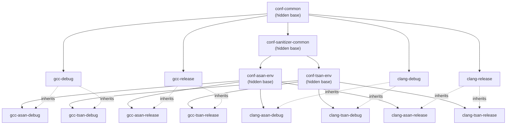
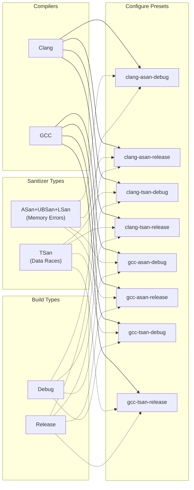
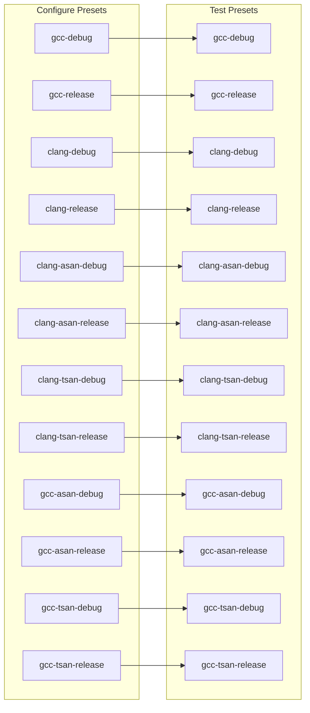
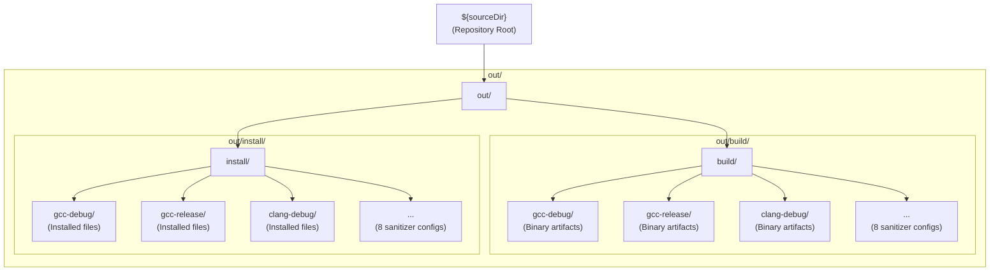

<!-- source: DeepWiki mcp.deepwiki.com · repo NVIDIA/aerial-framework · page 4.2 Build Presets and Configurations · fetched 2026-11-11 -->

# Build Presets and Configurations

<details>
<summary>Relevant source files</summary>

The following files were used as context for generating this wiki page:

- [CMakePresets.json](CMakePresets.json)

</details>


## Purpose and Scope

This document details the CMake preset system defined in [CMakePresets.json:1-288]() that provides 12 pre-configured build configurations for the NVIDIA Aerial Framework. These presets cover combinations of compilers (GCC, Clang), build types (Debug, RelWithDebInfo), and sanitizers (AddressSanitizer, ThreadSanitizer, UndefinedBehaviorSanitizer, LeakSanitizer). Each configure preset has a corresponding test preset for running CTest-based validation.

For information about the broader CMake build system architecture, see [CMake Configuration](#4.1). For dependency management, see [Dependency Management with CPM](#4.3). For testing and benchmarking infrastructure, see [Testing and Benchmarking](#4.6).

Sources: [CMakePresets.json:1-288]()

## Preset Architecture Overview

The preset system uses a hierarchical inheritance structure where specific presets inherit from common base configurations. This design promotes consistency and reduces duplication across the 12 configure presets and their matching test presets.

### Preset Inheritance Hierarchy



The diagram shows three inheritance layers:
1. **Base layer**: `conf-common` provides settings for all configurations
2. **Standard layer**: Compiler-specific debug/release presets inherit from `conf-common`
3. **Sanitizer layer**: Sanitizer presets inherit from both sanitizer environment configurations and standard compiler presets through multiple inheritance

Sources: [CMakePresets.json:10-182]()

## Common Base Configuration

The `conf-common` preset [CMakePresets.json:10-32]() establishes foundation settings inherited by all other presets.

### Configuration Parameters

| Parameter | Value | Description |
|-----------|-------|-------------|
| `hidden` | `true` | Not directly usable; exists only for inheritance |
| `generator` | `"Ninja"` | Uses Ninja build system for all configurations |
| `binaryDir` | `${sourceDir}/out/build/${presetName}` | Build outputs to preset-specific subdirectory |
| `installDir` | `${sourceDir}/out/install/${presetName}` | Installation to preset-specific subdirectory |
| `CMAKE_CUDA_ARCHITECTURES` | `"native"` | Auto-detect GPU architecture of build machine |

### Platform Conditions

The preset includes a condition [CMakePresets.json:19-26]() restricting builds to Linux and Darwin (macOS) systems:

```json
"condition": {
    "type": "inList",
    "string": "${hostSystemName}",
    "list": ["Linux", "Darwin"]
}
```

### Visual Studio Remote Settings

For developers using Visual Studio's remote development features, the preset configures the remote source directory [CMakePresets.json:27-31]():

```json
"vendor": {
    "microsoft.com/VisualStudioRemoteSettings/CMake/1.0": {
        "sourceDir": "$env{HOME}/.vs/$ms{projectDirName}"
    }
}
```

Sources: [CMakePresets.json:10-32]()

## Standard Build Presets

Four standard presets provide the base compiler and build type combinations. These presets are the most commonly used for daily development.

### GCC Presets

#### gcc-debug

[CMakePresets.json:34-43]()

Debug configuration using GCC compiler with full debug symbols and no optimization.

| Cache Variable | Value |
|----------------|-------|
| `CMAKE_C_COMPILER` | `gcc` |
| `CMAKE_CXX_COMPILER` | `g++` |
| `CMAKE_BUILD_TYPE` | `Debug` |

Build artifacts: `out/build/gcc-debug/`

#### gcc-release

[CMakePresets.json:45-54]()

Release configuration using GCC with optimizations and debug information.

| Cache Variable | Value |
|----------------|-------|
| `CMAKE_C_COMPILER` | `gcc` |
| `CMAKE_CXX_COMPILER` | `g++` |
| `CMAKE_BUILD_TYPE` | `RelWithDebInfo` |

Build artifacts: `out/build/gcc-release/`

### Clang Presets

#### clang-debug

[CMakePresets.json:56-65]()

Debug configuration using Clang compiler with full debug symbols and no optimization.

| Cache Variable | Value |
|----------------|-------|
| `CMAKE_C_COMPILER` | `clang` |
| `CMAKE_CXX_COMPILER` | `clang++` |
| `CMAKE_BUILD_TYPE` | `Debug` |

Build artifacts: `out/build/clang-debug/`

#### clang-release

[CMakePresets.json:67-76]()

Release configuration using Clang with optimizations and debug information.

| Cache Variable | Value |
|----------------|-------|
| `CMAKE_C_COMPILER` | `clang` |
| `CMAKE_CXX_COMPILER` | `clang++` |
| `CMAKE_BUILD_TYPE` | `RelWithDebInfo` |

Build artifacts: `out/build/clang-release/`

### Build Type Characteristics

| Build Type | Optimization | Debug Symbols | Assertions | Use Case |
|------------|--------------|---------------|------------|----------|
| `Debug` | `-O0` | Full (`-g`) | Enabled | Development, debugging |
| `RelWithDebInfo` | `-O3` | Full (`-g`) | Disabled (`-DNDEBUG`) | Profiling, performance testing |

Sources: [CMakePresets.json:34-76]()

## Sanitizer Configurations

Eight sanitizer presets enable runtime detection of memory errors, undefined behavior, memory leaks, and data races. These presets combine compiler choice, sanitizer type, and build type in a matrix.

### Sanitizer Environment Configuration

#### conf-asan-env

[CMakePresets.json:84-93]()

Common environment variables for AddressSanitizer (ASan), UndefinedBehaviorSanitizer (UBSan), and LeakSanitizer (LSan):

| Environment Variable | Configuration |
|---------------------|---------------|
| `ASAN_OPTIONS` | `protect_shadow_gap=0:check_initialization_order=1:strict_init_order=1:print_stats=1:atexit=1` |
| `LSAN_OPTIONS` | `print_stats=1:suppressions=${sourceDir}/tools/lsan_suppressions.txt` |
| `UBSAN_OPTIONS` | `print_stats=1:halt_on_error=1:suppressions=${sourceDir}/tools/ubsan_suppressions.txt` |

#### conf-tsan-env

[CMakePresets.json:95-102]()

Environment variables for ThreadSanitizer (TSan):

| Environment Variable | Configuration |
|---------------------|---------------|
| `TSAN_OPTIONS` | `print_stats=1:halt_on_error=1:suppressions=${sourceDir}/tools/tsan_suppressions.txt` |

### Sanitizer Preset Matrix



### AddressSanitizer Presets

These presets enable three sanitizers simultaneously: AddressSanitizer (memory errors), UndefinedBehaviorSanitizer (undefined behavior), and LeakSanitizer (memory leaks).

#### Clang ASan Presets

**clang-asan-debug** [CMakePresets.json:104-113]()

| Cache Variable | Value |
|----------------|-------|
| `ENABLE_SANITIZER_ADDRESS` | `ON` |
| `ENABLE_SANITIZER_UNDEFINED` | `ON` |
| `ENABLE_SANITIZER_LEAK` | `ON` |

Inherits from: `conf-asan-env`, `clang-debug`

**clang-asan-release** [CMakePresets.json:115-124]()

Same sanitizer configuration as debug but inherits from `clang-release` for optimized builds.

#### GCC ASan Presets

**gcc-asan-debug** [CMakePresets.json:144-153]()

| Cache Variable | Value |
|----------------|-------|
| `ENABLE_SANITIZER_ADDRESS` | `ON` |
| `ENABLE_SANITIZER_UNDEFINED` | `ON` |
| `ENABLE_SANITIZER_LEAK` | `ON` |

Inherits from: `conf-asan-env`, `gcc-debug`

**gcc-asan-release** [CMakePresets.json:155-164]()

Same sanitizer configuration as debug but inherits from `gcc-release` for optimized builds.

### ThreadSanitizer Presets

These presets enable ThreadSanitizer for detecting data races and threading issues. Note that TSan cannot be used simultaneously with ASan/LSan/UBSan.

#### Clang TSan Presets

**clang-tsan-debug** [CMakePresets.json:126-133]()

| Cache Variable | Value |
|----------------|-------|
| `ENABLE_SANITIZER_THREAD` | `ON` |

Inherits from: `conf-tsan-env`, `clang-debug`

**clang-tsan-release** [CMakePresets.json:135-142]()

Same configuration as debug but inherits from `clang-release`.

#### GCC TSan Presets

**gcc-tsan-debug** [CMakePresets.json:166-173]()

| Cache Variable | Value |
|----------------|-------|
| `ENABLE_SANITIZER_THREAD` | `ON` |

Inherits from: `conf-tsan-env`, `gcc-debug`

**gcc-tsan-release** [CMakePresets.json:175-182]()

Same configuration as debug but inherits from `gcc-release`.

Sources: [CMakePresets.json:78-182]()

## Test Presets

Each configure preset has a corresponding test preset for running CTest-based validation. The test presets configure output verbosity, failure handling, and environment variables for test frameworks.

### Common Test Configuration

The `test-common` preset [CMakePresets.json:185-202]() provides shared settings:

#### Output Configuration

```json
"output": {
    "outputOnFailure": true,
    "verbosity": "verbose"
}
```

- `outputOnFailure`: Display test output only when tests fail
- `verbosity`: Set to `"verbose"` for detailed test execution information

#### Execution Configuration

```json
"execution": {
    "noTestsAction": "error",
    "stopOnFailure": true
}
```

- `noTestsAction`: Treat missing tests as an error condition
- `stopOnFailure`: Stop test execution on first failure

#### Test Environment Variables

| Variable | Value | Purpose |
|----------|-------|---------|
| `BENCHMARK_COLOR` | `"1"` | Enable colored output for Google Benchmark |
| `GTEST_COLOR` | `"1"` | Enable colored output for GoogleTest |
| `GTEST_PRINT_TIME` | `"1"` | Display test execution time |

### Test Preset Mapping

Each configure preset maps to a test preset with identical naming:



### Individual Test Presets

All test presets [CMakePresets.json:203-287]() inherit from `test-common` and reference their corresponding configure preset via the `configurePreset` field.

Example for `gcc-debug` test preset [CMakePresets.json:204-209]():

```json
{
    "name": "gcc-debug",
    "displayName": "gcc Debug Tests",
    "description": "Enable output and stop on failure",
    "inherits": "test-common",
    "configurePreset": "gcc-debug"
}
```

This pattern repeats for all 12 presets, ensuring test configuration consistency across all build types.

Sources: [CMakePresets.json:184-287]()

## Usage Examples

### Configuring a Build

Select a preset during CMake configuration:

```bash
cmake --preset gcc-debug
```

Available standard presets:
- `gcc-debug`: GCC with debug symbols
- `gcc-release`: GCC with optimizations
- `clang-debug`: Clang with debug symbols
- `clang-release`: Clang with optimizations

Available sanitizer presets:
- `clang-asan-debug`, `clang-asan-release`: Clang with ASan+UBSan+LSan
- `clang-tsan-debug`, `clang-tsan-release`: Clang with TSan
- `gcc-asan-debug`, `gcc-asan-release`: GCC with ASan+UBSan+LSan
- `gcc-tsan-debug`, `gcc-tsan-release`: GCC with TSan

### Building with a Preset

After configuration, build using the preset name:

```bash
cmake --build --preset gcc-debug
```

Or use the build directory directly:

```bash
cmake --build out/build/gcc-debug
```

### Running Tests

Execute tests using the corresponding test preset:

```bash
ctest --preset gcc-debug
```

The test preset automatically inherits the configured build directory and applies test-specific settings.

### Preset Selection Decision Matrix

| Use Case | Recommended Preset | Rationale |
|----------|-------------------|-----------|
| Daily development | `gcc-debug` or `clang-debug` | Fast compilation, full debug info |
| Performance profiling | `clang-release` | Optimizations + debug symbols for Nsight |
| Memory error detection | `clang-asan-debug` | Best ASan implementation |
| Thread safety validation | `clang-tsan-release` | TSan overhead reduced with optimization |
| Release builds | `clang-release` or `gcc-release` | Production-ready optimizations |
| CI/CD validation | All presets | Comprehensive coverage |

Sources: [CMakePresets.json:1-288]()

## Build Output Directory Structure

Each preset generates isolated build and installation directories to prevent cross-contamination between configurations.



### Directory Paths

From [CMakePresets.json:14-15]():

- **Build directory**: `${sourceDir}/out/build/${presetName}`
  - Example: `out/build/gcc-debug/` for the `gcc-debug` preset
  - Contains object files, libraries, executables, and CMake cache
  
- **Install directory**: `${sourceDir}/out/install/${presetName}`
  - Example: `out/install/gcc-release/` for the `gcc-release` preset
  - Contains files installed by `cmake --install` command

### Directory Benefits

| Benefit | Description |
|---------|-------------|
| Isolation | Each preset's artifacts are completely separate |
| Parallel Builds | Multiple configurations can be built simultaneously |
| Easy Cleanup | Remove entire preset directory to clean build |
| Reproducibility | Consistent paths across all development environments |
| Version Control | `out/` can be excluded from Git without conflict |

Sources: [CMakePresets.json:14-15]()

## User-Specific Overrides

Developers can create a `CMakeUserPresets.json` file (not tracked in version control) to define custom presets or override existing ones without modifying [CMakePresets.json:1-288](). The user presets file follows the same schema and can inherit from any preset defined in the repository-level configuration.

Example user preset structure:

```json
{
    "version": 3,
    "configurePresets": [
        {
            "name": "my-custom-preset",
            "inherits": "clang-release",
            "cacheVariables": {
                "CMAKE_CUDA_ARCHITECTURES": "89"
            }
        }
    ]
}
```

This mechanism enables:
- Custom compiler paths
- Additional cache variables
- Machine-specific optimizations
- Local experimentation without affecting team configuration

Sources: [CMakePresets.json:1-3]()

---

