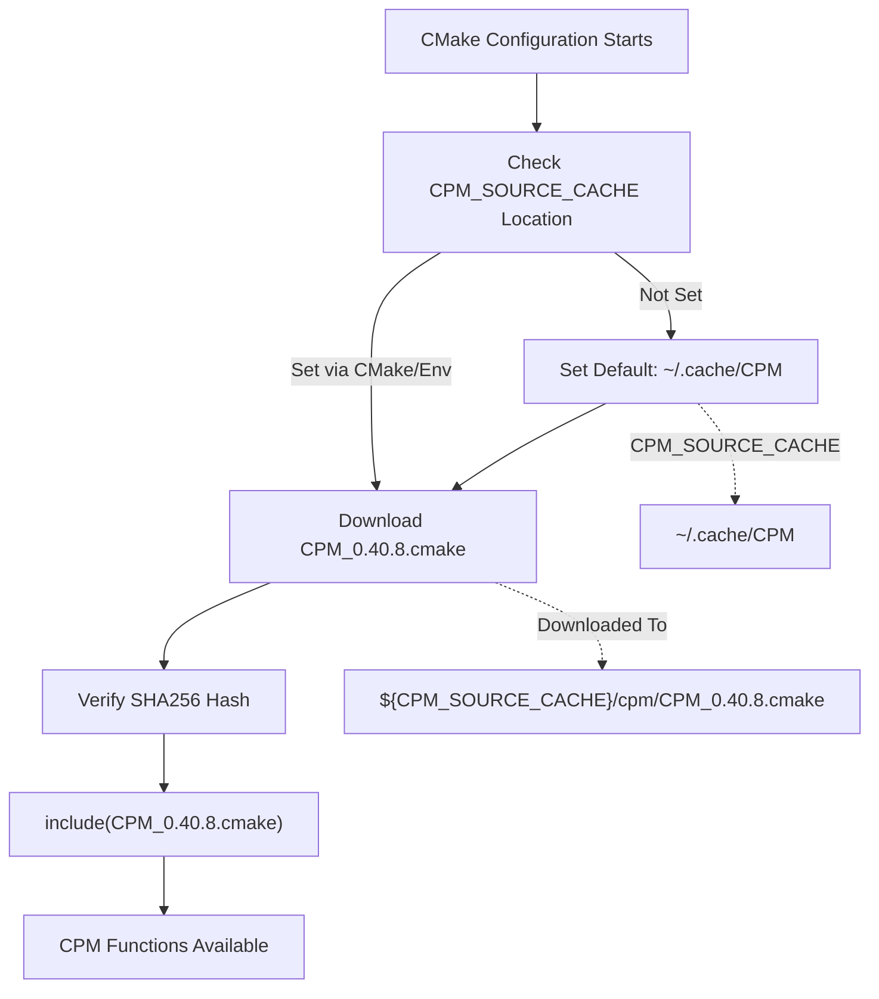
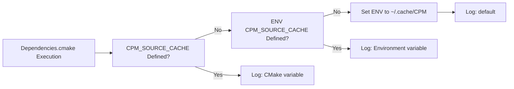
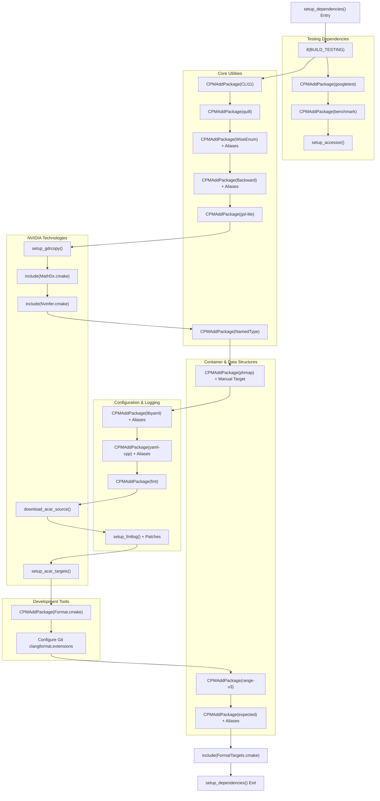
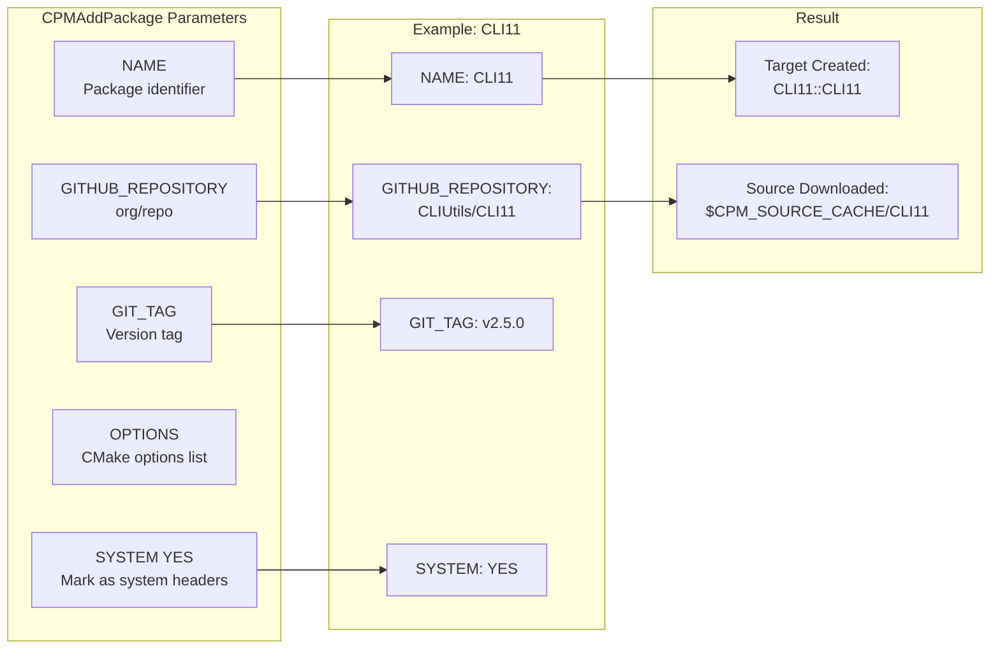
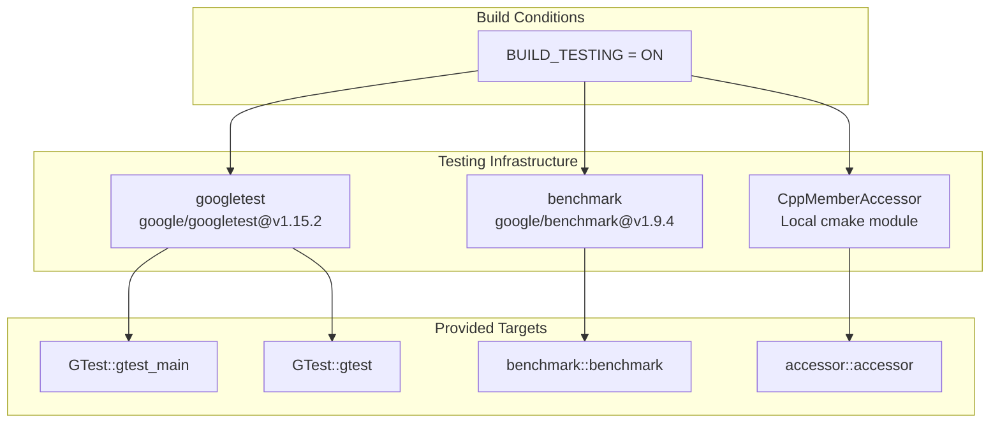
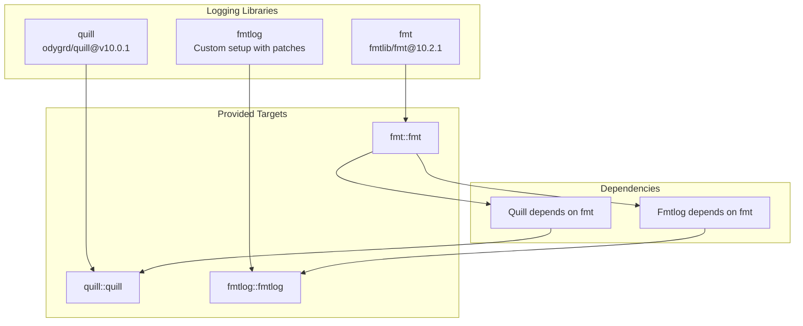
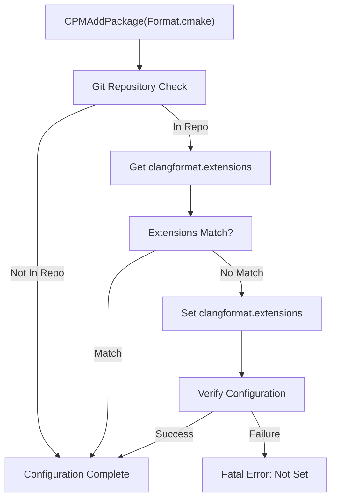
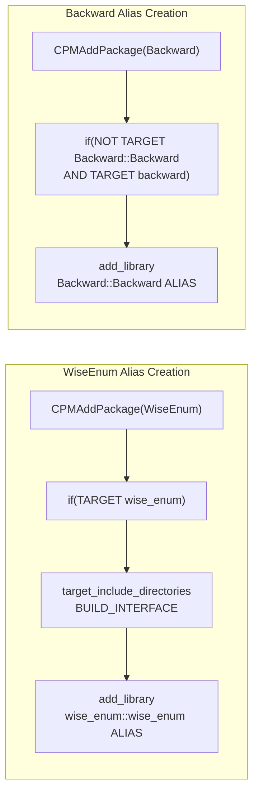
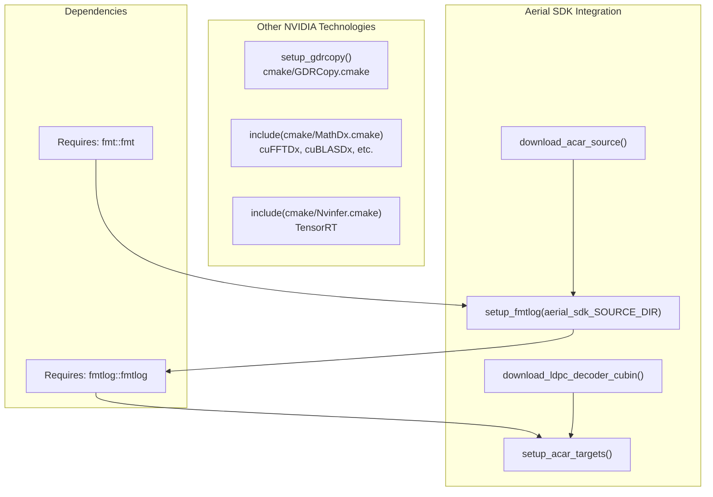
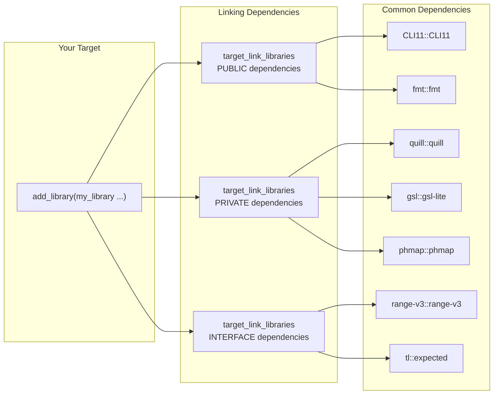

<!-- source: DeepWiki mcp.deepwiki.com · repo NVIDIA/aerial-framework · page 4.3 Dependency Management with CPM · fetched 2026-11-11 -->

# Dependency Management with CPM

<details>
<summary>Relevant source files</summary>

The following files were used as context for generating this wiki page:

- [cmake/CPM.cmake](cmake/CPM.cmake)
- [cmake/Dependencies.cmake](cmake/Dependencies.cmake)

</details>


## Purpose and Scope

This document explains how the NVIDIA Aerial Framework uses CPM (CMake Package Manager) to fetch, configure, and integrate 20+ external dependencies from GitHub and other sources. It covers the CPM setup mechanism, source caching, dependency declaration syntax, and special handling requirements for specific libraries.

For NVIDIA-specific technology integrations (Aerial SDK, DOCA, TensorRT, MathDx, GDRCopy), see [NVIDIA Technologies](#5.1). For general dependency information including licensing and versions, see [Third-Party Libraries](#5.2).

---

## CPM Architecture and Setup

CPM is a cross-platform CMake script that automates dependency downloading and configuration. The framework uses CPM version 0.40.8, which is automatically downloaded during the first CMake configuration.

### CPM Bootstrap Process



**CPM Download and Verification**

Sources: [cmake/CPM.cmake:1-24]()

The CPM bootstrap script determines the download location based on cache configuration and verifies the downloaded file:

| Configuration Method | Priority | Example Value |
|---------------------|----------|---------------|
| `CPM_SOURCE_CACHE` CMake variable | Highest | `cmake -DCPM_SOURCE_CACHE=/custom/path` |
| `CPM_SOURCE_CACHE` environment variable | Medium | `export CPM_SOURCE_CACHE=/custom/path` |
| Default (build directory) | Lowest | `${CMAKE_BINARY_DIR}/cmake/CPM_0.40.8.cmake` |

The script downloads CPM from `https://github.com/cpm-cmake/CPM.cmake/releases/download/v0.40.8/CPM.cmake` and verifies it against SHA256 hash `78ba32abdf798bc616bab7c73aac32a17bbd7b06ad9e26a6add69de8f3ae4791`.

---

## Source Cache Configuration

The source cache stores downloaded dependency sources for reuse across builds and projects, significantly reducing configuration time.

### Cache Location Resolution



**Source Cache Configuration Logic**

Sources: [cmake/Dependencies.cmake:18-29]()

The cache location is determined in this order:
1. CMake variable `CPM_SOURCE_CACHE` (highest priority)
2. Environment variable `CPM_SOURCE_CACHE`
3. Default: `$HOME/.cache/CPM` (set automatically)

The configuration status is logged during CMake configuration to help diagnose caching behavior.

---

## The setup_dependencies() Function

All dependency configuration occurs within the `setup_dependencies()` function, which is called from the root `CMakeLists.txt`. This function-based approach prevents CMAKE_CXX_FLAGS and other variable modifications from propagating to parent scopes.

### Function Structure



**Dependency Setup Flow**

Sources: [cmake/Dependencies.cmake:37-410]()

The function processes dependencies in groups:
- **Conditional Testing Dependencies**: Only added when `BUILD_TESTING` is enabled
- **Target Guards**: Each dependency checks `if(NOT TARGET <target_name>)` to avoid duplicate configuration
- **Special Handling**: Some dependencies require manual alias creation or custom setup functions

---

## CPMAddPackage Syntax

Dependencies are declared using the `CPMAddPackage()` function with a consistent parameter structure.

### Standard Declaration Pattern



**CPMAddPackage Parameter Structure**

Sources: [cmake/Dependencies.cmake:78-87](), [cmake/Dependencies.cmake:90-103]()

### Parameter Reference

| Parameter | Purpose | Example Values |
|-----------|---------|----------------|
| `NAME` | Package identifier | `CLI11`, `googletest`, `fmt` |
| `GITHUB_REPOSITORY` | GitHub repository path | `CLIUtils/CLI11`, `google/googletest` |
| `GIT_TAG` | Version specifier | `v2.5.0`, `v1.15.2`, commit hash |
| `OPTIONS` | CMake configuration options | `"BENCHMARK_ENABLE_TESTING OFF"` |
| `SYSTEM YES` | Suppress warnings from headers | Marks include paths as system |
| `DOWNLOAD_ONLY YES` | Skip configuration phase | Used for header-only manual setup |

### Version Tag Conventions

The codebase uses two tag formats:
- **`v` prefix tags** (e.g., `v1.15.2`): Most common for semantic versioning
- **Non-prefix tags** (e.g., `1.0.0`): Some repositories omit the `v`
- **Commit hashes** (e.g., `ca1388fb9da8e69314dda222dc7b139ca84e092f`): For unreleased versions

---

## Dependency Categories and Targets

The framework organizes its 20+ dependencies into functional categories. Each dependency provides one or more CMake targets for linking.

### Testing and Benchmarking Dependencies



**Testing Framework Dependencies**

Sources: [cmake/Dependencies.cmake:43-75]()

| Package | Repository | Tag | Target(s) | Options |
|---------|-----------|-----|-----------|---------|
| `googletest` | `google/googletest` | `v1.15.2` | `GTest::gtest_main`, `GTest::gtest` | None |
| `benchmark` | `google/benchmark` | `v1.9.4` | `benchmark::benchmark` | `BENCHMARK_ENABLE_TESTING OFF`, `BENCHMARK_ENABLE_GTEST_TESTS OFF` |
| `accessor` | Local module | N/A | `accessor::accessor` | Configured via `CppMemberAccessor.cmake` |

### Command Line and Configuration Dependencies

Sources: [cmake/Dependencies.cmake:77-266]()

| Package | Repository | Tag | Target(s) | Purpose |
|---------|-----------|-----|-----------|---------|
| `CLI11` | `CLIUtils/CLI11` | `v2.5.0` | `CLI11::CLI11` | Command-line argument parsing |
| `libyaml` | `yaml/libyaml` | `0.2.5` | `libyaml::libyaml` | C YAML parser library |
| `yaml-cpp` | `jbeder/yaml-cpp` | `0.8.0` | `yaml-cpp::yaml-cpp` | C++ YAML parser (used by nvlog) |

### Logging and Formatting Dependencies



**Logging Framework Dependencies**

Sources: [cmake/Dependencies.cmake:89-103](), [cmake/Dependencies.cmake:269-293]()

| Package | Repository | Tag | Target | Build Configuration |
|---------|-----------|-----|--------|-------------------|
| `fmt` | `fmtlib/fmt` | `10.2.1` | `fmt::fmt` | `BUILD_SHARED_LIBS ON`, `FMT_INSTALL OFF` |
| `quill` | `odygrd/quill` | `v10.0.1` | `quill::quill` | All tests/benchmarks/examples disabled |
| `fmtlog` | Via `Fmtlog.cmake` | Patched | `fmtlog::fmtlog` | Requires patches from `aerial_sdk_SOURCE_DIR` |

The `fmt` library is built as a shared library (`BUILD_SHARED_LIBS ON`) and is a dependency for both `quill` and `fmtlog`.

### Utility Libraries

Sources: [cmake/Dependencies.cmake:105-406]()

| Package | Repository | Tag | Target(s) | Purpose |
|---------|-----------|-----|-----------|---------|
| `WiseEnum` | `quicknir/wise_enum` | `3.1.0` | `wise_enum::wise_enum` | Enum reflection and iteration |
| `Backward` | `bombela/backward-cpp` | `v1.6` | `Backward::Backward` | Stack trace printing for crashes |
| `gsl-lite` | `gsl-lite/gsl-lite` | `v1.0.1` | `gsl::gsl-lite` | C++ Core Guidelines support library |
| `NamedType` | `joboccara/NamedType` | `v1.1.0` | `NamedType` | Strong type wrappers |
| `phmap` | `greg7mdp/parallel-hashmap` | `v2.0.0` | `phmap::phmap` | Parallel hashmap (header-only) |
| `range-v3` | `ericniebler/range-v3` | `ca1388fb` | `range-v3::range-v3` | Range algorithms for C++14/17/20 |
| `expected` | `TartanLlama/expected` | `v1.3.1` | `tl::expected` | Error handling via expected<T,E> |

### Development Tools

Sources: [cmake/Dependencies.cmake:299-363]()

**Format.cmake Integration**

The `Format.cmake` package (version `v1.8.2` from `TheLartians/Format.cmake`) provides `clang-format` and `cmake-format` integration. Special Git configuration is required to prevent formatting JSON files:



**Git Configuration for Format.cmake**

Sources: [cmake/Dependencies.cmake:311-363]()

The configuration sets `clangformat.extensions` to exclude JSON files and include CUDA files:
```
c,h,m,mm,cc,cp,cpp,c++,cxx,hh,hpp,hxx,inc,inl,ccm,cppm,cxxm,c++m,cu,cuh,proto,protodevel,java,js,ts,cs,sv,svh,v,vh
```

---

## Special Dependency Handling

Several dependencies require special handling beyond standard `CPMAddPackage()` calls, including manual alias creation, interface target construction, and custom patches.

### Manual Alias Creation



**Libraries Requiring Alias Creation**

Sources: [cmake/Dependencies.cmake:119-128](), [cmake/Dependencies.cmake:143-148](), [cmake/Dependencies.cmake:234-242](), [cmake/Dependencies.cmake:262-265](), [cmake/Dependencies.cmake:402-406]()

| Package | Upstream Target | Created Alias | Reason |
|---------|----------------|---------------|--------|
| `WiseEnum` | `wise_enum` | `wise_enum::wise_enum` | Missing BUILD_INTERFACE includes + namespace alias |
| `Backward` | `backward` | `Backward::Backward` | Conditional alias if config doesn't create it |
| `libyaml` | `yaml`, `yaml_static`, or `libyaml` | `libyaml::libyaml` | Unstable upstream target name |
| `yaml-cpp` | `yaml-cpp` | `yaml-cpp::yaml-cpp` | Namespace consistency |
| `expected` | `expected` | `tl::expected` | Namespace consistency |

### Manual Interface Targets

Some header-only libraries require manual interface target creation with `DOWNLOAD_ONLY YES`.

**phmap Manual Target Creation**

Sources: [cmake/Dependencies.cmake:196-218]()

The `parallel-hashmap` package is configured with `DOWNLOAD_ONLY YES`, requiring manual target construction:

```cmake
# After CPMAddPackage with DOWNLOAD_ONLY YES:
add_library(phmap INTERFACE)
target_include_directories(phmap SYSTEM INTERFACE "${parallel_hashmap_SOURCE_DIR}/")
add_library(phmap::phmap ALIAS phmap)
```

This approach is necessary because the upstream package doesn't provide a proper CMake target.

### NVIDIA Technology Integration



**NVIDIA Technology Setup Sequence**

Sources: [cmake/Dependencies.cmake:163-296]()

NVIDIA technologies use custom setup functions instead of direct `CPMAddPackage()` calls:

1. **Aerial SDK Setup Sequence**:
   - `download_acar_source()` - Downloads Aerial SDK source (provides patch files)
   - `download_ldpc_decoder_cubin()` - Downloads LDPC decoder CUDA binary
   - `setup_fmtlog(${aerial_sdk_SOURCE_DIR})` - Sets up fmtlog with SDK patches
   - `setup_acar_targets()` - Configures Aerial SDK targets (after fmt/fmtlog available)

2. **Other NVIDIA Technologies**:
   - `setup_gdrcopy()` - GPU Direct RDMA memory copy library
   - MathDx integration via `cmake/MathDx.cmake` - cuFFTDx, cuBLASDx, cuRANDDx, cuSOLVERDx
   - TensorRT integration via `cmake/Nvinfer.cmake` - nvinfer library

The ordering is critical: `fmt` must be available before `fmtlog`, and `fmtlog` must be available before Aerial SDK targets.

---

## Using Dependencies in Targets

Once configured, dependencies are linked to targets using standard CMake commands. The framework uses consistent target naming conventions.

### Target Linking Patterns



**Standard Dependency Linking**

### Target Reference Table

| Dependency | Link Target | Include Example |
|-----------|-------------|-----------------|
| CLI11 | `CLI11::CLI11` | `#include <CLI/CLI.hpp>` |
| fmt | `fmt::fmt` | `#include <fmt/format.h>` |
| quill | `quill::quill` | `#include <quill/Quill.h>` |
| yaml-cpp | `yaml-cpp::yaml-cpp` | `#include <yaml-cpp/yaml.h>` |
| GoogleTest | `GTest::gtest_main` | `#include <gtest/gtest.h>` |
| Google Benchmark | `benchmark::benchmark` | `#include <benchmark/benchmark.h>` |
| gsl-lite | `gsl::gsl-lite` | `#include <gsl/gsl>` |
| range-v3 | `range-v3::range-v3` | `#include <range/v3/all.hpp>` |
| tl::expected | `tl::expected` | `#include <tl/expected.hpp>` |
| phmap | `phmap::phmap` | `#include <parallel_hashmap/phmap.h>` |
| WiseEnum | `wise_enum::wise_enum` | `#include <wise_enum/wise_enum.h>` |
| Backward | `Backward::Backward` | `#include <backward.hpp>` |

### SYSTEM Include Propagation

All dependencies are configured with `SYSTEM YES`, which marks their include directories as system headers. This suppresses compiler warnings from third-party code and prevents them from interfering with the project's strict warning settings (see [Compiler Warnings and Code Quality](#4.5)).

---

## CPM Source Cache Benefits

The CPM source cache provides significant benefits for development workflows:

### Cache Performance Characteristics

| Scenario | Without Cache | With Cache (~/.cache/CPM) |
|----------|---------------|---------------------------|
| First configuration | Downloads all 20+ packages | Downloads all 20+ packages |
| Second configuration (same project) | Re-downloads all packages | Reuses cached sources |
| Configuration in new project | Downloads all packages | Reuses cached sources |
| Multiple parallel builds | Downloads duplicate copies | Shares single cached copy |
| Network connectivity | Required for every build | Required only for first download |

### Cache Directory Structure

After configuration, the cache directory structure follows this pattern:
```
~/.cache/CPM/
├── cpm/
│   └── CPM_0.40.8.cmake
├── googletest/
│   └── <googletest sources>
├── benchmark/
│   └── <benchmark sources>
├── CLI11/
│   └── <CLI11 sources>
├── quill/
│   └── <quill sources>
└── ... (other packages)
```

Each package is stored in its own subdirectory, allowing CPM to detect and reuse existing downloads across all projects using the same cache location.

---

## Summary

The NVIDIA Aerial Framework uses CPM 0.40.8 as its primary dependency management solution, configured through [cmake/CPM.cmake]() and [cmake/Dependencies.cmake](). The system:

- **Fetches 20+ dependencies** from GitHub using `CPMAddPackage()` with consistent parameter patterns
- **Caches sources** in `~/.cache/CPM` by default to accelerate repeated configurations
- **Handles special cases** including manual alias creation, interface target construction, and patching
- **Integrates NVIDIA technologies** through custom setup functions (`setup_gdrcopy()`, `setup_acar_targets()`, etc.)
- **Provides namespace-consistent targets** for all dependencies, enabling clean `target_link_libraries()` calls
- **Marks includes as SYSTEM** to isolate third-party warnings from project code

The `setup_dependencies()` function serves as the single entry point for all dependency configuration, ensuring consistent behavior and preventing variable pollution through CMake function scoping.

---

