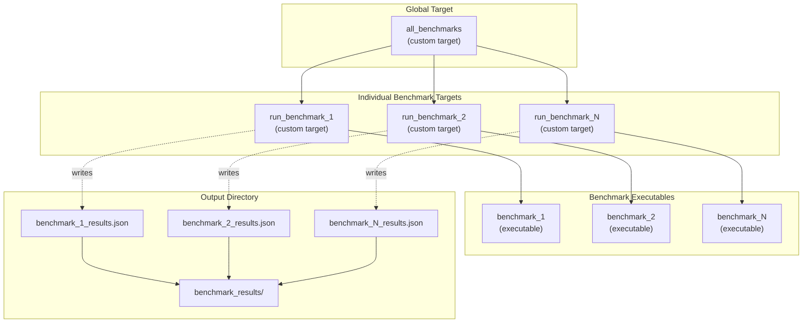
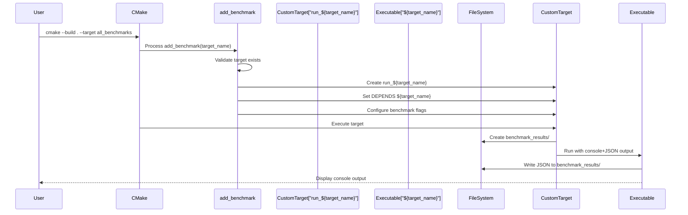
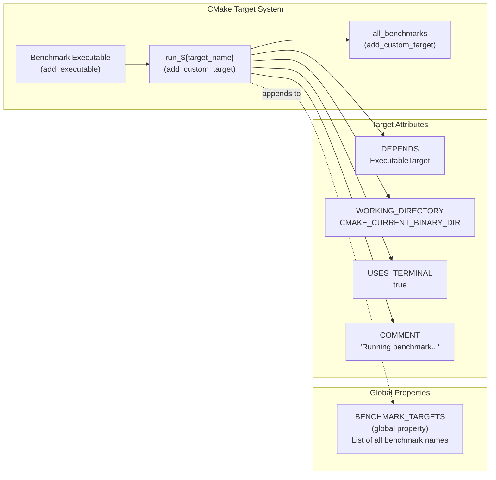

<!-- source: DeepWiki mcp.deepwiki.com · repo NVIDIA/aerial-framework · page 4.6 Testing and Benchmarking · fetched 2026-11-11 -->

# Testing and Benchmarking

<details>
<summary>Relevant source files</summary>

The following files were used as context for generating this wiki page:

- [CMakePresets.json](CMakePresets.json)
- [cmake/Benchmarks.cmake](cmake/Benchmarks.cmake)

</details>


## Purpose and Scope

This page describes the benchmarking infrastructure in the Aerial Framework build system, focusing on Google Benchmark integration, the `add_benchmark` function, and test preset configuration. For information about unit testing with GoogleTest and sanitizer configurations, see the build preset documentation in [Build Presets and Configurations](#4.2). For details on external testing dependencies, see [Third-Party Libraries](#5.2).

---

## Google Benchmark Integration

The Aerial Framework integrates Google Benchmark through a CMake module that provides a standardized interface for adding performance benchmarks to the build system. The integration automatically handles benchmark execution, result collection, and output formatting.

### Global Benchmark Target

The build system creates a global target named `all_benchmarks` that aggregates all registered benchmark executables. This target is defined in [cmake/Benchmarks.cmake:17-19]().



**Diagram: Benchmark Target Hierarchy**

Sources: [cmake/Benchmarks.cmake:17-19](), [cmake/Benchmarks.cmake:29-43]()

---

## The add_benchmark Function

The `add_benchmark` function is the primary interface for registering benchmark executables with the build system. It creates wrapper targets that execute benchmarks with standardized flags and output formatting.

### Function Signature

```cmake
add_benchmark(target_name)
```

**Parameters:**
| Parameter | Type | Description |
|-----------|------|-------------|
| `target_name` | string | Name of an existing executable target built with Google Benchmark |

### Function Behavior

The `add_benchmark` function performs the following operations:

1. **Target Validation**: Verifies that `target_name` exists as a CMake target [cmake/Benchmarks.cmake:25-27]()
2. **Result Directory Creation**: Creates `${CMAKE_BINARY_DIR}/benchmark_results` directory [cmake/Benchmarks.cmake:31]()
3. **Execution Target**: Creates a `run_${target_name}` custom target [cmake/Benchmarks.cmake:29-40]()
4. **Global Registration**: Adds the run target as a dependency of `all_benchmarks` [cmake/Benchmarks.cmake:43]()
5. **Property Tracking**: Stores the benchmark name in the global `BENCHMARK_TARGETS` property [cmake/Benchmarks.cmake:46]()

### Command-Line Flags

Each registered benchmark is executed with the following Google Benchmark flags:

| Flag | Value | Purpose |
|------|-------|---------|
| `--benchmark_format` | `console` | Display human-readable output to terminal |
| `--benchmark_out_format` | `json` | Format the output file as JSON |
| `--benchmark_out` | `${CMAKE_BINARY_DIR}/benchmark_results/${target_name}_results.json` | Specify output file location |

Sources: [cmake/Benchmarks.cmake:33-34]()



**Diagram: add_benchmark Execution Flow**

Sources: [cmake/Benchmarks.cmake:24-47]()

---

## Test Presets Configuration

The project defines 12 test presets that correspond to the 12 configure presets, ensuring that tests can be run in any build configuration. Test presets are defined in [CMakePresets.json:184-287]().

### Test Preset Hierarchy

```mermaid
graph TD
    subgraph "Base Configuration"
        TestCommon["test-common<br/>(hidden base preset)"]
    end
    
    subgraph "Standard Test Presets"
        GccDebugTest["gcc-debug<br/>configurePreset: gcc-debug"]
        GccReleaseTest["gcc-release<br/>configurePreset: gcc-release"]
        ClangDebugTest["clang-debug<br/>configurePreset: clang-debug"]
        ClangReleaseTest["clang-release<br/>configurePreset: clang-release"]
    end
    
    subgraph "Sanitizer Test Presets"
        ClangAsanDebugTest["clang-asan-debug<br/>configurePreset: clang-asan-debug"]
        ClangAsanReleaseTest["clang-asan-release<br/>configurePreset: clang-asan-release"]
        ClangTsanDebugTest["clang-tsan-debug<br/>configurePreset: clang-tsan-debug"]
        ClangTsanReleaseTest["clang-tsan-release<br/>configurePreset: clang-tsan-release"]
        GccAsanDebugTest["gcc-asan-debug<br/>configurePreset: gcc-asan-debug"]
        GccAsanReleaseTest["gcc-asan-release<br/>configurePreset: gcc-asan-release"]
        GccTsanDebugTest["gcc-tsan-debug<br/>configurePreset: gcc-tsan-debug"]
        GccTsanReleaseTest["gcc-tsan-release<br/>configurePreset: gcc-tsan-release"]
    end
    
    TestCommon --> GccDebugTest
    TestCommon --> GccReleaseTest
    TestCommon --> ClangDebugTest
    TestCommon --> ClangReleaseTest
    TestCommon --> ClangAsanDebugTest
    TestCommon --> ClangAsanReleaseTest
    TestCommon --> ClangTsanDebugTest
    TestCommon --> ClangTsanReleaseTest
    TestCommon --> GccAsanDebugTest
    TestCommon --> GccAsanReleaseTest
    TestCommon --> GccTsanDebugTest
    TestCommon --> GccTsanReleaseTest
```



**Diagram: Test Preset Inheritance Structure**

Sources: [CMakePresets.json:184-287]()

### Common Test Configuration

The `test-common` preset defines shared settings inherited by all test presets:

#### Output Configuration
| Setting | Value | Description |
|---------|-------|-------------|
| `outputOnFailure` | `true` | Display test output when tests fail |
| `verbosity` | `"verbose"` | Enable detailed test output |

Sources: [CMakePresets.json:189-192]()

#### Execution Configuration
| Setting | Value | Description |
|---------|-------|-------------|
| `noTestsAction` | `"error"` | Fail if no tests are found |
| `stopOnFailure` | `true` | Stop test execution on first failure |

Sources: [CMakePresets.json:193-196]()

#### Environment Variables

The test environment configures GoogleTest and Google Benchmark behavior:

| Variable | Value | Purpose |
|----------|-------|---------|
| `BENCHMARK_COLOR` | `"1"` | Enable colored output for benchmarks |
| `GTEST_COLOR` | `"1"` | Enable colored output for GoogleTest |
| `GTEST_PRINT_TIME` | `"1"` | Display execution time for each test |

Sources: [CMakePresets.json:197-201]()

---

## Running Benchmarks

### Execute All Benchmarks

To run all registered benchmarks:

```bash
cmake --build <build-dir> --target all_benchmarks
```

This command executes every benchmark registered via `add_benchmark`, displaying console output and saving JSON results.

### Execute Individual Benchmarks

To run a specific benchmark:

```bash
cmake --build <build-dir> --target run_<benchmark_name>
```

Or execute the benchmark binary directly:

```bash
<build-dir>/path/to/benchmark_executable --benchmark_format=console
```

### Running Tests with Presets

To run all tests in a specific configuration:

```bash
ctest --preset <preset-name>
```

For example:

```bash
# Run tests in clang debug configuration
ctest --preset clang-debug

# Run tests with AddressSanitizer enabled
ctest --preset clang-asan-debug
```

Sources: [CMakePresets.json:184-287]()

---

## Benchmark Output Structure

### Directory Structure

Benchmark results are stored in a dedicated directory within the build tree:

```
${CMAKE_BINARY_DIR}/
└── benchmark_results/
    ├── benchmark_1_results.json
    ├── benchmark_2_results.json
    └── benchmark_N_results.json
```

Sources: [cmake/Benchmarks.cmake:31](), [cmake/Benchmarks.cmake:34]()

### JSON Output Format

Google Benchmark produces JSON output conforming to the following structure (as per Google Benchmark specification):

```json
{
  "context": {
    "date": "YYYY-MM-DD HH:MM:SS",
    "host_name": "hostname",
    "executable": "benchmark_name",
    "num_cpus": 16,
    "mhz_per_cpu": 2400,
    "cpu_scaling_enabled": false,
    "caches": [ ... ],
    "library_build_type": "release"
  },
  "benchmarks": [
    {
      "name": "BenchmarkFunction/arg",
      "family_index": 0,
      "per_family_instance_index": 0,
      "run_name": "BenchmarkFunction/arg",
      "run_type": "iteration",
      "repetitions": 1,
      "threads": 1,
      "iterations": 1000000,
      "real_time": 123.45,
      "cpu_time": 120.30,
      "time_unit": "ns"
    }
  ]
}
```

The JSON format enables automated performance regression detection and result comparison across benchmark runs.

Sources: [cmake/Benchmarks.cmake:33-34]()

---

## Benchmark Target Properties



**Diagram: Benchmark Target Relationships and Properties**

The `add_benchmark` function configures the following target properties:

| Property | Value | Purpose |
|----------|-------|---------|
| `DEPENDS` | `${target_name}` | Ensures executable is built before running |
| `WORKING_DIRECTORY` | `${CMAKE_CURRENT_BINARY_DIR}` | Sets execution context |
| `USES_TERMINAL` | `true` | Enables direct terminal output |
| `COMMENT` | `"Running ${target_name} with console and JSON output"` | Displays during build |

Additionally, benchmark names are tracked in the global `BENCHMARK_TARGETS` property for potential future use (e.g., generating summary reports or test dashboards).

Sources: [cmake/Benchmarks.cmake:29-46]()

---

## Usage Example

The following example demonstrates how to integrate a benchmark executable into the build system:

```cmake
# Create a benchmark executable with Google Benchmark
add_executable(my_benchmark my_benchmark.cpp)
target_link_libraries(my_benchmark PRIVATE benchmark::benchmark)

# Register it with the benchmark system
add_benchmark(my_benchmark)
```

After registration:
- `cmake --build . --target all_benchmarks` runs the benchmark
- `cmake --build . --target run_my_benchmark` runs only this benchmark
- Results are written to `benchmark_results/my_benchmark_results.json`
- Console output is displayed during execution

Sources: [cmake/Benchmarks.cmake:21-23](), [cmake/Benchmarks.cmake:24-47]()

---

