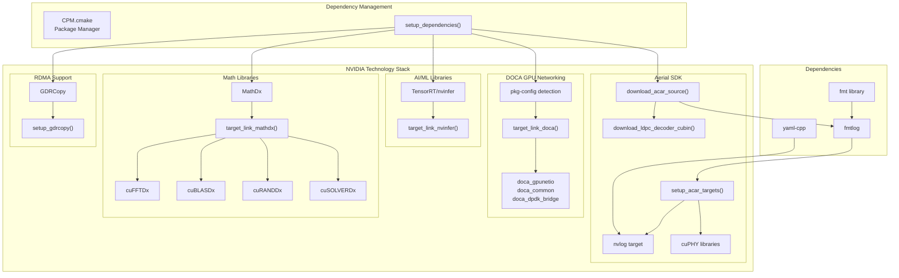
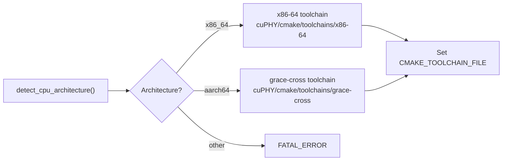
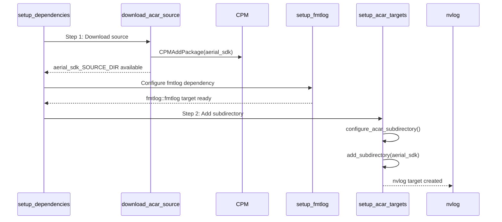
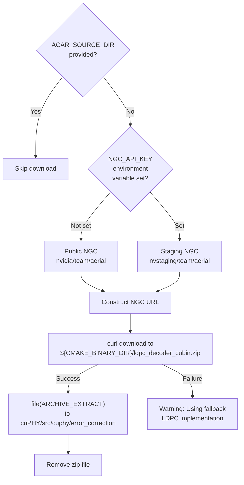
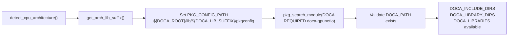
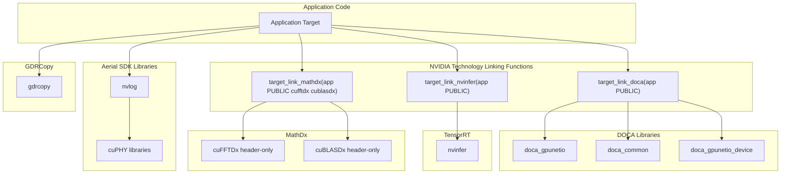

<!-- source: DeepWiki mcp.deepwiki.com · repo NVIDIA/aerial-framework · page 5.1 NVIDIA Technologies · fetched 2026-11-11 -->

# NVIDIA Technologies

<details>
<summary>Relevant source files</summary>

The following files were used as context for generating this wiki page:

- [cmake/Acar.cmake](cmake/Acar.cmake)
- [cmake/Dependencies.cmake](cmake/Dependencies.cmake)
- [cmake/Doca.cmake](cmake/Doca.cmake)

</details>


This page documents the integration of NVIDIA-specific technologies into the Aerial Framework. These technologies provide GPU-accelerated capabilities for signal processing, networking, and machine learning inference that are essential for real-time 3GPP RAN workloads.

For information about third-party open-source libraries, see [Third-Party Libraries](#5.2). For overall build system configuration, see [CMake Configuration](#4.1).

## Overview

The Aerial Framework integrates five key NVIDIA technologies through dedicated CMake modules:

| Technology | Purpose | CMake Module | Target/Function |
|------------|---------|--------------|-----------------|
| Aerial SDK (ACAR) | CUDA-accelerated RAN PHY processing | `cmake/Acar.cmake` | `nvlog`, `setup_acar_targets()` |
| DOCA GPUNetIO | Zero-copy GPU networking via GPUDirect RDMA | `cmake/Doca.cmake` | `target_link_doca()` |
| TensorRT | GPU inference for AI-native PHY | `cmake/Nvinfer.cmake` | `target_link_nvinfer()` |
| MathDx | Header-only GPU math libraries | `cmake/MathDx.cmake` | `target_link_mathdx()` |
| GDRCopy | GPU Direct RDMA memory copy | `cmake/GDRCopy.cmake` | `setup_gdrcopy()` |

These dependencies are managed centrally through `setup_dependencies()` in [cmake/Dependencies.cmake]().

**Sources:** [cmake/Dependencies.cmake:1-411](), [cmake/Acar.cmake:1-279](), [cmake/Doca.cmake:1-102]()

## NVIDIA Technologies Architecture



**Diagram: NVIDIA Technologies Integration Architecture**

This diagram shows how NVIDIA technologies are integrated through CMake functions and how they depend on each other and supporting libraries.

**Sources:** [cmake/Dependencies.cmake:37-410](), [cmake/Acar.cmake:16-201](), [cmake/Doca.cmake:16-101]()

## Aerial SDK (ACAR) Integration

The Aerial SDK provides CUDA-accelerated implementations of 3GPP RAN physical layer functions through the cuPHY library. The integration is handled by [cmake/Acar.cmake]() with a two-step configuration process.

### Configuration Options

The Aerial SDK integration is controlled by several CMake cache variables:

| Variable | Default | Description |
|----------|---------|-------------|
| `ACAR_REPO` | `https://github.com/NVIDIA/aerial-cuda-accelerated-ran.git` | Git repository URL |
| `ACAR_SOURCE_DIR` | empty | Optional path to local source directory |
| `SKIP_ACAR_DOWNLOAD` | `OFF` | Skip download and use `ACAR_SOURCE_DIR` |
| `LDPC_DECODER_CUBIN_VERSION` | `"2f9dcb"` | Version of LDPC decoder cubin files |

**Sources:** [cmake/Acar.cmake:22-29](), [cmake/Acar.cmake:220-222]()

### Architecture and Toolchain Detection

The `configure_acar_subdirectory()` function detects the CPU architecture and selects the appropriate toolchain file:



**Diagram: ACAR Architecture Detection and Toolchain Selection**

The implementation maps architectures to toolchain files:

- `x86_64` → `cuPHY/cmake/toolchains/x86-64`
- `aarch64` → `cuPHY/cmake/toolchains/grace-cross`

**Sources:** [cmake/Acar.cmake:31-81](), [cmake/CpuArchitecture.cmake]()

### Two-Step Setup Process

The Aerial SDK integration uses a two-step process to handle dependency ordering:



**Diagram: Two-Step ACAR Setup Sequence**

The two functions are:

1. **`download_acar_source()`** - Downloads Aerial SDK source via CPM, making `aerial_sdk_SOURCE_DIR` available for patch files and other dependencies. Uses `DOWNLOAD_ONLY YES` to defer building.

2. **`setup_acar_targets()`** - Configures and adds Aerial SDK as a subdirectory after dependencies like `fmtlog` are available. Creates the `nvlog` target.

**Sources:** [cmake/Acar.cmake:83-201](), [cmake/Dependencies.cmake:285-296]()

### Download Implementation

The `download_acar_source()` function handles three scenarios:

| Scenario | Configuration | Behavior |
|----------|---------------|----------|
| Skip download | `SKIP_ACAR_DOWNLOAD=ON` | Uses existing source at `ACAR_SOURCE_DIR` |
| Specific directory | `ACAR_SOURCE_DIR=/path` | Downloads to specified path |
| Default | Both empty | Downloads to `${CMAKE_BINARY_DIR}/_deps/aerial_sdk-src` |

The function tracks `ACAR_SOURCE_DIR` changes via `_ACAR_SOURCE_DIR_LAST` cache variable to force reconfiguration when the source directory changes.

**Sources:** [cmake/Acar.cmake:92-169]()

### ACAR Build Configuration

The `configure_acar_subdirectory()` function disables optional Aerial SDK components to minimize build time:

```cmake
set(ENABLE_TESTS OFF PARENT_SCOPE)
set(ENABLE_YANG_PARSER OFF PARENT_SCOPE)
set(AERIAL_METRICS OFF PARENT_SCOPE)
set(ENABLE_SCTP_CHECK OFF PARENT_SCOPE)
set(ENABLE_DOCA_GPU_COMM OFF PARENT_SCOPE)
set(ENABLE_CUMAC OFF PARENT_SCOPE)
set(ENABLE_PYAERIAL OFF PARENT_SCOPE)
```

**Sources:** [cmake/Acar.cmake:59-80]()

### LDPC Decoder Cubin Download

The `download_ldpc_decoder_cubin()` function downloads pre-compiled CUDA binary (cubin) files for the LDPC decoder from NVIDIA NGC:



**Diagram: LDPC Decoder Cubin Download Flow**

The NGC URL pattern is:
```
https://api.ngc.nvidia.com/v2/resources/org/{NGC_ORG_TEAM}/ldpc-decoder-cubin/{VERSION}/files?redirect=true&path=ldpc_decoder_cubin.zip
```

Where `NGC_ORG_TEAM` is:
- `nvidia/team/aerial` (public) if `NGC_API_KEY` is not set
- `nvstaging/team/aerial` (staging) if `NGC_API_KEY` is set

**Sources:** [cmake/Acar.cmake:203-278]()

## DOCA GPUNetIO Integration

DOCA (Data Center Infrastructure on a Chip Architecture) provides GPU-native networking capabilities for zero-copy packet processing via GPUDirect RDMA. The integration uses `pkg-config` for system library detection.

### DOCA Configuration

DOCA is located at a configurable installation path with architecture-specific library paths:

| Variable | Default | Purpose |
|----------|---------|---------|
| `DOCA_ROOT` | `/opt/mellanox/doca` | DOCA installation directory |
| `DOCA_PATH` | Same as `DOCA_ROOT` | Alternative path variable |
| `DOCA_ARCH` | Auto-detected | CPU architecture (x86_64/aarch64) |
| `DOCA_LIB_SUFFIX` | Derived from arch | Library path suffix (x86_64-linux-gnu/aarch64-linux-gnu) |

The pkg-config search path is extended to include DOCA's architecture-specific pkgconfig directory:
```
${DOCA_ROOT}/lib/${DOCA_LIB_SUFFIX}/pkgconfig
```

**Sources:** [cmake/Doca.cmake:22-35]()

### DOCA Library Detection



**Diagram: DOCA Detection via pkg-config**

**Sources:** [cmake/Doca.cmake:16-47]()

### Linking DOCA to Targets

The `target_link_doca()` function configures targets to use DOCA libraries:

```cmake
function(target_link_doca target visibility)
```

**Parameters:**
- `target` - Target to configure
- `visibility` - Required: `PUBLIC`, `PRIVATE`, or `INTERFACE`

**Configuration Applied:**

| Configuration Type | Values |
|-------------------|---------|
| Compile definitions | `ALLOW_EXPERIMENTAL_API`, `DOCA_ALLOW_EXPERIMENTAL_API` |
| Include directories | `${DOCA_INCLUDE_DIRS}` (SYSTEM) |
| Library directories | `${DOCA_LIBRARY_DIRS}`, `${DOCA_GPUNETIO_LIBDIR}` |
| Libraries | `doca_gpunetio`, `doca_common`, `doca_argp`, `doca_eth`, `doca_dpdk_bridge`, `doca_flow`, `doca_rdma` |
| Special linking | `doca_gpunetio_device` with `WHOLE_ARCHIVE` |
| CUDA properties | `CUDA_SEPARABLE_COMPILATION ON`, `CUDA_RESOLVE_DEVICE_SYMBOLS ON` |

**Sources:** [cmake/Doca.cmake:49-101]()

### DOCA GPU Device Library

The DOCA GPU device library requires special whole-archive linking to ensure all device-side symbols are included:

```cmake
target_link_system_libraries(${target} ${DOCA_VISIBILITY}
                             "$<LINK_LIBRARY:WHOLE_ARCHIVE,doca_gpunetio_device>")
```

This uses CMake 3.24+ `LINK_LIBRARY` generator expression to apply whole-archive semantics.

**Sources:** [cmake/Doca.cmake:93-96]()

## TensorRT (nvinfer) Integration

TensorRT provides GPU inference capabilities for deploying AI models compiled via MLIR-TensorRT. The integration is handled by `cmake/Nvinfer.cmake` which is included conditionally:

```cmake
# Setup TensorRT nvinfer library for GPU inference operations
# Provides nvinfer::nvinfer target (use target_link_nvinfer())
if(NOT TARGET nvinfer::nvinfer)
    include(${CMAKE_SOURCE_DIR}/cmake/Nvinfer.cmake)
endif()
```

The module provides the `target_link_nvinfer()` function for linking TensorRT to targets.

**Sources:** [cmake/Dependencies.cmake:175-179]()

## MathDx Libraries Integration

NVIDIA MathDx provides header-only, device-side math libraries optimized for specific GPU architectures. The integration is handled by `cmake/MathDx.cmake`:

```cmake
# Setup MathDx for GPU-accelerated operations (REQUIRED)
# Provides: cuFFTDx (FFT), cuBLASDx (BLAS), cuRANDDx (random), cuSOLVERDx (solver)
# Note: Use target_link_mathdx() with explicit component arguments to link
# header-only components (e.g., cufftdx, cublasdx, curanddx)
if(NOT TARGET mathdx::cufftdx)
    include(${CMAKE_SOURCE_DIR}/cmake/MathDx.cmake)
endif()
```

### MathDx Components

| Component | Target | Purpose |
|-----------|--------|---------|
| cuFFTDx | `mathdx::cufftdx` | Fast Fourier Transform operations |
| cuBLASDx | `mathdx::cublasdx` | Basic Linear Algebra Subprograms |
| cuRANDDx | `mathdx::curanddx` | Random number generation |
| cuSOLVERDx | `mathdx::cusolverdx` | Linear solver operations |

Components are linked using `target_link_mathdx()` with explicit component arguments since they are header-only libraries.

**Sources:** [cmake/Dependencies.cmake:168-173]()

## GDRCopy Integration

GDRCopy (GPUDirect RDMA Copy) enables low-latency, CPU-initiated memory copies between GPU memory and CPU memory using GPUDirect RDMA. The integration is handled by `cmake/GDRCopy.cmake`:

```cmake
# Setup GDRCopy for GPU Direct RDMA memory copy
if(NOT TARGET gdrcopy::gdrcopy)
    include(${CMAKE_SOURCE_DIR}/cmake/GDRCopy.cmake)
    setup_gdrcopy()
endif()
```

The `setup_gdrcopy()` function configures the library for use, creating the `gdrcopy::gdrcopy` target.

**Sources:** [cmake/Dependencies.cmake:162-166]()

## Integration Summary



**Diagram: Application Integration with NVIDIA Technologies**

All NVIDIA technologies are initialized through `setup_dependencies()` in the root CMakeLists.txt. Applications link to these technologies using the provided helper functions:

- `target_link_doca()` - DOCA GPU networking
- `target_link_nvinfer()` - TensorRT inference
- `target_link_mathdx()` - MathDx math libraries
- Direct linking to `nvlog` - Aerial SDK logging
- Direct linking to `gdrcopy::gdrcopy` - GDRCopy RDMA

**Sources:** [cmake/Dependencies.cmake:37-410](), [cmake/Acar.cmake:1-279](), [cmake/Doca.cmake:1-102]()

---

