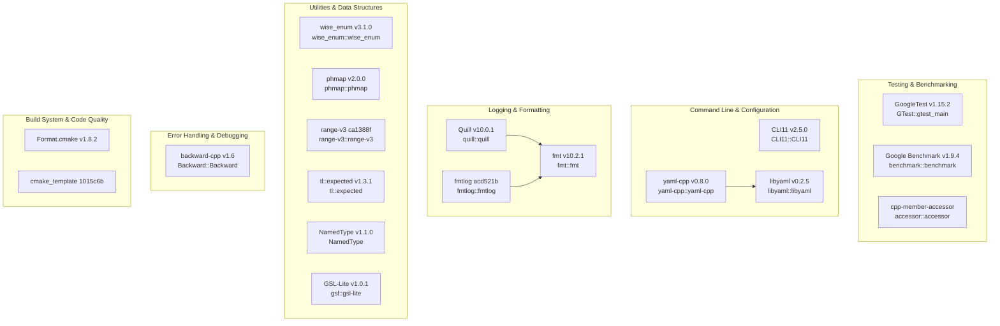
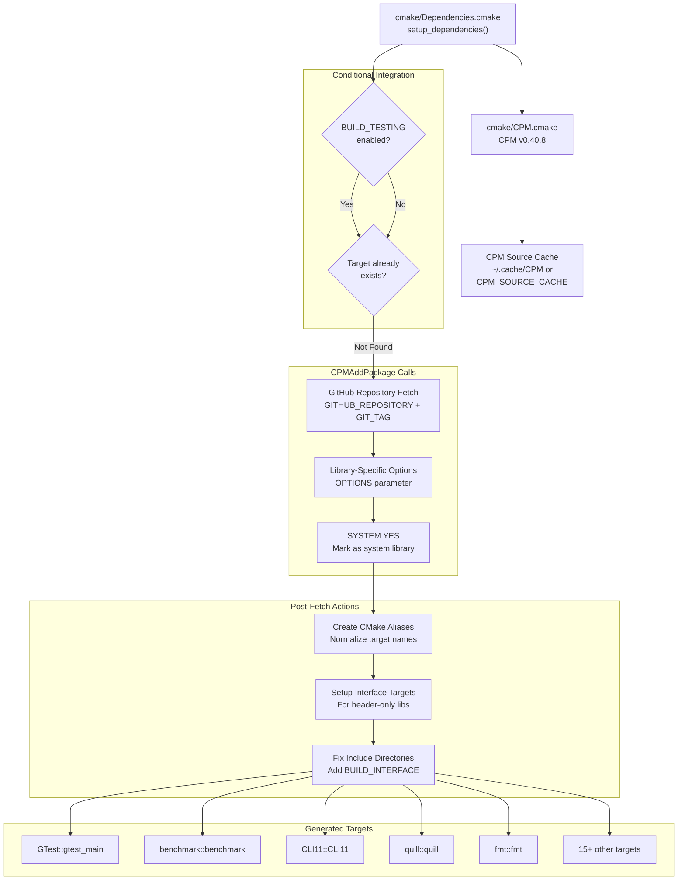

<!-- source: DeepWiki mcp.deepwiki.com · repo NVIDIA/aerial-framework · page 5.2 Third-Party Libraries · fetched 2026-11-11 -->

# Third-Party Libraries

<details>
<summary>Relevant source files</summary>

The following files were used as context for generating this wiki page:

- [ATTRIBUTION.md](ATTRIBUTION.md)
- [cmake/Dependencies.cmake](cmake/Dependencies.cmake)

</details>


## Purpose and Scope

This document provides comprehensive information about all open-source third-party libraries used in the NVIDIA Aerial Framework. These libraries are integrated via CPM (CMake Package Manager) and cover testing, logging, data structures, error handling, and build tooling.

For information about NVIDIA-specific technologies (Aerial SDK, DOCA, TensorRT, MathDx, GDRCopy), see [NVIDIA Technologies](#5.1).

## Library Overview

The Aerial Framework integrates 19 open-source third-party libraries, each serving specific functionality. All libraries are fetched and configured through [cmake/Dependencies.cmake:37-410]().

| Library | Version | License | Primary Purpose | CMake Target |
|---------|---------|---------|-----------------|--------------|
| **cmake_template** | 1015c6b8841 | Unlicense | CMake build system templates | N/A (template) |
| **GoogleTest** | 1.15.2 | BSD 3-Clause | C++ unit testing framework | `GTest::gtest_main` |
| **Google Benchmark** | 1.9.4 | Apache 2.0 | Microbenchmarking framework | `benchmark::benchmark` |
| **cpp-member-accessor** | latest | MIT | Private member access for testing | `accessor::accessor` |
| **CLI11** | 2.5.0 | BSD 3-Clause | Command-line argument parsing | `CLI11::CLI11` |
| **yaml-cpp** | 0.8.0 | MIT | YAML configuration parsing | `yaml-cpp::yaml-cpp` |
| **libyaml** | 0.2.5 | MIT | Low-level YAML parsing (C library) | `libyaml::libyaml` |
| **Quill** | 10.0.1 | MIT | High-performance asynchronous logging | `quill::quill` |
| **fmt** | 10.2.1 | MIT | Modern C++ formatting library | `fmt::fmt` |
| **fmtlog** | acd521b1a64 | MIT | Fast minimal logging with fmt | `fmtlog::fmtlog` |
| **wise_enum** | 3.1.0 | Boost 1.0 | Enum reflection and iteration | `wise_enum::wise_enum` |
| **phmap** | 2.0.0 | Apache 2.0 | Parallel hashmap (header-only) | `phmap::phmap` |
| **range-v3** | ca1388fb9da | Boost 1.0 | Range library for C++14/17/20 | `range-v3::range-v3` |
| **tl::expected** | 1.3.1 | CC0 1.0 | Functional error handling | `tl::expected` |
| **NamedType** | 1.1.0 | MIT | Strong typing for primitives | `NamedType` |
| **GSL-Lite** | 1.0.1 | MIT | C++ Core Guidelines support | `gsl::gsl-lite` |
| **Backward** | 1.6 | MIT | Stack trace generation | `Backward::Backward` |
| **Format.cmake** | 1.8.2 | Apache 2.0 | Code formatting integration | N/A (build tool) |

Sources: [ATTRIBUTION.md:1-794](), [cmake/Dependencies.cmake:37-410]()

## Dependency Categories



Sources: [cmake/Dependencies.cmake:37-410](), [ATTRIBUTION.md:1-794]()

## Integration Architecture via CPM



Sources: [cmake/Dependencies.cmake:16-29](), [cmake/Dependencies.cmake:37-410](), [cmake/CPM.cmake:1]()

## Library Details by Category

### Testing & Benchmarking

#### GoogleTest (v1.15.2)

GoogleTest provides the primary unit testing framework for C++ code. It is conditionally included only when `BUILD_TESTING` is enabled.

**Integration:**
```cmake
# cmake/Dependencies.cmake:44-54
if(BUILD_TESTING)
    if(NOT TARGET GTest::gtest_main)
        cpmaddpackage(
            NAME googletest
            GITHUB_REPOSITORY google/googletest
            GIT_TAG v1.15.2
            SYSTEM YES)
    endif()
endif()
```

**License:** BSD 3-Clause License (Copyright 2008, Google Inc.)

**Usage Pattern:** Link tests with `GTest::gtest_main` to automatically generate a main() function with test runner.

#### Google Benchmark (v1.9.4)

Google Benchmark provides microbenchmarking infrastructure for performance-critical code. JSON output is enabled for CI/CD integration.

**Integration:**
[cmake/Dependencies.cmake:56-69]()

**Configuration Options:**
- `BENCHMARK_ENABLE_TESTING OFF` - Disable benchmark's own tests
- `BENCHMARK_ENABLE_GTEST_TESTS OFF` - Disable Google Test integration in benchmark

**License:** Apache License 2.0 (Copyright 2015 Google Inc.)

**Usage Pattern:** Link benchmarks with `benchmark::benchmark` target. Results can be exported to [benchmark_results/]() directory as JSON.

#### cpp-member-accessor

Custom CMake module that enables accessing private class members in test code for white-box testing scenarios.

**Integration:**
[cmake/Dependencies.cmake:71-74]()

**Module Location:** [cmake/CppMemberAccessor.cmake]()

**License:** MIT License

Sources: [cmake/Dependencies.cmake:43-75](), [ATTRIBUTION.md:68-101](), [ATTRIBUTION.md:305-323]()

### Command Line & Configuration

#### CLI11 (v2.5.0)

Modern C++11 command-line parser that provides type-safe argument parsing with automatic help generation.

**Integration:**
```cmake
# cmake/Dependencies.cmake:77-87
if(NOT TARGET CLI11::CLI11)
    cpmaddpackage(
        NAME CLI11
        GITHUB_REPOSITORY CLIUtils/CLI11
        GIT_TAG v2.5.0
        SYSTEM YES)
endif()
```

**License:** BSD 3-Clause License (Copyright 2017-2024 University of Cincinnati)

**Usage Pattern:** Include `<CLI/CLI.hpp>` and link with `CLI11::CLI11` for command-line parsing in application entry points.

#### yaml-cpp (v0.8.0)

C++ YAML parser and emitter library used for configuration file parsing throughout the framework.

**Integration:**
[cmake/Dependencies.cmake:245-266]()

**Configuration Options:**
- `YAML_CPP_BUILD_TESTS OFF`
- `YAML_CPP_BUILD_TOOLS OFF`
- `YAML_BUILD_SHARED_LIBS OFF`
- `YAML_CPP_FORMAT_SOURCE OFF`
- `YAML_CPP_INSTALL OFF`

**Alias Creation:** Creates `yaml-cpp::yaml-cpp` alias if not provided upstream [cmake/Dependencies.cmake:263-265]()

**License:** MIT License (Copyright 2008-2015 Jesse Beder)

#### libyaml (v0.2.5)

Low-level C library for YAML parsing. Serves as a dependency for the yaml.hpp wrapper used by nvlog.

**Integration:**
[cmake/Dependencies.cmake:221-242]()

**Alias Handling:** Creates stable `libyaml::libyaml` alias regardless of upstream target name (yaml, yaml_static, or libyaml).

**License:** MIT License (Copyright 2006-2016 Kirill Simonov, 2017-2020 Ingy döt Net)

Sources: [cmake/Dependencies.cmake:77-87](), [cmake/Dependencies.cmake:220-266](), [ATTRIBUTION.md:105-135](), [ATTRIBUTION.md:417-474]()

### Logging & Formatting

#### Quill (v10.0.1)

High-performance asynchronous logging library designed for low-latency applications. All logging operations are performed on a background thread to minimize impact on critical paths.

**Integration:**
```cmake
# cmake/Dependencies.cmake:89-103
if(NOT TARGET quill::quill)
    cpmaddpackage(
        NAME quill
        GITHUB_REPOSITORY odygrd/quill
        GIT_TAG v10.0.1
        OPTIONS
        "QUILL_BUILD_TESTS OFF"
        "QUILL_BUILD_BENCHMARKS OFF"
        "QUILL_BUILD_EXAMPLES OFF"
        SYSTEM YES)
endif()
```

**Dependencies:** Requires `fmt::fmt` library [cmake/Dependencies.cmake:89]()

**License:** MIT License (Copyright 2020-2024 Odysseas Georgoudis & contributors)

#### fmt (v10.2.1)

Modern C++ formatting library providing Python-style formatting syntax. Serves as a common dependency for both Quill and fmtlog.

**Integration:**
[cmake/Dependencies.cmake:269-283]()

**Configuration:**
- `BUILD_SHARED_LIBS ON` - Built as shared library
- `CMAKE_POSITION_INDEPENDENT_CODE ON` - Enable PIC for shared linking
- `FMT_INSTALL OFF` - Disable installation rules

**License:** MIT License (Copyright 2012-present, Victor Zverovich and {fmt} contributors)

**Usage Pattern:** Link with `fmt::fmt` and include `<fmt/format.h>` for string formatting operations.

#### fmtlog (commit acd521b1a64)

Fast minimal logging library built on top of fmt. Patched version from aerial_sdk is used.

**Integration:**
```cmake
# cmake/Dependencies.cmake:290-293
if(NOT TARGET fmtlog::fmtlog)
    include(${CMAKE_SOURCE_DIR}/cmake/Fmtlog.cmake)
    setup_fmtlog(${aerial_sdk_SOURCE_DIR})
endif()
```

**Setup Module:** [cmake/Fmtlog.cmake]()

**Patch Source:** Patches are sourced from `${aerial_sdk_SOURCE_DIR}` after calling `download_acar_source()` [cmake/Dependencies.cmake:286]()

**License:** MIT License (Copyright 2021 MengRao)

Sources: [cmake/Dependencies.cmake:89-103](), [cmake/Dependencies.cmake:269-293](), [ATTRIBUTION.md:40-64](), [ATTRIBUTION.md:275-301](), [ATTRIBUTION.md:478-504]()

### Utilities & Data Structures

#### wise_enum (v3.1.0)

Reflection library for C++ enumerations enabling string conversion and iteration over enum values.

**Integration:**
[cmake/Dependencies.cmake:105-129]()

**Special Handling:** 
- Adds `BUILD_INTERFACE` include directories since upstream only sets `INSTALL_INTERFACE` [cmake/Dependencies.cmake:121-122]()
- Creates lowercase alias `wise_enum::wise_enum` [cmake/Dependencies.cmake:125-127]()

**License:** Boost Software License 1.0

#### phmap (v2.0.0)

Header-only parallel hashmap library providing high-performance thread-safe hash containers.

**Integration:**
```cmake
# cmake/Dependencies.cmake:196-218
if(NOT TARGET phmap::phmap)
    cpmaddpackage(
        NAME parallel_hashmap
        GITHUB_REPOSITORY greg7mdp/parallel-hashmap
        GIT_TAG v2.0.0
        OPTIONS
        "PHMAP_BUILD_TESTS OFF"
        "PHMAP_BUILD_EXAMPLES OFF"
        DOWNLOAD_ONLY YES
        SYSTEM YES)
    
    add_library(phmap INTERFACE)
    target_include_directories(phmap SYSTEM INTERFACE "${parallel_hashmap_SOURCE_DIR}/")
    add_library(phmap::phmap ALIAS phmap)
endif()
```

**Manual Interface Target:** Since this is header-only with `DOWNLOAD_ONLY YES`, an interface target is manually created [cmake/Dependencies.cmake:213-217]()

**License:** Apache License 2.0 (Copyright 2019 Gregory Popovitch)

#### range-v3 (commit ca1388fb9da)

Range library providing functional programming primitives for C++14/17/20.

**Integration:**
[cmake/Dependencies.cmake:367-384]()

**Configuration Options:**
- `RANGE_V3_TESTS OFF`
- `RANGE_V3_EXAMPLES OFF`
- `RANGE_V3_PERF OFF`
- `RANGE_V3_HEADER_CHECKS OFF`
- `RANGE_V3_DOCS OFF`
- `RANGE_V3_INSTALL ON`

**License:** Boost Software License 1.0 with additional licenses for incorporated code (libc++, Elements of Programming, SGI STL)

**Usage Pattern:** Include `<range/v3/all.hpp>` and link with `range-v3::range-v3`

#### tl::expected (v1.3.1)

C++11/14/17 implementation of `std::expected` for functional-style error handling without exceptions.

**Integration:**
[cmake/Dependencies.cmake:389-406]()

**Alias Creation:** Creates `tl::expected` alias if upstream only provides `expected` target [cmake/Dependencies.cmake:403-405]()

**License:** CC0 1.0 Universal (Public Domain dedication)

**Usage Pattern:** Include `<tl/expected.hpp>` and link with `tl::expected`

#### NamedType (v1.1.0)

Strong typing library that wraps primitive types to prevent accidental misuse and improve type safety.

**Integration:**
[cmake/Dependencies.cmake:181-193]()

**Configuration:** `ENABLE_TEST OFF`

**License:** MIT License (Copyright 2017 Jonathan Boccara)

#### GSL-Lite (v1.0.1)

Lightweight implementation of the C++ Core Guidelines Support Library (GSL).

**Integration:**
```cmake
# cmake/Dependencies.cmake:150-160
if(NOT TARGET gsl::gsl-lite)
    cpmaddpackage(
        NAME gsl-lite
        GITHUB_REPOSITORY gsl-lite/gsl-lite
        GIT_TAG v1.0.1
        SYSTEM YES)
endif()
```

**License:** MIT License (Copyright 2015-2023 Martin Moene and contributors)

**Usage Pattern:** Provides utilities like `gsl::span`, `gsl::not_null`, and contracts (`Expects`, `Ensures`)

Sources: [cmake/Dependencies.cmake:105-129](), [cmake/Dependencies.cmake:150-160](), [cmake/Dependencies.cmake:181-218](), [cmake/Dependencies.cmake:367-406](), [ATTRIBUTION.md:139-167](), [ATTRIBUTION.md:193-219](), [ATTRIBUTION.md:253-271](), [ATTRIBUTION.md:327-353](), [ATTRIBUTION.md:508-663](), [ATTRIBUTION.md:667-793]()

### Error Handling & Debugging

#### backward-cpp (v1.6)

Stack trace library for generating detailed backtraces on crashes or errors, improving debuggability.

**Integration:**
```cmake
# cmake/Dependencies.cmake:132-148
if(NOT TARGET Backward::Backward)
    cpmaddpackage(
        NAME Backward
        GITHUB_REPOSITORY bombela/backward-cpp
        GIT_TAG v1.6
        SYSTEM YES)
    
    if(NOT TARGET Backward::Backward AND TARGET backward)
        add_library(Backward::Backward ALIAS backward)
    endif()
endif()
```

**Alias Handling:** Creates `Backward::Backward` alias if only `backward` target exists [cmake/Dependencies.cmake:145-147]()

**License:** MIT License (Copyright 2013 Google Inc.)

**Usage Pattern:** Link with `Backward::Backward` to enable automatic stack trace generation on program termination or signals.

Sources: [cmake/Dependencies.cmake:132-148](), [ATTRIBUTION.md:387-413]()

### Build System & Code Quality

#### cmake_template (commit 1015c6b8841)

Base CMake project structure from cpp-best-practices that provides the foundation for the build system organization.

**License:** Unlicense (Public Domain)

**Usage:** Most CMake files in the repository are derived from this template [ATTRIBUTION.md:10]()

#### Format.cmake (v1.8.2)

CMake module that integrates code formatting tools (clang-format, cmake-format) into the build system.

**Integration:**
[cmake/Dependencies.cmake:299-363]()

**Git Configuration:** Automatically configures `clangformat.extensions` in git config to prevent formatting JSON files:
```
c,h,m,mm,cc,cp,cpp,c++,cxx,hh,hpp,hxx,inc,inl,ccm,cppm,cxxm,c++m,cu,cuh,proto,protodevel,java,js,ts,cs,sv,svh,v,vh
```
[cmake/Dependencies.cmake:321-323]()

**License:** Apache License 2.0 (Copyright 2019 Lars Melchior)

**Generated Targets:** Creates formatting targets via [cmake/FormatTargets.cmake:1]() [cmake/Dependencies.cmake:409]()

Sources: [cmake/Dependencies.cmake:299-410](), [ATTRIBUTION.md:5-36](), [ATTRIBUTION.md:171-189]()

## CPM Source Cache Configuration

CPM uses a source cache to avoid re-downloading dependencies across multiple builds. The cache location is determined by the following precedence:

1. `CPM_SOURCE_CACHE` CMake variable (highest priority)
2. `CPM_SOURCE_CACHE` environment variable
3. Default: `~/.cache/CPM` [cmake/Dependencies.cmake:21]()

The configuration logic is implemented at [cmake/Dependencies.cmake:16-29]():

```cmake
if(NOT DEFINED CPM_SOURCE_CACHE AND NOT DEFINED ENV{CPM_SOURCE_CACHE})
    set(ENV{CPM_SOURCE_CACHE} "$ENV{HOME}/.cache/CPM")
    message(STATUS "CPM source cache: $ENV{HOME}/.cache/CPM (default)")
else()
    if(DEFINED CPM_SOURCE_CACHE)
        message(STATUS "CPM source cache: ${CPM_SOURCE_CACHE} (CMake variable)")
    else()
        message(STATUS "CPM source cache: $ENV{CPM_SOURCE_CACHE} (environment variable)")
    endif()
endif()
```

Sources: [cmake/Dependencies.cmake:16-29]()

## License Summary

The project uses libraries under various permissive licenses:

| License Type | Count | Libraries |
|--------------|-------|-----------|
| **MIT License** | 10 | fmt, NamedType, cpp-member-accessor, Quill, GSL-Lite, backward-cpp, libyaml, yaml-cpp, fmtlog, GDRCopy |
| **BSD 3-Clause** | 2 | GoogleTest, CLI11 |
| **Apache 2.0** | 3 | Format.cmake, phmap, Google Benchmark |
| **Boost Software License 1.0** | 2 | wise_enum, range-v3 |
| **CC0 1.0 (Public Domain)** | 1 | tl::expected |
| **Unlicense (Public Domain)** | 1 | cmake_template |

**Total:** 19 third-party libraries

All licenses are permissive and compatible with the project's Apache 2.0 license. Full license texts are available in [ATTRIBUTION.md:1-794]().

Sources: [ATTRIBUTION.md:1-794]()

## Target Name Patterns

The integration code follows consistent patterns for creating and normalizing CMake targets:

### Conditional Target Existence Checks

All libraries check for existing targets before fetching:
```cmake
if(NOT TARGET <namespace>::<name>)
    cpmaddpackage(...)
endif()
```

Examples: [cmake/Dependencies.cmake:44](), [cmake/Dependencies.cmake:77](), [cmake/Dependencies.cmake:89]()

### Alias Creation for Consistency

When upstream packages don't provide expected namespaced targets, aliases are created:

- **wise_enum:** `wise_enum::wise_enum` [cmake/Dependencies.cmake:125-127]()
- **Backward:** `Backward::Backward` [cmake/Dependencies.cmake:145-147]()
- **libyaml:** `libyaml::libyaml` [cmake/Dependencies.cmake:235-241]()
- **yaml-cpp:** `yaml-cpp::yaml-cpp` [cmake/Dependencies.cmake:263-265]()
- **tl::expected:** `tl::expected` [cmake/Dependencies.cmake:403-405]()

### Header-Only Library Handling

Header-only libraries like **phmap** require manual interface target creation when using `DOWNLOAD_ONLY YES`:
[cmake/Dependencies.cmake:213-217]()

### System Library Marking

All external dependencies are marked with `SYSTEM YES` to suppress compiler warnings from third-party code.

Sources: [cmake/Dependencies.cmake:37-410]()

---

