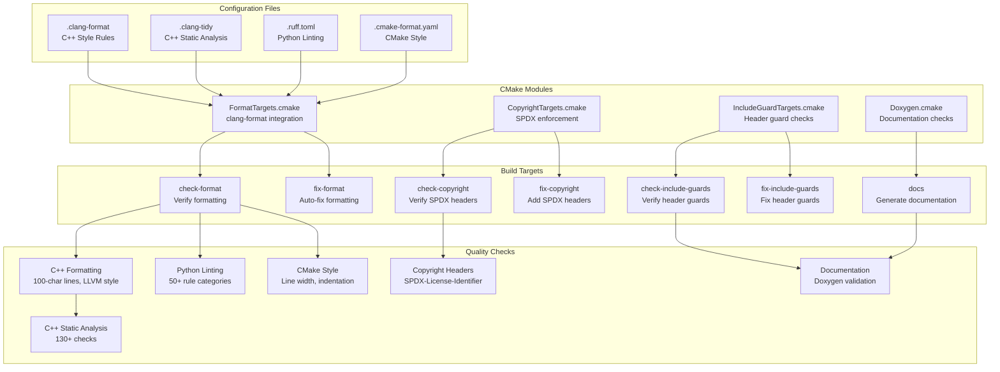
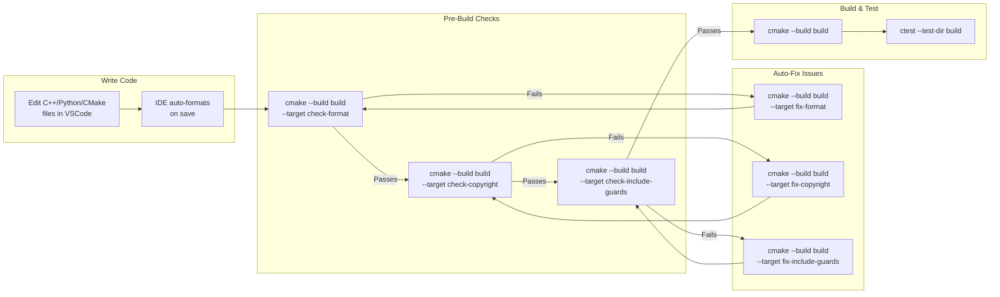

<!-- source: DeepWiki mcp.deepwiki.com · repo NVIDIA/aerial-framework · page 6 Development Guide · fetched 2026-11-11 -->

# Development Guide

<details>
<summary>Relevant source files</summary>

The following files were used as context for generating this wiki page:

- [.clang-format](.clang-format)
- [.clang-tidy](.clang-tidy)
- [.ruff.toml](.ruff.toml)

</details>


This page provides an overview of development practices, code quality enforcement, and tooling for contributing to the NVIDIA Aerial Framework. The framework enforces strict coding standards through automated tooling to ensure consistency, maintainability, and correctness across C++, Python, and CMake codebases.

For information about the build system architecture, see [Build System](#4). For details on testing and validation, see [Testing & Validation Architecture](#6) in the high-level diagrams.

## Overview

The Aerial Framework maintains code quality through:

- **Automated formatting** for C++, Python, and CMake files
- **Static analysis** with over 130 checks for C++ code
- **Linting** with comprehensive rule sets for Python
- **Copyright and license enforcement** with SPDX headers
- **Documentation validation** using Doxygen
- **Include guard validation** for header files

All quality checks are integrated into the CMake build system and can be run via dedicated targets. The development container comes pre-configured with all necessary tools.

## Code Quality Enforcement System

The following diagram shows the complete code quality enforcement architecture:



**Sources:** [.clang-format:1-263](), [.clang-tidy:1-165](), [.ruff.toml:1-267]()

## Development Workflow

The typical development workflow integrates quality checks at multiple stages:



**Sources:** [cmake/FormatTargets.cmake](), [cmake/CopyrightTargets.cmake](), [cmake/IncludeGuardTargets.cmake]()

## Code Quality Tools Summary

The following table summarizes the code quality tools and their purposes:

| Tool | Language | Purpose | Configuration File | CMake Module |
|------|----------|---------|-------------------|--------------|
| clang-format | C++ | Code formatting (LLVM style, 100-char lines) | `.clang-format` | `FormatTargets.cmake` |
| clang-tidy | C++ | Static analysis (130+ checks, naming conventions) | `.clang-tidy` | `FormatTargets.cmake` |
| ruff | Python | Linting and formatting (50+ rule categories) | `.ruff.toml` | `FormatTargets.cmake` |
| cmake-format | CMake | CMake file formatting | `.cmake-format.yaml` | `FormatTargets.cmake` |
| check-copyright | All | SPDX header validation | N/A | `CopyrightTargets.cmake` |
| check-include-guards | C++ | Header guard validation | N/A | `IncludeGuardTargets.cmake` |
| Doxygen | C++ | Documentation generation | `Doxyfile` | `Doxygen.cmake` |

**Sources:** [.clang-format:1-263](), [.clang-tidy:1-165](), [.ruff.toml:1-267]()

## Naming Conventions

The framework follows Rust-inspired naming conventions for C++ code, enforced by clang-tidy:

| Entity Type | Convention | Examples | clang-tidy Configuration |
|-------------|-----------|----------|--------------------------|
| Types (class, struct, enum) | `CamelCase` | `TaskScheduler`, `CudaGraph` | [.clang-tidy:39-52]() |
| Functions and methods | `snake_case` | `schedule_task()`, `execute_graph()` | [.clang-tidy:57-72]() |
| Variables and members | `snake_case` | `buffer_size`, `packet_count` | [.clang-tidy:77-94]() |
| Constants (global/class) | `UPPER_CASE` | `MAX_BUFFER_SIZE`, `DEFAULT_TIMEOUT` | [.clang-tidy:101-122]() |
| Private/protected members | `snake_case_` | `thread_pool_`, `cuda_stream_` | [.clang-tidy:161-164]() |
| Template parameters | `CamelCase` | `typename DeviceType`, `template <int Size>` | [.clang-tidy:133-142]() |
| Namespaces | `snake_case` | `nvidia::aerial`, `cuda_utils` | [.clang-tidy:147-150]() |
| Macros | `UPPER_CASE` | `AERIAL_CHECK_CUDA`, `DOCA_CALL` | [.clang-tidy:155-156]() |
| Enum values | `CamelCase` | `Status::Success`, `Mode::Realtime` | [.clang-tidy:119-122]() |

**Sources:** [.clang-tidy:36-164]()

## Code Style Configuration

### C++ Style Highlights

Key clang-format rules from [.clang-format:1-263]():

- **Line length**: 100 characters ([.clang-format:96]())
- **Indentation**: 4 spaces, never tabs ([.clang-format:154](), [.clang-format:254]())
- **Brace style**: Attach (K&R style) ([.clang-format:90]())
- **Pointer alignment**: Right (`int *ptr`) ([.clang-format:193]())
- **Include sorting**: Enabled with custom priority groups ([.clang-format:114-146]())
- **Argument packing**: One argument per line (`BinPackArguments: false`) ([.clang-format:62-63]())

Include order priority (from highest to lowest):
1. System headers without dot: `<thread>`, `<vector>` (Priority 1)
2. Standard library headers: `<iostream>`, `<memory.hpp>` (Priority 2)
3. Third-party libraries: `<fmt/format.h>`, `<gtest/gtest.h>` (Priority 3)
4. CUDA headers: `<cuda_runtime.h>`, `*.cuh` (Priority 4)
5. Project headers: `"scheduler.hpp"`, `"cuda_graph.hpp"` (Priority 5)

**Sources:** [.clang-format:114-146]()

### Python Style Highlights

Key ruff rules from [.ruff.toml:1-267]():

- **Line length**: 100 characters ([.ruff.toml:36]())
- **Target Python version**: 3.12+ ([.ruff.toml:40]())
- **Docstring convention**: NumPy style ([.ruff.toml:187]())
- **Quote style**: Double quotes ([.ruff.toml:203-206]())
- **Import style**: Absolute imports preferred ([.ruff.toml:235]())
- **Type annotations**: Required for functions ([.ruff.toml:57-58]())
- **Complexity limit**: Max McCabe complexity of 10 ([.ruff.toml:191]())

Enabled rule categories (50+):
- **F**: Pyflakes (basic error detection)
- **E, W**: pycodestyle (PEP 8 enforcement)
- **N**: pep8-naming (naming conventions)
- **D**: pydocstyle (docstring conventions)
- **ANN**: flake8-annotations (type annotations)
- **B**: flake8-bugbear (bug detection)
- **S**: flake8-bandit (security issues)
- **PERF**: perflint (performance anti-patterns)
- Plus 40+ additional categories

**Sources:** [.ruff.toml:42-143]()

## Static Analysis Checks

clang-tidy performs comprehensive static analysis with 130+ checks. Key check categories:

| Category | Purpose | Example Checks |
|----------|---------|----------------|
| bugprone-* | Detect likely bugs | `bugprone-use-after-move`, `bugprone-infinite-loop` |
| cert-* | CERT Secure Coding Standards | `cert-err58-cpp`, `cert-dcl50-cpp` |
| concurrency-* | Thread safety issues | `concurrency-mt-unsafe` |
| cppcoreguidelines-* | C++ Core Guidelines | `cppcoreguidelines-avoid-goto`, `cppcoreguidelines-pro-type-*` |
| modernize-* | Modern C++ practices | `modernize-use-auto`, `modernize-use-nullptr` |
| performance-* | Performance issues | `performance-unnecessary-copy-initialization` |
| readability-* | Code readability | `readability-identifier-naming`, `readability-function-size` |

Disabled check families (to reduce noise):
- `abseil-*`, `altera-*`, `android-*`, `fuchsia-*` (platform-specific)
- `google-*`, `llvm*` (house styles not applicable)
- `zircon-*` (kernel-specific)

**Sources:** [.clang-tidy:2-22]()

## File Filtering

clang-tidy only analyzes headers in the framework source tree:

```
HeaderFilterRegex: '^.*/aerial-framework/(framework|ran)/.*\.(h|hpp|hxx)$'
```

This ensures external dependencies are not checked, only project code.

**Sources:** [.clang-tidy:24]()

## CMake Integration

Quality checks are integrated as CMake targets that can be invoked during build:

```bash
# Check all formatting issues
cmake --build build --target check-format

# Auto-fix all formatting issues
cmake --build build --target fix-format

# Check copyright headers
cmake --build build --target check-copyright

# Add missing copyright headers
cmake --build build --target fix-copyright

# Check include guards
cmake --build build --target check-include-guards

# Fix include guards
cmake --build build --target fix-include-guards

# Generate documentation
cmake --build build --target docs
```

**Sources:** [cmake/FormatTargets.cmake](), [cmake/CopyrightTargets.cmake](), [cmake/IncludeGuardTargets.cmake](), [cmake/Doxygen.cmake]()

## Development Container Integration

The `.devcontainer` configuration includes all code quality tools:

- `clang-format` (version matching `.clang-format` configuration)
- `clang-tidy` (LLVM toolchain)
- `ruff` (Python linter/formatter)
- `cmake-format` (CMake file formatter)
- `doxygen` (documentation generator)

All tools are available on the PATH and integrated with VSCode for on-save formatting.

**Sources:** [.devcontainer/devcontainer.json]()

## Detailed Topics

For detailed information on specific aspects of the development process, see the following pages:

- **[C++ Code Formatting](#6.1)**: clang-format configuration details, include ordering, brace styles
- **[C++ Static Analysis](#6.2)**: clang-tidy check catalog, naming convention enforcement
- **[Python Code Quality](#6.3)**: Ruff rule sets, docstring conventions, type annotation requirements
- **[CMake Formatting](#6.4)**: cmake-format configuration, CMake style guidelines
- **[Documentation with Doxygen](#6.5)**: Doxygen configuration, docstring enforcement, Sphinx integration
- **[Copyright and License Enforcement](#6.6)**: SPDX header format, automated checking and fixing

## Quick Reference: Common Commands

| Task | Command |
|------|---------|
| Format C++ files | `clang-format -i file.cpp` |
| Run clang-tidy on file | `clang-tidy file.cpp -- -Iinclude` |
| Format Python files | `ruff format file.py` |
| Lint Python files | `ruff check file.py` |
| Auto-fix Python issues | `ruff check --fix file.py` |
| Check all formatting | `cmake --build build --target check-format` |
| Fix all formatting | `cmake --build build --target fix-format` |
| Build documentation | `cmake --build build --target docs` |

**Sources:** [.clang-format:1-263](), [.clang-tidy:1-165](), [.ruff.toml:1-267]()

---

