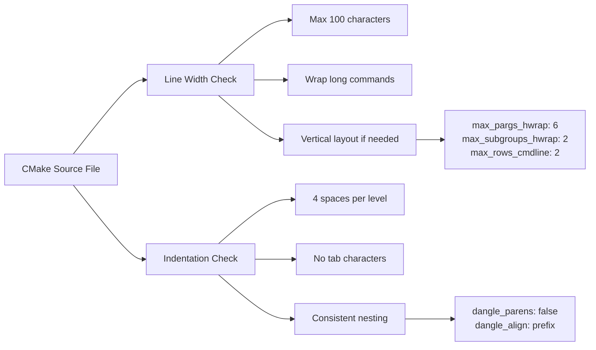
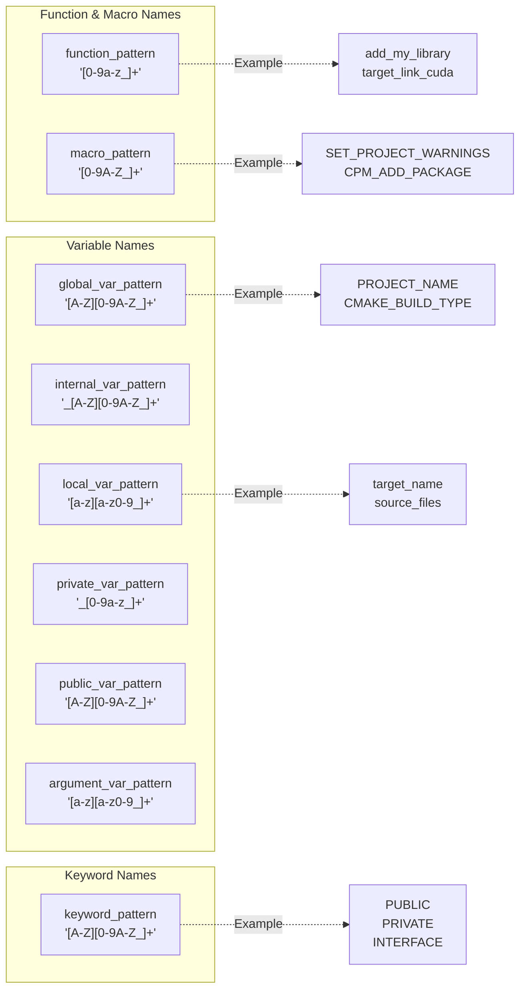
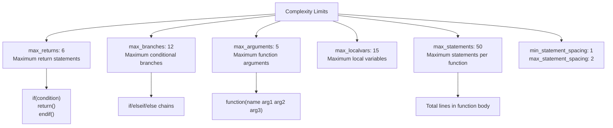
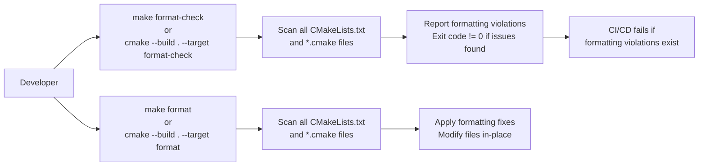
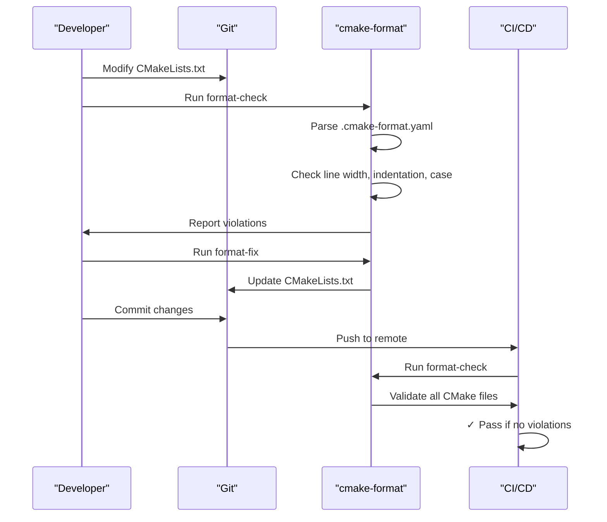

<!-- source: DeepWiki mcp.deepwiki.com · repo NVIDIA/aerial-framework · page 6.4 CMake Formatting · fetched 2026-11-11 -->

# CMake Formatting

<details>
<summary>Relevant source files</summary>

The following files were used as context for generating this wiki page:

- [.cmake-format.yaml](.cmake-format.yaml)

</details>


## Purpose and Scope

This document describes the CMake file formatting configuration used in the NVIDIA Aerial Framework. The project uses `cmake-format` to enforce consistent styling across all CMake files (`CMakeLists.txt` and `*.cmake` modules). This ensures maintainability and readability of the build system configuration.

For related code quality topics, see [C++ Code Formatting](#6.1) for clang-format configuration, [C++ Static Analysis](#6.2) for clang-tidy rules, and [Python Code Quality](#6.3) for Ruff configuration.

## Configuration File Overview

The cmake-format configuration is defined in `.cmake-format.yaml` at the repository root. The configuration file is structured into six major sections:

```mermaid
graph TB
    Config[".cmake-format.yaml"]
    
    Config --> Parse["parse:<br/>Listfile parsing options"]
    Config --> Format["format:<br/>Formatting rules"]
    Config --> Markup["markup:<br/>Comment formatting"]
    Config --> Lint["lint:<br/>Naming & complexity"]
    Config --> Encode["encode:<br/>File encoding"]
    Config --> Misc["misc:<br/>Miscellaneous options"]
    
    Parse --> AdditionalCmds["additional_commands:<br/>Custom function definitions"]
    Parse --> OverrideSpec["override_spec:<br/>Per-command overrides"]
    
    Format --> LineWidth["line_width: 100"]
    Format --> TabSize["tab_size: 4"]
    Format --> CommandCase["command_case: canonical"]
    Format --> EnableSort["enable_sort: true"]
    
    Markup --> FirstLiteral["first_comment_is_literal: true"]
    Markup --> LiteralPattern["literal_comment_pattern"]
    
    Lint --> FunctionPattern["function_pattern: '[0-9a-z_]+'"]
    Lint --> MacroPattern["macro_pattern: '[0-9A-Z_]+'"]
    Lint --> ComplexityLimits["max_returns, max_branches,<br/>max_arguments, etc."]
    
    Encode --> InputEncoding["input_encoding: utf-8"]
    Encode --> OutputEncoding["output_encoding: utf-8"]
```



Sources: [.cmake-format.yaml:1-246]()

## Formatting Rules

### Line Width and Indentation

The formatting configuration enforces consistent line width and indentation across all CMake files:

| Parameter | Value | Description |
|-----------|-------|-------------|
| `line_width` | 100 | Maximum characters per line |
| `tab_size` | 4 | Spaces per indentation level |
| `use_tabchars` | false | Use spaces instead of tab characters |
| `line_ending` | unix | Use Unix-style line endings (LF) |



Sources: [.cmake-format.yaml:28-97]()

### Command and Keyword Case

The formatter standardizes the case of CMake commands and keywords:

- **Command Case**: `canonical` - Uses CMake's canonical case (e.g., `add_library`, `target_link_libraries`)
- **Keyword Case**: `unchanged` - Preserves the original case of keywords (e.g., `PUBLIC`, `PRIVATE`, `INTERFACE`)

This configuration ensures that built-in CMake commands follow the official style guide while allowing flexibility for custom keywords.

Sources: [.cmake-format.yaml:98-103]()

### Parentheses and Layout

Parentheses handling and argument layout rules:

| Parameter | Value | Description |
|-----------|-------|-------------|
| `separate_ctrl_name_with_space` | false | No space between control flow names and `(` |
| `separate_fn_name_with_space` | false | No space between function names and `(` |
| `dangle_parens` | false | Don't put closing `)` on separate line |
| `dangle_align` | prefix | Align to statement start if dangled |
| `min_prefix_chars` | 4 | Minimum chars before forcing rejection |
| `max_prefix_chars` | 10 | Maximum chars before forcing nested layout |

Sources: [.cmake-format.yaml:62-90]()

### Argument Sorting

The formatter can automatically sort argument lists:

- **`enable_sort`**: `true` - Sortable argument lists are sorted lexicographically
- **`autosort`**: `false` - Parser does not infer sortability without annotation

This ensures consistent ordering of file lists, library dependencies, and other sortable CMake arguments.

Sources: [.cmake-format.yaml:107-114]()

## Parsing Configuration

The parse section defines how cmake-format interprets custom CMake functions and commands:

```yaml
additional_commands:
  foo:
    flags:
    - BAR
    - BAZ
    kwargs:
      HEADERS: '*'
      SOURCES: '*'
      DEPENDS: '*'
```

This example demonstrates how to define custom function signatures. For the Aerial Framework, this can be extended to handle project-specific CMake functions like `target_link_cuda` from [cmake/Cuda.cmake]() or `add_benchmark` from [cmake/Benchmarks.cmake]().

Sources: [.cmake-format.yaml:1-16]()

## Comment and Markup Formatting

### Comment Reflow Rules

cmake-format handles comment formatting with special rules for preserving important content:

| Parameter | Value | Description |
|-----------|-------|-------------|
| `enable_markup` | true | Parse and reflow comment markup |
| `first_comment_is_literal` | true | Preserve first comment block (copyright) |
| `literal_comment_pattern` | `(?s).*(Arguments:\|Example usage:\|Note:).*` | Don't reflow blocks matching this pattern |
| `bullet_char` | `*` | Character for bulleted lists |
| `hashruler_min_length` | 10 | Minimum consecutive `#` for hash rulers |

```mermaid
graph TD
    Comment["CMake Comment Block"]
    
    Comment --> First{"First comment<br/>in file?"}
    Comment --> Pattern{"Matches literal<br/>pattern?"}
    Comment --> Ruler{"Hash ruler<br/>(10+ #)?"}
    
    First -->|Yes| Preserve1["Preserve as literal<br/>(copyright/license)"]
    Pattern -->|Yes| Preserve2["Preserve as literal<br/>(Arguments:/Example/Note)"]
    Ruler -->|Yes| Preserve3["Preserve ruler<br/>Canonicalize if needed"]
    
    First -->|No| Reflow
    Pattern -->|No| Reflow
    Ruler -->|No| Reflow["Reflow with markup"]
    
    Reflow --> BulletList["• Bullet lists (* char)"]
    Reflow --> EnumList["1. Enumerated lists"]
    Reflow --> Fence["```code fences```"]
```

The `literal_comment_pattern` specifically preserves blocks containing:
- **Arguments:** - Function/macro argument documentation
- **Example usage:** - Usage examples
- **Note:** - Important notes

This ensures that structured documentation in CMake files remains intact during formatting.

Sources: [.cmake-format.yaml:126-172]()

## Linting Rules

### Naming Conventions

cmake-format enforces naming conventions through regular expression patterns:



### Naming Pattern Rules

| Entity Type | Pattern | Example |
|-------------|---------|---------|
| Functions | `[0-9a-z_]+` | `add_library`, `target_sources` |
| Macros | `[0-9A-Z_]+` | `OPTION`, `CPM_ADD_PACKAGE` |
| Global Variables | `[A-Z][0-9A-Z_]+` | `CMAKE_CXX_STANDARD`, `PROJECT_VERSION` |
| Internal Variables | `_[A-Z][0-9A-Z_]+` | `_CMAKE_INTERNAL_VAR` |
| Local Variables | `[a-z][a-z0-9_]+` | `target_name`, `source_list` |
| Private Variables | `_[0-9a-z_]+` | `_internal_helper` |
| Arguments | `[a-z][a-z0-9_]+` | `target`, `depends` |
| Keywords | `[A-Z][0-9A-Z_]+` | `PUBLIC`, `INTERFACE`, `REQUIRED` |

Sources: [.cmake-format.yaml:177-210]()

### Complexity Limits

The linter enforces complexity limits to maintain readable CMake code:



| Limit | Value | Purpose |
|-------|-------|---------|
| `max_returns` | 6 | Prevent excessive early returns |
| `max_branches` | 12 | Limit conditional complexity |
| `max_arguments` | 5 | Keep function signatures simple |
| `max_localvars` | 15 | Encourage factoring large functions |
| `max_statements` | 50 | Limit function body size |
| `min_statement_spacing` | 1 | Require at least 1 newline between statements |
| `max_statement_spacing` | 2 | Require at most 2 newlines between statements |

These limits help maintain the readability of complex build logic in files like [cmake/Dependencies.cmake]() and [cmake/ProjectOptions.cmake]().

Sources: [.cmake-format.yaml:211-225]()

## Encoding Configuration

File encoding is explicitly configured to ensure consistent handling across platforms:

| Parameter | Value | Description |
|-----------|-------|-------------|
| `emit_byteorder_mark` | false | Do not emit UTF-8 BOM |
| `input_encoding` | utf-8 | Read files as UTF-8 |
| `output_encoding` | utf-8 | Write files as UTF-8 |

CMake officially supports only UTF-8 encoding, so these settings ensure compatibility.

Sources: [.cmake-format.yaml:226-239]()

## Usage and Integration

### Running cmake-format

The cmake-format tool can be invoked through the build system's format targets:



### Format Target Integration

The cmake-format tool is integrated through [cmake/FormatTargets.cmake]() which defines:

- **`format-check`** - Validates CMake file formatting without modifying files
- **`format-fix`** or **`format`** - Applies formatting fixes to all CMake files

These targets work in conjunction with other format checkers:
- C++ formatting via clang-format (see [#6.1](#6.1))
- Python formatting via ruff (see [#6.3](#6.3))
- Copyright header checking (see [#6.6](#6.6))

### Workflow Example



### Configuration Sections Summary

The complete configuration hierarchy:

| Section | Lines | Purpose |
|---------|-------|---------|
| `parse` | 1-22 | Custom command definitions and variable/property tags |
| `format` | 23-125 | Line width, indentation, case, layout, sorting |
| `markup` | 126-171 | Comment reflow, literal patterns, fences, rulers |
| `lint` | 172-225 | Naming patterns, complexity limits, spacing |
| `encode` | 226-239 | UTF-8 encoding configuration |
| `misc` | 240-246 | Per-command overrides |

Sources: [.cmake-format.yaml:1-246]()

## Best Practices

When writing CMake code for the Aerial Framework:

1. **Run format-check before committing** - Ensure all CMake files pass formatting validation
2. **Use canonical case for commands** - Built-in commands like `add_library` follow CMake's canonical style
3. **Keep functions simple** - Respect the complexity limits (5 arguments, 50 statements)
4. **Preserve structured comments** - Use `Arguments:`, `Example usage:`, or `Note:` prefixes for documentation blocks that should not be reflowed
5. **Sort argument lists** - When appropriate, sort file lists and dependencies alphabetically
6. **Follow naming conventions** - Use lowercase_underscore for functions, UPPERCASE_UNDERSCORE for macros

These practices ensure consistency across the build system modules in [cmake/](), making the build configuration easier to understand and maintain.

Sources: [.cmake-format.yaml:1-246]()

---

