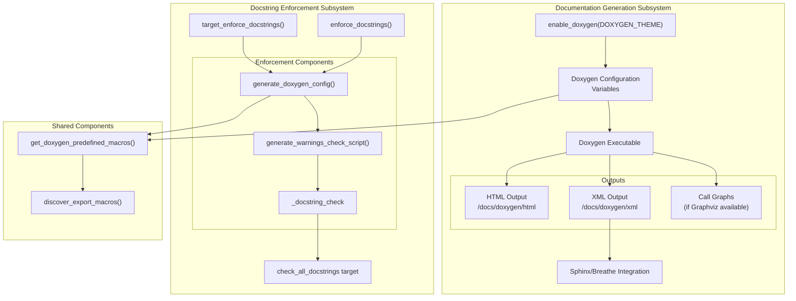
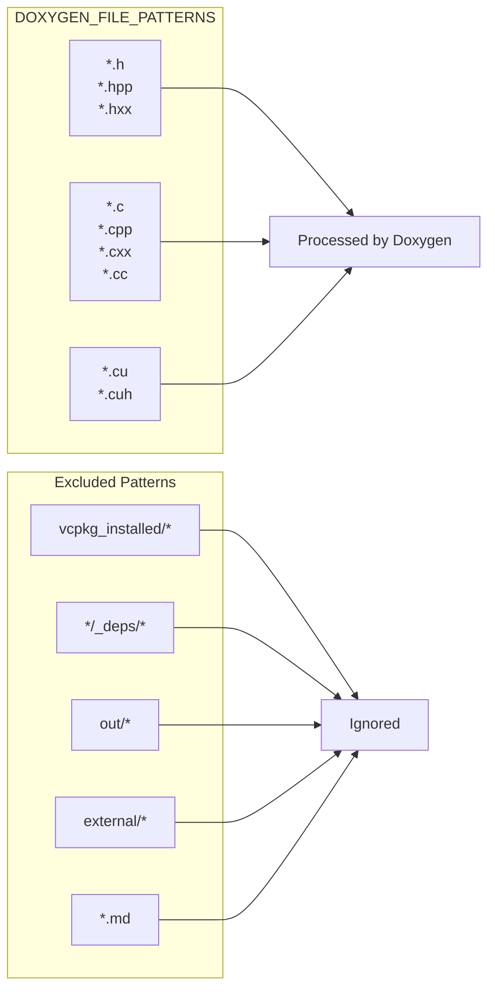
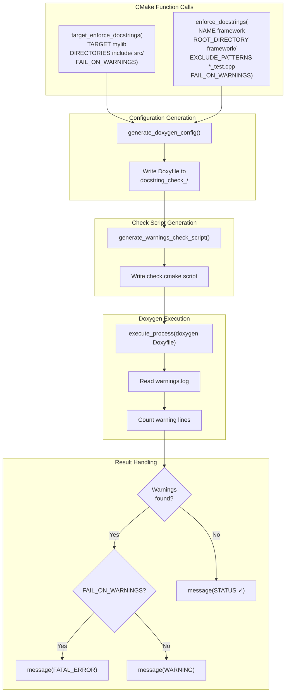
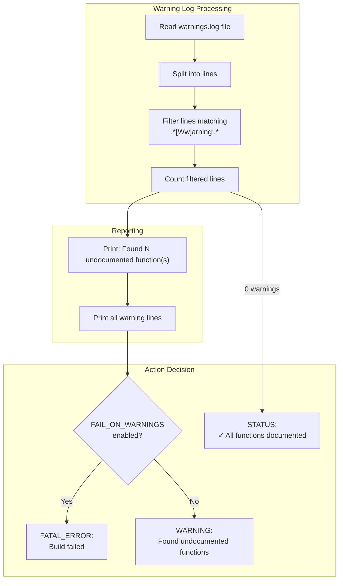
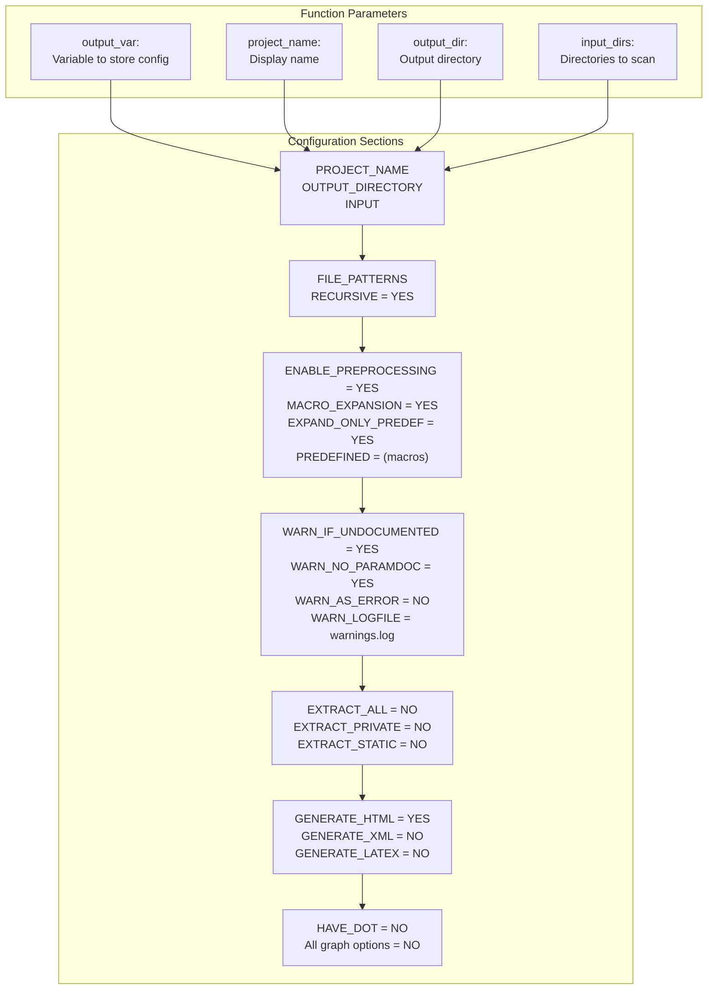
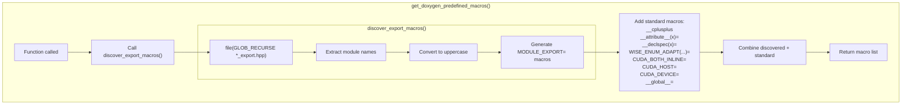
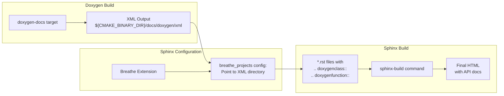

<!-- source: DeepWiki mcp.deepwiki.com · repo NVIDIA/aerial-framework · page 6.5 Documentation with Doxygen · fetched 2026-11-11 -->

# Documentation with Doxygen

<details>
<summary>Relevant source files</summary>

The following files were used as context for generating this wiki page:

- [cmake/Doxygen.cmake](cmake/Doxygen.cmake)

</details>


## Purpose and Scope

This page describes the Doxygen-based documentation system used in the NVIDIA Aerial Framework. The system serves two primary purposes: (1) generating browsable API documentation with HTML and XML output for Sphinx/Breathe integration, and (2) enforcing documentation standards by validating that all public functions have proper docstrings. The CMake module provides the `enable_doxygen()` function for documentation generation and `target_enforce_docstrings()`/`enforce_docstrings()` functions for docstring validation.

For information about other code quality tools, see [C++ Code Formatting](#6.1), [C++ Static Analysis](#6.2), and [Copyright and License Enforcement](#6.6).

**Sources:** [cmake/Doxygen.cmake:1-521]()

---

## Doxygen System Architecture

The Doxygen integration consists of two independent subsystems: the documentation generator and the docstring enforcement system.

### System Overview



**Sources:** [cmake/Doxygen.cmake:19-140](), [cmake/Doxygen.cmake:306-365](), [cmake/Doxygen.cmake:398-463]()

---

## API Documentation Generation

The `enable_doxygen()` function configures and enables full API documentation generation. It is called once in the root CMakeLists.txt to create the `doxygen-docs` target.

### Configuration Function

```mermaid
graph LR
    subgraph "enable_doxygen Input"
        ThemeArg["DOXYGEN_THEME<br/>argument"]
    end
    
    subgraph "Theme Selection"
        EmptyCheck{"Theme empty?"}
        ThemeVal["awesome-sidebar<br/>(default)"]
        FetchTheme["FetchContent_Declare<br/>doxygen-awesome-css v1.6.1"]
        Stylesheet["DOXYGEN_HTML_EXTRA_STYLESHEET"]
    end
    
    subgraph "Doxygen Settings"
        ExtractAll["DOXYGEN_EXTRACT_ALL = YES"]
        TreeView["DOXYGEN_GENERATE_TREEVIEW = YES"]
        WarnError["DOXYGEN_WARN_AS_ERROR = YES"]
        GenXML["DOXYGEN_GENERATE_XML = YES"]
        GenHTML["DOXYGEN_GENERATE_HTML = YES"]
    end
    
    subgraph "Graph Configuration"
        DotCheck{"DOXYGEN_HAVE_DOT?"}
        EnableGraphs["CALLER_GRAPH = YES<br/>CALL_GRAPH = YES<br/>DOT_IMAGE_FORMAT = svg"]
        DisableGraphs["All graph options = NO"]
    end
    
    subgraph "Output"
        FindDoxygen["find_package(Doxygen REQUIRED)"]
        AddTarget["doxygen_add_docs(doxygen-docs ALL)"]
    end
    
    ThemeArg --> EmptyCheck
    EmptyCheck -- "Yes" --> ThemeVal
    EmptyCheck -- "No" --> FetchTheme
    ThemeVal --> FetchTheme
    FetchTheme --> Stylesheet
    
    Stylesheet --> ExtractAll
    ExtractAll --> TreeView
    TreeView --> WarnError
    WarnError --> GenXML
    GenXML --> GenHTML
    
    GenHTML --> DotCheck
    DotCheck -- "Yes" --> EnableGraphs
    DotCheck -- "No" --> DisableGraphs
    
    EnableGraphs --> FindDoxygen
    DisableGraphs --> FindDoxygen
    FindDoxygen --> AddTarget
```



**Sources:** [cmake/Doxygen.cmake:19-140]()

### Key Configuration Options

The function sets numerous Doxygen variables that control the documentation build:

| Setting | Value | Purpose |
|---------|-------|---------|
| `DOXYGEN_EXTRACT_ALL` | `YES` | Extract all entities, even undocumented ones |
| `DOXYGEN_GENERATE_TREEVIEW` | `YES` | Enable tree navigation sidebar |
| `DOXYGEN_WARN_AS_ERROR` | `YES` | Treat warnings as errors in build |
| `DOXYGEN_WARN_IF_UNDOCUMENTED` | `YES` | Warn about missing documentation |
| `DOXYGEN_WARN_NO_PARAMDOC` | `YES` | Warn about undocumented parameters |
| `DOXYGEN_GENERATE_XML` | `YES` | Generate XML for Sphinx/Breathe |
| `DOXYGEN_XML_OUTPUT` | `xml` | XML output directory name |
| `DOXYGEN_GENERATE_HTML` | `YES` | Generate browsable HTML docs |
| `DOXYGEN_HTML_OUTPUT` | `html` | HTML output directory name |
| `DOXYGEN_OUTPUT_DIRECTORY` | `${CMAKE_BINARY_DIR}/docs/doxygen` | Base output directory |

**Sources:** [cmake/Doxygen.cmake:23-89]()

### File Pattern Configuration

Doxygen processes C/C++/CUDA source files exclusively:



**Sources:** [cmake/Doxygen.cmake:59-106]()

### Theme Support

The system supports the modern `doxygen-awesome-css` theme with two variants:

- **`awesome`**: Base theme with modern styling
- **`awesome-sidebar`** (default): Includes sidebar-only navigation

The theme is fetched via CMake's `FetchContent` from GitHub tag `v1.6.1`:

```
https://github.com/jothepro/doxygen-awesome-css/archive/refs/tags/v1.6.1.zip
```

**Sources:** [cmake/Doxygen.cmake:108-128]()

### Build Target

The function creates the `doxygen-docs` target that builds automatically with `ALL`:

```
cmake --build <builddir> --target doxygen-docs
```

Output is generated at: `${CMAKE_BINARY_DIR}/docs/doxygen/html/index.html`

**Sources:** [cmake/Doxygen.cmake:133-139]()

---

## Docstring Enforcement System

The enforcement system validates that all public functions have proper documentation. It provides two functions for different use cases: per-target checking and directory tree checking.

### Enforcement Architecture



**Sources:** [cmake/Doxygen.cmake:306-365](), [cmake/Doxygen.cmake:398-463](), [cmake/Doxygen.cmake:222-285]()

### target_enforce_docstrings Function

This function enforces documentation for specific CMake targets by checking specified directories.

**Function Signature:**
```
target_enforce_docstrings(
    TARGET <target_name>
    DIRECTORIES <dir1> [<dir2>...]
    [FAIL_ON_WARNINGS]
)
```

**Arguments:**

| Argument | Required | Description |
|----------|----------|-------------|
| `TARGET` | Yes | Name of the CMake target |
| `DIRECTORIES` | Yes | List of directories to check |
| `FAIL_ON_WARNINGS` | No | If present, undocumented functions cause build failure |

**Behavior:**
1. Creates output directory: `${CMAKE_CURRENT_BINARY_DIR}/docstring_check_${TARGET}`
2. Generates Doxyfile with enforcement settings
3. Creates check script that runs Doxygen and analyzes warnings
4. Creates target: `${TARGET}_docstring_check`
5. Adds dependency: `${TARGET}` depends on `${TARGET}_docstring_check`
6. Adds to global `check_all_docstrings` target

**Sources:** [cmake/Doxygen.cmake:287-365]()

### enforce_docstrings Function

This function enforces documentation for entire directory trees with pattern-based exclusions.

**Function Signature:**
```
enforce_docstrings(
    NAME <name>
    ROOT_DIRECTORY <directory>
    [EXCLUDE_DIRECTORIES <dir1> [<dir2>...]]
    [EXCLUDE_PATTERNS <pattern1> [<pattern2>...]]
    [FAIL_ON_WARNINGS]
)
```

**Arguments:**

| Argument | Required | Description |
|----------|----------|-------------|
| `NAME` | No | Name for the check (defaults to directory name) |
| `ROOT_DIRECTORY` | Yes | Root directory to scan recursively |
| `EXCLUDE_DIRECTORIES` | No | Directories to exclude from checking |
| `EXCLUDE_PATTERNS` | No | Glob patterns to exclude (e.g., `*_test.cpp`) |
| `FAIL_ON_WARNINGS` | No | If present, undocumented functions cause build failure |

**Behavior:**
1. Creates output directory: `${CMAKE_CURRENT_BINARY_DIR}/docstring_check_${NAME}`
2. Generates Doxyfile with recursive scanning of ROOT_DIRECTORY
3. Adds EXCLUDE_PATTERNS to Doxygen configuration
4. Creates check script and target: `${NAME}_docstring_check`
5. Adds to global `check_all_docstrings` target

**Sources:** [cmake/Doxygen.cmake:367-463]()

### Warning Detection and Reporting

The check script performs detailed warning analysis:



**Sources:** [cmake/Doxygen.cmake:249-283]()

### Build Targets

The enforcement system creates the following targets:

| Target | Purpose |
|--------|---------|
| `${TARGET}_docstring_check` | Check a specific target |
| `${NAME}_docstring_check` | Check a named directory tree |
| `check_all_docstrings` | Check all enforced targets/directories |

**Usage:**
```bash
# Check specific target
cmake --build <builddir> --target mylib_docstring_check

# Check all docstrings
cmake --build <builddir> --target check_all_docstrings
```

**Sources:** [cmake/Doxygen.cmake:347-363](), [cmake/Doxygen.cmake:449-461](), [cmake/Doxygen.cmake:465-474]()

---

## Doxygen Configuration Generation

The `generate_doxygen_config()` helper creates Doxyfile content for the enforcement subsystem with minimal settings.

### Configuration Content



**Sources:** [cmake/Doxygen.cmake:151-220]()

### Key Differences from enable_doxygen

The enforcement configuration differs from the documentation generation configuration:

| Setting | Documentation Build | Enforcement Build | Reason |
|---------|---------------------|-------------------|--------|
| `EXTRACT_ALL` | `YES` | `NO` | Only check documented entities |
| `EXTRACT_PRIVATE` | Default | `NO` | Skip private implementation |
| `WARN_AS_ERROR` | `YES` | `NO` | Let script handle error logic |
| `GENERATE_XML` | `YES` | `NO` | Not needed for validation |
| `GENERATE_HTML` | `YES` (full) | `YES` (minimal) | Required for validation only |
| `HAVE_DOT` | Auto-detect | `NO` | Graphs not needed |

**Sources:** [cmake/Doxygen.cmake:186-217]()

---

## Preprocessing and Macro Handling

Both subsystems use preprocessing to handle C++ attributes, export macros, and CUDA keywords.

### Predefined Macro Discovery



**Sources:** [cmake/Doxygen.cmake:476-520]()

### Standard Predefined Macros

The system defines these macros to hide compiler-specific syntax from Doxygen:

| Macro | Expansion | Purpose |
|-------|-----------|---------|
| `__cplusplus` | (defined) | Enable C++ mode |
| `__attribute__(x)` | (empty) | Remove GCC attributes |
| `__declspec(x)` | (empty) | Remove MSVC declspecs |
| `WISE_ENUM_ADAPT(...)` | (empty) | Hide enum adapter macros |
| `CUDA_BOTH_INLINE` | (empty) | Remove CUDA inline markers |
| `CUDA_HOST` | (empty) | Remove CUDA host markers |
| `CUDA_DEVICE` | (empty) | Remove CUDA device markers |
| `__global__` | (empty) | Remove CUDA kernel markers |

**Sources:** [cmake/Doxygen.cmake:505-519]()

### Export Macro Discovery

The `discover_export_macros()` function automatically finds all library export headers:

1. Searches for `*_export.hpp` files in source and build trees
2. Extracts module name from filename (e.g., `sample_export.hpp` → `SAMPLE`)
3. Generates macro definition: `SAMPLE_EXPORT=` (expands to empty)
4. Returns list of all discovered export macros

This ensures that Doxygen correctly processes shared library visibility attributes without manual configuration.

**Sources:** [cmake/Doxygen.cmake:476-497]()

---

## Source Browsing and Cross-References

The `enable_doxygen()` function configures extensive source code integration.

### Source Browsing Settings

| Setting | Value | Effect |
|---------|-------|--------|
| `DOXYGEN_SOURCE_BROWSER` | `YES` | Include syntax-highlighted source code |
| `DOXYGEN_REFERENCED_BY_RELATION` | `YES` | Show "Referenced by" links |
| `DOXYGEN_REFERENCES_RELATION` | `YES` | Show "References" links |
| `DOXYGEN_REFERENCES_LINK_SOURCE` | `YES` | Link references to source lines |
| `DOXYGEN_SOURCE_TOOLTIPS` | `YES` | Show tooltips on hover |
| `DOXYGEN_VERBATIM_HEADERS` | `YES` | Include full header content |

These settings enable navigation from documentation to source code and vice versa, with bidirectional reference tracking.

**Sources:** [cmake/Doxygen.cmake:71-77]()

---

## Sphinx and Breathe Integration

The XML output generated by `enable_doxygen()` is designed for integration with Sphinx documentation via the Breathe extension.

### Integration Flow



### XML Output Configuration

The XML is generated with specific settings for Breathe compatibility:

- **Output directory:** `${DOXYGEN_OUTPUT_DIRECTORY}/xml`
- **Format:** Standard Doxygen XML schema
- **Content:** Complete API documentation including undocumented entities
- **Cross-references:** Preserved for Sphinx linking

**Sources:** [cmake/Doxygen.cmake:53-57]()

---

## Summary of CMake Functions

### enable_doxygen(DOXYGEN_THEME)

Configures and creates the `doxygen-docs` build target for full API documentation generation with HTML and XML output. Supports optional theme selection.

**Sources:** [cmake/Doxygen.cmake:19-140]()

### target_enforce_docstrings()

Creates per-target docstring validation for specified directories. Adds dependency to the target itself.

**Sources:** [cmake/Doxygen.cmake:306-365]()

### enforce_docstrings()

Creates directory-tree docstring validation with pattern-based exclusions. Does not depend on specific targets.

**Sources:** [cmake/Doxygen.cmake:398-463]()

### generate_doxygen_config(output_var, project_name, output_dir, input_dirs)

Helper function that generates Doxyfile content for enforcement checks. Used internally by both enforcement functions.

**Sources:** [cmake/Doxygen.cmake:151-220]()

### generate_warnings_check_script(output_file, target_name, output_dir, fail_on_warnings)

Helper function that generates CMake script for running Doxygen and analyzing the warnings log. Handles both warning and error modes.

**Sources:** [cmake/Doxygen.cmake:222-285]()

### get_doxygen_predefined_macros(output_var)

Returns list of predefined macros for Doxygen preprocessing, including auto-discovered export macros and standard compiler/CUDA attributes.

**Sources:** [cmake/Doxygen.cmake:499-520]()

### discover_export_macros(output_var)

Automatically discovers library export headers and generates corresponding macro definitions for Doxygen preprocessing.

**Sources:** [cmake/Doxygen.cmake:476-497]()

---

