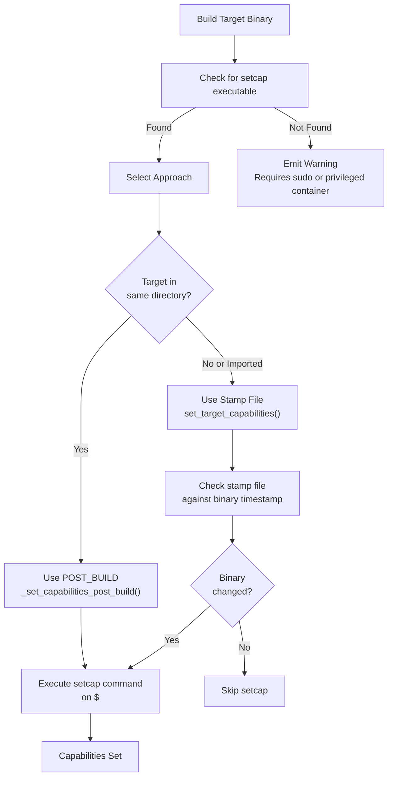
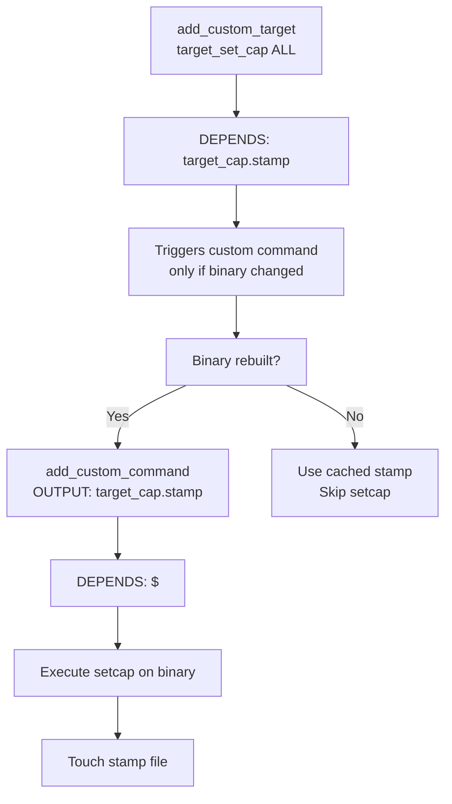
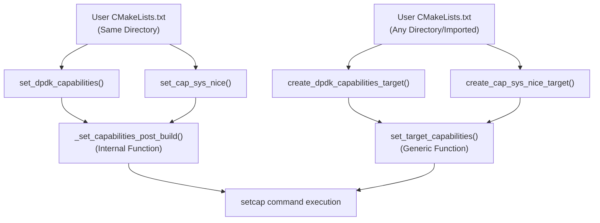

<!-- source: DeepWiki mcp.deepwiki.com · repo NVIDIA/aerial-framework · page 7.1 Linux Capabilities Management · fetched 2026-11-11 -->

# Linux Capabilities Management

<details>
<summary>Relevant source files</summary>

The following files were used as context for generating this wiki page:

- [cmake/CapPermissions.cmake](cmake/CapPermissions.cmake)

</details>


## Purpose and Scope

This document describes the Linux capabilities management system in the Aerial Framework build system, which allows executables to run with elevated privileges without requiring root access or `sudo`. This is critical for real-time signal processing applications that need DPDK networking capabilities and high-priority thread scheduling.

The system provides CMake functions to automatically set Linux capabilities on built executables using the `setcap` command. For general build system information, see [Build System](#4). For compiler and code quality settings, see [Compiler Warnings and Code Quality](#4.5).

**Sources:** [cmake/CapPermissions.cmake:1-111]()

---

## Overview

Linux capabilities partition the privileges traditionally associated with superuser into distinct units that can be independently enabled and disabled. The Aerial Framework requires specific capabilities for:

1. **DPDK operations** - Network device access, raw sockets, DMA operations, and memory locking
2. **Real-time scheduling** - Setting high-priority thread scheduling policies for deterministic execution

The capabilities management system automatically applies these permissions during the build process, eliminating the need to run applications as root or in privileged containers.

**Sources:** [cmake/CapPermissions.cmake:16-19](), [cmake/CapPermissions.cmake:99-101]()

---

## Required Capabilities

### DPDK Capabilities

The `DPDK_CAPABILITIES` variable defines the set of capabilities required for DPDK DevX (Direct Verbs Extensions) and TIS (Transport Interface Send) operations:

| Capability | Purpose |
|------------|---------|
| `cap_net_raw` | Create raw sockets for packet manipulation |
| `cap_net_admin` | Network device configuration and administration |
| `cap_sys_rawio` | Raw I/O port access for direct hardware control |
| `cap_ipc_lock` | Lock memory to prevent swapping (mlockall) |
| `cap_dac_override` | Bypass file read/write/execute permission checks |
| `cap_sys_admin` | System administration operations including huge pages |
| `cap_sys_nice` | Set process priority and scheduling policy |

The capability string format `"cap1,cap2,cap3=eip"` follows the `setcap` syntax where:
- `e` = Effective (capabilities are active)
- `i` = Inheritable (passed to child processes)
- `p` = Permitted (allowed to be activated)

**Sources:** [cmake/CapPermissions.cmake:16-19]()

### CAP_SYS_NICE

The `CAP_SYS_NICE` capability allows setting real-time scheduling policies (SCHED_FIFO, SCHED_RR) and adjusting thread priorities. This is essential for the Aerial Framework's microsecond-level deterministic execution requirements, enabling pinned high-priority threads in the task scheduler.

**Sources:** [cmake/CapPermissions.cmake:100](), [cmake/CapPermissions.cmake:104]()

---

## Implementation Architecture

The system provides two implementation strategies to handle different target types and CMake directory constraints:

### Capability Setting Workflow



**Diagram: Capability Setting Decision Flow**

**Sources:** [cmake/CapPermissions.cmake:24-40](), [cmake/CapPermissions.cmake:48-92]()

### POST_BUILD Approach

The `_set_capabilities_post_build()` function uses CMake's `POST_BUILD` custom command, which executes immediately after the target binary is built. This is the simpler approach but has a critical limitation: it only works for targets defined in the same `CMakeLists.txt` file where the function is called.

**Implementation Details:**
- Finds the `setcap` executable at configure time
- Attaches a custom command directly to the target using `POST_BUILD`
- Executes `setcap` with the specified capabilities on `$<TARGET_FILE>`
- Provides informative echo messages during the build

**Sources:** [cmake/CapPermissions.cmake:24-40]()

### Stamp File Approach

The `set_target_capabilities()` function uses a stamp file pattern to work around CMake's directory limitation. This approach:
- Works with imported targets (e.g., from `find_package()`)
- Works with targets defined in different `CMakeLists.txt` directories
- Only executes `setcap` when the binary actually changes, not on every build

**Stamp File Mechanism:**



**Diagram: Stamp File Dependency Tracking**

The stamp file (`${CMAKE_CURRENT_BINARY_DIR}/${TARGET_NAME}_cap.stamp`) acts as a build artifact that tracks whether `setcap` needs to run. The `DEPENDS` clause on `$<TARGET_FILE:${TARGET_NAME}>` ensures the custom command only executes when the target binary timestamp is newer than the stamp file.

**Sources:** [cmake/CapPermissions.cmake:48-92]()

---

## Public API Functions

### Function Hierarchy



**Diagram: Function Call Hierarchy and Usage Patterns**

**Sources:** [cmake/CapPermissions.cmake:24-111]()

### set_dpdk_capabilities

Sets DPDK capabilities on an executable target in the same directory.

**Signature:**
```cmake
set_dpdk_capabilities(TARGET_NAME)
```

**Parameters:**
- `TARGET_NAME` - Name of the executable target

**Behavior:**
- Calls `_set_capabilities_post_build()` with `DPDK_CAPABILITIES`
- Requires target to be defined in the same `CMakeLists.txt`
- Sets all seven DPDK-required capabilities with `eip` permissions

**Sources:** [cmake/CapPermissions.cmake:94-97]()

### set_cap_sys_nice

Sets `CAP_SYS_NICE` capability on an executable target in the same directory.

**Signature:**
```cmake
set_cap_sys_nice(TARGET_NAME)
```

**Parameters:**
- `TARGET_NAME` - Name of the executable target

**Behavior:**
- Calls `_set_capabilities_post_build()` with `"cap_sys_nice=eip"`
- Enables real-time scheduling policy adjustment
- Requires target to be defined in the same `CMakeLists.txt`

**Sources:** [cmake/CapPermissions.cmake:99-101]()

### create_dpdk_capabilities_target

Creates a capability-setting target for DPDK operations, works across directories.

**Signature:**
```cmake
create_dpdk_capabilities_target(TARGET_NAME)
```

**Parameters:**
- `TARGET_NAME` - Name of the executable target (can be imported or from another directory)

**Behavior:**
- Calls `set_target_capabilities()` with `DPDK_CAPABILITIES`
- Uses stamp file approach for cross-directory support
- Creates a custom target named `${TARGET_NAME}_set_cap`
- Validates that the target exists and is an executable

**Sources:** [cmake/CapPermissions.cmake:107-110]()

### create_cap_sys_nice_target

Creates a capability-setting target for real-time scheduling, works across directories.

**Signature:**
```cmake
create_cap_sys_nice_target(TARGET_NAME)
```

**Parameters:**
- `TARGET_NAME` - Name of the executable target (can be imported or from another directory)

**Behavior:**
- Calls `set_target_capabilities()` with `"cap_sys_nice=eip"`
- Uses stamp file approach for cross-directory support
- Creates a custom target named `${TARGET_NAME}_set_cap`

**Sources:** [cmake/CapPermissions.cmake:103-105]()

### set_target_capabilities (Generic)

The low-level generic function for setting arbitrary capabilities on any target.

**Signature:**
```cmake
set_target_capabilities(TARGET_NAME CAPABILITIES DESCRIPTION)
```

**Parameters:**
- `TARGET_NAME` - Name of the executable target
- `CAPABILITIES` - Capability string in `setcap` format
- `DESCRIPTION` - Human-readable description for log messages

**Behavior:**
1. Validates target exists and is of type `EXECUTABLE`
2. Searches for `setcap` executable
3. Creates stamp file at `${CMAKE_CURRENT_BINARY_DIR}/${TARGET_NAME}_cap.stamp`
4. Creates custom command depending on `$<TARGET_FILE:${TARGET_NAME}>`
5. Creates custom target `${TARGET_NAME}_set_cap` added to `ALL`
6. Only executes `setcap` when binary changes

**Validation:**
```cmake
if(NOT TARGET ${TARGET_NAME})
    message(WARNING "Target ${TARGET_NAME} does not exist, skipping capability setup")
    return()
endif()

if(NOT target_type STREQUAL "EXECUTABLE")
    message(WARNING "Target ${TARGET_NAME} is not an executable (type: ${target_type}), skipping setcap")
    return()
endif()
```

**Sources:** [cmake/CapPermissions.cmake:48-92]()

---

## Usage Examples

### Example 1: DPDK Application in Same Directory

```cmake
add_executable(dpdk_app main.cpp)
target_link_libraries(dpdk_app PRIVATE dpdk::dpdk)

# Set DPDK capabilities after target creation
set_dpdk_capabilities(dpdk_app)
```

**Build Output:**
```
Setting DPDK capabilities for dpdk_app
Capabilities set successfully for dpdk_app
```

**Sources:** [cmake/CapPermissions.cmake:94-97]()

### Example 2: Real-Time Application with CAP_SYS_NICE

```cmake
add_executable(rt_scheduler scheduler.cpp)
target_link_libraries(rt_scheduler PRIVATE pthread)

# Enable real-time scheduling
set_cap_sys_nice(rt_scheduler)
```

**Sources:** [cmake/CapPermissions.cmake:99-101]()

### Example 3: Imported Target from Another Directory

```cmake
# In top-level CMakeLists.txt
find_package(AerialSDK REQUIRED)

# In different CMakeLists.txt - use create_*_target functions
create_dpdk_capabilities_target(AerialSDK::dpdk_example)
create_cap_sys_nice_target(AerialSDK::scheduler)
```

**Sources:** [cmake/CapPermissions.cmake:103-110]()

### Example 4: Custom Capabilities

```cmake
add_executable(custom_app app.cpp)

# Set custom capability set
set_target_capabilities(custom_app 
    "cap_net_raw,cap_net_admin=eip" 
    "Network Access")
```

**Sources:** [cmake/CapPermissions.cmake:48-92]()

---

## Target Type Validation

The system performs runtime validation to ensure capabilities are only set on executable targets:

| Target Type | Action | Reason |
|-------------|--------|--------|
| `EXECUTABLE` | Set capabilities | Executables can have file capabilities |
| `SHARED_LIBRARY` | Skip with warning | Libraries don't support file capabilities |
| `STATIC_LIBRARY` | Skip with warning | Archives don't support file capabilities |
| `INTERFACE_LIBRARY` | Skip with warning | Header-only targets have no binary |
| Non-existent target | Skip with warning | Avoid CMake configuration errors |

**Validation Code Location:** [cmake/CapPermissions.cmake:49-64]()

**Sources:** [cmake/CapPermissions.cmake:49-64]()

---

## Error Handling

### Missing setcap Executable

If the `setcap` command is not found on the system, the functions emit a warning but do not fail the build:

```
WARNING: setcap not found - applications may require sudo or privileged containers
WARNING: setcap not found - dpdk_app may require sudo or privileged containers
```

**Workarounds:**
1. Run applications with `sudo` (not recommended for production)
2. Use a privileged Docker container with `--privileged` flag
3. Install `libcap` package: `apt-get install libcap2-bin` (Debian/Ubuntu)

**Sources:** [cmake/CapPermissions.cmake:37-39](), [cmake/CapPermissions.cmake:88-91]()

### Invalid Target Types

Attempting to set capabilities on non-executable targets generates a warning:

```
WARNING: Target my_library is not an executable (type: SHARED_LIBRARY), skipping setcap
```

This prevents configuration errors and clarifies that capabilities only apply to executables.

**Sources:** [cmake/CapPermissions.cmake:58-64]()

---

## Relationship to Container Environment

In the development container defined by `.devcontainer/devcontainer.json`, capabilities are automatically available because:

1. The container runs with sufficient privileges for development
2. The `libcap2-bin` package provides `setcap` and `getcap` utilities
3. Build outputs in the container volume inherit capability settings

For deployment in production containers, ensure either:
- The container is run with `--cap-add` flags for required capabilities, or
- The container is run in privileged mode, or
- The binary has file capabilities set (which this system automates)

For container setup details, see [Development Environment Setup](#2.1).

**Sources:** [cmake/CapPermissions.cmake:1-111]()

---

## Verification

After building, verify capabilities are correctly set using `getcap`:

```bash
# Check DPDK application
getcap ./build/dpdk_app
# Expected: cap_net_raw,cap_net_admin,cap_sys_rawio,cap_ipc_lock,cap_dac_override,cap_sys_admin,cap_sys_nice=eip

# Check real-time scheduler
getcap ./build/rt_scheduler
# Expected: cap_sys_nice=eip

# List all executables with capabilities
getcap -r ./build/
```

If capabilities are not set, check the build log for warnings about missing `setcap` or target type mismatches.

**Sources:** [cmake/CapPermissions.cmake:16-19](), [cmake/CapPermissions.cmake:100]()

---

## Build System Integration

The capabilities management module is included automatically as part of the root CMake configuration. Individual subdirectories can use the capability functions without explicit inclusion:

```cmake
# In framework/ran/CMakeLists.txt
add_executable(ran_app ${SOURCES})
set_dpdk_capabilities(ran_app)  # Functions are globally available
```

The module file location: [cmake/CapPermissions.cmake:1-111]()

**Sources:** [cmake/CapPermissions.cmake:1-111]()

---

