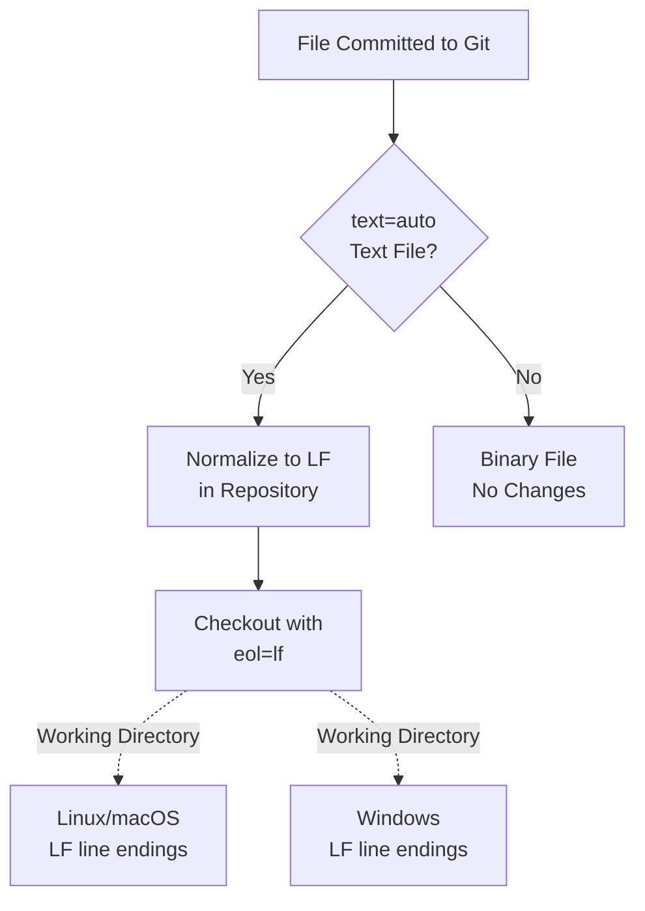
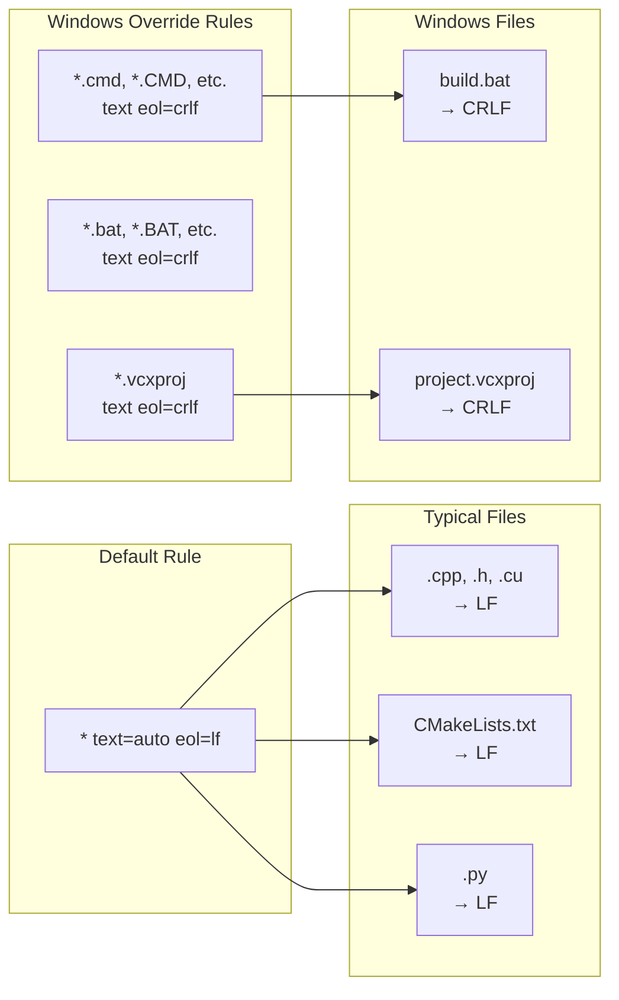
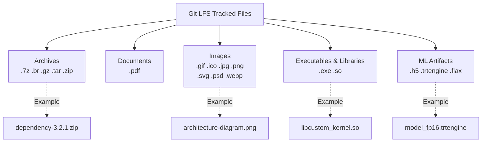
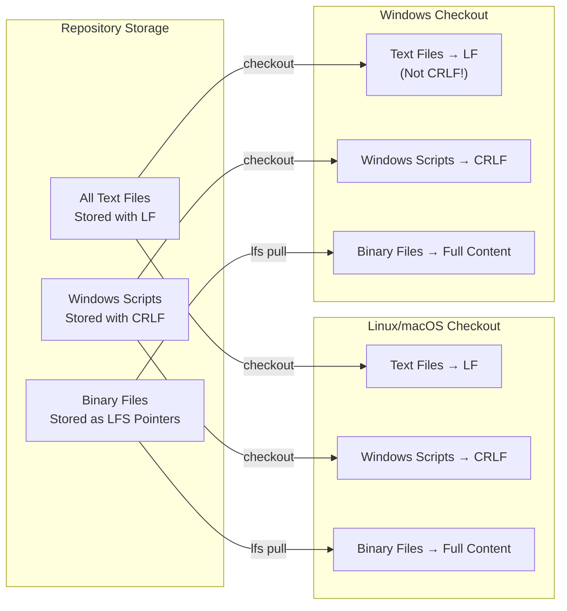

<!-- source: DeepWiki mcp.deepwiki.com · repo NVIDIA/aerial-framework · page 8.1 Git Attributes and LFS · fetched 2026-11-11 -->

# Git Attributes and LFS

<details>
<summary>Relevant source files</summary>

The following files were used as context for generating this wiki page:

- [.gitattributes](.gitattributes)

</details>


## Purpose and Scope

This document describes the Git configuration for line ending normalization and Git Large File System (LFS) integration in the NVIDIA Aerial Framework repository. The `.gitattributes` file defines how Git handles text file line endings across different platforms and identifies binary files that should be stored using Git LFS rather than in the main repository.

For information about which files and directories are ignored from version control, see [Git Ignore Patterns](#8.2).

## Overview

The `.gitattributes` file [.gitattributes:1-35]() serves two primary functions:

1. **Line Ending Normalization**: Ensures consistent line endings across Windows, Linux, and macOS development environments
2. **Git LFS Integration**: Marks binary files (archives, images, compiled binaries) for storage in Git LFS to prevent repository bloat

Sources: [.gitattributes:1-35]()

## Line Ending Configuration

### Default Normalization Strategy

The repository uses a universal line ending normalization strategy defined at [.gitattributes:4]():

```
* text=auto eol=lf
```

This configuration:
- **`text=auto`**: Enables Git's automatic line ending detection and normalization
- **`eol=lf`**: Forces LF (Line Feed, `\n`) line endings in the working directory for all detected text files
- **Scope**: Applies to all files by default (wildcard `*`)

**Diagram: Line Ending Normalization Flow**



Sources: [.gitattributes:4]()

### Windows-Specific Exceptions

Three file types receive platform-specific line ending treatment [.gitattributes:5-7]():

| Pattern | Line Ending | Rationale |
|---------|-------------|-----------|
| `*.{cmd,[cC][mM][dD]}` | CRLF | Windows command scripts require CRLF |
| `*.{bat,[bB][aA][tT]}` | CRLF | Windows batch scripts require CRLF |
| `*.{vcxproj,vcxproj.filters}` | CRLF | Visual Studio project files require CRLF |

The pattern syntax `{cmd,[cC][mM][dD]}` matches both lowercase and uppercase variants (e.g., `cmd`, `CMD`, `Cmd`, `cMd`).

**Diagram: File Extension Pattern Matching**



Sources: [.gitattributes:4-7]()

## Git LFS Configuration

### Overview

Git Large File System (LFS) replaces large binary files with text pointers in the Git repository while storing the actual file contents on a separate LFS server. The Aerial Framework uses LFS for files that:
- Are binary (not human-readable text)
- Change infrequently but consume significant storage
- Would cause repository bloat if stored directly

All LFS-tracked files use the pattern [.gitattributes:12]():

```
filter=lfs diff=lfs merge=lfs -text
```

| Attribute | Meaning |
|-----------|---------|
| `filter=lfs` | Use LFS smudge/clean filters on checkout/commit |
| `diff=lfs` | Use LFS-specific diff algorithm |
| `merge=lfs` | Use LFS-specific merge driver |
| `-text` | Mark file as binary (disable text normalization) |

Sources: [.gitattributes:10-35]()

### File Type Categories

**Diagram: LFS File Type Classification**



Sources: [.gitattributes:11-34]()

#### Archive Files

Compressed archives are tracked in LFS [.gitattributes:12-16]():

| Extension | Compression Type | Use Case |
|-----------|------------------|----------|
| `.7z` | 7-Zip | High compression ratio archives |
| `.br` | Brotli | Web-optimized compression |
| `.gz` | Gzip | Unix/Linux standard compression |
| `.tar` | Tape Archive | Uncompressed archives (often combined with .gz) |
| `.zip` | ZIP | Cross-platform archives |

#### Document Files

PDF documents are LFS-tracked [.gitattributes:18](). Common uses:
- Technical specifications
- Design documents
- User manuals
- Research papers

#### Image Files

Seven image formats are LFS-tracked [.gitattributes:20-26]():

| Extension | Format | Typical Use |
|-----------|--------|-------------|
| `.gif` | GIF (Graphics Interchange Format) | Animations, simple graphics |
| `.ico` | Icon | Application icons |
| `.jpg` | JPEG | Photographs, complex images |
| `.png` | PNG (Portable Network Graphics) | Screenshots, diagrams with transparency |
| `.svg` | SVG (Scalable Vector Graphics) | Scalable diagrams, logos |
| `.psd` | Photoshop Document | Source graphics files |
| `.webp` | WebP | Modern web-optimized images |

Note: `.svg` files are technically text-based XML but are treated as binary in this configuration due to their typical use as pre-rendered assets.

#### Machine Learning Artifacts

ML-specific binary formats are LFS-tracked [.gitattributes:31-34]():

| Extension | Framework | Description |
|-----------|-----------|-------------|
| `.h5` | Keras/TensorFlow | HDF5 model weights |
| `.trtengine` | TensorRT | Compiled TensorRT engines |
| `.flax` | JAX/Flax | Flax model checkpoints |

These files are critical to the Aerial Framework's ML pipeline (see [Developer Tools](#3.1) and [Runtime Engine](#3.2)).

#### Binary Executables and Libraries

Native code binaries are LFS-tracked [.gitattributes:30,33]():

| Extension | Type | Platform |
|-----------|------|----------|
| `.exe` | Windows Executable | Windows |
| `.so` | Shared Object Library | Linux |

#### Commented-Out Fonts

Web fonts are commented out in the current configuration [.gitattributes:28]():

```
#*.woff2 filter=lfs diff=lfs merge=lfs -text
```

This indicates `.woff2` files are currently tracked as regular text files or are not present in the repository.

Sources: [.gitattributes:12-34]()

## Practical Implications

### For Developers

**Cloning the Repository**

When cloning, Git LFS must be installed and initialized:

```bash
git lfs install
git clone https://github.com/NVIDIA/aerial-framework
```

Without LFS, binary files will appear as small text pointer files (typically ~130 bytes) rather than their actual contents.

**Adding New Binary Files**

If adding a new binary file type not already covered by `.gitattributes`:

1. Add the pattern to `.gitattributes`:
   ```
   *.newext filter=lfs diff=lfs merge=lfs -text
   ```

2. Track the file explicitly:
   ```bash
   git lfs track "*.newext"
   ```

3. Commit the `.gitattributes` update:
   ```bash
   git add .gitattributes path/to/file.newext
   git commit -m "Add .newext files to LFS"
   ```

### Cross-Platform Consistency

The line ending configuration ensures that:
- **C++ source files** (`.cpp`, `.h`, `.cu`) use LF on all platforms
- **CMake files** (`CMakeLists.txt`, `*.cmake`) use LF on all platforms  
- **Python files** (`.py`) use LF on all platforms
- **Shell scripts** (`.sh`) use LF on all platforms
- **Windows-specific files** (`.bat`, `.cmd`) correctly use CRLF

This prevents line ending conflicts in pull requests and ensures build scripts execute correctly on their target platforms.

**Diagram: Platform-Specific Handling**



Sources: [.gitattributes:1-35]()

### Storage Efficiency

By using Git LFS for binary files, the repository remains lightweight:

- **Benefit**: Faster clones for users who don't need all historical versions of binary assets
- **Bandwidth**: LFS files are downloaded on-demand during checkout
- **Repository Size**: The main `.git` directory stores only pointer files (~130 bytes each) instead of full binary content

Example size comparison for a hypothetical TensorRT engine file:

| Storage Method | Repository Size | Checkout Size |
|----------------|-----------------|---------------|
| Direct (no LFS) | +250 MB per version | 250 MB |
| With LFS | +130 bytes pointer | 250 MB (downloaded once) |

### Integration with NVIDIA Technologies

Several LFS-tracked file types are specific to NVIDIA's technology stack:

- **`.trtengine`**: TensorRT engines generated by the MLIR-TensorRT compiler (see [NVIDIA Technologies](#5.1))
- **`.h5` / `.flax`**: ML model weights for JAX/PyTorch integration (see [Developer Tools](#3.1))
- **`.so`**: Compiled CUDA kernels and shared libraries for runtime execution (see [Runtime Engine](#3.2))

These files support the framework's two-tier architecture where high-level ML models are compiled to GPU-optimized inference engines.

Sources: [.gitattributes:31-34]()

## Summary

The `.gitattributes` configuration provides:

1. **Consistent Line Endings**: LF (`\n`) for all text files across platforms, with CRLF exceptions only for Windows-native files
2. **Binary File Management**: Git LFS tracking for 18+ file extensions across archives, documents, images, ML artifacts, and executables
3. **Cross-Platform Compatibility**: Proper handling of Windows batch files and Visual Studio projects alongside Unix-style source files
4. **Repository Efficiency**: Reduced clone times and storage by offloading large binary files to LFS

This configuration is critical for maintaining repository hygiene in a cross-platform, GPU-accelerated ML and signal processing framework.

Sources: [.gitattributes:1-35]()

---

