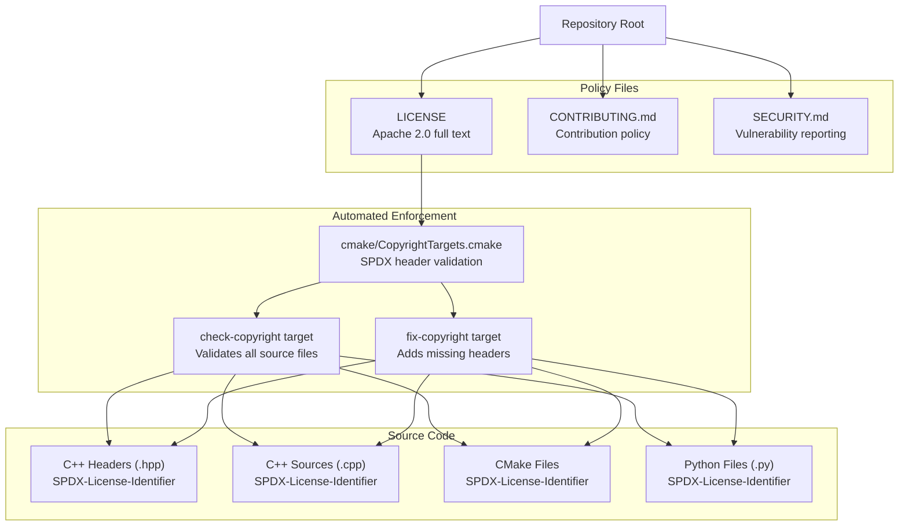
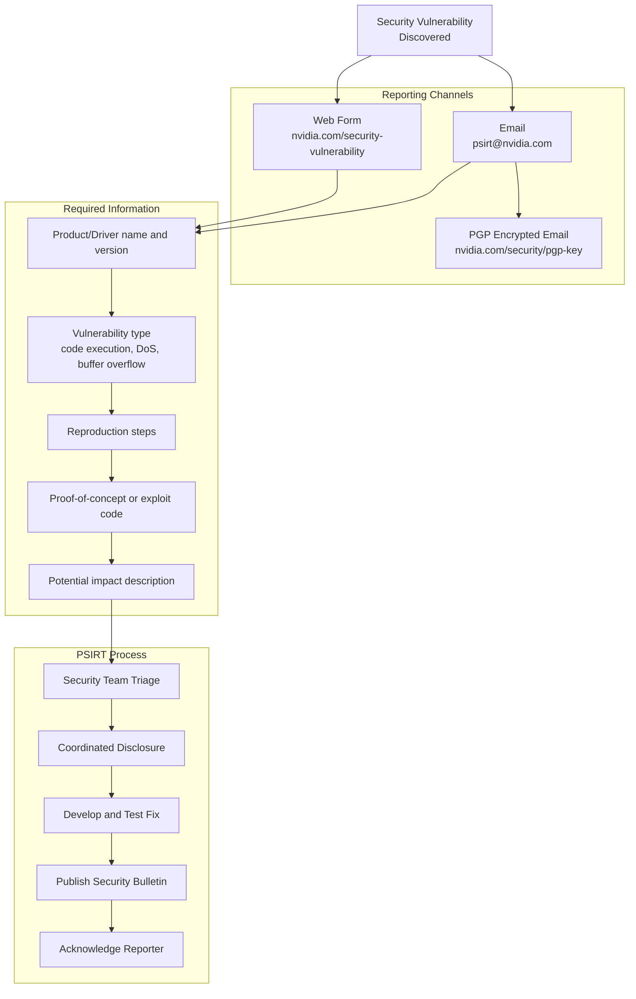
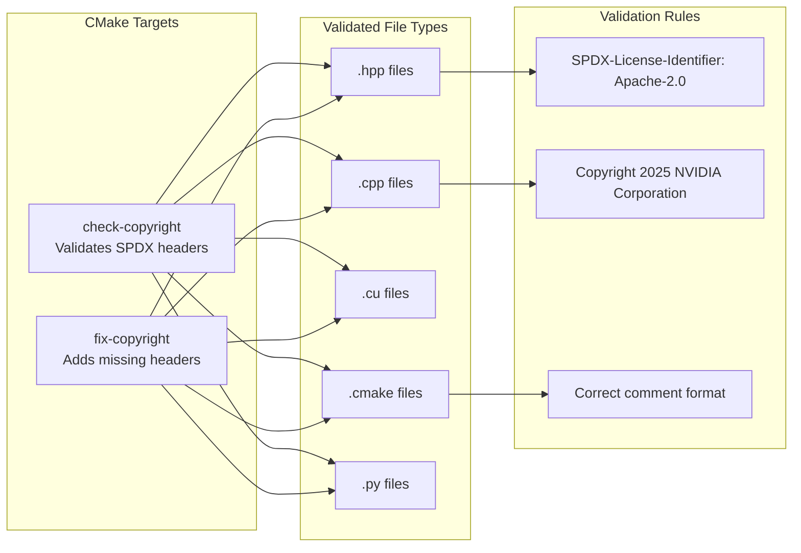

<!-- source: DeepWiki mcp.deepwiki.com · repo NVIDIA/aerial-framework · page 9 Project Policies · fetched 2026-11-11 -->

# Project Policies

<details>
<summary>Relevant source files</summary>

The following files were used as context for generating this wiki page:

- [CONTRIBUTING.md](CONTRIBUTING.md)
- [LICENSE](LICENSE)
- [SECURITY.md](SECURITY.md)

</details>


## Purpose and Scope

This page provides an overview of the legal, contribution, and security policies governing the NVIDIA Aerial Framework project. It covers the Apache 2.0 licensing terms, NVIDIA copyright requirements, the current contribution policy, and procedures for reporting security vulnerabilities.

For detailed information on specific topics:
- License details and third-party attribution: see [License and Attribution](#9.1)
- Contribution procedures and guidelines: see [Contributing Guidelines](#9.2)
- Security vulnerability reporting process: see [Security Policy](#9.3)
- Automated copyright enforcement in builds: see [Copyright and License Enforcement](#6.6)

## Policy Files Overview

The project maintains three primary policy files at the repository root that define the legal and operational framework:

| File | Purpose | Key Information |
|------|---------|-----------------|
| [LICENSE:1-210]() | Apache 2.0 license text and copyright notice | Primary project license, NVIDIA copyright 2025 |
| [CONTRIBUTING.md:1-2]() | Contribution acceptance policy | Currently not accepting external contributions |
| [SECURITY.md:1-24]() | Security vulnerability reporting procedures | PSIRT contact information, disclosure policy |

### Policy Files Structure



**Sources:** [LICENSE:1-210](), [CONTRIBUTING.md:1-2](), [SECURITY.md:1-24]()

## Licensing

The NVIDIA Aerial Framework is licensed under the **Apache License, Version 2.0** (January 2004). All source code in this repository is subject to these terms.

### Copyright Notice

All files in the repository must include the NVIDIA copyright notice and SPDX license identifier:

```
Copyright 2025 NVIDIA Corporation
SPDX-License-Identifier: Apache-2.0
```

**Sources:** [LICENSE:197-209]()

### License Terms Summary

The Apache 2.0 license grants users the following rights:

| Right | Scope | Conditions |
|-------|-------|------------|
| **Use** | Perpetual, worldwide, non-exclusive | Must include license copy |
| **Modify** | Prepare derivative works | Modified files must carry notices |
| **Distribute** | In source or binary form | Must retain attribution notices |
| **Patent Grant** | Irrevocable patent license | Terminates if you sue for patent infringement |
| **Sublicense** | Allowed with conditions | Must comply with license terms |

**Key Restrictions:**
- **No Trademark Rights**: License does not grant permission to use NVIDIA trademarks
- **No Warranty**: Software provided "AS IS" without warranties
- **No Liability**: Contributors not liable for damages

**Sources:** [LICENSE:9-183]()

### Third-Party Dependencies

When building the Aerial Framework, you download NVIDIA and third-party software governed by their own licenses and terms. These are documented at:

```
https://docs.nvidia.com/aerial/framework/latest/acknowledgements.html
```

**Sources:** [LICENSE:1-5]()

### SPDX Header Enforcement

The build system enforces copyright compliance through automated CMake targets that validate all source files contain proper SPDX headers. For implementation details, see [Copyright and License Enforcement](#6.6).

**Sources:** [LICENSE:1-210]()

## Contribution Policy

The project currently **does not accept external contributions**. This is explicitly stated in the contribution policy file:

```markdown
We are not accepting contributions at this time.
```

### Current Policy Status

| Contribution Type | Status |
|------------------|--------|
| Pull Requests | Not accepted |
| Issue Reports | View only (for internal tracking) |
| Feature Requests | Not accepted |
| Documentation Improvements | Not accepted |
| Bug Reports | Security issues only (see Security Policy) |

### Future Contributions

The project may open to external contributions in the future. Check [CONTRIBUTING.md:1-2]() for updates to the contribution policy.

**Sources:** [CONTRIBUTING.md:1-2]()

## Security Vulnerability Reporting

NVIDIA maintains a formal security vulnerability disclosure process through its Product Security Incident Response Team (PSIRT).

### Security Reporting Workflow



**Sources:** [SECURITY.md:1-24]()

### How to Report Security Issues

**Do NOT report security vulnerabilities through GitHub issues or pull requests.**

Use one of the following official channels:

#### Web Form
Submit through the official NVIDIA security vulnerability form:
```
https://www.nvidia.com/object/submit-security-vulnerability.html
```

#### Email
Send reports to: `psirt@nvidia.com`

For sensitive information, use PGP encryption with NVIDIA's public key:
```
https://www.nvidia.com/en-us/security/pgp-key
```

**Sources:** [SECURITY.md:5-12]()

### Required Information for Security Reports

Include the following details in your vulnerability report:

| Field | Description |
|-------|-------------|
| **Product Name** | Aerial Framework + version/branch |
| **Vulnerability Type** | e.g., code execution, denial of service, buffer overflow |
| **Reproduction Steps** | Detailed instructions to reproduce the issue |
| **Proof-of-Concept** | Exploit code or demonstration |
| **Impact Assessment** | How an attacker could exploit the vulnerability |

**Sources:** [SECURITY.md:13-18]()

### Coordinated Vulnerability Disclosure

NVIDIA follows a coordinated vulnerability disclosure policy:

- **Acknowledgement**: Externally reported security issues that are addressed receive public acknowledgement
- **No Bug Bounty**: NVIDIA does not currently offer a bug bounty program
- **Disclosure Timeline**: Follows industry-standard coordinated disclosure practices

For complete policy details, visit:
```
https://www.nvidia.com/en-us/security/psirt-policies/
```

**Sources:** [SECURITY.md:20-21]()

### Additional Security Resources

For all security-related concerns and information about NVIDIA product security:

```
https://www.nvidia.com/en-us/security
```

**Sources:** [SECURITY.md:22-24]()

## License Compliance in Build System

The build system includes automated tools to enforce license compliance across all source files. This ensures that every file contains the required SPDX license identifier and copyright notice.

### Copyright Enforcement Targets



**Sources:** [LICENSE:197-209](), based on build system structure from high-level diagrams

### Running Copyright Checks

To validate all source files contain proper SPDX headers:

```bash
cmake --build build --target check-copyright
```

To automatically add missing SPDX headers to files:

```bash
cmake --build build --target fix-copyright
```

For detailed implementation, see [Copyright and License Enforcement](#6.6).

**Sources:** Build system architecture from high-level diagrams

## Policy Compliance Summary

| Policy Area | Status | Enforcement |
|------------|--------|-------------|
| **License** | Apache 2.0 | Automated SPDX header checks |
| **Copyright** | NVIDIA 2025 | `check-copyright` CMake target |
| **Contributions** | Not accepted | Documented in CONTRIBUTING.md |
| **Security** | Active PSIRT | psirt@nvidia.com |
| **Third-Party Licenses** | Documented | See NGC acknowledgements page |

**Sources:** [LICENSE:1-210](), [CONTRIBUTING.md:1-2](), [SECURITY.md:1-24]()

---

