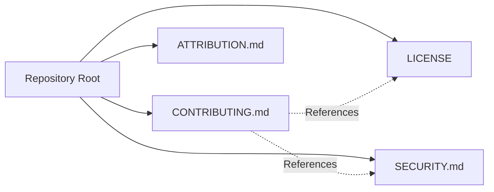
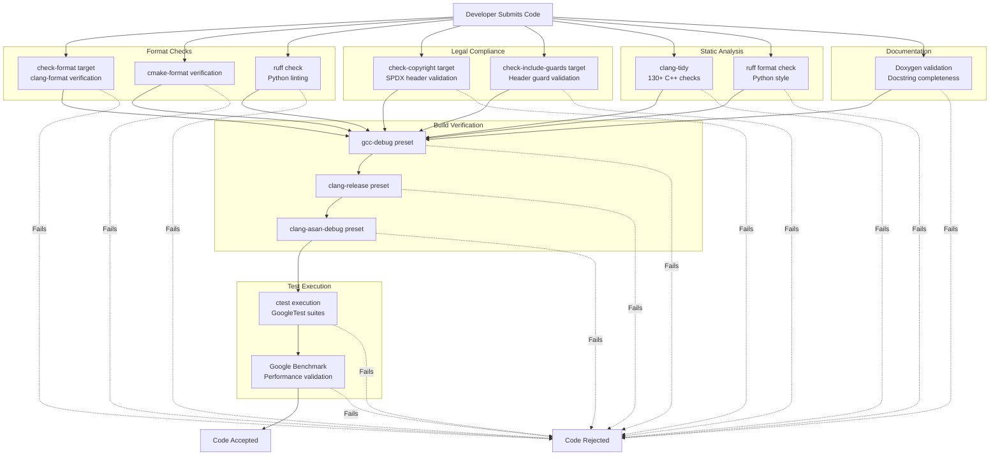
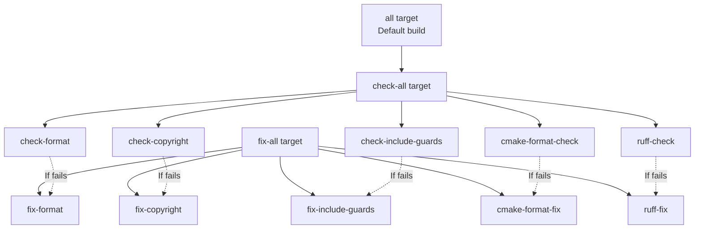
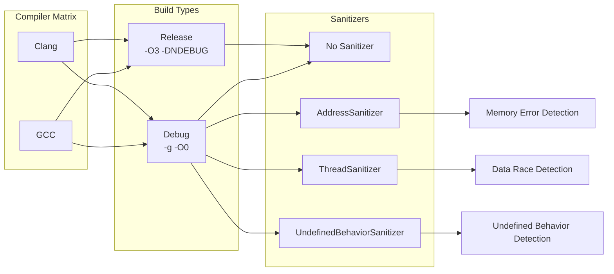
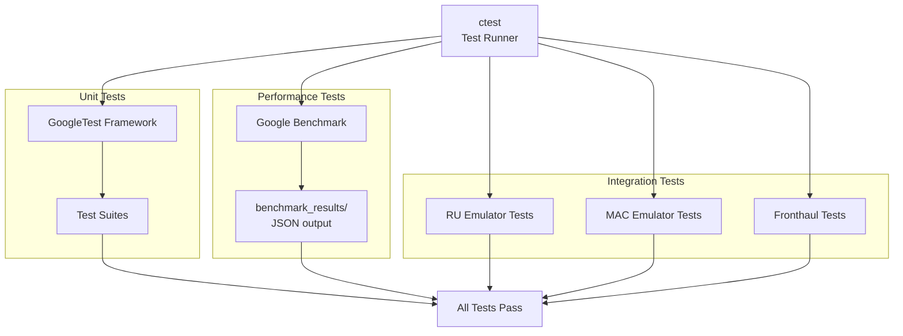

<!-- source: DeepWiki mcp.deepwiki.com · repo NVIDIA/aerial-framework · page 9.2 Contributing Guidelines · fetched 2026-11-11 -->

# Contributing Guidelines

Relevant source files

The following files were used as context for generating this wiki page:

- [CONTRIBUTING.md](CONTRIBUTING.md)

## Purpose and Scope

This document outlines the contribution policy for the NVIDIA Aerial Framework repository. It describes the current state of external contributions, code quality standards that govern all development, and the enforcement mechanisms that maintain consistency across the codebase.

For detailed information about specific development practices, see:
- Code formatting standards: [C++ Code Formatting](#6.1), [Python Code Quality](#6.3), [CMake Formatting](#6.4)
- Static analysis configuration: [C++ Static Analysis](#6.2)
- Documentation requirements: [Documentation with Doxygen](#6.5)
- Legal compliance: [License and Attribution](#9.1), [Copyright and License Enforcement](#6.6)
- Security reporting: [Security Policy](#9.3)

---

## Current Contribution Policy

The NVIDIA Aerial Framework is **not accepting external contributions at this time**. This policy is explicitly stated in the repository's contribution guidelines.

**Sources:** [CONTRIBUTING.md:1]()

---

## Project Status and Context

The Aerial Framework is currently at version 0.1.0, representing an early-stage release of a highly specialized real-time signal processing framework for 3GPP RAN applications. The project requires:

- Deep integration with NVIDIA proprietary technologies (Aerial SDK, DOCA GPUNetIO)
- Microsecond-level timing guarantees and deterministic execution
- Compliance with 3GPP standards and O-RAN specifications
- Extensive domain expertise in telecommunications signal processing

This early-stage status and the specialized nature of the codebase necessitate controlled development by NVIDIA engineers with expertise in both GPU programming and telecommunications protocols.

**Sources:** [VERSION:1](), [README.md]()

---

## Code Quality Standards for Development

While external contributions are not currently accepted, all development in the repository follows strict code quality standards enforced through automated tooling. Understanding these standards provides insight into the project's quality expectations.

### Contribution Policy File Location

**Diagram: Policy Documents Structure** - The CONTRIBUTING.md file is located at the repository root alongside other policy documents that govern legal compliance and security reporting procedures.

**Sources:** [CONTRIBUTING.md:1](), [LICENSE:1](), [SECURITY.md:1](), [ATTRIBUTION.md:1]()

---

## Code Quality Enforcement System

All code merged into the repository must pass through a comprehensive quality enforcement system implemented via CMake targets and automated checks.

### Quality Enforcement Pipeline

**Diagram: Code Quality Enforcement Pipeline** - All code submissions must pass format checks, legal compliance validation, static analysis, multiple build configurations, and comprehensive testing before acceptance.

**Sources:** [cmake/FormatTargets.cmake:1-100](), [cmake/CopyrightTargets.cmake:1-100](), [cmake/IncludeGuardTargets.cmake:1-100](), [.clang-format:1-50](), [.clang-tidy:1-50](), [.ruff.toml:1-50](), [CMakePresets.json:1-200]()

---

## Quality Enforcement Targets

The CMake build system provides specific targets for code quality enforcement that would be used in any contribution workflow:

| Target | Purpose | Implementation | Auto-Fix Available |
|--------|---------|----------------|-------------------|
| `check-format` | Verify C++ code formatting | clang-format with .clang-format config | `fix-format` |
| `check-copyright` | Verify SPDX headers | Python script checking license headers | `fix-copyright` |
| `check-include-guards` | Verify header guards | Python script validating #pragma once or guards | `fix-include-guards` |
| `cmake-format-check` | Verify CMake file formatting | cmake-format with .cmake-format.yaml | `cmake-format-fix` |
| `ruff-check` | Verify Python code quality | ruff with .ruff.toml config | `ruff-fix` |

### CMake Target Dependencies

**Diagram: Quality Check and Fix Targets** - The build system provides check targets for validation and corresponding fix targets for automated correction of format violations.

**Sources:** [cmake/FormatTargets.cmake:1-100](), [cmake/CopyrightTargets.cmake:1-100](), [cmake/IncludeGuardTargets.cmake:1-100]()

---

## Development Standards Reference

Internal NVIDIA contributors and those interested in understanding the project's quality standards should reference the following documentation sections:

### C++ Development Standards

- **Code Style**: Line length 100 characters, 2-space indentation, Allman brace style
  - Configuration: [.clang-format:1-50]()
  - Documentation: [C++ Code Formatting](#6.1)

- **Static Analysis**: 130+ clang-tidy checks including modernize, performance, readability
  - Configuration: [.clang-tidy:1-50]()
  - Documentation: [C++ Static Analysis](#6.2)

- **Naming Conventions**:
  - Classes: `PascalCase`
  - Functions: `snake_case`
  - Variables: `snake_case`
  - Constants: `UPPER_SNAKE_CASE`
  - Private members: `snake_case_` (trailing underscore)

### Python Development Standards

- **Linting**: Ruff with PEP 8 compliance, type annotation enforcement
  - Configuration: [.ruff.toml:1-50]()
  - Documentation: [Python Code Quality](#6.3)

- **Complexity Limits**: McCabe complexity maximum of 10, function length limits

### CMake Development Standards

- **Formatting**: 120 character line width, consistent indentation
  - Configuration: [.cmake-format.yaml:1-50]()
  - Documentation: [CMake Formatting](#6.4)

### Legal Requirements

- **Copyright Headers**: SPDX-License-Identifier: Apache-2.0 required in all source files
  - Enforcement: [cmake/CopyrightTargets.cmake:1-100]()
  - Documentation: [Copyright and License Enforcement](#6.6)

- **Include Guards**: `#pragma once` required in all header files
  - Enforcement: [cmake/IncludeGuardTargets.cmake:1-100]()

**Sources:** [.clang-format:1-50](), [.clang-tidy:1-50](), [.ruff.toml:1-50](), [.cmake-format.yaml:1-50](), [cmake/CopyrightTargets.cmake:1-100](), [cmake/IncludeGuardTargets.cmake:1-100]()

---

## Build and Test Requirements

Any code changes must successfully build and test across multiple configurations:

### Required Build Configurations

**Diagram: Build Configuration Matrix** - Code must build successfully with both GCC and Clang compilers, in debug and release modes, and pass all sanitizer checks.

**Sources:** [CMakePresets.json:1-200]()

### Build Presets

The following presets are defined in CMakePresets.json:

| Preset | Compiler | Build Type | Sanitizer | Purpose |
|--------|----------|------------|-----------|---------|
| `gcc-debug` | GCC | Debug | None | Standard debug builds |
| `gcc-release` | GCC | Release | None | Production builds |
| `clang-debug` | Clang | Debug | None | Clang-based debugging |
| `clang-release` | Clang | Release | None | Clang optimized builds |
| `clang-asan-debug` | Clang | Debug | AddressSanitizer | Memory error detection |
| `clang-tsan-debug` | Clang | Debug | ThreadSanitizer | Race condition detection |
| `clang-ubsan-debug` | Clang | Debug | UBSan | Undefined behavior detection |

**Sources:** [CMakePresets.json:1-200]()

---

## Testing Requirements

All code must pass the comprehensive test suite:

### Test Execution

**Diagram: Test Execution Pipeline** - All unit tests, performance benchmarks, and integration tests must pass before code can be accepted.

**Sources:** [cmake/Benchmarks.cmake:1-100](), [CMakeLists.txt:1-100]()

---

## Future Contribution Opportunities

The contribution policy documented in CONTRIBUTING.md may evolve as the project matures. Potential future changes could include:

1. **Issue Reporting**: Opening the issue tracker for bug reports and feature requests
2. **Documentation Contributions**: Accepting improvements to documentation and examples
3. **Pull Request Process**: Establishing a formal pull request review process
4. **Contributor License Agreement**: Implementing a CLA for external contributors
5. **Community Guidelines**: Developing code of conduct and community interaction policies

Interested parties should monitor the repository for updates to [CONTRIBUTING.md:1-2]() which will reflect any policy changes.

---

## Contact and Questions

For questions about the NVIDIA Aerial Framework that do not involve code contributions:

- **Security Issues**: Follow the procedures in [Security Policy](#9.3)
- **Licensing Questions**: Review [License and Attribution](#9.1)
- **General Inquiries**: Contact NVIDIA through official channels

**Sources:** [CONTRIBUTING.md:1-2](), [SECURITY.md:1](), [LICENSE:1](), [ATTRIBUTION.md:1]()

---

## Summary

The NVIDIA Aerial Framework currently operates under a closed contribution model as documented in [CONTRIBUTING.md:1](). All development follows strict code quality standards enforced through automated tooling including clang-format, clang-tidy, ruff, and comprehensive testing across multiple build configurations. Internal NVIDIA contributors must adhere to the standards documented in sections [6.1](#6.1) through [6.6](#6.6). The contribution policy may evolve as the project reaches maturity beyond version 0.1.0.

---

