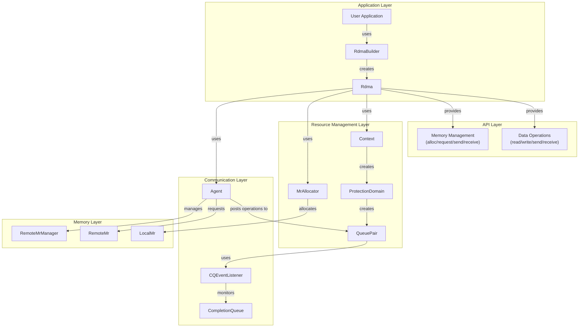
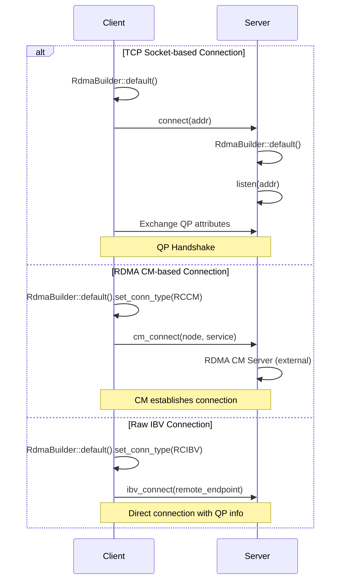
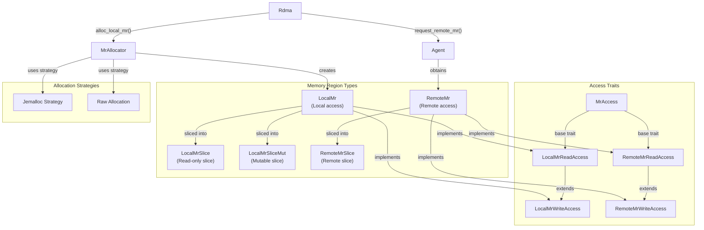
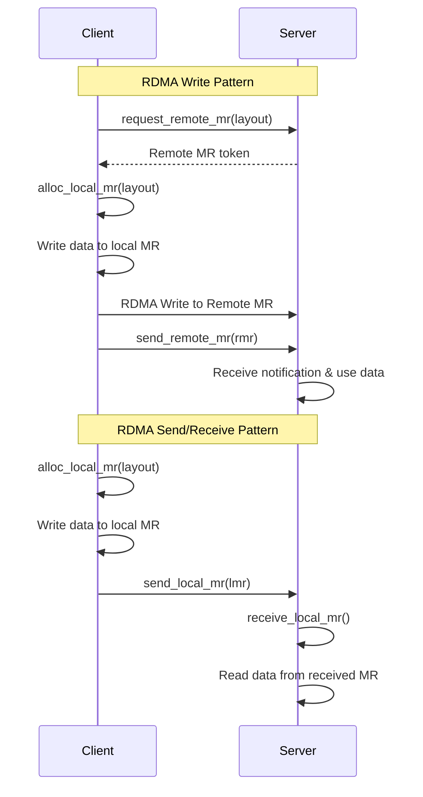
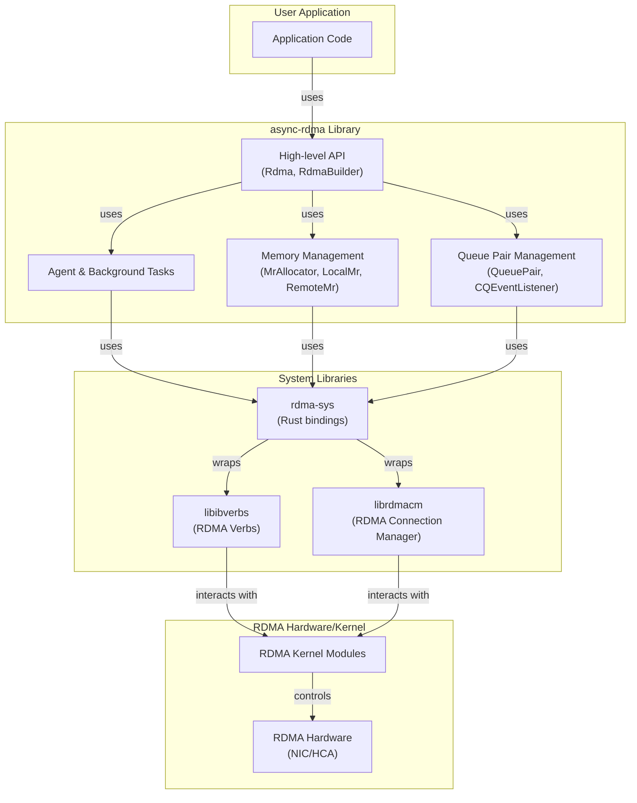

<!-- source: DeepWiki mcp.deepwiki.com · repo datenlord/async-rdma · page 1 Overview · fetched 2026-11-11 -->

# Overview

<details>
<summary>Relevant source files</summary>

The following files were used as context for generating this wiki page:

- [.gitignore](.gitignore)
- [Cargo.toml](Cargo.toml)
- [ChangeLog.md](ChangeLog.md)
- [LICENSE](LICENSE)
- [README.md](README.md)
- [src/lib.rs](src/lib.rs)

</details>


This document provides a comprehensive introduction to the async-rdma library, a framework for writing asynchronous RDMA (Remote Direct Memory Access) applications in Rust. This overview covers the purpose, architecture, and key features of the library to help users understand how to utilize it effectively.

## What is async-rdma?

Async-rdma is a high-level Rust framework that provides asynchronous abstractions over RDMA technology. RDMA enables direct memory access from one computer to the memory of another without involving the operating system or CPU, resulting in:

- **High throughput** and **low latency** network communication
- **Zero-copy** data transfer between applications
- **Kernel bypass** for improved performance
- **CPU offloading** for network operations

Rather than requiring developers to work with complex low-level RDMA APIs directly, async-rdma offers a more ergonomic interface with Rust's safety guarantees and asynchronous programming model.

Sources: [src/lib.rs:1-16](). [README.md:1-32]().

## Key Components and Architecture

The library consists of several interconnected components that work together to provide a comprehensive RDMA solution:



Sources: [src/lib.rs:123-165](). [Cargo.toml:1-40]().

### Core Components

1. **RdmaBuilder**: Entry point for configuring and establishing RDMA connections
2. **Rdma**: Primary interface for performing RDMA operations
3. **Context**: Represents an RDMA device and provides factory methods for other resources
4. **ProtectionDomain**: Provides security isolation for memory regions
5. **QueuePair**: Core communication channel between RDMA endpoints
6. **Agent**: Orchestrates high-level communication patterns and memory management
7. **MrAllocator**: Manages memory region allocation and registration
8. **LocalMr/RemoteMr**: Represents local and remote memory regions for RDMA operations

Sources: [src/lib.rs:167-204](). [src/lib.rs:327-368]().

## Key Features

### Connection Establishment

Async-rdma provides multiple ways to establish connections between RDMA endpoints:



Sources: [src/lib.rs:371-421](). [src/lib.rs:545-562](). [src/lib.rs:435-455]().

### Memory Management System

Async-rdma provides a sophisticated memory management system that handles allocation, registration, and deallocation of memory regions:



Sources: [src/lib.rs:178-182](). [src/lib.rs:183-184]().

### Data Transfer Operations

Async-rdma supports several RDMA operation patterns:

1. **Read/Write Operations**: Direct memory access between local and remote memory regions
2. **Send/Receive Operations**: Two-sided communication with notifications
3. **Atomic Operations**: Compare-and-swap operations on remote memory



Sources: [src/lib.rs:25-71](). [README.md:126-179]().

## Basic Usage Example

Below is a simple example demonstrating how async-rdma can be used to establish a connection, allocate memory regions, and perform RDMA operations:

```rust
// Client side
async fn client(addr: SocketAddrV4) -> io::Result<()> {
    let layout = Layout::new::<[u8; 8]>();
    let rdma = RdmaBuilder::default().connect(addr).await?;
    // Request 8 bytes remote memory
    let mut rmr = rdma.request_remote_mr(layout).await?;
    // Allocate 8 bytes local memory
    let mut lmr = rdma.alloc_local_mr(layout)?;
    // Write data into local memory
    lmr.as_mut_slice().write(&[1_u8; 8])?;
    // Write data to remote memory
    rdma.write(&lmr.get(4..8).unwrap(), &mut rmr.get_mut(4..8).unwrap()).await?;
    // Send remote MR back to make server aware of it
    rdma.send_remote_mr(rmr).await?;
    Ok(())
}

// Server side
async fn server(addr: SocketAddrV4) -> io::Result<()> {
    let rdma = RdmaBuilder::default().listen(addr).await?;
    // Receive MR metadata from client
    let lmr = rdma.receive_local_mr().await?;
    // Read data that was written by client
    let data = *lmr.as_slice();
    println!("Data written by the client: {:?}", data);
    Ok(())
}
```

Sources: [src/lib.rs:33-59](). [README.md:141-166]().

## Underlying Architecture

Async-rdma builds upon RDMA system libraries and abstracts them with a Rust-friendly asynchronous API:



Sources: [Cargo.toml:11-39](). [src/lib.rs:124-164]().

## Conclusion

Async-rdma provides an ergonomic, high-performance Rust interface to RDMA technology. By abstracting away many of the complexities of RDMA programming, it allows developers to focus on their application logic while benefiting from the performance advantages of RDMA.

For more detailed information on specific aspects of the library:
- For connection establishment details, see [Connection Management](#3.1)
- For memory management details, see [Memory Management](#3.2)
- For data transfer operations, see [Data Transfer Operations](#3.3)
- For usage examples, see [Examples & Patterns](#5)

---

