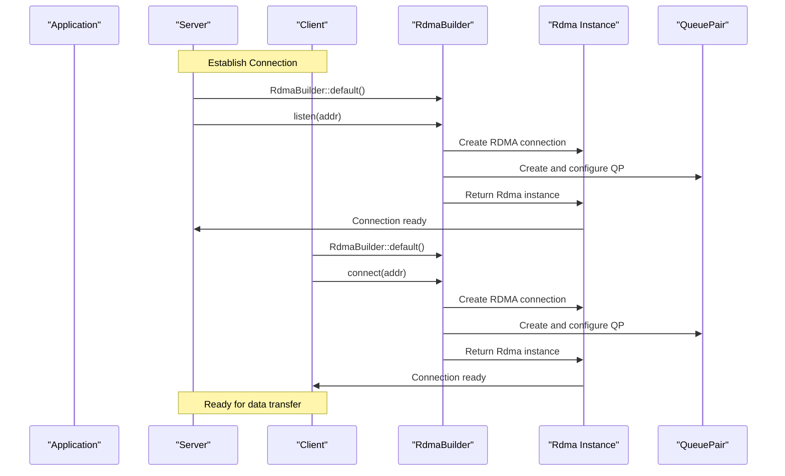
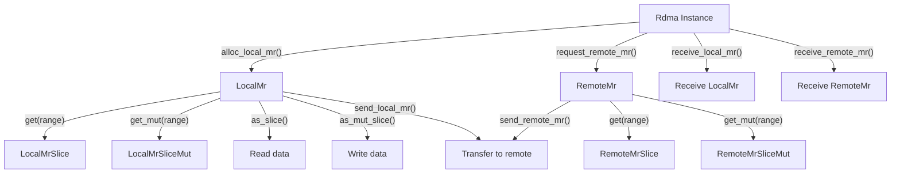
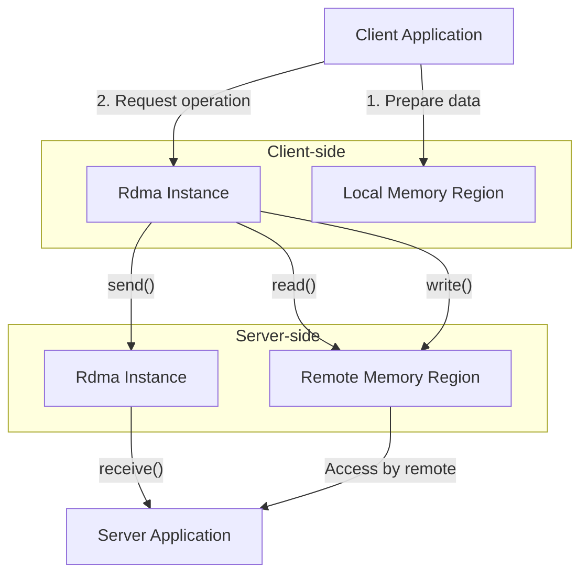

<!-- source: DeepWiki mcp.deepwiki.com · repo datenlord/async-rdma · page 2 Getting Started · fetched 2026-11-11 -->

# Getting Started

<details>
<summary>Relevant source files</summary>

The following files were used as context for generating this wiki page:

- [.gitignore](.gitignore)
- [Cargo.toml](Cargo.toml)
- [ChangeLog.md](ChangeLog.md)
- [LICENSE](LICENSE)
- [README.md](README.md)
- [examples/client.rs](examples/client.rs)
- [examples/cm_client.rs](examples/cm_client.rs)
- [examples/server.rs](examples/server.rs)

</details>


This guide will help you install, configure, and begin using the async-rdma library. async-rdma is a Rust framework that provides high-level abstractions and asynchronous APIs for RDMA (Remote Direct Memory Access) operations, enabling direct memory access between computers with minimal CPU involvement.

For a high-level overview of the library and its architecture, see [Overview](#1).

## Prerequisites

Before using async-rdma, you need an environment with RDMA support. This section explains how to set up a test environment using software-based RDMA.

### RDMA Environment Setup

The following steps show how to configure RDMA in an Ubuntu 20.04 environment. If you already have a properly configured RDMA setup, you can skip to the [Installation](#installation) section.

#### 1. Check Kernel Support for RDMA

```bash
cat /boot/config-$(uname -r) | grep RXE
```

If `CONFIG_RDMA_RXE` is set to `y` or `m`, your kernel supports software-based RDMA (RXE).

#### 2. Install Dependencies

```bash
sudo apt install -y libibverbs1 ibverbs-utils librdmacm1 libibumad3 ibverbs-providers rdma-core libibverbs-dev iproute2 perftest build-essential net-tools git librdmacm-dev rdmacm-utils cmake libprotobuf-dev protobuf-compiler clang curl
```

#### 3. Configure RDMA Network Device

Load the kernel driver:
```bash
modprobe rdma_rxe
```

Configure a user-mode RDMA network device:
```bash
sudo rdma link add rxe_0 type rxe netdev ens33
```
Replace `ens33` with your network interface name (check with `ifconfig`).

Verify the RDMA device is active:
```bash
rdma link
```

#### 4. Test the RDMA Setup

```bash
# In terminal 1
ib_send_bw -d rxe_0

# In terminal 2
ib_send_bw -d rxe_0 localhost
```

Sources: [README.md:38-102]()

## Installation

### Install Rust (if needed)

```bash
curl --proto '=https' --tlsv1.2 -sSf https://sh.rustup.rs | sh -s -- -y
source $HOME/.cargo/env
```

### Add async-rdma to Your Project

To use async-rdma in your Rust project, add the following to your `Cargo.toml`:

```toml
[dependencies]
async-rdma = "0.5.0"
```

This will pull the latest released version from crates.io.

Sources: [Cargo.toml:1-9](), [README.md:102-106]()

## Basic Connection Setup

async-rdma uses a client-server model for establishing RDMA connections. The following diagram illustrates the connection process:



### Server Side

```rust
use async_rdma::RdmaBuilder;

// Listen for connection on specified address
let rdma = RdmaBuilder::default()
    .listen("192.168.1.1:7471")
    .await
    .unwrap();
```

### Client Side

```rust
use async_rdma::RdmaBuilder;

// Connect to server at specified address
let rdma = RdmaBuilder::default()
    .connect("192.168.1.1:7471")
    .await
    .unwrap();
```

Additional connection options are available with `RdmaBuilder`. For example, you can use RDMA Connection Manager (CM):

```rust
use async_rdma::{ConnectionType, RdmaBuilder};

// Connect using CM API
let rdma = RdmaBuilder::default()
    .set_conn_type(ConnectionType::RCCM)
    .set_raw(true)
    .cm_connect("192.168.1.1", "7471")
    .await
    .unwrap();
```

Sources: [examples/server.rs:107-108](), [examples/client.rs:135-136](), [examples/cm_client.rs:21-26]()

## Memory Management

RDMA operations require registered memory regions. async-rdma provides abstractions for local and remote memory regions.



### Allocating Memory Regions

```rust
use std::alloc::Layout;
use async_rdma::{Rdma, LocalMrWriteAccess};

// Allocate a local memory region
let mut lmr = rdma.alloc_local_mr(Layout::new::<[u8; 8]>())?;

// Write data to the memory region
lmr.as_mut_slice().write(&[1_u8; 8])?;

// Request a remote memory region from the other endpoint
let rmr = rdma.request_remote_mr(Layout::new::<[u8; 8]>()).await?;
```

### Memory Region Slices

You can create slices of memory regions to work with specific portions:

```rust
// Get a read-only slice of bytes 4-8
let slice = lmr.get(4..8).unwrap();

// Get a mutable slice of bytes 4-8
let mut_slice = lmr.get_mut(4..8).unwrap();
```

Sources: [examples/client.rs:22-27](), [examples/client.rs:74-77]()

## Data Transfer Operations

async-rdma supports four primary RDMA operations:



### Send and Receive

The send/receive operations involve both endpoints' CPUs:

```rust
// Client side
let mut lmr = rdma.alloc_local_mr(Layout::new::<[u8; 8]>())?;
lmr.as_mut_slice().write(&[1_u8; 8])?;
rdma.send(&lmr).await?;

// Server side
let lmr = rdma.receive().await?;
let data = *lmr.as_slice();
// Process received data
```

### Read and Write

RDMA read/write operations access remote memory directly without involving the remote CPU:

```rust
// Client side - Write to remote memory
let mut lmr = rdma.alloc_local_mr(Layout::new::<[u8; 8]>())?;
lmr.as_mut_slice().write(&[1_u8; 8])?;
let mut rmr = rdma.request_remote_mr(Layout::new::<[u8; 8]>()).await?;
rdma.write(&lmr, &mut rmr).await?;

// Client side - Read from remote memory
rdma.read(&mut lmr, &rmr).await?;
let data = *lmr.as_slice();
// Process read data
```

### Operations with Immediate Data

You can also perform operations with immediate data, which triggers a completion event on the remote side:

```rust
// Send with immediate data
rdma.send_with_imm(&lmr, 1_u32).await?;

// Receive with immediate data
let (lmr, imm) = rdma.receive_with_imm().await?;

// Write with immediate data
rdma.write_with_imm(&lmr, &mut rmr, 4_u32).await?;

// Receive write immediate data
let imm = rdma.receive_write_imm().await?;
```

Sources: [examples/client.rs:21-29](), [examples/server.rs:17-24](), [examples/client.rs:74-87](), [examples/server.rs:44-55](), [examples/client.rs:32-44](), [examples/server.rs:27-41]()

## Complete Example

Here's a simple client-server example demonstrating RDMA write operation:

```rust
// Server side
async fn server(addr: SocketAddrV4) -> io::Result<()> {
    // Listen for connection
    let rdma = RdmaBuilder::default().listen(addr).await?;
    
    // Receive memory region that was written to by client
    let lmr = rdma.receive_local_mr().await?;
    
    // Access the data
    let data = *lmr.as_slice();
    println!("Data written by client: {:?}", data);
    
    Ok(())
}

// Client side
async fn client(addr: SocketAddrV4) -> io::Result<()> {
    // Connect to server
    let rdma = RdmaBuilder::default().connect(addr).await?;
    
    // Allocate and prepare local memory
    let mut lmr = rdma.alloc_local_mr(Layout::new::<[u8; 8]>())?;
    lmr.as_mut_slice().write(&[1_u8; 8])?;
    
    // Request remote memory region from server
    let mut rmr = rdma.request_remote_mr(Layout::new::<[u8; 8]>()).await?;
    
    // Write to remote memory (second half only)
    rdma.write(
        &lmr.get(4..8).unwrap(), 
        &mut rmr.get_mut(4..8).unwrap()
    ).await?;
    
    // Notify server about the memory region
    rdma.send_remote_mr(rmr).await?;
    
    Ok(())
}
```

Sources: [README.md:125-178]()

## Next Steps

Now that you're familiar with the basics of async-rdma, you can explore:

- [Core Concepts](#3) for deeper understanding of RDMA operations
- [API Reference](#4) for detailed documentation of the library components
- [Examples & Patterns](#5) for more complex usage patterns

For troubleshooting or community support, you can:
- Check the [GitHub repository](https://github.com/datenlord/async-rdma)
- Join the [Gitter chat](https://gitter.im/datenlord/async-rdma)

Sources: [README.md:181-188]()

---

