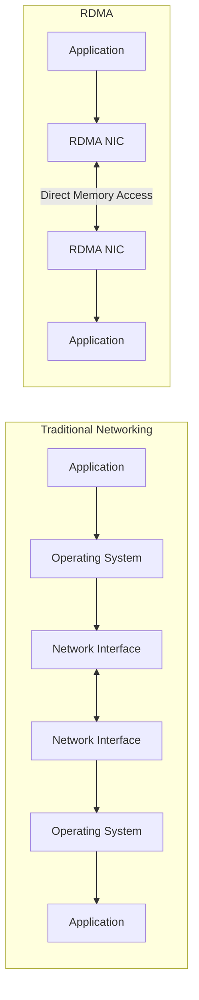
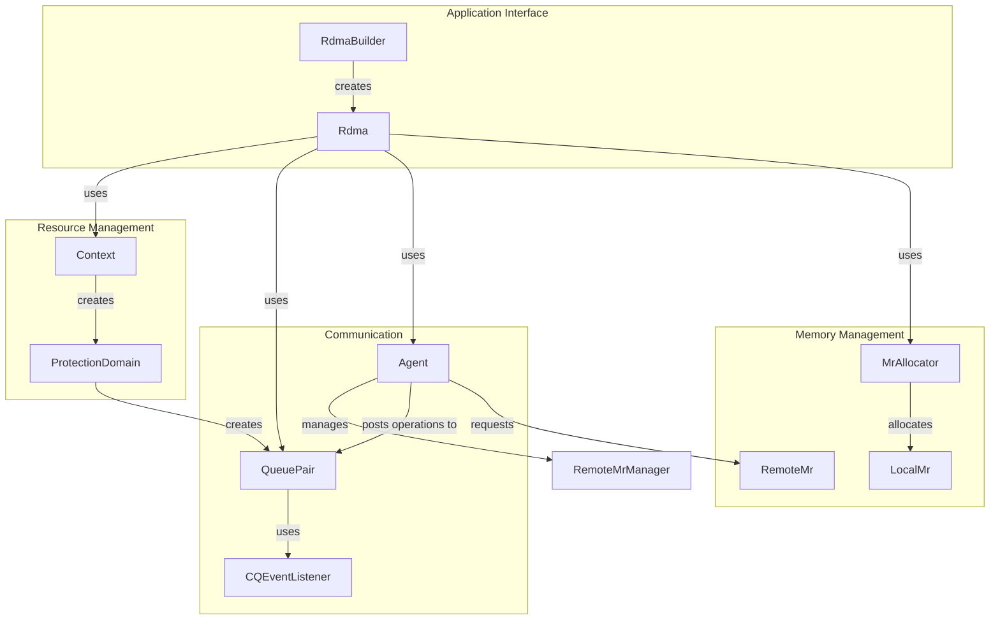
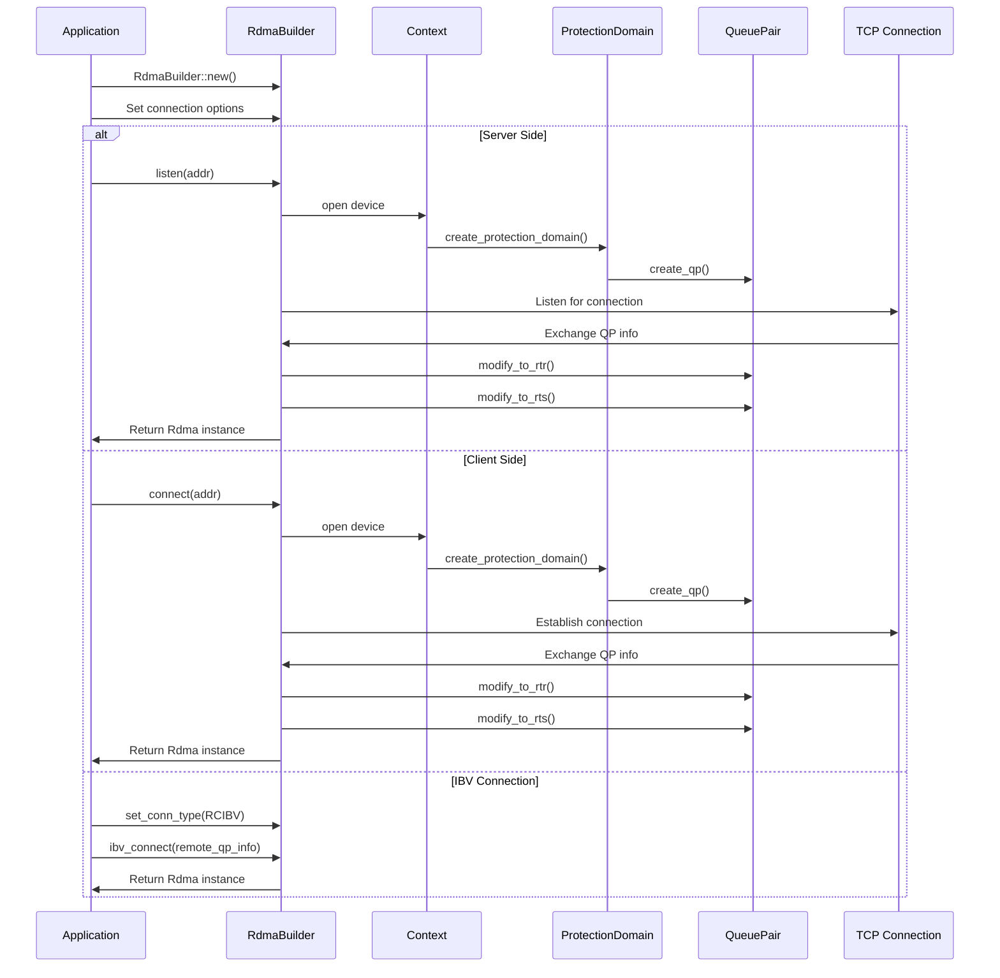
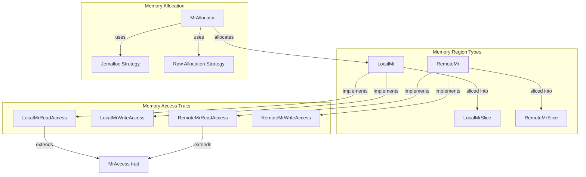
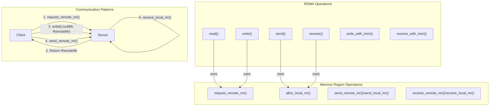
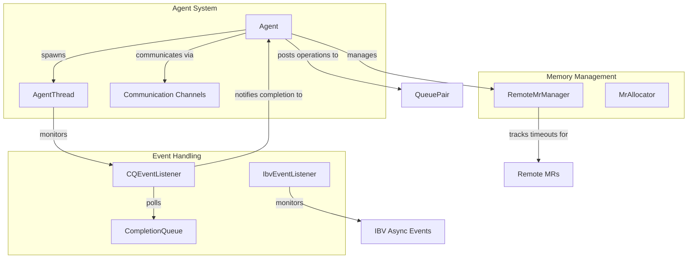
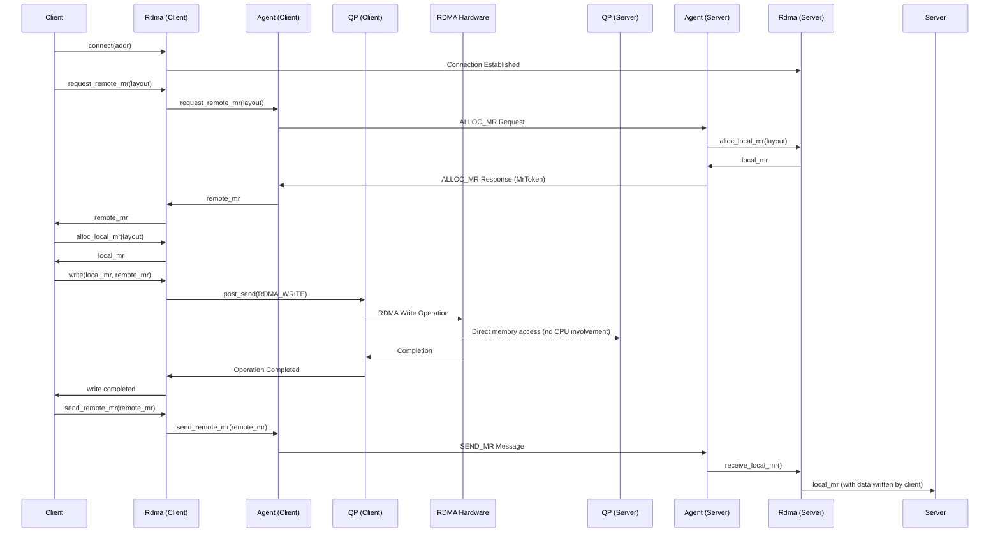

<!-- source: DeepWiki mcp.deepwiki.com · repo datenlord/async-rdma · page 3 Core Concepts · fetched 2026-11-11 -->

# Core Concepts

Relevant source files

The following files were used as context for generating this wiki page:

- [.gitignore](.gitignore)
- [ChangeLog.md](ChangeLog.md)
- [LICENSE](LICENSE)
- [README.md](README.md)
- [src/lib.rs](src/lib.rs)

This page provides an overview of the fundamental concepts in async-rdma, the high-level Rust framework for Remote Direct Memory Access (RDMA) operations. These concepts form the foundation for understanding how to effectively use the library for building RDMA-enabled applications. For specific implementation details, see [API Reference](#4), and for practical usage examples, see [Examples & Patterns](#5).

## RDMA Overview

Remote Direct Memory Access (RDMA) is a technology that allows direct memory access from one computer to memory on another computer without involving the processor, cache, or operating system of either computer. This results in high-throughput, low-latency networking with minimal CPU overhead.

The async-rdma library provides a high-level abstraction over RDMA operations, making them accessible through an asynchronous Rust API. It handles the complex low-level RDMA operations and resource management while exposing a simpler interface to the application developer.

Sources: [src/lib.rs:1-72]()

## Key Components

The async-rdma library consists of several key components that work together to provide a complete RDMA solution:

1. **RdmaBuilder**: Entry point for configuring and establishing RDMA connections
2. **Rdma**: Primary interface for performing RDMA operations
3. **QueuePair**: Core communication channel between RDMA endpoints
4. **Agent**: Background component that handles asynchronous operations
5. **Memory Regions**: LocalMr and RemoteMr for memory management

Sources: [src/lib.rs:123-166](), [README.md:21-32]()

## Connection Management

In RDMA, connections must be established between endpoints before data transfer can occur. The async-rdma library provides several ways to establish connections:

The library supports three connection types:
1. **RCSocket** (default): Uses TCP sockets to exchange QP information
2. **RCIBV**: Uses direct IBV (InfiniBand Verbs) information for connection
3. **RCCM**: Uses RDMA Connection Manager for connection (requires CM feature)

The choice of connection type depends on your application requirements and infrastructure.

Sources: [src/lib.rs:327-565]()

## Memory Management

RDMA operations require memory to be registered with the RDMA device before it can be used for data transfer. The async-rdma library provides a comprehensive memory management system:

### Memory Region Types

1. **LocalMr**: Memory registered locally that can be accessed by the local process
2. **RemoteMr**: Memory on a remote node that can be accessed via RDMA operations
3. **Memory Slices**: Allow access to specific portions of memory regions

### Allocation Strategies

1. **Jemalloc Strategy**: Uses Jemalloc for efficient memory management and reuse
2. **Raw Allocation Strategy**: Provides direct control over memory allocation

### Memory Access Control

The library uses traits to define the operations that can be performed on memory regions:
- **ReadAccess**: Allows reading from memory regions
- **WriteAccess**: Allows writing to memory regions

Sources: [src/lib.rs:176-182](), [src/lib.rs:133-142](), [ChangeLog.md:95-101]()

## Data Transfer Operations

The async-rdma library provides several data transfer operations to meet different requirements:

### Data Transfer Patterns

1. **Read/Write Pattern**: The client requests a RemoteMr from the server, then reads from or writes to it directly
   - Benefits: More efficient for large data transfers as the target CPU is not involved
   - Use cases: Bulk data transfer, storage operations

2. **Send/Receive Pattern**: Data is sent from one endpoint and received at the other
   - Benefits: Simpler to use, doesn't require memory region coordination
   - Use cases: Command/control messages, smaller data transfers

### Memory Region Transfer

The library also provides operations to transfer memory region metadata between endpoints:
- **send_remote_mr/send_local_mr**: Send memory region metadata to the remote endpoint
- **receive_remote_mr/receive_local_mr**: Receive memory region metadata from the remote endpoint

Sources: [src/lib.rs:8-15](), [README.md:130-168]()

## Background Components

Several components work in the background to facilitate RDMA operations:

### Agent

The Agent component handles:
1. Memory region management requests
2. RDMA operation orchestration
3. Communication with the remote endpoint

### Event Listeners

1. **CQEventListener**: Monitors the completion queue for completed operations
2. **IbvEventListener**: Monitors for asynchronous IBV events

### RemoteMrManager

Manages the lifecycle of remote memory regions, including automatic timeout to prevent resource leaks.

Sources: [src/lib.rs:123-126](), [src/lib.rs:167-170](), [ChangeLog.md:99-101]()

## Example Workflow

Here's how these components work together in a typical RDMA workflow:

This example demonstrates the complete workflow of:
1. Establishing a connection
2. Requesting a remote memory region
3. Allocating a local memory region
4. Writing data from local to remote memory
5. Notifying the server about the memory transfer

Sources: [src/lib.rs:33-47](), [README.md:141-156]()

## Summary

The core concepts of async-rdma revolve around providing high-level abstractions for RDMA operations while managing the complexity of low-level RDMA resources. By understanding these concepts, you can effectively use the library to build high-performance RDMA applications with minimal boilerplate code.

- **RdmaBuilder** provides a flexible way to establish connections
- **Memory Regions** abstract away the complexity of RDMA memory registration
- **Data Transfer Operations** provide simple interfaces for RDMA data movement
- **Background Components** handle the details of resource management and event processing

For more detailed information on specific components, refer to the [API Reference](#4) section.

Sources: [src/lib.rs:1-20](), [README.md:4-32]()

---

