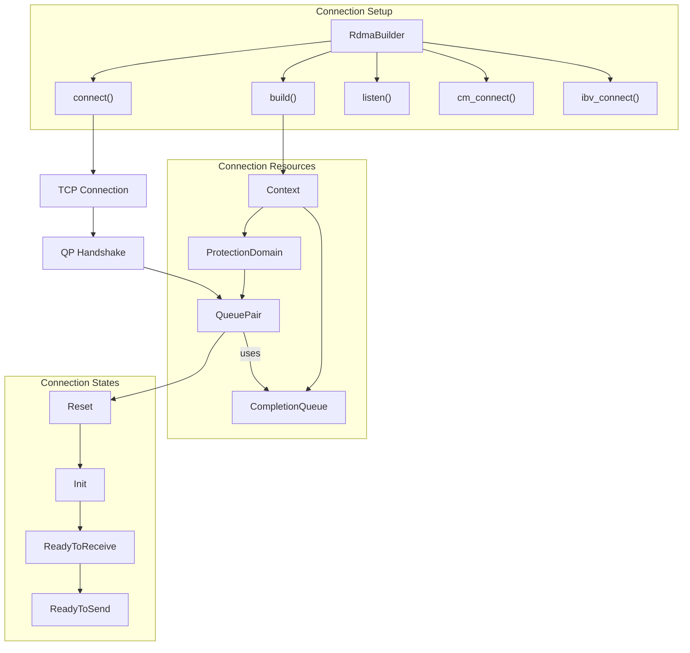
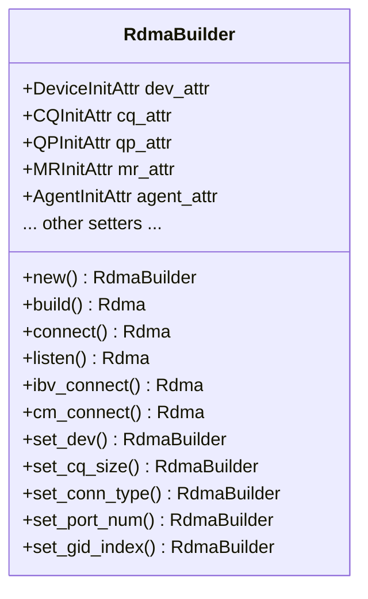
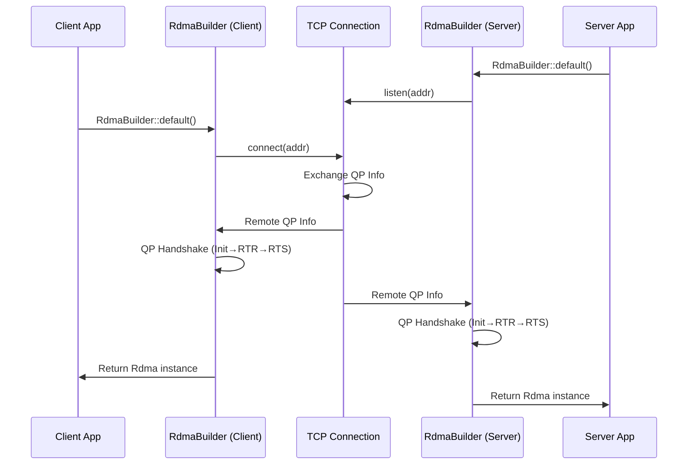
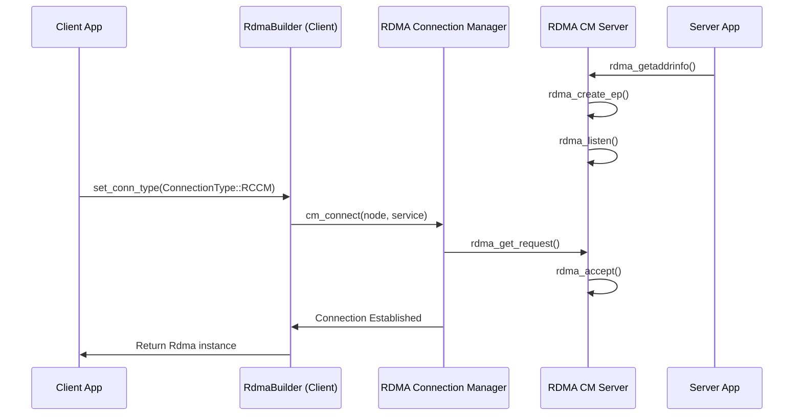
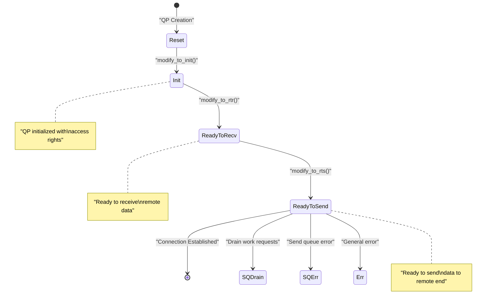
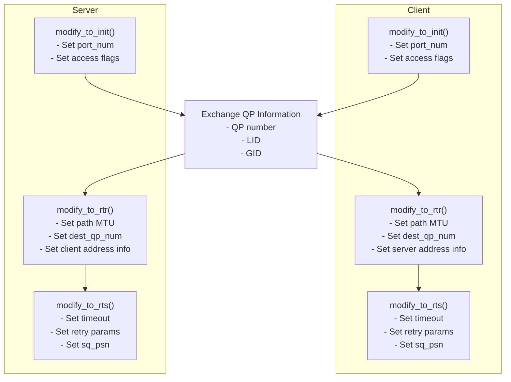

<!-- source: DeepWiki mcp.deepwiki.com · repo datenlord/async-rdma · page 3.1 Connection Management · fetched 2026-11-11 -->

# Connection Management

<details>
<summary>Relevant source files</summary>

The following files were used as context for generating this wiki page:

- [examples/client.rs](examples/client.rs)
- [examples/cm_client.rs](examples/cm_client.rs)
- [examples/server.rs](examples/server.rs)
- [src/lib.rs](src/lib.rs)
- [src/queue_pair.rs](src/queue_pair.rs)

</details>


This page explains how RDMA connections are established and managed in the async-rdma library. It covers the process of creating, configuring, and establishing RDMA connections between endpoints using the `RdmaBuilder` and `QueuePair` components.

## Overview

Connection management in async-rdma involves setting up and managing the communication channels between RDMA endpoints. The library supports multiple connection methods and provides a high-level API to simplify the connection process.



Sources: [src/lib.rs:327-1074](). [src/queue_pair.rs:494-513]()

## Connection Types

Async-rdma supports three connection types, each with a different mechanism for establishing connections:

| Connection Type | Description | Usage Scenario |
|----------------|-------------|----------------|
| `RCSocket` | Reliable Connection using TCP socket for connection setup | General purpose, easiest to use |
| `RCIBV` | Reliable Connection using IBV for direct connection setup | When you have connection info through another channel |
| `RCCM` | Reliable Connection using Connection Manager | When using RDMA CM for advanced connection management |

Sources: [src/lib.rs:546-562]()

## RdmaBuilder

The `RdmaBuilder` is the entry point for creating and configuring RDMA connections. It follows the builder pattern, allowing you to set various connection parameters before establishing a connection.



The builder provides methods to configure:
- Device selection
- Connection type
- Queue Pair attributes
- Memory region attributes
- Completion Queue attributes

Sources: [src/lib.rs:330-1073]()

## Establishing Connections

There are two main patterns for establishing connections:

1. Client-Server (Socket-based)
2. Direct connection (IBV or CM based)

### Client-Server Connection Process



Examples:

Client-side connection:
```rust
// Connect to an RDMA server
let rdma = RdmaBuilder::default().connect(addr).await?;
```

Server-side connection:
```rust
// Listen for an RDMA connection
let rdma = RdmaBuilder::default().listen(addr).await?;
```

Sources: [src/lib.rs:407-428](), [src/lib.rs:601-628](), [examples/client.rs:135-136](), [examples/server.rs:107-108]()

### Connection Manager (CM) Connection Process

When using the Connection Manager approach:



Example:
```rust
// Connect using Connection Manager
let rdma = RdmaBuilder::default()
    .set_conn_type(ConnectionType::RCCM)
    .set_raw(true)
    .cm_connect(node, service)
    .await?;
```

Sources: [src/lib.rs:546-562](), [examples/cm_client.rs:20-26]()

## Queue Pair State Management

The Queue Pair (QP) passes through several states during connection establishment:



During connection establishment, the QP undergoes a handshake process:

1. **Init**: QP is initialized with access rights
2. **Ready to Receive (RTR)**: QP is configured to receive data
3. **Ready to Send (RTS)**: QP is configured to send data

Sources: [src/queue_pair.rs:494-513](), [src/queue_pair.rs:602-706]()

## QP Handshake Process

The QueuePair handshake process involves modifying the QP through state transitions:



Key QP attributes exchanged:
- `qp_num`: Queue Pair number
- `lid`: Local ID for the port
- `gid`: Global ID (128-bit identifier for the port)

Sources: [src/queue_pair.rs:610-707](), [src/lib.rs:1076-1154]()

## Configuration Options

Async-rdma provides extensive configuration options via the `RdmaBuilder`:

| Category | Options | Description |
|----------|---------|-------------|
| Device | `set_dev()` | Set RDMA device name |
| Connection | `set_conn_type()` | Set connection type (RCSocket, RCIBV, RCCM) |
| Queue Pair | `set_port_num()`, `set_gid_index()` | Set port and GID for the connection |
| Queue Size | `set_qp_max_send_wr()`, `set_qp_max_recv_wr()` | Set send/receive queue sizes |
| Access | `set_qp_access()`, `set_mr_access()` | Set access permissions |
| Retry | `set_retry_cnt()`, `set_rnr_retry()` | Configure retry behavior |
| Timeouts | `set_timeout()`, `set_cc_evnet_timeout()` | Set operation timeouts |

Sources: [src/lib.rs:631-1062]()

## Best Practices

When establishing RDMA connections:

1. **Port and GID Configuration**: Always set the port number and GID index appropriate for your network
   ```rust
   let rdma = RdmaBuilder::default()
       .set_port_num(1)
       .set_gid_index(1)
       .connect(addr)
       .await?;
   ```

2. **Choose the right connection type**:
   - Use `RCSocket` for standard client-server applications
   - Use `RCIBV` when you have connection info through other channels
   - Use `RCCM` when you need advanced connection management features

3. **Configure appropriate timeouts and retry counts** based on your network conditions and application requirements

Sources: [src/lib.rs:352-353](), [examples/client.rs:135-136](), [examples/cm_client.rs:20-26]()

---

