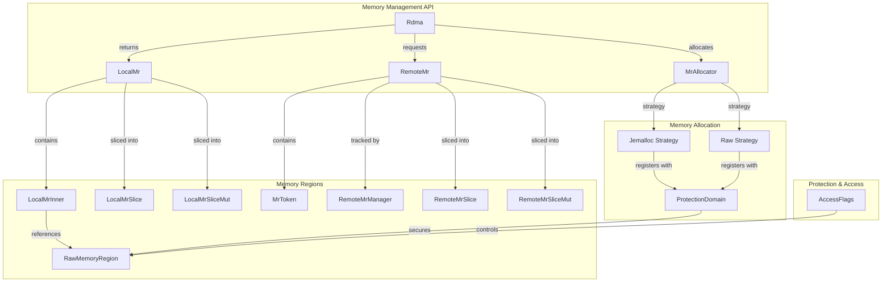
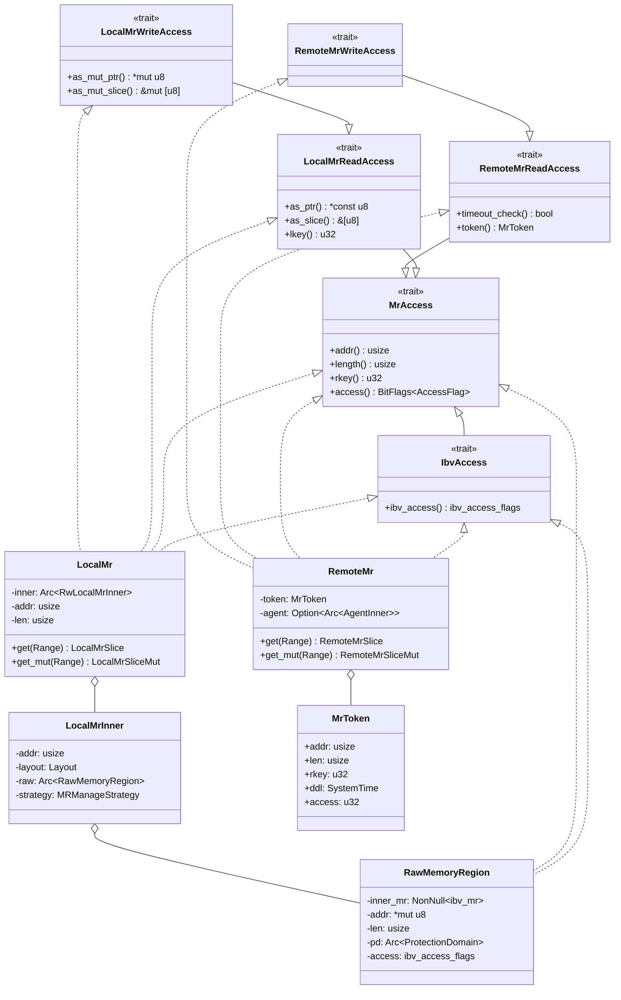
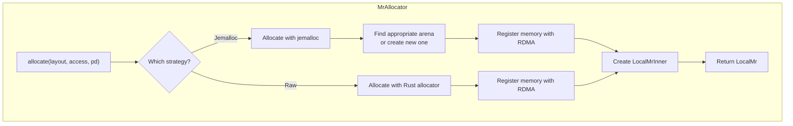
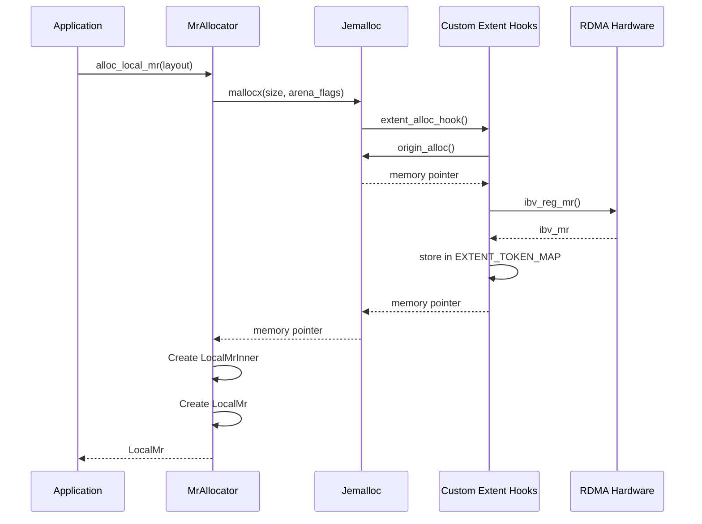
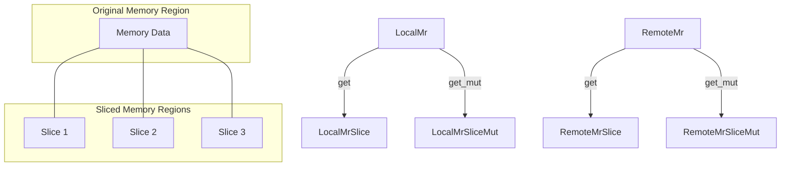
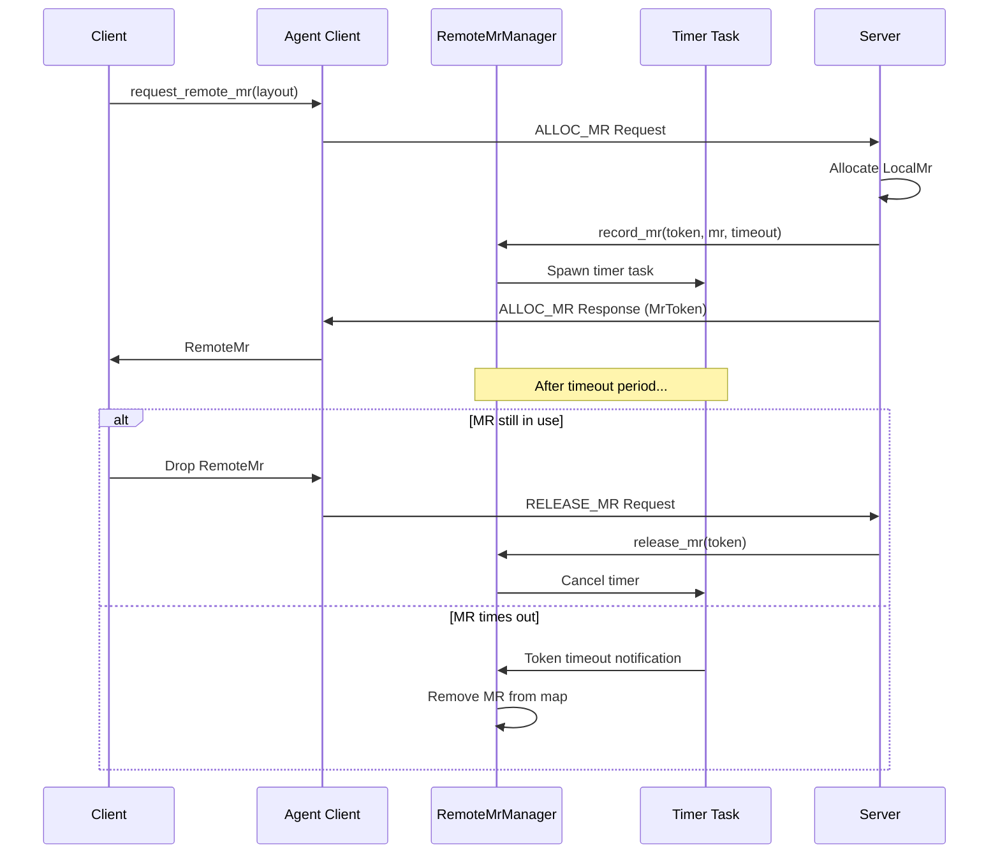
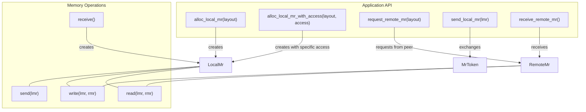

<!-- source: DeepWiki mcp.deepwiki.com · repo datenlord/async-rdma · page 3.2 Memory Management · fetched 2026-11-11 -->

# Memory Management

Relevant source files

The following files were used as context for generating this wiki page:

- [src/access.rs](src/access.rs)
- [src/id.rs](src/id.rs)
- [src/memory_region/local.rs](src/memory_region/local.rs)
- [src/memory_region/mod.rs](src/memory_region/mod.rs)
- [src/memory_region/raw.rs](src/memory_region/raw.rs)
- [src/memory_region/remote.rs](src/memory_region/remote.rs)
- [src/mr_allocator.rs](src/mr_allocator.rs)
- [src/rmr_manager.rs](src/rmr_manager.rs)
- [tests/rmr_access.rs](tests/rmr_access.rs)

This page documents the memory management system in the async-rdma library, which is responsible for allocating, registering, and managing memory regions for RDMA operations. Memory management is a critical component of RDMA programming as data must be explicitly registered with the RDMA hardware before it can be accessed remotely.

For information about data transfer operations that use these memory regions, see [Data Transfer Operations](#3.3).

## Memory Management Architecture

The memory management system in async-rdma consists of several components working together to provide a safe and efficient interface for RDMA memory operations.

Sources: [src/mr_allocator.rs](), [src/memory_region/local.rs](), [src/memory_region/remote.rs](), [src/memory_region/raw.rs]()

## Memory Region Types

The async-rdma library provides several types of memory regions, each serving a specific purpose in the RDMA communication model:

Sources: [src/memory_region/mod.rs](), [src/memory_region/local.rs](), [src/memory_region/remote.rs](), [src/memory_region/raw.rs]()

### Memory Region Abstractions

The library uses several abstractions to represent memory regions:

1. **RawMemoryRegion**: The lowest level abstraction that directly interacts with the RDMA hardware through the `ibv_mr` structure.

2. **LocalMr**: Represents a memory region on the local machine that can be used for RDMA operations. It contains:
   - A reference to `LocalMrInner` which holds the actual memory and metadata
   - Address and length information for easy access
   - Methods to create slices of the memory region

3. **RemoteMr**: Represents a memory region on a remote machine that can be accessed through RDMA operations. It contains:
   - A `MrToken` with the necessary information to access the remote memory
   - An optional reference to the `AgentInner` that requested this memory region
   - Methods to create slices of the remote memory region

4. **MrToken**: A serializable structure that contains the necessary information to access a memory region remotely:
   - Address, length, and remote key
   - Deadline (timeout) after which the memory region may no longer be valid
   - Access permissions encoded as a bitfield

Sources: [src/memory_region/raw.rs:10-114](), [src/memory_region/local.rs:368-533](), [src/memory_region/remote.rs:22-129](), [src/memory_region/mod.rs:44-63]()

## Memory Region Allocation

The `MrAllocator` component is responsible for allocating and registering memory regions for RDMA operations. It supports two allocation strategies:

### Allocation Strategies

1. **Jemalloc Strategy**: Uses the jemalloc memory allocator with custom extent hooks for efficient memory management. This strategy is more complex but provides better performance for certain workloads.

2. **Raw Strategy**: Uses the standard Rust allocator for simplicity. This strategy is easier to understand and debug but may not provide the same performance as the Jemalloc strategy.

Sources: [src/mr_allocator.rs:132-295]()

### Memory Registration Process

When allocating a memory region, the following steps are performed:

1. Allocate memory using the selected strategy (Jemalloc or Raw)
2. Register the memory with the RDMA hardware through the Protection Domain
3. Create a `RawMemoryRegion` to track the registration
4. Create a `LocalMrInner` to manage the memory region
5. Return a `LocalMr` that provides a safe interface to the memory region

The memory registration process is critical for RDMA operations as it makes the memory accessible to the RDMA hardware for direct access.

### Custom Extent Hooks for Jemalloc

When using the Jemalloc strategy, the library registers custom extent hooks to intercept memory allocation and deallocation requests. These hooks are responsible for registering memory regions with the RDMA hardware and maintaining the necessary metadata.

Sources: [src/mr_allocator.rs:461-501](), [src/mr_allocator.rs:32-75]()

## Memory Region Access

The library provides a rich set of traits to define the access patterns for memory regions:

### Access Traits Hierarchy

- **MrAccess**: Base trait for all memory regions, providing methods to access address, length, and remote key.
- **IbvAccess**: Trait for accessing the IBVERBS access flags that control the permissions of the memory region.
- **LocalMrReadAccess**: Trait for read access to local memory regions, providing methods like `as_ptr()`, `as_slice()`, etc.
- **LocalMrWriteAccess**: Trait for write access to local memory regions, extending `LocalMrReadAccess` with methods like `as_mut_ptr()`, `as_mut_slice()`, etc.
- **RemoteMrReadAccess**: Trait for read access to remote memory regions, providing methods to check timeout and access the token.
- **RemoteMrWriteAccess**: Trait for write access to remote memory regions, extending `RemoteMrReadAccess`.

### Access Flags

The library uses a set of bit flags to control the access permissions of memory regions:

| Access Flag | Description |
|-------------|-------------|
| LocalWrite | Allows local write operations |
| RemoteWrite | Allows remote write operations |
| RemoteRead | Allows remote read operations |
| RemoteAtomic | Allows remote atomic operations |
| MwBind | Enables memory window binding |
| ZeroBased | Uses byte offset instead of pointer address |
| OnDemand | Creates an on-demand paging memory region |
| HugeTlb | Uses huge pages for the memory region |
| RelaxOrder | Allows system to reorder accesses |

These flags are used when registering memory regions with the RDMA hardware to control what operations are allowed on the memory.

Sources: [src/memory_region/mod.rs:19-42](), [src/access.rs:4-27]()

### Memory Region Slicing

Both `LocalMr` and `RemoteMr` support slicing operations, allowing users to work with specific portions of a memory region without creating new registrations:

Sources: [src/memory_region/local.rs:427-501](), [src/memory_region/remote.rs:94-128]()

## Remote Memory Region Management

The `RemoteMrManager` is responsible for managing remote memory regions, including tracking their lifetimes and handling timeouts.

Sources: [src/rmr_manager.rs:17-175]()

### Memory Region Tokens

Memory region tokens (`MrToken`) are used to exchange information about memory regions between nodes. They contain:

- Address and length of the memory region
- Remote key for accessing the memory region
- Deadline (timeout) after which the memory region may no longer be valid
- Access permissions encoded as a bitfield

When a remote memory region is requested, the server allocates a local memory region and creates a token that is sent back to the client. The client then uses this token to create a `RemoteMr` that can be used for RDMA operations.

Sources: [src/memory_region/mod.rs:44-63]()

### Timeout Mechanism

To prevent resource leaks, remote memory regions have a timeout mechanism:

1. When a `RemoteMr` is created, it is assigned a timeout period.
2. When the `RemoteMr` is dropped, it sends a release request to the server.
3. If the release request is not received before the timeout, the server automatically frees the resources.

This ensures that resources are not leaked even if a client crashes or fails to properly release the remote memory region.

Sources: [src/rmr_manager.rs:102-132](), [src/memory_region/remote.rs:63-77]()

## Memory Management API

The async-rdma library provides a simple and intuitive API for memory management through the `Rdma` interface:

Sources: [src/mr_allocator.rs:175-230]()

### Key API Methods

| Method | Description |
|--------|-------------|
| `alloc_local_mr(layout)` | Allocates a local memory region with the specified layout |
| `alloc_local_mr_with_access(layout, access)` | Allocates a local memory region with the specified layout and access flags |
| `request_remote_mr(layout)` | Requests a remote memory region from the peer with the specified layout |
| `send_local_mr(lmr)` | Sends a local memory region to the peer |
| `receive_remote_mr()` | Receives a remote memory region from the peer |

These methods provide a high-level interface for managing memory regions in RDMA applications, abstracting away the complex details of memory registration and management.

## Best Practices

When working with the memory management system in async-rdma, consider the following best practices:

1. **Use appropriate access flags**: Only request the access permissions that are actually needed for your operations. This improves security and may enhance performance.

2. **Prefer slicing over new allocations**: When working with parts of a memory region, use the slicing methods rather than allocating new memory regions.

3. **Release remote memory regions promptly**: Although the timeout mechanism helps prevent resource leaks, it's best practice to explicitly release remote memory regions when they are no longer needed.

4. **Be aware of memory registration costs**: Memory registration with RDMA hardware can be expensive, so minimize the number of registrations and reuse memory regions when possible.

5. **Check for timeout**: When working with remote memory regions, check for timeouts using the `timeout_check()` method to ensure the region is still valid.

---

