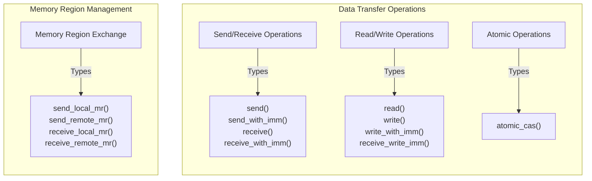
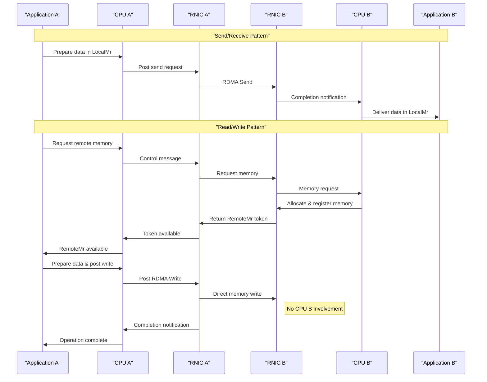
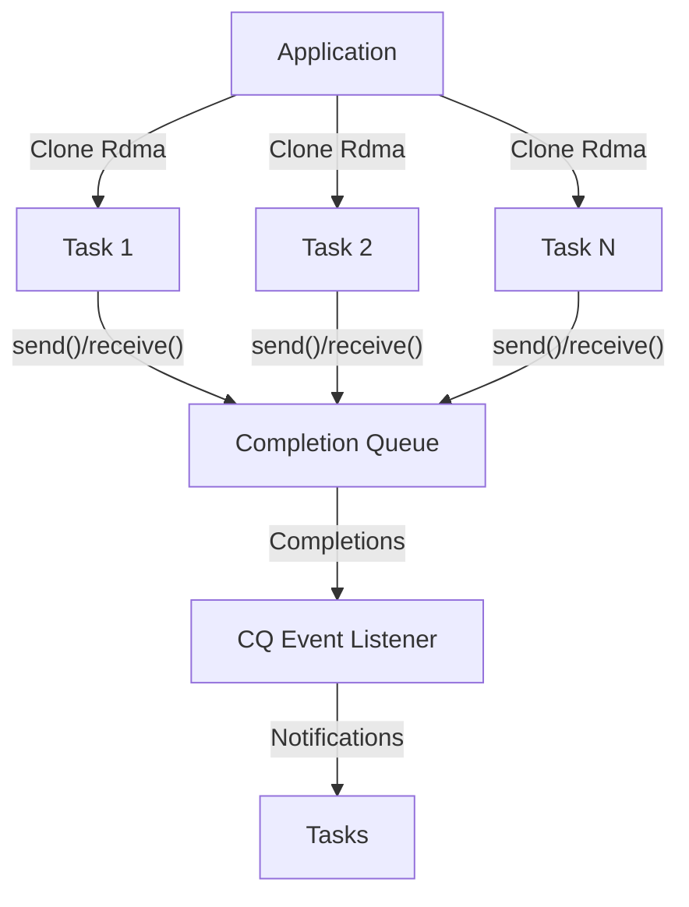

<!-- source: DeepWiki mcp.deepwiki.com · repo datenlord/async-rdma · page 3.3 Data Transfer Operations · fetched 2026-11-11 -->

# Data Transfer Operations

<details>
<summary>Relevant source files</summary>

The following files were used as context for generating this wiki page:

- [examples/client.rs](examples/client.rs)
- [examples/cm_client.rs](examples/cm_client.rs)
- [examples/server.rs](examples/server.rs)
- [src/lib.rs](src/lib.rs)
- [tests/imm.rs](tests/imm.rs)
- [tests/loop.rs](tests/loop.rs)
- [tests/mr_slice.rs](tests/mr_slice.rs)

</details>


This page documents the data transfer operations available in the async-rdma library, explaining how they work and when to use each one. It covers the primary RDMA operations: Send/Receive, Read/Write, and Atomic operations. For details on memory management, see [Memory Management](#3.2).

## Overview of RDMA Data Transfer Operations

RDMA (Remote Direct Memory Access) offers several ways to transfer data between networked systems with minimal CPU involvement. The async-rdma library provides a high-level asynchronous Rust interface to these operations.



Sources: [src/lib.rs:8-12]()

## Data Transfer Operation Patterns

RDMA operations follow two main patterns, each with different performance characteristics and use cases.



Sources: [src/lib.rs:23-47]()

### Send/Receive Pattern

In this pattern:

1. Sender prepares data in a local memory region
2. Sender initiates the send operation
3. Receiver must post a corresponding receive operation
4. The receiver's CPU is involved in processing the incoming data

Best for:
- Small messages
- Control messages
- Cases where receiver needs immediate notification
- Simpler programming model

### Read/Write Pattern

In this pattern:

1. Client requests and receives a token for remote memory access
2. Client reads from or writes to the remote memory directly
3. Target CPU is not involved in the data transfer (zero-copy)

Best for:
- Large data transfers
- Highest performance requirements
- Cases where receiver doesn't need immediate notification

Sources: [examples/client.rs:20-107](), [examples/server.rs:16-91]()

## Send/Receive Operations

### Send Operation

The `send` operation transfers data from a local memory region to a remote endpoint. The remote endpoint must post a corresponding `receive` operation.

```
Client: rdma.send(&lmr).await?;
Server: let lmr = rdma.receive().await?;
```

Sources: [examples/client.rs:20-29](), [examples/server.rs:16-24]()

### Send with Immediate Data

The `send_with_imm` operation is similar to `send`, but includes a 32-bit immediate value. The immediate value is delivered to the receiver along with a completion notification.

```
Client: rdma.send_with_imm(&lmr, 1_u32).await?;
Server: let (lmr, imm) = rdma.receive_with_imm().await?;
```

This provides a way to send a small piece of metadata along with the main data. The immediate value can be used for things like message type, sequence number, or status codes.

Sources: [examples/client.rs:30-45](), [examples/server.rs:25-41](), [tests/imm.rs:6-49]()

### Receive Operation

The `receive` operation posts a receive request and waits for a corresponding `send` from the remote endpoint. When a matching send arrives, the data is placed into a newly allocated local memory region.

Sources: [examples/server.rs:16-24]()

### Receive with Immediate Data

The `receive_with_imm` operation is similar to `receive`, but it also returns any immediate value that was sent by the sender. If the sender did not include an immediate value, this returns `None`.

Sources: [examples/server.rs:25-41](), [tests/imm.rs:6-49]()

## Memory Region Exchange Operations

These operations are used to share memory region information between endpoints.

### Send/Receive Local Memory Region

These operations are used to transfer the metadata of a local memory region to the remote endpoint:

```
Client: rdma.send_local_mr(lmr).await?;
Server: let lmr = rdma.receive_local_mr().await?;
```

This is commonly used to inform the server about memory that the client has written to.

Sources: [examples/client.rs:47-71](), [examples/server.rs:58-65]()

### Send/Receive Remote Memory Region

These operations are used to transfer the metadata of a remote memory region:

```
Client: rdma.send_remote_mr(rmr).await?;
Server: let rmr = rdma.receive_remote_mr().await?;
```

This is commonly used after a client performs a write operation to a remote memory region, then informs the server about it.

Sources: [examples/client.rs:74-87](), [examples/server.rs:44-55]()

## RDMA Read/Write Operations

### RDMA Read

The `read` operation reads data from a remote memory region directly into a local memory region:

```
Client: let rmr = rdma.receive_remote_mr().await?;
Client: rdma.read(&mut lmr, &rmr).await?;
```

The operation is initiated by the client, and the server's CPU is not involved in the data transfer.

Sources: [examples/server.rs:44-55]()

### RDMA Write

The `write` operation writes data from a local memory region directly to a remote memory region:

```
Client: let mut rmr = rdma.request_remote_mr(Layout::new::<[u8; 8]>()).await?;
Client: rdma.write(&lmr.get(4..8).unwrap(), &mut rmr.get_mut(4..8).unwrap()).await?;
```

Like read, the operation is initiated by the client, and the server's CPU is not involved. The server must have previously allocated and shared the remote memory region.

Sources: [examples/client.rs:74-87](), [src/lib.rs:37-46]()

### RDMA Write with Immediate Data

The `write_with_imm` operation is similar to `write`, but also includes a 32-bit immediate value that generates a completion event on the remote side:

```
Client: rdma.write_with_imm(&lmr.get(4..8).unwrap(), &mut rmr.get_mut(4..8).unwrap(), 4_u32).await?;
Server: let imm = rdma.receive_write_imm().await?;
```

This operation combines the efficiency of RDMA write with the notification capability of immediate data. It's useful when you need to inform the server about write completion without requiring additional message exchanges.

Sources: [examples/client.rs:89-107](), [examples/server.rs:67-80](), [tests/imm.rs:51-84]()

## Atomic Operations

### Compare and Swap (CAS)

The `atomic_cas` operation performs an atomic compare-and-swap on a remote memory region:

```
Client: rdma.atomic_cas(0, new_value, &mut rmr).await?;
```

This operation:
1. Reads the current value at the target address
2. Compares it with a specified expected value
3. If they match, writes a new value
4. Returns the original value

This is useful for implementing distributed synchronization mechanisms and lock-free data structures.

Sources: [examples/client.rs:109-119](), [examples/server.rs:82-91]()

## Data Transfer with Memory Region Slices

The async-rdma library allows slicing memory regions to operate on specific portions of memory:

```
// Slicing a local memory region
let slice = lmr.get(4..8).unwrap();
let mut_slice = lmr.get_mut(4..8).unwrap();

// Slicing a remote memory region
let slice = rmr.get(4..8).unwrap();
let mut_slice = rmr.get_mut(4..8).unwrap();

// Using slices in operations
rdma.write(&lmr.get(4..8).unwrap(), &mut rmr.get_mut(4..8).unwrap()).await?;
```

This allows efficient operation on parts of memory regions without allocating new memory regions.

Sources: [examples/client.rs:82-83](), [examples/client.rs:98-102](), [tests/mr_slice.rs:10-219]()

## Advanced Usage Patterns

### Parallel Data Transfer

Multiple data transfer operations can be executed in parallel using tokio tasks:



The `Rdma` instance can be safely cloned and used across multiple tokio tasks. The completion queue and event listener ensure proper handling of completions.

Sources: [tests/loop.rs:1-52]()

## Best Practices

1. **Choose the right operation pattern:**
   - Use Send/Receive for control messages and small data transfers
   - Use Read/Write for large data transfers and maximum performance

2. **Leverage immediate data** when you need to send small metadata along with your operation

3. **Use memory region slices** to operate on parts of memory regions efficiently

4. **For high throughput applications**, consider:
   - Adding a small delay between rapid send operations
   - Using parallel tasks for concurrent operations
   - Tuning QP parameters using `RdmaBuilder`

5. **Error handling**: All operations return `io::Result<T>`, which should be properly handled to detect and recover from failures

Sources: [examples/client.rs:1-157](), [examples/server.rs:1-133](), [tests/loop.rs:26-37]()

---

