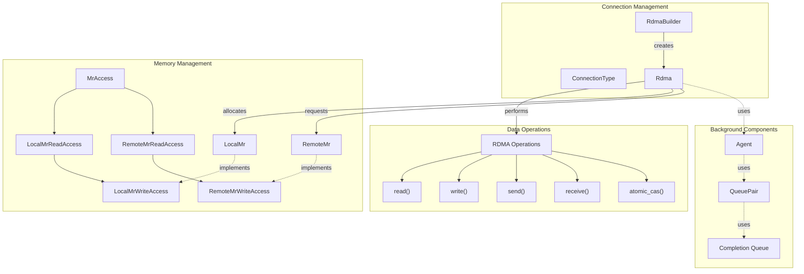
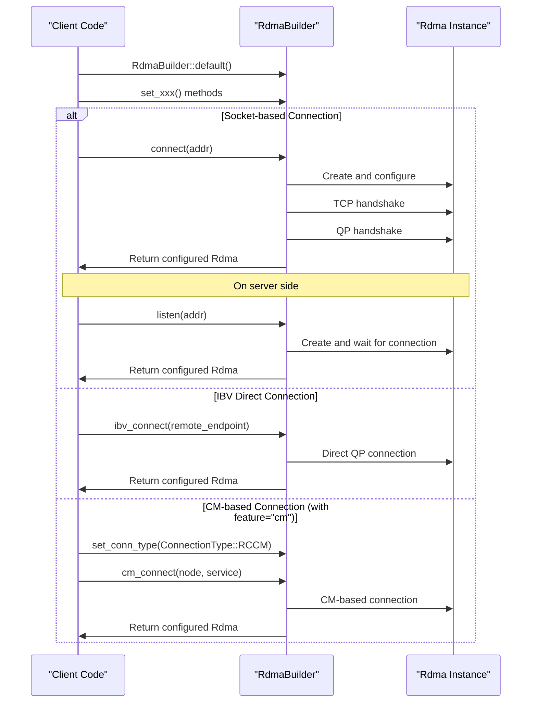
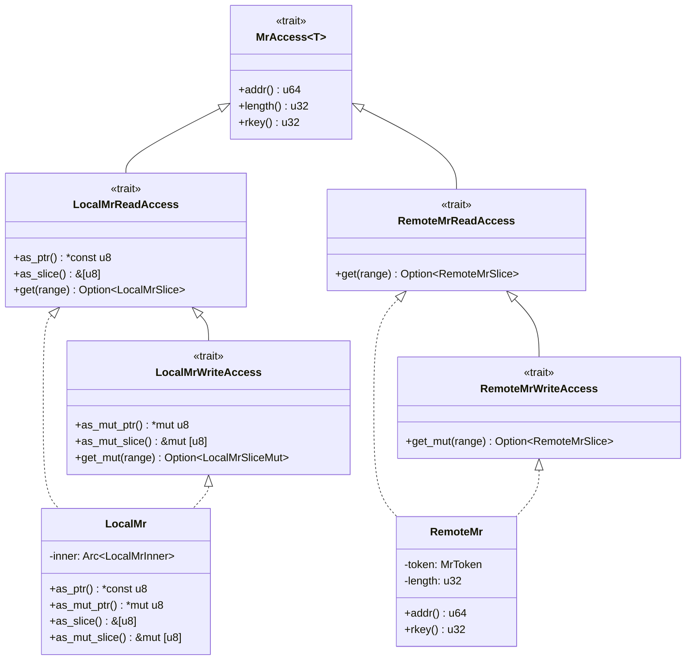

<!-- source: DeepWiki mcp.deepwiki.com · repo datenlord/async-rdma · page 4 API Reference · fetched 2026-11-11 -->

# API Reference

<details>
<summary>Relevant source files</summary>

The following files were used as context for generating this wiki page:

- [Cargo.toml](Cargo.toml)
- [src/lib.rs](src/lib.rs)

</details>


This page provides a high-level overview of the primary API components in the async-rdma library. It introduces the key abstractions and their relationships, serving as a gateway to more detailed documentation for each component.

For detailed implementation examples, see [Examples & Patterns](#5). For internal architecture details, see [Internals](#6).

## Core API Components

The async-rdma library provides several key components that work together to enable asynchronous RDMA operations in Rust:



Sources: [src/lib.rs:123-166](), [src/lib.rs:167-183]()

## Connection Management

The entry point for establishing RDMA connections is the `RdmaBuilder` class, which follows the builder pattern to configure and create `Rdma` instances.

### RdmaBuilder

`RdmaBuilder` provides methods to:

1. Configure connection parameters
2. Set RDMA device attributes
3. Establish connections using different methods
4. Define memory access permissions

The most common connection patterns:



Sources: [src/lib.rs:328-1073](), [src/lib.rs:1074-1128](), [src/lib.rs:1129-1205]()

### Connection Types

The library supports three connection types, defined in the `ConnectionType` enum:

| Connection Type | Description | Use Case |
|-----------------|-------------|----------|
| `RCSocket` | Establish reliable connection through Socket APIs | General purpose, easiest to use |
| `RCIBV` | Establish connection through IBV APIs directly | More control over connection parameters |
| `RCCM` | Establish connection through CM APIs (with feature="cm") | Integration with existing CM applications |

Sources: [src/lib.rs:1208-1216]()

## RDMA Operations

The `Rdma` class provides the main interface for performing RDMA operations. These operations follow standard RDMA semantics:

### Data Transfer Operations

```mermaid
graph LR
    subgraph "RDMA Operations"
        direction TB
        Send["send()/send_with_imm()"] -->|"Transfers local memory"| Receive["receive()/receive_with_imm()"]
        Write["write()/write_with_imm()"] -->|"One-sided write to"| RemoteMem["Remote Memory Region"]
        Read["read()"] -->|"One-sided read from"| RemoteMem
        Atomic["atomic_cas()"] -->|"Compare-and-swap on"| RemoteMem
    end
    
    subgraph "Raw Operations (feature=\"raw\")"
        direction TB
        SendRaw["send_raw()/send_raw_with_imm()"]
        ReceiveRaw["receive_raw()/receive_raw_with_imm()"]
        SendRaw --> ReceiveRaw
    end
    
    subgraph "Memory Region Management"
        direction TB
        AllocLocal["alloc_local_mr()"]
        RequestRemote["request_remote_mr()"]
        SendMr["send_local_mr()/send_remote_mr()"]
        ReceiveMr["receive_local_mr()/receive_remote_mr()"]
        
        AllocLocal -->|"Local memory"| SendMr
        RequestRemote -->|"Remote memory"| SendMr
        SendMr --> ReceiveMr
    end
```

Sources: [src/lib.rs:1607-2587]()

Each operation has specific semantics:

| Operation | Description | Method |
|-----------|-------------|--------|
| Send | Send local memory content to remote | `send(), send_with_imm()` |
| Receive | Receive data into local memory | `receive(), receive_with_imm()` |
| Write | Write local memory to remote memory | `write(), write_with_imm()` |
| Read | Read remote memory into local memory | `read()` |
| Atomic | Compare-and-swap on remote memory | `atomic_cas()` |

### Memory Region Management

The memory management APIs allow for allocating and accessing memory regions for RDMA operations:

| Operation | Description | Method |
|-----------|-------------|--------|
| Allocate Local MR | Create a local memory region | `alloc_local_mr()` |
| Request Remote MR | Request a memory region from remote peer | `request_remote_mr()` |
| Send MR | Send metadata for a memory region | `send_local_mr(), send_remote_mr()` |
| Receive MR | Receive metadata for a memory region | `receive_local_mr(), receive_remote_mr()` |

Sources: [src/lib.rs:2588-3154](), [src/lib.rs:3155-3351]()

## Memory Access Model

The memory region system uses a hierarchy of traits to control read and write access to local and remote memory:



Sources: [src/lib.rs:178-183]()

## Access Flags and Permissions

Memory regions and queue pairs can have various access permissions defined using the `AccessFlag` enum and `BitFlags<AccessFlag>`:

| Access Flag | Description | 
|-------------|-------------|
| `LocalWrite` | Allow local write to the memory region |
| `RemoteWrite` | Allow remote write to the memory region |
| `RemoteRead` | Allow remote read from the memory region |
| `RemoteAtomic` | Allow remote atomic operations on the memory region |
| `MWBind` | Allow memory window binding |
| `ZeroBased` | Use zero-based addressing |
| `OnDemand` | Register memory on demand |
| `HugeTLB` | Use huge TLB pages |

Sources: [src/lib.rs:168-169]()

## Background Components

The following components work in the background to support RDMA operations:

### Agent

The Agent component:
- Manages memory regions in the background
- Handles control messages between endpoints
- Orchestrates asynchronous operations

### QueuePair

The QueuePair component:
- Maintains the connection state between endpoints
- Posts RDMA operations to the hardware
- Processes work completions

### Completion Queue & Event Handling

The completion queue system:
- Monitors for operation completions
- Notifies waiting operations
- Supports different polling strategies

Sources: [src/lib.rs:169-170](), [src/lib.rs:184-189]()

## Detailed API Documentation

For detailed documentation on specific API components, refer to the following pages:

- [RdmaBuilder](#4.1) - Documentation for connection and configuration
- [Rdma](#4.2) - Documentation for the main RDMA operations interface
- [Memory Regions](#4.3) - Documentation for memory region management and access
- [Agent](#4.4) - Documentation for the background agent component
- [Queue Pair](#4.5) - Documentation for queue pair management
- [Completion Queue & Event Handling](#4.6) - Documentation for the event system

---

