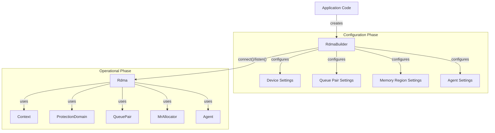
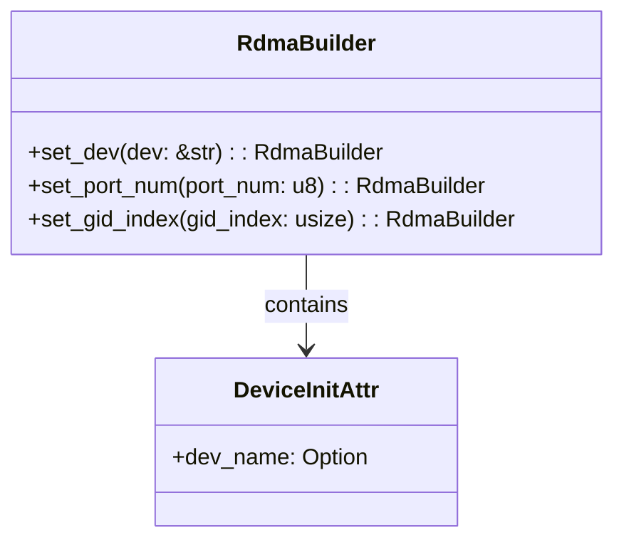
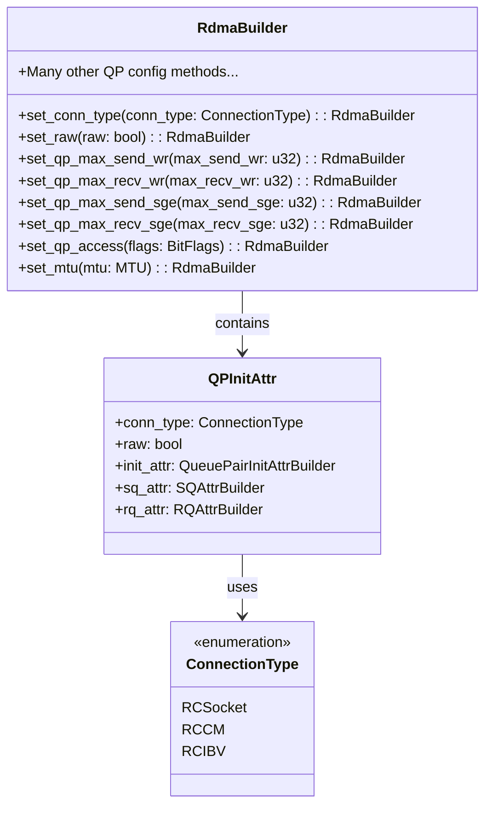
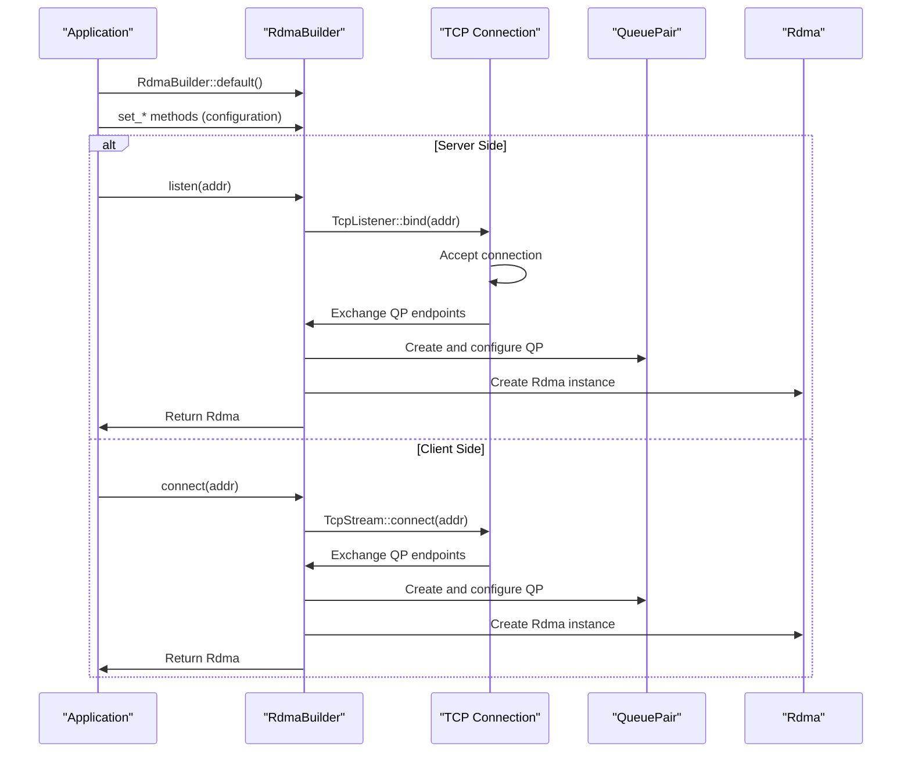

<!-- source: DeepWiki mcp.deepwiki.com · repo datenlord/async-rdma · page 4.1 RdmaBuilder · fetched 2026-11-11 -->

# RdmaBuilder

<details>
<summary>Relevant source files</summary>

The following files were used as context for generating this wiki page:

- [examples/client.rs](examples/client.rs)
- [examples/cm_client.rs](examples/cm_client.rs)
- [examples/server.rs](examples/server.rs)
- [src/lib.rs](src/lib.rs)

</details>


The `RdmaBuilder` component serves as the entry point for applications to configure and establish RDMA connections in the async-rdma library. It follows the builder pattern, allowing users to customize various aspects of the RDMA connection before creating the actual `Rdma` object, which provides the main interface for performing RDMA operations. For information about the Rdma interface itself, see [Rdma](#4.2).

## Architecture Overview

`RdmaBuilder` plays a crucial role in the initialization phase of RDMA communication. It abstracts the complex RDMA connection setup details and provides a clean, fluent interface for configuration.



Sources: [src/lib.rs:330-343](), [src/lib.rs:1-25]()

## Creating a RdmaBuilder

Creating a new `RdmaBuilder` instance is straightforward:

```rust
// Create a new builder with default settings
let builder = RdmaBuilder::new();

// Alternatively, using default()
let builder = RdmaBuilder::default();
```

Both methods create a builder with default settings, which include:
- No specific device name (auto-selected)
- Default access rights: `LocalWrite | RemoteRead | RemoteWrite | RemoteAtomic`
- Default completion queue size: 16
- Default port number: 1
- Default GID index: 1

Sources: [src/lib.rs:343-357]()

## Configuration Methods

The `RdmaBuilder` provides numerous methods to customize various aspects of the RDMA connection. These methods follow a fluent interface pattern, allowing method chaining.

### Device Settings



Sources: [src/lib.rs:214-219](), [src/lib.rs:631-636](), [src/lib.rs:655-666](), [src/lib.rs:669-673]()

| Method | Description |
|--------|-------------|
| `set_dev(dev: &str)` | Sets the RDMA device name |
| `set_port_num(port_num: u8)` | Sets the port number on the RDMA device |
| `set_gid_index(gid_index: usize)` | Sets the GID (Global Identifier) index |

### Queue Pair Settings



Sources: [src/lib.rs:242-276](), [src/lib.rs:676-726](), [src/lib.rs:767-945](), [src/lib.rs:1002-1007](), [src/lib.rs:1207-1216]()

The queue pair configuration methods allow fine-tuning of the RDMA queue pair capabilities:

| Method | Description |
|--------|-------------|
| `set_conn_type(conn_type: ConnectionType)` | Sets connection type (RCSocket, RCCM, or RCIBV) |
| `set_raw(raw: bool)` | Sets whether to send/receive raw data |
| `set_qp_max_send_wr(max_send_wr: u32)` | Maximum outstanding send requests |
| `set_qp_max_recv_wr(max_recv_wr: u32)` | Maximum outstanding receive requests |
| `set_qp_max_send_sge(max_send_sge: u32)` | Maximum SGEs per send work request |
| `set_qp_max_recv_sge(max_recv_sge: u32)` | Maximum SGEs per receive work request |
| `set_mtu(mtu: MTU)` | Sets the path MTU for the connection |

Additionally, there are numerous methods for fine-tuning low-level QP parameters such as retry counts, timeouts, and service levels.

### Memory Region Settings

| Method | Description |
|--------|-------------|
| `set_mr_access(flags: BitFlags<AccessFlag>)` | Sets memory region access permissions |
| `set_mr_strategy(strategy: MRManageStrategy)` | Sets strategy for managing memory regions (Jemalloc or Raw) |

Sources: [src/lib.rs:277-294](), [src/lib.rs:727-746]()

### Agent Settings

| Method | Description |
|--------|-------------|
| `set_max_message_length(max_msg_len: usize)` | Maximum length of messages handled by Agent |
| `set_max_rmr_access(flags: BitFlags<AccessFlag>)` | Maximum access permissions for remote MR requests |
| `set_cc_evnet_timeout(timeout: Duration)` | Timeout for completion channel event notifications |
| `set_polling_trigger(pt_type: PollingTriggerType)` | Sets the polling trigger type (Automatic or Manual) |

Sources: [src/lib.rs:295-326](), [src/lib.rs:747-762](), [src/lib.rs:1042-1062]()

## Connection Methods

After configuring the RDMA connection parameters, the `RdmaBuilder` offers several methods to establish the actual connection:

### Socket-based Connections



Sources: [src/lib.rs:370-429](), [src/lib.rs:600-628](), [src/lib.rs:1076-1128]()

| Method | Description |
|--------|-------------|
| `connect<A: ToSocketAddrs>(addr: A) -> io::Result<Rdma>` | Establishes connection with an RDMA server |
| `listen<A: ToSocketAddrs>(addr: A) -> io::Result<Rdma>` | Listens for incoming connections |

These methods use TCP for the initial connection setup and exchange of Queue Pair information.

### Advanced Connection Methods

For more advanced scenarios, RdmaBuilder offers additional connection methods:

| Method | Description |
|--------|-------------|
| `ibv_connect(remote: QueuePairEndpoint) -> io::Result<Rdma>` | Connects using raw IBV information, without TCP |
| `cm_connect(node: &str, service: &str) -> io::Result<Rdma>` | Establishes connection using the RDMA Connection Manager (requires "cm" feature) |

Sources: [src/lib.rs:429-455](), [src/lib.rs:546-562]()

## Building the Rdma Object

If you need to create an `Rdma` object without establishing a connection immediately, you can use the `build()` method:

```rust
let rdma = RdmaBuilder::default().set_dev("mlx5_0").build()?;
```

This creates an `Rdma` object with the configured settings but without establishing a connection.

Sources: [src/lib.rs:360-369]()

## Usage Examples

### Basic Client Setup

```rust
// Create a builder with default settings and connect to a server
let rdma = RdmaBuilder::default()
    .connect("192.168.1.100:7471").await?;

// Now use the Rdma object for operations
let mut lmr = rdma.alloc_local_mr(Layout::new::<[u8; 8]>())?;
```

Sources: [src/lib.rs:33-39](), [examples/client.rs:135-136]()

### Basic Server Setup

```rust
// Create a builder with default settings and listen for connections
let rdma = RdmaBuilder::default()
    .listen("0.0.0.0:7471").await?;

// Now use the Rdma object for operations
let lmr = rdma.receive().await?;
```

Sources: [src/lib.rs:51-54](), [examples/server.rs:107]()

### Using Connection Manager (CM)

```rust
// Create a builder with CM connection type
let rdma = RdmaBuilder::default()
    .set_conn_type(ConnectionType::RCCM)
    .set_raw(true)
    .cm_connect("192.168.1.100", "7471")
    .await?;
```

Sources: [examples/cm_client.rs:20-26]()

## Best Practices

1. **Set Port Number and GID Index**: It's highly recommended to explicitly set these values rather than relying on defaults.

2. **Configure Queue Pair Parameters**: For performance-critical applications, adjust the queue pair parameters like max send/receive work requests based on your workload.

3. **Set Appropriate Timeouts**: Use `set_cc_evnet_timeout` to configure appropriate timeouts for your environment.

4. **Connection Type Selection**:
   - Use `RCSocket` for standard RDMA connections over TCP/IP
   - Use `RCIBV` when you need to manage the connection details manually
   - Use `RCCM` when working with RDMA Connection Manager

5. **Error Handling**: Always check the returned `io::Result<Rdma>` when establishing connections.

Sources: [src/lib.rs:351-353](), [src/lib.rs:764-766](), [src/lib.rs:1042-1047]()

## Summary

The `RdmaBuilder` provides a flexible interface for configuring and establishing RDMA connections with various parameters. It abstracts away the complexity of RDMA connection setup while still providing fine-grained control over all aspects of the connection. The builder pattern allows for clear, readable code with method chaining for configuration.

---

