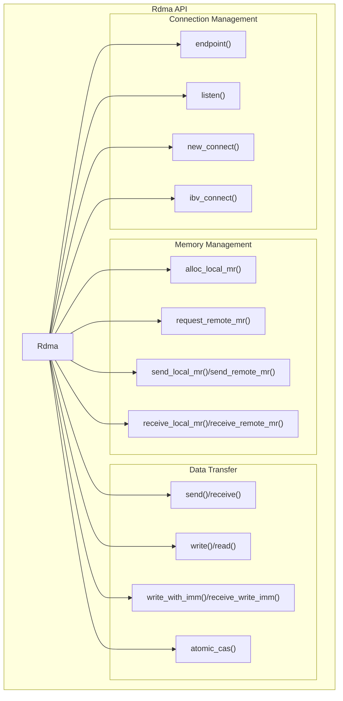
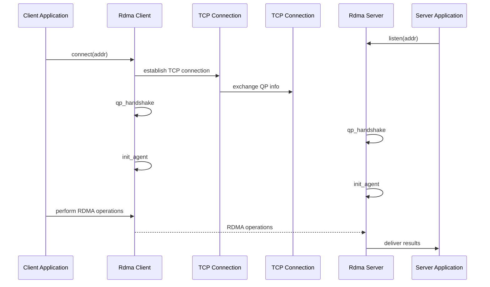
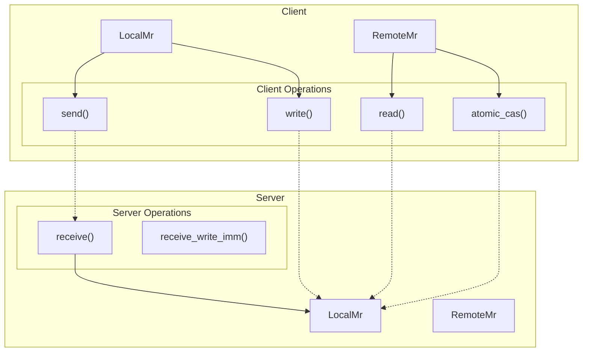
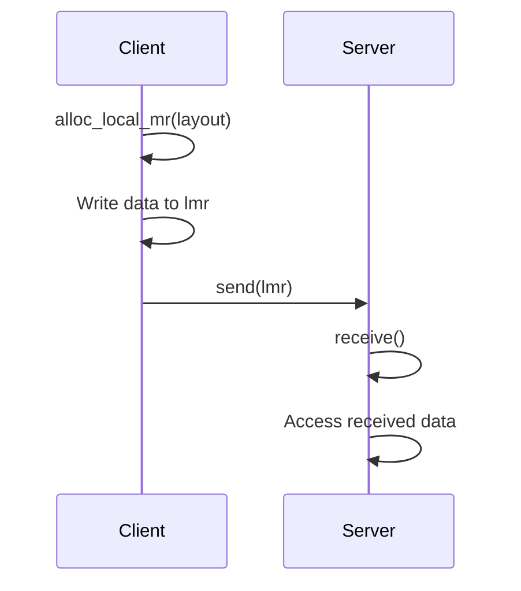
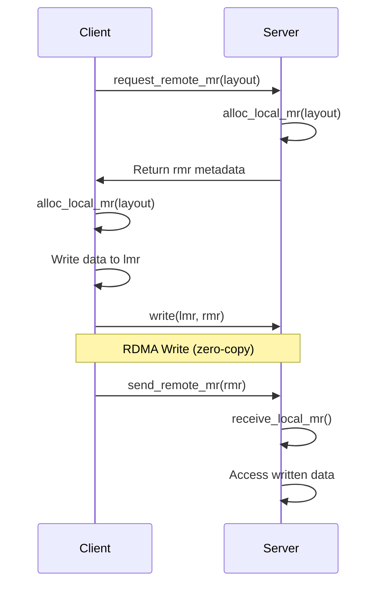
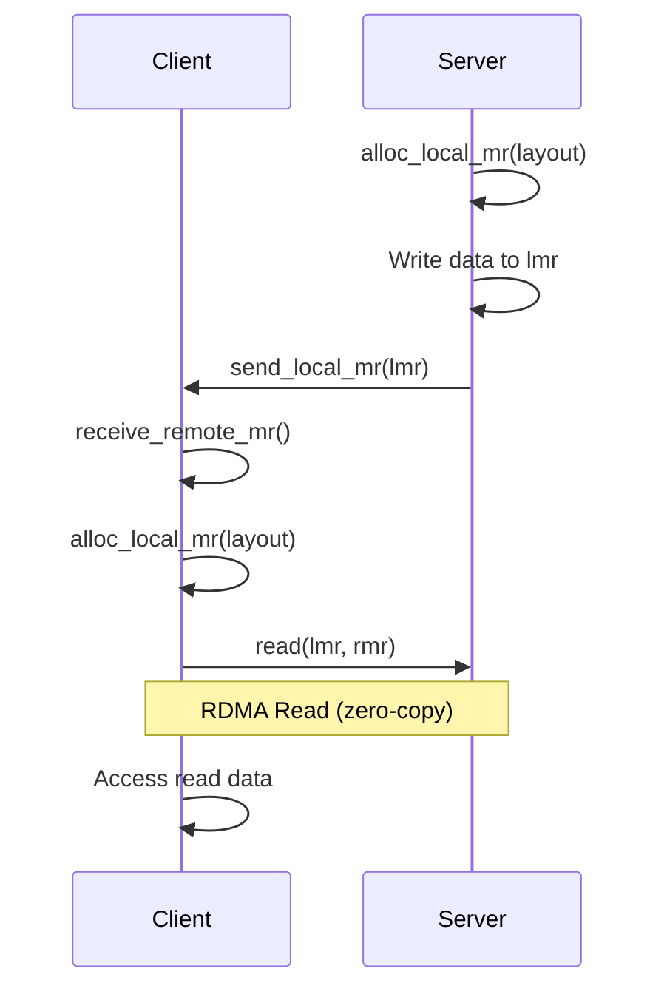

<!-- source: DeepWiki mcp.deepwiki.com · repo datenlord/async-rdma · page 4.2 Rdma · fetched 2026-11-11 -->

# Rdma

<details>
<summary>Relevant source files</summary>

The following files were used as context for generating this wiki page:

- [examples/client.rs](examples/client.rs)
- [examples/cm_client.rs](examples/cm_client.rs)
- [examples/server.rs](examples/server.rs)
- [src/lib.rs](src/lib.rs)

</details>


The `Rdma` struct is the primary interface to perform RDMA operations in the async-rdma library. It provides high-level methods for memory management, data transfer, and connection handling. This page documents how to use the `Rdma` API for various RDMA operations.

For information about creating and configuring RDMA connections, see [RdmaBuilder](#4.1). For details about memory region types and operations, see [Memory Regions](#4.3).

## Overview

The `Rdma` struct serves as the central access point for all RDMA operations, providing:

1. **Memory management** - Allocation and management of local and remote memory regions
2. **Data transfer** - Methods for sending and receiving data using RDMA operations
3. **Connection management** - Handling multiple connections and cloning connections
4. **Advanced operations** - Atomic operations, immediate data, and manual polling



Sources: [src/lib.rs:1241-1261]()

## Internal Structure

The `Rdma` struct consists of several critical components that work together to provide RDMA functionality:

```mermaid
classDiagram
    class Rdma {
        ctx: Arc<Context>
        pd: Arc<ProtectionDomain>
        allocator: Arc<MrAllocator>
        qp: Arc<QueuePair>
        agent: Option<Arc<Agent>>
        conn_type: ConnectionType
        raw: bool
        clone_attr: CloneAttr
        trigger_tx: Option<mpsc::Sender<()>>
    }
    
    Rdma --> Context
    Rdma --> ProtectionDomain
    Rdma --> MrAllocator
    Rdma --> QueuePair
    Rdma --> Agent
    Rdma --> ConnectionType
    Rdma --> CloneAttr
    
    class ConnectionType {
        <<enumeration>>
        RCSocket
        RCCM
        RCIBV
    }
    
    class Context {
        open(dev_name, port, gid_index)
        create_protection_domain()
        create_completion_queue()
        create_event_channel()
    }
    
    class ProtectionDomain {
        create_qp()
    }
    
    class MrAllocator {
        alloc(layout)
        dealloc(mr)
    }
    
    class QueuePair {
        post_send()
        post_recv()
        modify_to_rtr()
        modify_to_rts()
    }
    
    class Agent {
        send_data()
        recv_data()
        request_remote_mr()
        send_mr()
        recv_mr()
    }
```

Sources: [src/lib.rs:1241-1261]()

## Connection Management

The `Rdma` struct provides methods to manage connections with remote RDMA endpoints. These connections can be established in various ways depending on the specific requirements.

### Establishing Connections

Connections are typically established through the `RdmaBuilder` (see [RdmaBuilder](#4.1)), but the `Rdma` instance also provides methods for creating additional connections or accepting incoming connections:

1. **Accepting new connections (server-side)**:
   ```rust
   let new_rdma = rdma.listen().await?;
   ```

2. **Creating new connections (client-side)**:
   ```rust
   let new_rdma = rdma.new_connect(addr).await?;
   ```

3. **Connecting via IBV information**:
   ```rust
   rdma.ibv_connect(remote_endpoint).await?;
   ```

### Connection Flow



Sources: [src/lib.rs:399-428](), [src/lib.rs:600-627]()

## Memory Management

Memory management is a fundamental aspect of RDMA operations, allowing you to control memory regions for data transfers.

### Local Memory Regions

Local memory regions (LocalMr) represent memory blocks that can be accessed locally and remotely:

```rust
// Allocate a local memory region of 8 bytes
let layout = Layout::new::<[u8; 8]>();
let mut lmr = rdma.alloc_local_mr(layout)?;
```

### Remote Memory Regions

Remote memory regions (RemoteMr) represent memory on a remote node that can be accessed via RDMA operations:

```rust
// Request a remote memory region from the remote endpoint
let layout = Layout::new::<[u8; 8]>();
let mut rmr = rdma.request_remote_mr(layout).await?;
```

### Memory Region Exchange

You can share memory region information between endpoints:

```rust
// Send a local memory region to the remote endpoint
rdma.send_local_mr(lmr).await?;

// Send a remote memory region to the remote endpoint
rdma.send_remote_mr(rmr).await?;

// Receive a local memory region from the remote endpoint
let lmr = rdma.receive_local_mr().await?;

// Receive a remote memory region from the remote endpoint
let rmr = rdma.receive_remote_mr().await?;
```

Sources: [src/lib.rs:179-181](), [examples/client.rs:48-71](), [examples/server.rs:58-65]()

## Data Transfer Operations

The `Rdma` API provides several methods for transferring data, catering to different requirements and use cases.

### Send/Receive Operations

Send/receive operations involve both the sender and receiver CPUs:

```rust
// Send data (sender side)
rdma.send(&lmr).await?;

// Receive data (receiver side)
let lmr = rdma.receive().await?;
```

With immediate data:

```rust
// Send data with immediate value (sender side)
rdma.send_with_imm(&lmr, imm_data).await?;

// Receive data with immediate value (receiver side)
let (lmr, imm) = rdma.receive_with_imm().await?;
```

### RDMA Read/Write Operations

RDMA read/write operations allow direct memory access without involving the remote CPU:

```rust
// Write local data to remote memory region (client side)
rdma.write(&lmr, &mut rmr).await?;

// Read from remote memory region to local memory region
rdma.read(&mut lmr, &rmr).await?;
```

With immediate data (for write):

```rust
// Write with immediate data (sender side)
rdma.write_with_imm(&lmr, &mut rmr, imm_data).await?;

// Receive write immediate notification (receiver side)
let imm = rdma.receive_write_imm().await?;
```

### Atomic Operations

Atomic operations provide a way to perform compound operations on remote memory:

```rust
// Compare and swap operation
rdma.atomic_cas(compare_value, swap_value, &mut rmr).await?;
```

### Data Transfer Flow



Sources: [examples/client.rs:21-45](), [examples/client.rs:74-119](), [examples/server.rs:17-91]()

## Example Usage Patterns

Here are some common patterns for using the `Rdma` API:

### Send and Receive Pattern



Example:

```rust
// Client side
let mut lmr = rdma.alloc_local_mr(Layout::new::<[u8; 8]>())?;
lmr.as_mut_slice().write(&[1_u8; 8])?;
rdma.send(&lmr).await?;

// Server side
let lmr = rdma.receive().await?;
let data = *lmr.as_slice();
```

### RDMA Write Pattern



Example:

```rust
// Client side
let mut rmr = rdma.request_remote_mr(Layout::new::<[u8; 8]>()).await?;
let mut lmr = rdma.alloc_local_mr(Layout::new::<[u8; 8]>())?;
lmr.as_mut_slice().write(&[1_u8; 8])?;
rdma.write(&lmr, &mut rmr).await?;
rdma.send_remote_mr(rmr).await?;

// Server side
let lmr = rdma.receive_local_mr().await?;
let data = *lmr.as_slice();
```

### RDMA Read Pattern



Example:

```rust
// Server side
let mut lmr = rdma.alloc_local_mr(Layout::new::<[u8; 8]>())?;
lmr.as_mut_slice().write(&[1_u8; 8])?;
rdma.send_local_mr(lmr).await?;

// Client side
let rmr = rdma.receive_remote_mr().await?;
let mut lmr = rdma.alloc_local_mr(Layout::new::<[u8; 8]>())?;
rdma.read(&mut lmr, &rmr).await?;
let data = *lmr.as_slice();
```

Sources: [src/lib.rs:33-48](), [src/lib.rs:50-59](), [examples/client.rs:74-87](), [examples/server.rs:44-55]()

## Advanced Features

### Raw Data Operations

For performance-critical applications, you can bypass the Agent and work with raw data:

```rust
// Set raw mode in RdmaBuilder
let rdma = RdmaBuilder::default()
    .set_raw(true)
    .connect(addr).await?;

// Send raw data
rdma.send_raw(&lmr).await?;

// Receive raw data
let lmr = rdma.receive_raw(layout).await?;
```

### Manual Polling

You can manually control polling of the completion queue:

```rust
// Set manual polling trigger
let rdma = RdmaBuilder::default()
    .set_polling_trigger(PollingTriggerType::Manual)
    .connect(addr).await?;

// Get the manual trigger
let trigger = rdma.get_manual_trigger();

// Trigger polling manually
trigger.trigger();

// Poll all available completions
rdma.poll().await?;
```

### Multiple Connections

You can create multiple connections sharing resources:

```rust
// Create a new server connection from an existing one
let new_rdma = rdma.listen().await?;

// Create a new client connection from an existing one
let new_rdma = rdma.new_connect(addr).await?;
```

Sources: [examples/client.rs:145-156](), [examples/server.rs:119-131](), [examples/cm_client.rs:20-43]()

## Performance Considerations

- Use RDMA Read/Write operations instead of Send/Receive when possible, as they bypass the remote CPU
- Consider using immediate data with RDMA Write to notify the receiver without additional Send operations
- For small frequent transfers, batch operations to reduce overhead
- Use raw data operations when you need maximum performance
- Consider connection sharing to reduce resource usage

Sources: [src/lib.rs:1-71]()

## Error Handling

The `Rdma` API uses Rust's standard `io::Result` for error handling:

```rust
match rdma.send(&lmr).await {
    Ok(_) => println!("Data sent successfully"),
    Err(e) => eprintln!("Error sending data: {}", e),
}
```

Common errors include:
- Connection failures
- Memory allocation failures
- Timeout errors
- Permission errors (when attempting operations not allowed by the access rights)
- Queue pair state errors

## Summary

The `Rdma` API provides a comprehensive interface for RDMA operations, combining ease of use with powerful functionality. By leveraging the various memory management and data transfer methods, you can implement efficient RDMA-based communication patterns for your applications.

The key benefits of the async-rdma API include:
1. Asynchronous operations via Tokio
2. Safe memory management with Rust's ownership model
3. High-level abstractions that simplify RDMA programming
4. Support for multiple connection types and patterns
5. Efficient zero-copy data transfers

For more specific details about using memory regions, see [Memory Regions](#4.3), and for information about the background Agent component, see [Agent](#4.4).

---

