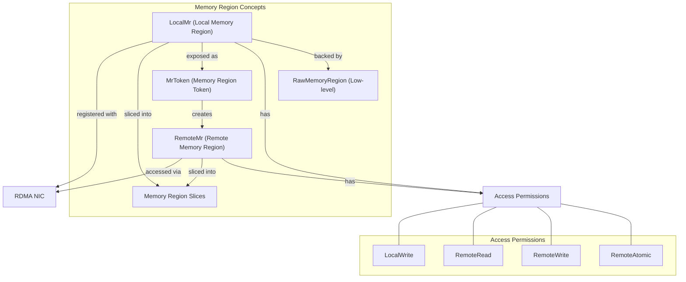
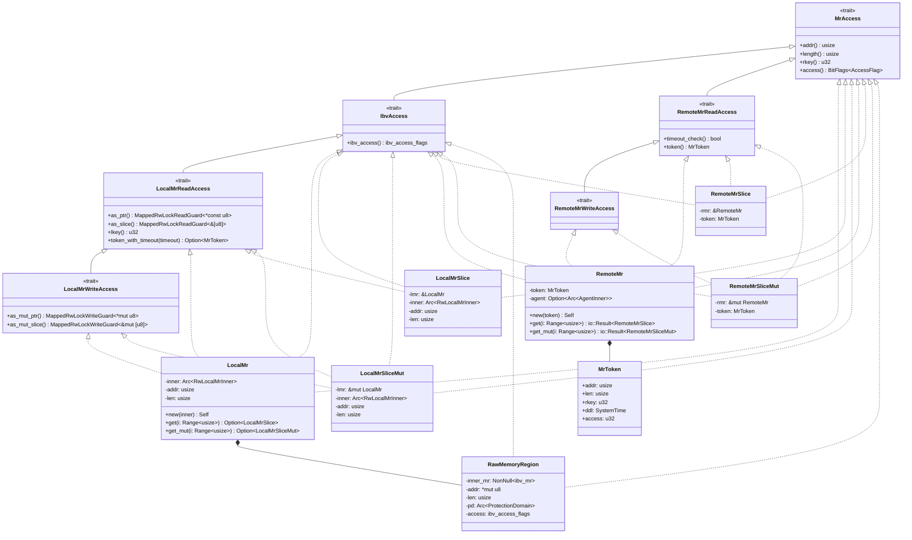
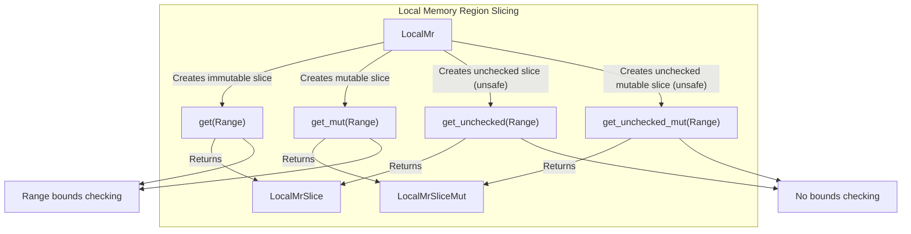
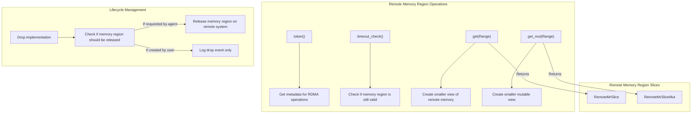
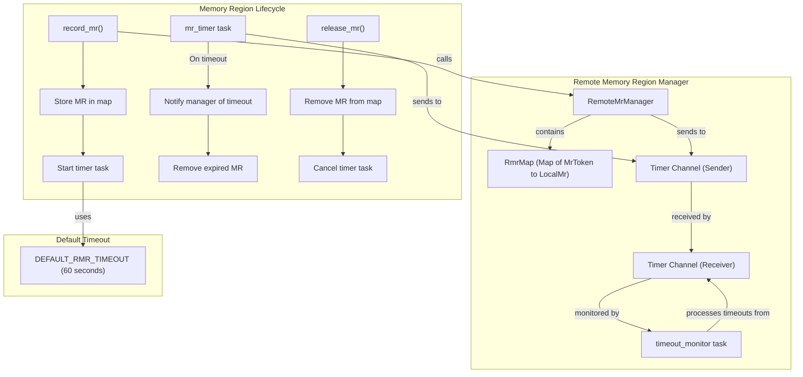
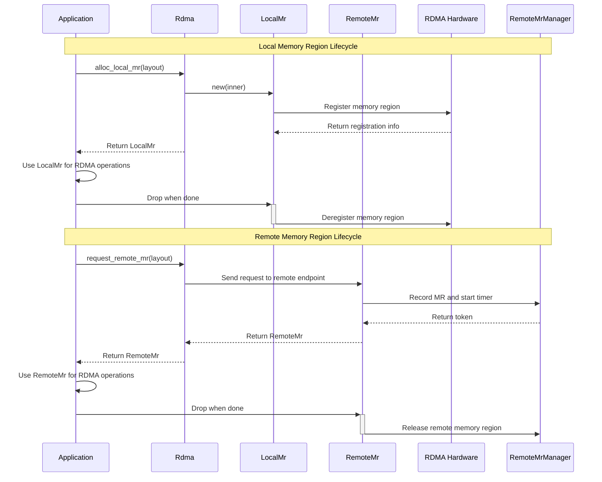

<!-- source: DeepWiki mcp.deepwiki.com · repo datenlord/async-rdma · page 4.3 Memory Regions · fetched 2026-11-11 -->

# Memory Regions

Relevant source files

The following files were used as context for generating this wiki page:

- [src/access.rs](src/access.rs)
- [src/id.rs](src/id.rs)
- [src/memory_region/local.rs](src/memory_region/local.rs)
- [src/memory_region/mod.rs](src/memory_region/mod.rs)
- [src/memory_region/raw.rs](src/memory_region/raw.rs)
- [src/memory_region/remote.rs](src/memory_region/remote.rs)
- [src/rmr_manager.rs](src/rmr_manager.rs)
- [tests/rmr_access.rs](tests/rmr_access.rs)

This page provides detailed documentation on the Memory Regions subsystem of async-rdma. Memory regions (MRs) are fundamental components in RDMA operations that allow applications to register memory buffers with the RDMA hardware, enabling direct memory access between remote systems.

For information about performing data transfer operations with memory regions, see [Data Transfer Operations](#3.3).

## Memory Regions Concepts

In RDMA, a Memory Region represents a registered segment of memory that has been made accessible for RDMA operations. Before performing any RDMA operation, memory must be registered with the RDMA device. This registration process creates a memory region and allows the hardware to directly access the memory without involving the CPU.

The async-rdma library provides a high-level abstraction over memory regions through two primary types: `LocalMr` and `RemoteMr`.

Sources: [src/memory_region/mod.rs:10-37](), [src/memory_region/local.rs:367-425](), [src/memory_region/remote.rs:22-92](), [src/access.rs:4-27]()

### Memory Access Permissions

Each memory region can have different access permissions that determine what operations can be performed on it:

| Access Flag    | Description                                  | Use Case                                |
|----------------|----------------------------------------------|----------------------------------------|
| LocalWrite     | Local process can write to the memory        | Receiving data from remote nodes        |
| RemoteRead     | Remote processes can read from the memory    | Allowing others to read your data       |
| RemoteWrite    | Remote processes can write to the memory     | Allowing others to write to your memory |
| RemoteAtomic   | Remote processes can perform atomic ops      | Distributed locks and counters          |
| MwBind         | Enable memory window binding                 | Advanced memory management              |
| ZeroBased      | Use byte offset instead of pointer address   | Memory efficiency in some cases         |
| OnDemand       | Create an on-demand paging MR                | Dynamic memory allocation               |
| HugeTlb        | Use huge pages for this MR                   | Performance optimization                |
| RelaxOrder     | Allow reordering of accesses                 | Performance optimization                |

Sources: [src/access.rs:4-27](), [src/access.rs:30-101]()

## Memory Region Type Hierarchy

The memory region system in async-rdma consists of a hierarchy of types that represent different aspects of memory regions:

Sources: [src/memory_region/mod.rs:19-37](), [src/memory_region/local.rs:32-365](), [src/memory_region/remote.rs:8-20](), [src/memory_region/raw.rs:10-114]()

## Local Memory Regions

Local memory regions (`LocalMr`) represent memory that is registered with the local RDMA device. These memory regions can be allocated and registered with specific access permissions.

### Structure and Implementation

`LocalMr` is composed of:
- `inner`: An `Arc<RwLock<LocalMrInner>>` that holds the actual memory region data
- `addr`: The start address of the memory region
- `len`: The length of the memory region

The `LocalMrInner` contains:
- `addr`: The start address of the memory region
- `layout`: The memory layout
- `raw`: An `Arc<RawMemoryRegion>` that represents the low-level RDMA memory region
- `strategy`: The memory management strategy (Jemalloc or Raw)

Sources: [src/memory_region/local.rs:367-425](), [src/memory_region/local.rs:538-621]()

### Memory Access Operations

Local memory regions provide methods to access the memory through the `LocalMrReadAccess` and `LocalMrWriteAccess` traits:

```mermaid
graph TD
    subgraph "Read Operations"
        AsPtr["as_ptr()"] --> ReadData["Read data from MR"]
        AsSlice["as_slice()"] --> ReadData
        AsSliceCursor["as_slice_cursor()"] --> ReadData
    end
    
    subgraph "Write Operations"
        AsMutPtr["as_mut_ptr()"] --> WriteData["Write data to MR"]
        AsMutSlice["as_mut_slice()"] --> WriteData
        AsMutSliceCursor["as_mut_slice_cursor()"] --> WriteData
    end
    
    subgraph "Safety Mechanisms"
        LockRead["Read lock on inner RwLock"]
        LockWrite["Write lock on inner RwLock"]
        TryMethods["Try variants for non-blocking access"]
        UncheckedMethods["Unchecked variants for unsafe direct access"]
    end
    
    AsPtr --> LockRead
    AsSlice --> LockRead
    AsSliceCursor --> LockRead
    
    AsMutPtr --> LockWrite
    AsMutSlice --> LockWrite
    AsMutSliceCursor --> LockWrite
    
    TryAsPtr["try_as_ptr()"] --> TryMethods
    TryAsSlice["try_as_slice()"] --> TryMethods
    TryAsMutPtr["try_as_mut_ptr()"] --> TryMethods
    TryAsMutSlice["try_as_mut_slice()"] --> TryMethods
    
    AsPtr_Unchecked["as_ptr_unchecked()"] --> UncheckedMethods
    AsSlice_Unchecked["as_slice_unchecked()"] --> UncheckedMethods
    AsMutPtr_Unchecked["as_mut_ptr_unchecked()"] --> UncheckedMethods
    AsMutSlice_Unchecked["as_mut_slice_unchecked()"] --> UncheckedMethods
```

Sources: [src/memory_region/local.rs:32-365]()

### Memory Region Slicing

Local memory regions can be sliced to create smaller views of the memory region:

Sources: [src/memory_region/local.rs:426-533](), [src/memory_region/local.rs:659-795]()

## Remote Memory Regions

Remote memory regions (`RemoteMr`) represent memory that is located on a remote system and accessible through RDMA operations. Unlike local memory regions, remote memory regions are not directly registered but are represented by a `MrToken` that contains the necessary information to access the remote memory.

### Structure and Implementation

`RemoteMr` is composed of:
- `token`: A `MrToken` that contains metadata about the remote memory region
- `agent`: An optional `Arc<AgentInner>` that represents the agent which requested this remote memory region

The `MrToken` contains:
- `addr`: The start address of the memory region
- `len`: The length of the memory region
- `rkey`: The remote key used to access the memory region
- `ddl`: The deadline (expiration time) of the memory region
- `access`: The access permissions as a bitmask

Sources: [src/memory_region/remote.rs:22-92](), [src/memory_region/mod.rs:44-63]()

### Remote Memory Access Operations

Remote memory regions provide methods to get metadata about the memory region through the `RemoteMrReadAccess` and `RemoteMrWriteAccess` traits. The actual read and write operations are performed through RDMA operations, not through direct memory access.

Sources: [src/memory_region/remote.rs:8-20](), [src/memory_region/remote.rs:94-128](), [src/memory_region/remote.rs:193-290]()

## Remote Memory Region Management

Remote memory regions are managed by the `RemoteMrManager`, which handles the lifecycle of memory regions, including timeouts and cleanup of expired memory regions.

Sources: [src/rmr_manager.rs:10-175]()

## Creating and Using Memory Regions

### Creating Local Memory Regions

Local memory regions are typically created through the `Rdma` interface:

1. `alloc_local_mr`: Allocates a new local memory region with a specified layout
2. `alloc_local_mr_with_access`: Allocates a new local memory region with specified layout and access permissions

### Creating Remote Memory Regions

Remote memory regions can be obtained in several ways:

1. `request_remote_mr`: Request a remote memory region from the remote endpoint
2. `new`: Create a remote memory region manually from a `MrToken`
3. `receive_remote_mr`: Receive a remote memory region that was sent by the remote endpoint

### Memory Region Lifecycle

Sources: [src/memory_region/local.rs:418-425](), [src/memory_region/local.rs:551-569](), [src/memory_region/remote.rs:63-77](), [src/memory_region/remote.rs:80-92](), [src/rmr_manager.rs:37-98]()

## Thread Safety and Concurrency

Memory regions in async-rdma are designed to be used safely in concurrent environments:

1. `LocalMr` uses `RwLock` to protect access to the underlying memory, ensuring that memory is not accessed during RDMA operations
2. Methods like `as_ptr()`, `as_slice()`, `as_mut_ptr()`, and `as_mut_slice()` return guarded objects that release the lock when they go out of scope
3. "Try" variants of these methods allow non-blocking attempts to access the memory
4. "Unchecked" variants provide unsafe direct access for performance-critical code that can guarantee correctness

Sources: [src/memory_region/local.rs:32-365]()

## Memory Region Error Handling

The async-rdma library uses Rust's `Result` type for error handling in memory region operations. Common errors include:

1. Invalid memory region layout
2. Registration failures
3. Out-of-bounds access when slicing memory regions
4. Remote memory region timeout
5. Insufficient access permissions for operations

The slicing operations (`get`, `get_mut`) on `LocalMr` return `Option<LocalMrSlice>` or `Option<LocalMrSliceMut>`, returning `None` if the requested range is invalid.

The slicing operations on `RemoteMr` return `io::Result<RemoteMrSlice>` or `io::Result<RemoteMrSliceMut>`, returning an error if the requested range is invalid.

Sources: [src/memory_region/local.rs:426-482](), [src/memory_region/remote.rs:94-128]()

## Optimizations and Performance Considerations

The memory region system in async-rdma includes several optimizations:

1. Memory slicing: Allows operations on portions of memory regions without additional registration
2. Arc sharing: The inner memory region implementation is shared using `Arc` to minimize copying
3. Read/write locks: Allow concurrent read access to memory regions
4. Memory access strategies: Support for both jemalloc and raw allocation strategies
5. Unsafe variants: Provide direct memory access for performance-critical code that can ensure safety

Sources: [src/memory_region/local.rs:419-425](), [src/memory_region/local.rs:538-621]()

---

