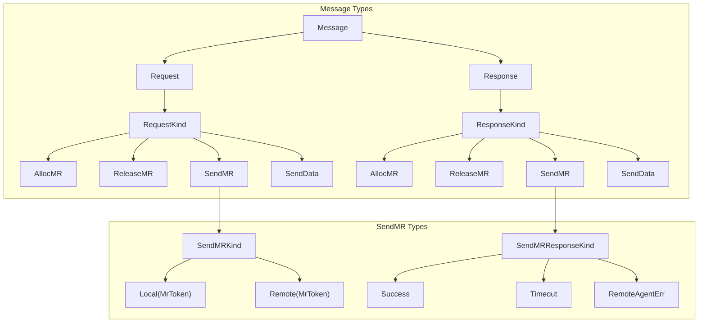
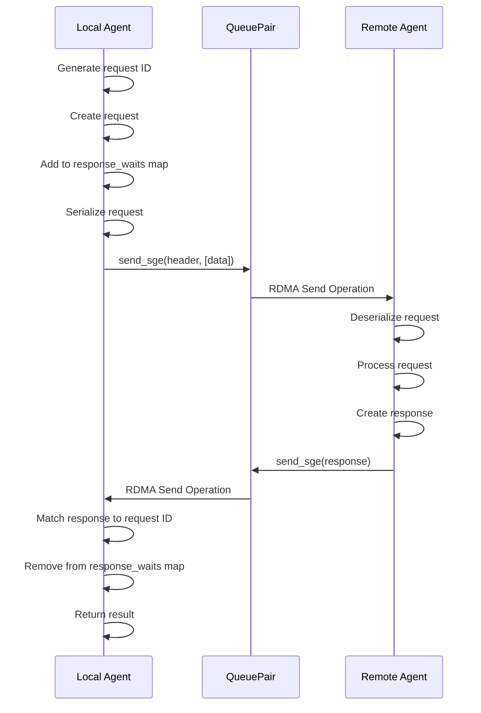
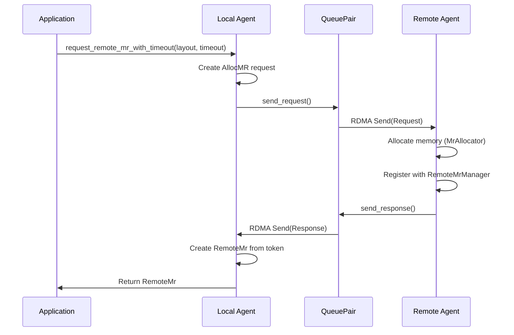
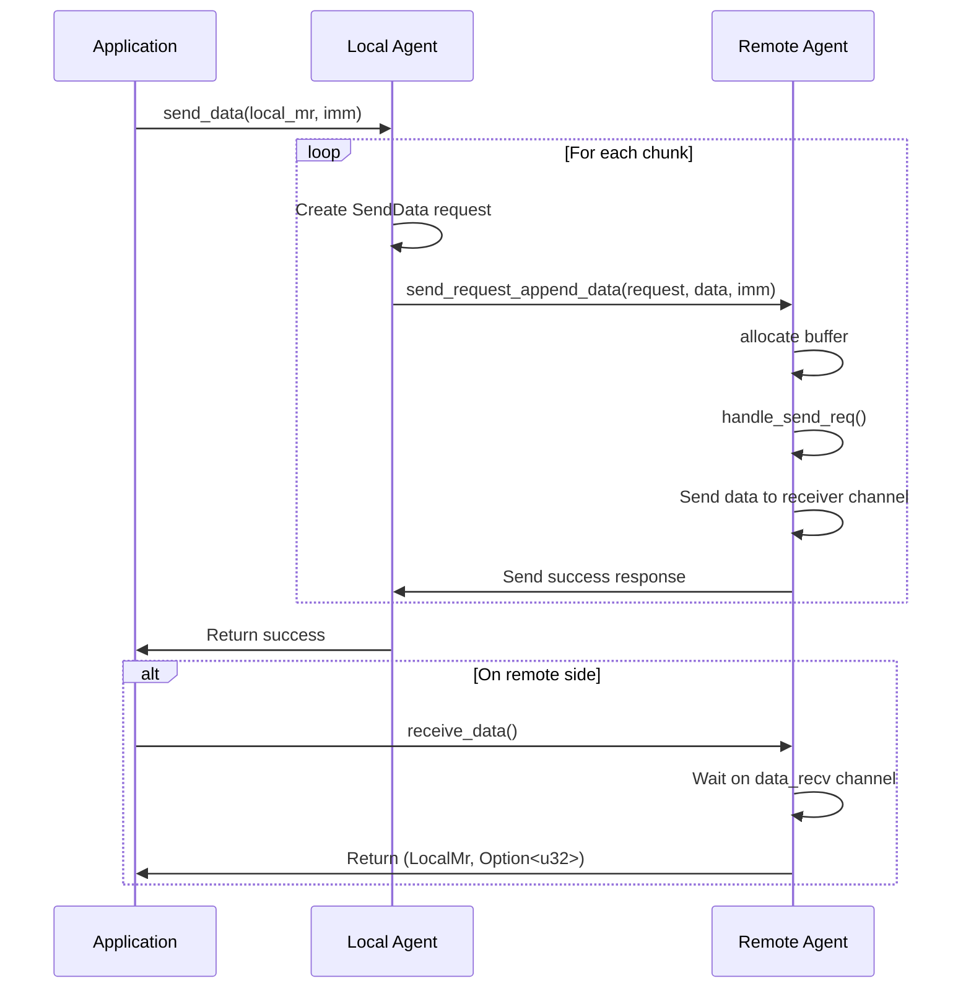
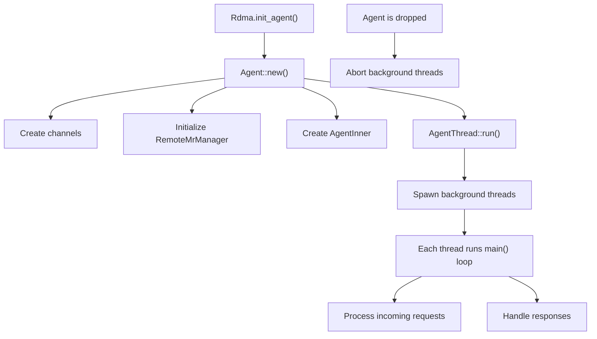

<!-- source: DeepWiki mcp.deepwiki.com · repo datenlord/async-rdma · page 4.4 Agent · fetched 2026-11-11 -->

# Agent

<details>
<summary>Relevant source files</summary>

The following files were used as context for generating this wiki page:

- [src/agent.rs](src/agent.rs)
- [src/lib.rs](src/lib.rs)

</details>


The Agent component in async-rdma serves as the orchestrator for memory management and communication between RDMA endpoints. It operates as a background service that manages asynchronous RDMA operations including memory region allocation, data transfer, and coordination with remote endpoints. This page documents the Agent's architecture, communication protocol, and key operations.

For information about memory regions themselves, see [Memory Regions](#4.3).

## Agent Architecture

The Agent component follows a multi-layered architecture that separates public interfaces from internal implementation details. It consists of several cooperating components that work together to provide high-level RDMA operations.

```mermaid
classDiagram
    class "Agent" {
        -Arc~AgentInner~ inner
        -Mutex~Receiver~LocalMr~~ local_mr_recv
        -Mutex~Receiver~RemoteMr~~ remote_mr_recv
        -Mutex~Receiver~(LocalMr, usize, Option~u32~)~~ data_recv
        -Mutex~Receiver~u32~~ imm_recv
        -Handles handles
        -Arc~AgentThread~ agent_thread
        -IbvEventListener ibv_event_listener
        +request_remote_mr_with_timeout()
        +send_local_mr_with_timeout()
        +send_remote_mr()
        +receive_local_mr()
        +receive_remote_mr()
        +send_data()
        +receive_data()
        +receive_imm()
    }
    
    class "AgentInner" {
        -Arc~QueuePair~ qp
        -ResponseWaitsMap response_waits
        -RemoteMrManager rmr_manager
        -Arc~MrAllocator~ allocator
        -usize max_sr_data_len
        +request_remote_mr_with_timeout()
        +release_mr()
        -send_request()
        -send_request_append_data()
        -send_response()
    }
    
    class "AgentThread" {
        -Arc~AgentInner~ inner
        -Sender~LocalMr~ local_mr_send
        -Sender~RemoteMr~ remote_mr_send
        -Sender~(LocalMr, usize, Option~u32~)~ data_send
        -Sender~u32~ imm_send
        -usize max_sr_data_len
        +run()
        -main()
        -handle_write_imm()
        -handle_request()
        -handle_response()
        -handle_send_req()
    }
    
    class "QueuePair" {
        +send_sge()
        +receive_sge()
        +read()
        +write()
    }
    
    class "RemoteMrManager" {
        -max_rmr_access
        -pd
        +record_mr()
        +release_mr()
    }

    Agent *-- AgentInner
    Agent *-- AgentThread
    AgentInner *-- RemoteMrManager
    AgentInner --> QueuePair
    AgentThread --> AgentInner
```

Sources: [src/agent.rs:49-69](), [src/agent.rs:79-281](), [src/agent.rs:284-320](), [src/agent.rs:587-599]()

### Core Components

The Agent consists of three primary components:

1. **Agent**: The public interface that exposes high-level operations to the Rdma object. It manages channels for receiving memory regions and data.

2. **AgentInner**: Handles the core logic for memory management and communication. It maintains references to the QueuePair, RemoteMrManager, and MrAllocator.

3. **AgentThread**: Runs in the background to process incoming requests and manage communication with the remote endpoint.

The Agent initializes these components and spawns background tasks to handle incoming RDMA operations. It creates multiple receiver threads (up to MAX_RECV_WR) to handle concurrent requests.

Sources: [src/agent.rs:79-124](), [src/agent.rs:303-336]()

## Communication Protocol

The Agent uses a message-based protocol for communication between RDMA endpoints. Each message is either a Request or a Response, with specific types defined for different operations.



Sources: [src/agent.rs:826-967]()

### Request/Response Flow

When an Agent operation is invoked, it follows this general flow:

1. Create a request with a unique ID
2. Serialize the request into a header buffer
3. Send the header (and any associated data) to the remote endpoint
4. Wait for a response with a matching request ID
5. Process the response and return the result

The Agent manages this process using a `response_waits` map that tracks pending requests and a timeout mechanism to prevent indefinite waits.



Sources: [src/agent.rs:626-638](), [src/agent.rs:641-686](), [src/agent.rs:529-552]()

## Memory Region Management

One of the primary responsibilities of the Agent is managing memory regions across RDMA endpoints. This includes allocating remote memory regions, transferring memory region metadata, and releasing memory when no longer needed.

### Requesting Remote Memory Regions

The Agent provides a mechanism to request memory allocation on a remote endpoint. This is a key operation for RDMA applications that need to access memory on remote machines.



Sources: [src/agent.rs:127-135](), [src/agent.rs:603-626](), [src/agent.rs:435-465]()

### Memory Region Transfer

The Agent allows transferring memory region metadata between endpoints, enabling one endpoint to access memory on another.

- **send_local_mr**: Sends a local memory region's metadata to the remote endpoint
- **send_remote_mr**: Sends a remote memory region's metadata to the remote endpoint
- **receive_local_mr**: Receives a local memory region's metadata from the remote endpoint
- **receive_remote_mr**: Receives a remote memory region's metadata from the remote endpoint

Sources: [src/agent.rs:138-161](), [src/agent.rs:163-192](), [src/agent.rs:195-212]()

## Data Transfer Operations

The Agent provides high-level operations for transferring data between endpoints:

### Send/Receive Data

The Agent handles data transfer by breaking large data blocks into manageable chunks and managing the underlying RDMA operations.



The data transfer system is designed to handle arbitrary data sizes by breaking them into chunks that fit within the maximum message size. This chunking is transparent to the application.

Sources: [src/agent.rs:215-250](), [src/agent.rs:253-265](), [src/agent.rs:555-583]()

### Immediate Data Handling

The Agent supports RDMA operations with immediate data:

- **send_data with imm**: Sends data with an immediate value
- **receive_data**: Receives data and any associated immediate value
- **receive_imm**: Receives only the immediate value from a write_with_imm operation

Immediate data is useful for signaling the completion of operations without transferring additional data.

Sources: [src/agent.rs:215-250](), [src/agent.rs:253-265](), [src/agent.rs:268-275](), [src/agent.rs:422-429]()

## Agent Initialization and Lifecycle

The Agent is initialized by the Rdma object and operates for the lifetime of the RDMA connection. Its lifecycle follows these stages:

1. **Creation**: Created by the Rdma object with a QueuePair, MrAllocator, and context
2. **Initialization**: Sets up communication channels and spawns background threads
3. **Operation**: Processes RDMA operations (memory management, data transfer)
4. **Termination**: Aborts background threads when the Agent is dropped



Sources: [src/agent.rs:79-124](), [src/agent.rs:71-77](), [src/lib.rs:1444-1460]()

## Configuration Parameters

The Agent has several configuration parameters that affect its behavior:

| Parameter | Description | Default |
|-----------|-------------|---------|
| max_message_length | Maximum size of a message for send/receive operations | 512 bytes |
| max_rmr_access | Maximum access permissions for remote memory regions | LOCAL_WRITE \| REMOTE_WRITE \| REMOTE_READ \| REMOTE_ATOMIC |
| RESPONSE_TIMEOUT | Maximum time to wait for a response | 5 seconds |

These parameters can be configured when creating the Rdma object through RdmaBuilder.

Sources: [src/agent.rs:43-46](), [src/lib.rs:299-316](), [src/lib.rs:752-762]()

The Agent component is a critical part of the async-rdma system, providing the abstraction layer that makes complex RDMA operations accessible through a high-level asynchronous API. By managing memory regions and handling communication between endpoints, it enables applications to leverage RDMA technology without dealing with the low-level details of RDMA operations.

---

