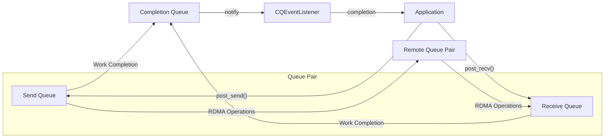
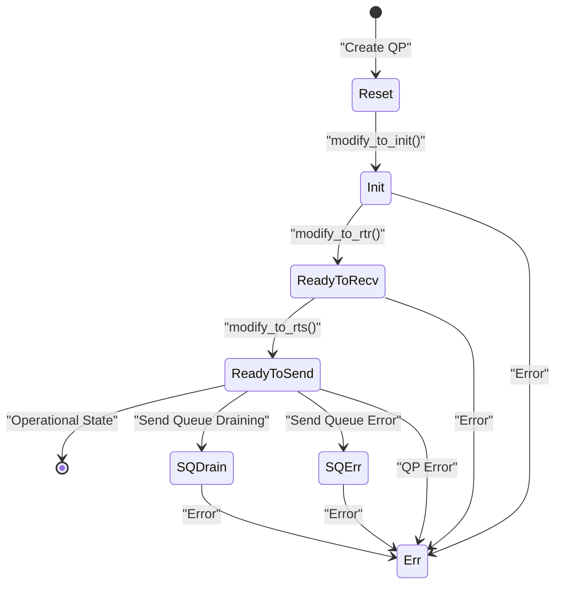
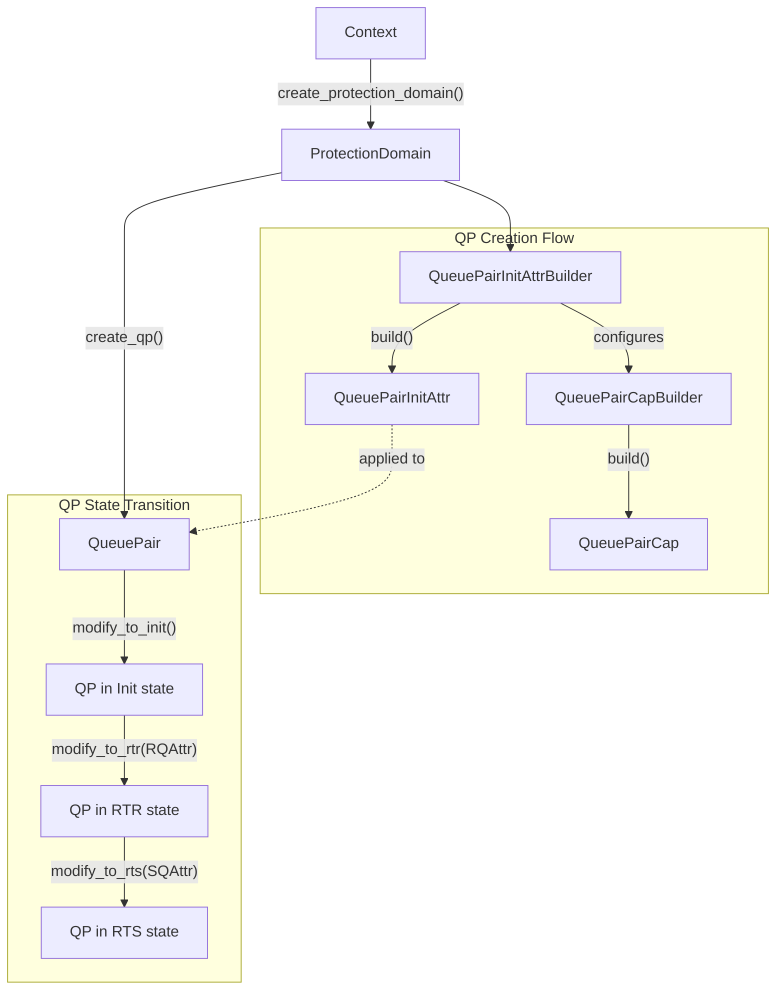
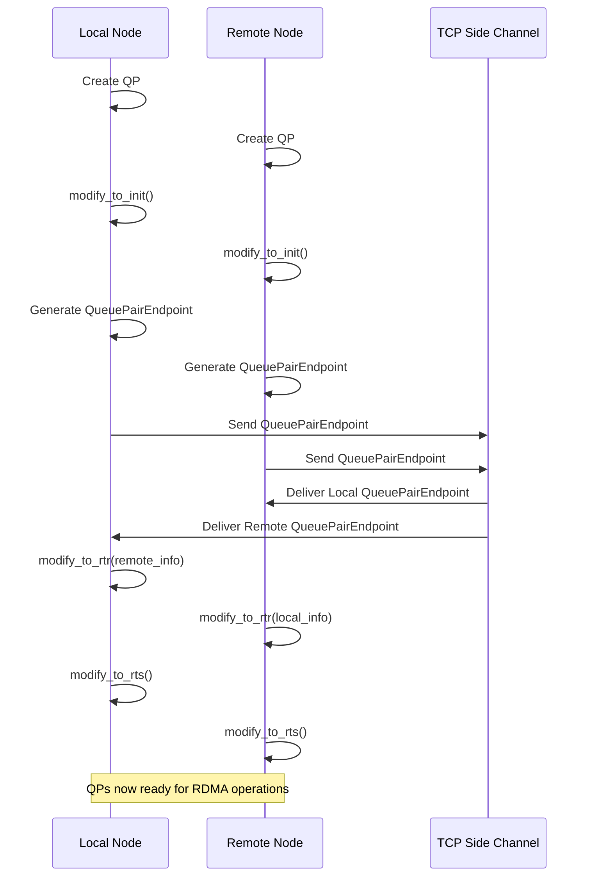
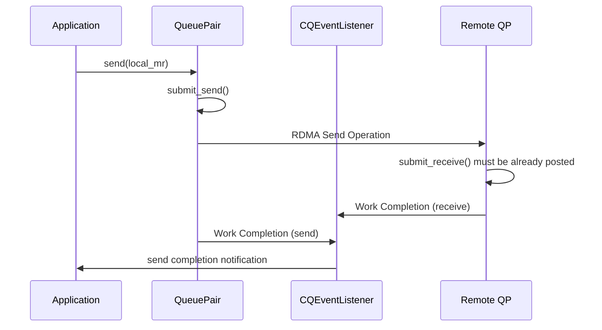
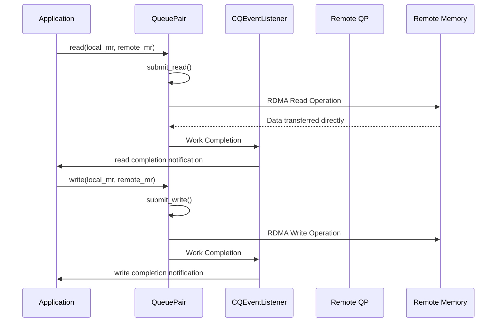
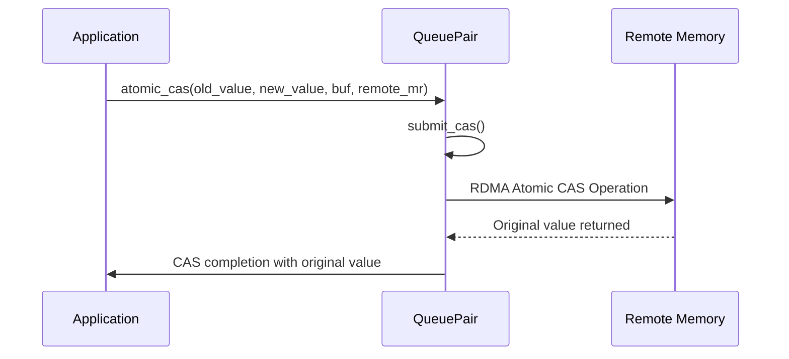
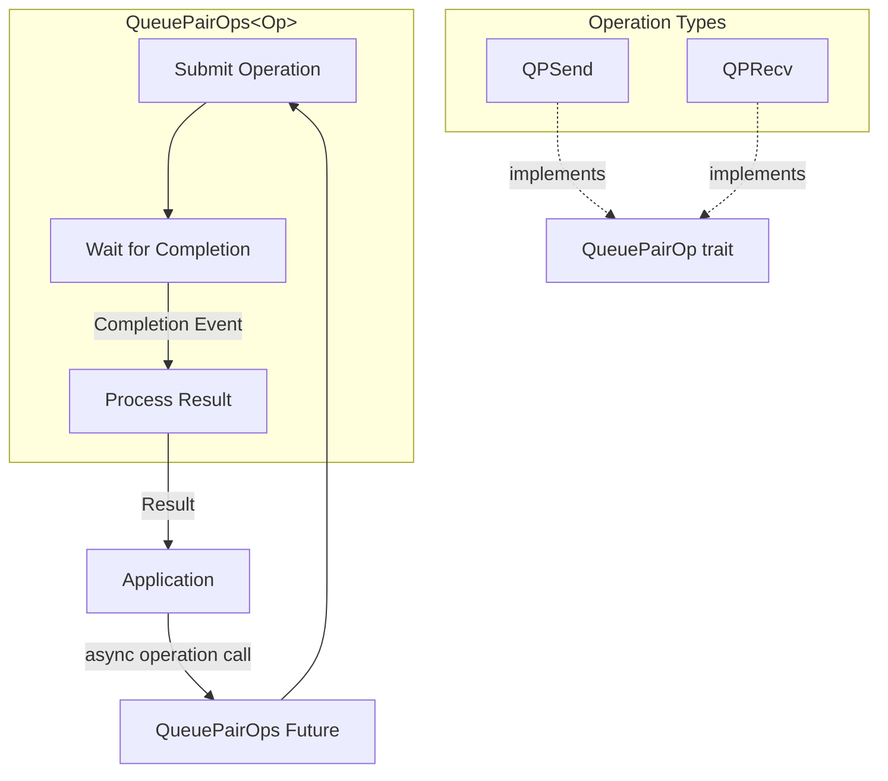

<!-- source: DeepWiki mcp.deepwiki.com · repo datenlord/async-rdma · page 4.5 Queue Pair · fetched 2026-11-11 -->

# Queue Pair

Relevant source files

The following files were used as context for generating this wiki page:

- [src/protection_domain.rs](src/protection_domain.rs)
- [src/queue_pair.rs](src/queue_pair.rs)

Queue Pairs (QPs) are the core communication channels in RDMA (Remote Direct Memory Access) technology. In the async-rdma library, the QueuePair component provides an asynchronous Rust interface to manage RDMA connections and data transfer operations between endpoints.

For information about the higher-level Agent component that uses Queue Pairs, see [Agent](#4.4). For details about Completion Queues that interact with Queue Pairs, see [Completion Queue & Event Handling](#4.6).

## Queue Pair Overview

A Queue Pair consists of a Send Queue (SQ) and a Receive Queue (RQ) that together form a bidirectional communication channel between RDMA endpoints. Work requests are posted to these queues and processed asynchronously by the RDMA hardware.

Sources: [src/queue_pair.rs:541-551](), [src/queue_pair.rs:718-776]()

## Queue Pair States

Queue Pairs follow a state machine model, transitioning through various states during their lifecycle:

Sources: [src/queue_pair.rs:494-513](), [src/queue_pair.rs:602-706]()

Each state represents a different phase in the QP lifecycle:

| State | Description | 
|-------|-------------|
| Reset | Initial state after QP creation |
| Init | QP is initialized with basic parameters but not ready for communication |
| ReadyToRecv (RTR) | QP is configured to receive messages |
| ReadyToSend (RTS) | QP is fully configured for bidirectional communication |
| SQDrain | Send Queue is in draining state (processing remaining requests) |
| SQErr | Send Queue has encountered an error |
| Err | QP is in error state |
| Unknown | QP state is unknown or uninitialized |

Sources: [src/queue_pair.rs:494-513]()

## QP Initialization and Configuration

Queue Pairs are created through the ProtectionDomain component and configured using a builder pattern. The configuration involves several stages and attribute sets:

Sources: [src/protection_domain.rs:45-72](), [src/queue_pair.rs:602-706]()

### QP Capacity Configuration

The `QueuePairCap` struct defines limits for the QP operation:

| Attribute | Description | Default |
|-----------|-------------|---------|
| max_send_wr | Maximum number of outstanding Send Work Requests | 10 |
| max_recv_wr | Maximum number of outstanding Receive Work Requests | 10 |
| max_send_sge | Maximum Scatter/Gather Elements per Send | 5 |
| max_recv_sge | Maximum Scatter/Gather Elements per Receive | 5 |
| max_inline_data | Maximum bytes of inline data for Send operations | 0 |

Sources: [src/queue_pair.rs:99-125](), [src/queue_pair.rs:42-54]()

### QP Initialization Attributes

The `QueuePairInitAttr` defines the basic QP properties:

| Attribute | Description |
|-----------|-------------|
| send_cq | Completion Queue for Send operations |
| recv_cq | Completion Queue for Receive operations |
| qp_cap | Capacity parameters |
| qp_type | Type of QP (RC, UC, UD) - primarily supports RC (Reliable Connection) |
| sq_sig_all | Whether all Send WRs generate Work Completions |
| access | Access flags for memory regions |
| pkey_index | P_Key index for subnet partitioning |

Sources: [src/queue_pair.rs:149-187]()

### Connection Establishment Attributes

For a QP to connect to a remote endpoint, it needs several additional configurations:

1. **Address Handler (`AddressHandler`)**: Contains addressing information for the remote endpoint:
   - dest_lid: LID (Local Identifier) of the destination
   - grh: Global Route Header for routing between subnets
   - service_level, port_num, etc.

2. **Receive Queue Attributes (`RQAttr`)**: 
   - mtu: Maximum Transfer Unit
   - dest_qp_number: Remote QP number
   - rq_psn: Packet Sequence Number for receives
   - address_handler: Remote endpoint addressing information

3. **Send Queue Attributes (`SQAttr`)**:
   - timeout: ACK timeout for detecting lost packets
   - retry_cnt: Number of retry attempts for unacknowledged packets
   - rnr_retry: Number of retries on Receiver Not Ready
   - sq_psn: Packet Sequence Number for sends
   - max_rd_atomic: Maximum outstanding RDMA Read/Atomic operations

Sources: [src/queue_pair.rs:252-284](), [src/queue_pair.rs:395-428](), [src/queue_pair.rs:465-491]()

## Connection Establishment Process

The QP connection establishment process involves creating a QP, then transitioning it through various states while configuring connection parameters:

1. **Create QP**: Allocate and initialize the QP with basic parameters
2. **Modify to Init**: Set initial QP attributes and access flags
3. **Exchange QP Information**: Exchange `QueuePairEndpoint` data with remote peer (usually via a side channel like TCP)
4. **Modify to RTR**: Apply received remote QP attributes to enable receiving
5. **Modify to RTS**: Set final parameters to enable sending

Sources: [src/queue_pair.rs:602-706](), [src/queue_pair.rs:228-245]()

## QP Operations

Once a Queue Pair is established and in the Ready to Send (RTS) state, it supports several types of operations:

### Send/Receive Operations

Send and Receive operations work in pairs:
- **Send**: Posts data from a local memory region to be sent to the remote node
- **Receive**: Posts a buffer to receive incoming data

These operations require CPU involvement on both sides (sender and receiver).

Sources: [src/queue_pair.rs:718-742](), [src/queue_pair.rs:753-776](), [src/queue_pair.rs:857-932]()

### RDMA Operations

RDMA operations (Read and Write) allow direct memory access to remote memory:

- **Read**: Reads data from a remote memory region into a local memory region
- **Write**: Writes data from a local memory region to a remote memory region

These operations only require CPU involvement on the initiating side.

Sources: [src/queue_pair.rs:788-813](), [src/queue_pair.rs:824-855](), [src/queue_pair.rs:997-1097]()

### Atomic Operations

Atomic operations provide hardware-level atomic memory operations:

- **Compare and Swap (CAS)**: Atomically compares a remote memory value with an expected value and, if they match, replaces it with a new value

Sources: [src/queue_pair.rs:866-888](), [src/queue_pair.rs:1044-1066]()

## Asynchronous Operation Handling

The async-rdma library provides asynchronous Rust interfaces for all QP operations. The `QueuePairOps` struct wraps operation submissions and completions into `Future` implementations:

Sources: [src/queue_pair.rs:1144-1214](), [src/queue_pair.rs:1277-1344]()

Each operation:
1. Registers with the CQEventListener
2. Submits the work request to the QP
3. Asynchronously waits for a completion event
4. Returns the result (success or error) when the operation completes

## Queue Pair Performance Considerations

When working with Queue Pairs, several factors can affect performance:

1. **Queue Capacity**: The `max_send_wr`, `max_recv_wr`, and SGE limits should be tuned based on your workload
2. **MTU Size**: Larger MTUs reduce packet overhead but may require more buffering
3. **Timeout and Retry Parameters**: These affect how aggressively lost packets are retried
4. **Inline Data**: Small sends can be optimized using inline data

Sources: [src/queue_pair.rs:99-125](), [src/queue_pair.rs:367-390]()

## Queue Pair Usage Example

Here's how Queue Pairs are typically used within the async-rdma library:

1. Create a Protection Domain from a Context
2. Create a Queue Pair on that Protection Domain
3. Transition the QP through state changes (Init -> RTR -> RTS)
4. Exchange QP information with the remote endpoint
5. Perform RDMA operations (send, receive, read, write)

The higher-level `Rdma` and `Agent` components handle most of these details, but understanding the QP lifecycle is crucial for advanced usage.

Sources: [src/protection_domain.rs:45-72](), [src/queue_pair.rs:602-706]()

## Related Components

- **ProtectionDomain**: Creates and manages Queue Pairs, providing security isolation
- **CQEventListener**: Monitors Completion Queue events from QP operations
- **Agent**: Uses Queue Pairs to implement higher-level communication patterns
- **Memory Regions**: Provide memory buffers that QPs operate on

For more information about these components, see their respective wiki pages.

---

