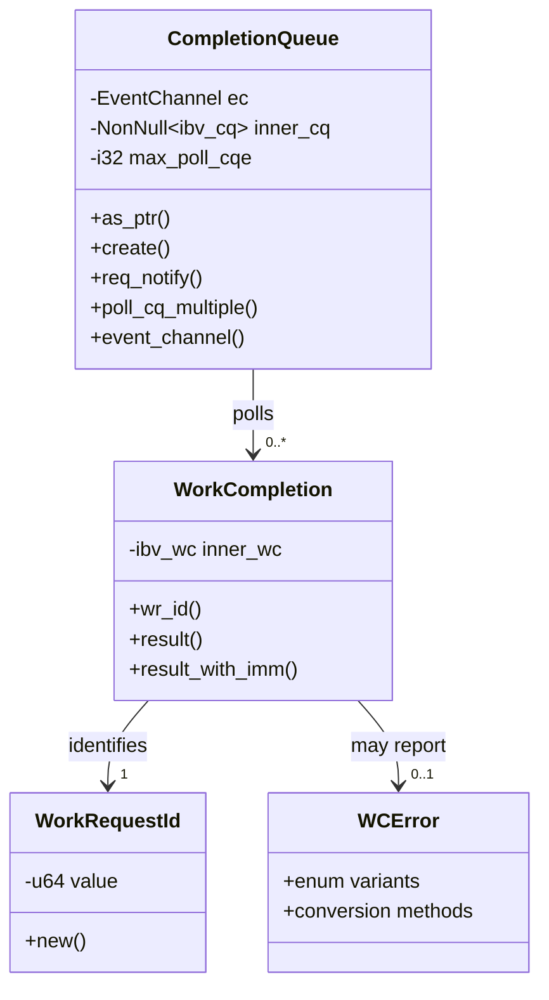
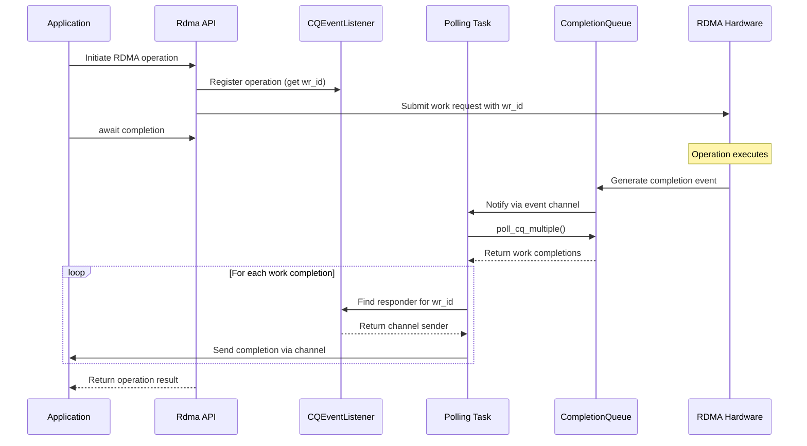

<!-- source: DeepWiki mcp.deepwiki.com · repo datenlord/async-rdma · page 4.6 Completion Queue & Event Handling · fetched 2026-11-11 -->

# Completion Queue & Event Handling

<details>
<summary>Relevant source files</summary>

The following files were used as context for generating this wiki page:

- [doc/cq_event_listener_arch.md](doc/cq_event_listener_arch.md)
- [doc/images/cq_event_listener.png](doc/images/cq_event_listener.png)
- [src/completion_queue.rs](src/completion_queue.rs)
- [src/cq_event_listener.rs](src/cq_event_listener.rs)

</details>


This page documents the completion queue and event handling system in async-rdma. These components are responsible for asynchronously processing RDMA operation completions and notifying the appropriate callers when their operations finish. Understanding this system is essential for working with asynchronous RDMA operations and implementing custom event handling strategies.

For information about Queue Pairs, see [Queue Pair](#4.5). For details on RDMA operations that generate these completions, see [Data Transfer Operations](#3.3).

## 1. Completion Queue Overview

A Completion Queue (CQ) is a kernel-level queue that stores notification of completed RDMA operations. When an RDMA operation completes (either successfully or with an error), a completion event is generated and placed in the CQ. The async-rdma library wraps the low-level RDMA completion queues with an asynchronous event notification system.

The `CompletionQueue` struct provides the core functionality for creating, managing, and polling completion queues:



Sources: [src/completion_queue.rs:32-157](), [src/completion_queue.rs:160-220](), [src/completion_queue.rs:225-270](), [src/completion_queue.rs:282-304]()

### 1.1 CompletionQueue Structure

The `CompletionQueue` struct wraps the low-level RDMA completion queue (`ibv_cq`) and provides methods for interacting with it. Key components include:

- **Event Channel**: Used for asynchronous notification of completion events
- **Inner CQ**: The pointer to the actual RDMA completion queue
- **Max Poll CQE**: Maximum number of completion queue entries to poll at once (default is 32)

The completion queue is created with a specified size and bound to an event channel that notifies when completion events arrive.

### 1.2 Work Completions

Work completions represent the result of RDMA operations. The `WorkCompletion` struct provides methods to:

- Extract the work request ID that identifies which operation completed
- Get the result of the operation (success with length or an error)
- Handle immediate data if present in the completion

Work completion errors are represented by the `WCError` enum, which provides detailed error information for debugging RDMA operation failures.

Sources: [src/completion_queue.rs:160-220](), [src/completion_queue.rs:225-270]()

## 2. Event Handling System

The event handling system bridges the low-level RDMA completion queue with the asynchronous Rust API. The `CQEventListener` is the central component that monitors completion events and notifies waiting tasks.

```mermaid
flowchart TD
    subgraph "Event Handling System"
        direction TB
        CQEventListener["CQEventListener"]
        PollingTask["Polling Task"]
        ReqMap["Request Map"]
        WCBuffer["Work Completion Buffer"]
        
        CQEventListener --> PollingTask : "spawns"
        PollingTask --> ReqMap : "updates"
        PollingTask --> WCBuffer : "fills"
    end
    
    subgraph "Polling Triggers"
        AsyncFdTrigger["AsyncFdTrigger"]
        ChannelTrigger["ChannelTrigger"]
        ManualTrigger["ManualTrigger"]
        
        PollingTask --> AsyncFdTrigger : "uses in automatic mode"
        PollingTask --> ChannelTrigger : "uses in manual mode"
        ManualTrigger --> ChannelTrigger : "signals"
    end
    
    subgraph "RDMA Subsystem"
        CQ["CompletionQueue"]
        EventChannel["EventChannel"]
        
        CQ --> EventChannel : "notifies"
        EventChannel --> AsyncFdTrigger : "triggers"
        CQEventListener --> CQ : "polls"
    end
    
    subgraph "Client Code"
        RdmaOp["RDMA Operation"]
        Waiter["Awaiting Task"]
        
        RdmaOp --> CQEventListener : "registers"
        CQEventListener --> Waiter : "notifies completion"
    end
```

Sources: [src/cq_event_listener.rs:26-111](), [src/cq_event_listener.rs:112-185](), [doc/cq_event_listener_arch.md:1-59]()

### 2.1 CQEventListener

The `CQEventListener` struct is responsible for:

1. Spawning a background task that polls for completion events
2. Registering work requests before they're submitted
3. Maintaining a map from work request IDs to responders
4. Notifying waiting tasks when their operations complete

When an RDMA operation is initiated, it registers with the `CQEventListener` to get a work request ID and a channel for receiving the completion notification. After the operation is submitted, the task awaits on this channel for the completion event.

### 2.2 Polling Triggers

The `CQEventListener` supports two types of polling triggers:

1. **Automatic (AsyncFdTrigger)**: Uses an asynchronous file descriptor to monitor the event channel. When the event channel signals a completion, the polling task is awakened to poll the completion queue.

2. **Manual (ChannelTrigger)**: Requires explicit triggering from user code through a `ManualTrigger`. This is useful for controlling the timing of completion queue polling.

The polling type is selected when creating the RDMA connection and can be configured according to application requirements.

Sources: [src/cq_event_listener.rs:247-343](), [src/cq_event_listener.rs:344-419]()

### 2.3 Event Flow Diagram

The following diagram illustrates the flow of events in the completion notification process:



Sources: [src/cq_event_listener.rs:112-185](), [doc/cq_event_listener_arch.md:30-59]()

## 3. Memory Management During Event Handling

The `CQEventListener` protects memory regions during RDMA operations by acquiring read or write locks on the memory before operations and holding these locks until completion. This ensures that memory regions aren't deallocated or modified while RDMA operations are in progress.

```mermaid
flowchart TD
    subgraph "Memory Protection"
        Register["register(inners, is_write)"]
        RegRead["register_for_read()"]
        RegWrite["register_for_write()"]
        LockGuards["LmrGuards (locks)"]
        ReqMap["Request Map"]
        
        RegRead --> Register
        RegWrite --> Register
        Register --> LockGuards : "acquires locks"
        Register --> ReqMap : "stores in map with wr_id"
    end
    
    subgraph "Completion Processing"
        Poller["Polling Task"]
        WC["Work Completion"]
        Lookup["Find in request map"]
        ReleaseLocks["Release locks"]
        
        Poller --> WC : "receives"
        WC --> Lookup : "using wr_id"
        Lookup --> ReleaseLocks : "by removing from map"
    end
    
    Register --> |"returns (wr_id, rx)"|User["User Code"]
    User --> |"await rx.recv()"|CompEvent["Completion Event"]
    Poller --> |"sends completion"|CompEvent
```

Sources: [src/cq_event_listener.rs:189-244]()

The `register`, `register_for_read`, and `register_for_write` methods handle the lock acquisition process:

1. For read operations, read locks are acquired on the local memory regions
2. For write operations, write locks are acquired on the local memory regions
3. Locks are stored in the request map along with the responder channel
4. When a completion event is processed, the corresponding entry is removed from the map, which releases the locks

This mechanism prevents race conditions and ensures memory safety during asynchronous RDMA operations.

## 4. Work Request and Completion Mapping

Each RDMA operation is assigned a unique `WorkRequestId` that is generated using a random u64 value. This ID is used to match work request submissions with their corresponding completion events:

```
Work Request ID Flow:
1. CQEventListener generates a new WorkRequestId
2. ID is stored in request map with responder channel
3. ID is included in the work request submitted to the RDMA hardware
4. When completion occurs, the same ID appears in the work completion
5. CQEventListener uses the ID to find the waiting task
```

Sources: [src/completion_queue.rs:282-304](), [src/cq_event_listener.rs:189-244]()

### 4.1 Error Handling

The `WorkCompletion` structure provides methods to extract either a successful result or an error:

- `result()`: Returns the length of the transfer on success or a `WCError` on failure
- `result_with_imm()`: Returns both the length and any immediate data on success, or an error on failure

The `WCError` enum provides detailed error information, including:

| Error Type | Description |
|------------|-------------|
| LocLenErr | Local Length Error: message size exceeds maximum supported |
| LocQpOpErr | Local QP Operation Error: QP consistency error detected |
| RemAccessErr | Remote Access Error: protection error on remote data buffer |
| RetryExc | Transport Retry Counter Exceeded: timeout on message delivery |
| RnrRetryExc | RNR Retry Counter Exceeded: receive queue not ready |
| Fatal | Fatal Error |
| GeneralErr | General Error: other errors |

Sources: [src/completion_queue.rs:225-270](), [src/completion_queue.rs:174-202]()

## 5. Usage Patterns

### 5.1 Automatic Polling

By default, the `CQEventListener` uses automatic polling with `AsyncFdTrigger`. This provides efficient event-driven notification of completions:

1. The event channel is registered with tokio's reactor
2. When a completion is available, the event channel becomes readable
3. The polling task is awakened to process completions
4. Completions are dispatched to waiting tasks

This approach minimizes CPU usage while providing good responsiveness.

### 5.2 Manual Polling

For applications that need control over when polling occurs, manual polling can be enabled:

```
let rdma = RdmaBuilder::default()
    .set_polling_trigger(PollingTriggerType::Manual)
    .connect(addr)
    .await?;

let trigger = rdma.get_manual_trigger().unwrap();

// In a separate task
tokio::spawn(async move {
    loop {
        tokio::time::sleep(POLLING_INTERVAL).await;
        trigger.pull().await.unwrap();
    }
});
```

This allows precise control over when completion queue polling occurs, which can be useful for coordinating with other asynchronous operations or implementing custom polling strategies.

Sources: [src/cq_event_listener.rs:344-419]()

## 6. Internal Implementation Details

### 6.1 Polling Implementation

The core polling logic is implemented in the polling task spawned by `CQEventListener`. This task:

1. Waits for a trigger (either AsyncFdTrigger or ChannelTrigger)
2. Calls `poll_cq_multiple` to retrieve completions
3. For each completion, looks up the responder in the request map
4. Sends the completion to the waiting task
5. Requests notification for the next completions

The event-driven nature of this implementation integrates well with tokio's asynchronous runtime.

Sources: [src/cq_event_listener.rs:112-185]()

### 6.2 Default Parameters

Several default parameters control the behavior of the completion queue and event listener:

| Parameter | Value | Description |
|-----------|-------|-------------|
| DEFAULT_CQ_SIZE | 1024 | Minimum number of entries CQ will support |
| DEFAULT_MAX_CQE | 32 | Maximum number of CQEs to poll at a time |
| DEFAULT_CC_EVENT_TIMEOUT | 100ms | Timeout for waiting for CQ notifications |

These values can be configured when creating the RDMA connection to optimize for specific workloads.

Sources: [src/completion_queue.rs:26-29](), [src/cq_event_listener.rs:37]()

## 7. Summary

The Completion Queue and Event Handling system in async-rdma provides a robust, asynchronous interface for processing RDMA operation completions. Key components include:

1. **CompletionQueue**: Wraps the low-level RDMA completion queue
2. **WorkCompletion**: Represents the result of an RDMA operation
3. **CQEventListener**: Bridges the low-level completion queue with async Rust tasks
4. **Polling Triggers**: Support both automatic and manual polling strategies

This system ensures that asynchronous RDMA operations integrate well with Rust's async/await syntax while maintaining the performance and efficiency expected from RDMA networking.

---

