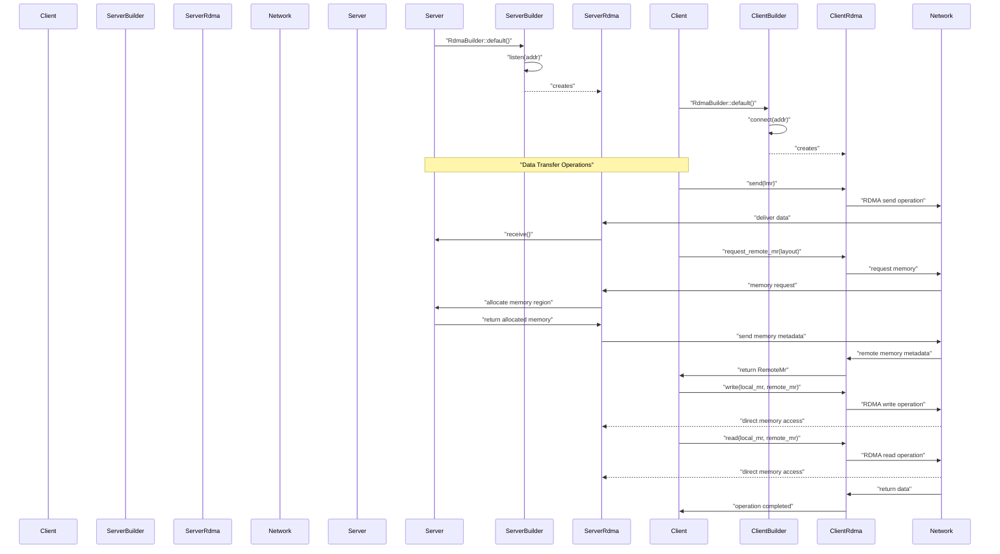
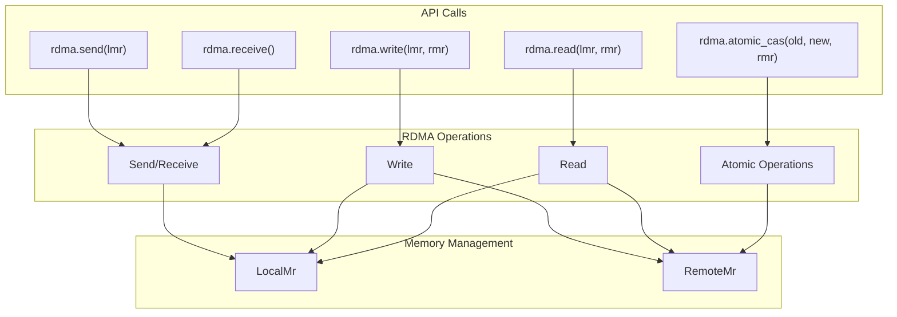
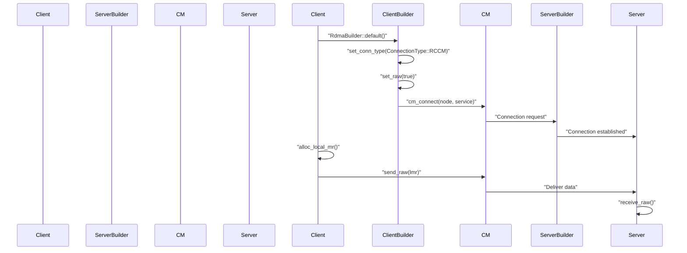
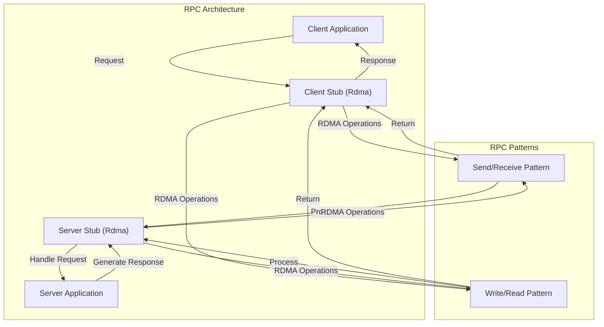

<!-- source: DeepWiki mcp.deepwiki.com · repo datenlord/async-rdma · page 5 Examples & Patterns · fetched 2026-11-11 -->

# Examples & Patterns

<details>
<summary>Relevant source files</summary>

The following files were used as context for generating this wiki page:

- [examples/client.rs](examples/client.rs)
- [examples/cm_client.rs](examples/cm_client.rs)
- [examples/rpc.rs](examples/rpc.rs)
- [examples/server.rs](examples/server.rs)

</details>


This page provides an overview of common usage patterns and examples for the async-rdma library. It demonstrates how to effectively utilize RDMA operations in various scenarios, from basic client-server communication to more advanced patterns like RPC implementations.

For detailed API documentation, see [API Reference](#4). For understanding the core concepts behind these patterns, refer to [Core Concepts](#3).

## Basic Client-Server Communication

The async-rdma library provides a straightforward way to establish connections and transfer data between clients and servers. Below is a diagram that illustrates the basic client-server communication pattern:



Sources: [examples/client.rs:135-143](), [examples/server.rs:107-108]()

### Connection Establishment

To establish a connection between a client and a server:

1. **Server Side**: The server listens for incoming connections using `RdmaBuilder::listen()`:
   ```rust
   let mut rdma = RdmaBuilder::default().listen(addr).await.unwrap();
   ```

2. **Client Side**: The client connects to the server using `RdmaBuilder::connect()`:
   ```rust
   let mut rdma = RdmaBuilder::default().connect(addr).await.unwrap();
   ```

3. **Creating Multiple Connections**: Both server and client can create additional connections that share the same memory allocator and event listener:
   ```rust
   // Server accepts a new connection
   let rdma = rdma.listen().await.unwrap();
   
   // Client creates a new connection
   let rdma = rdma.new_connect(addr).await.unwrap();
   ```

Sources: [examples/client.rs:135-143](), [examples/client.rs:147-148](), [examples/server.rs:107-108](), [examples/server.rs:121-122]()

### Data Transfer Operations

The async-rdma library supports various RDMA operations for data transfer:



Sources: [examples/client.rs:21-29](), [examples/client.rs:73-86](), [examples/server.rs:16-24](), [examples/server.rs:43-55]()

#### Send/Receive Operations

Send/Receive operations involve both CPUs in the data transfer:

1. **Send Operation (Client)**:
   ```rust
   // Allocate and fill local memory region
   let mut lmr = rdma.alloc_local_mr(Layout::new::<[u8; 8]>())?;
   lmr.as_mut_slice().write(&[1_u8; 8])?;
   
   // Send data to remote endpoint
   rdma.send(&lmr).await?;
   ```

2. **Receive Operation (Server)**:
   ```rust
   // Receive data from client
   let lmr = rdma.receive().await?;
   let data = *lmr.as_slice();
   ```

Sources: [examples/client.rs:21-28](), [examples/server.rs:16-24]()

#### RDMA Read/Write Operations

RDMA Read/Write operations bypass the target CPU:

1. **Write Operation (Client)**:
   ```rust
   // Request remote memory region
   let mut rmr = rdma.request_remote_mr(Layout::new::<[u8; 8]>()).await?;
   
   // Allocate and fill local memory region
   let mut lmr = rdma.alloc_local_mr(Layout::new::<[u8; 8]>())?;
   lmr.as_mut_slice().write(&[1_u8; 8])?;
   
   // Write data from local to remote memory
   rdma.write(&lmr, &mut rmr).await?;
   
   // Send remote memory metadata to server
   rdma.send_remote_mr(rmr).await?;
   ```

2. **Read Operation (Server)**:
   ```rust
   // Allocate local memory region
   let mut lmr = rdma.alloc_local_mr(Layout::new::<[u8; 8]>())?;
   
   // Receive remote memory metadata
   let rmr = rdma.receive_remote_mr().await?;
   
   // Read data from remote to local memory
   rdma.read(&mut lmr, &rmr).await?;
   ```

Sources: [examples/client.rs:73-86](), [examples/server.rs:43-55]()

#### Atomic Operations

Atomic operations like Compare-and-Swap (CAS) provide atomic memory access:

```rust
// Request remote memory region
let mut rmr = rdma.request_remote_mr(Layout::new::<[u8; 8]>()).await?;
let new_value = u64::from_le_bytes([1_u8; 8]);

// Perform atomic CAS operation
rdma.atomic_cas(0, new_value, &mut rmr).await?;
```

Sources: [examples/client.rs:109-118]()

## Communication Patterns

The async-rdma library supports different communication patterns tailored to specific use cases.

### Send/Receive with Immediate Data

You can send immediate data (a 32-bit value) along with your RDMA operations:

1. **Send with Immediate (Client)**:
   ```rust
   // Allocate and fill local memory region
   let mut lmr = rdma.alloc_local_mr(Layout::new::<[u8; 8]>())?;
   lmr.as_mut_slice().write(&[1_u8; 8])?;
   
   // Send data with immediate value
   rdma.send_with_imm(&lmr, 1_u32).await?;
   ```

2. **Receive with Immediate (Server)**:
   ```rust
   // Receive data and immediate value
   let (lmr, imm) = rdma.receive_with_imm().await?;
   let data = *lmr.as_slice();
   ```

Sources: [examples/client.rs:31-45](), [examples/server.rs:26-41]()

### Write with Immediate Data

Similar to Send/Receive, RDMA Write operations can also include immediate data:

```rust
// Write with immediate value
rdma.write_with_imm(
    &lmr.get(4..8).unwrap(),
    &mut rmr.get_mut(4..8).unwrap(),
    4_u32,
).await?;
```

Sources: [examples/client.rs:89-107](), [examples/server.rs:67-80]()

### Connection Manager (CM) Pattern

For applications requiring reliable connection management, the CM pattern provides an alternative connection establishment method:



Sources: [examples/cm_client.rs:14-43]()

This pattern is implemented using:

```rust
// Client side
let rdma = RdmaBuilder::default()
    .set_conn_type(ConnectionType::RCCM)
    .set_raw(true)
    .cm_connect(node, service)
    .await
    .unwrap();

// Sending raw data
rdma.send_raw(&lmr).await.unwrap();

// Receiving raw data
let recv_mr = rdma
    .receive_raw(Layout::new::<[u8; BUF_SIZE]>())
    .await
    .unwrap();
```

Sources: [examples/cm_client.rs:20-42]()

## RPC Implementation Pattern

The async-rdma library can be used to implement Remote Procedure Call (RPC) patterns, where a client sends requests to a server and receives responses.



Sources: [examples/rpc.rs:10-277]()

### Send/Receive RPC Pattern

This pattern uses RDMA Send/Receive operations for RPC:

1. **Client Side**:
   ```rust
   // Allocate and prepare request
   let mut lmr_req = rdma.alloc_local_mr(Layout::new::<Request>()).unwrap();
   unsafe { *(*lmr_req.as_mut_ptr() as *mut Request) = request };
   
   // Send request
   rdma.send(&lmr_req).await.unwrap();
   
   // Receive response
   let response = rdma.receive().await.map(|lmr_resp| /* process response */).unwrap();
   ```

2. **Server Side**:
   ```rust
   // Receive request
   let request = rdma.receive().await.map(|lmr_req| /* extract request */).unwrap();
   
   // Process request
   let response = process_request(request);
   
   // Allocate and prepare response
   let mut lmr_resp = rdma.alloc_local_mr(Layout::new::<Response>()).unwrap();
   unsafe { *(*lmr_resp.as_mut_ptr() as *mut Response) = response };
   
   // Send response
   rdma.send(&lmr_resp).await.unwrap();
   ```

Sources: [examples/rpc.rs:151-178](), [examples/rpc.rs:85-110]()

### Read/Write RPC Pattern

This pattern uses RDMA Read/Write operations for RPC, which can be more efficient but requires synchronization:

1. **Client Side**:
   ```rust
   // Prepare request in local memory
   let mut lmr_req = rdma.alloc_local_mr(Layout::new::<Request>()).unwrap();
   unsafe { *(*lmr_req.as_mut_ptr() as *mut Request) = request };
   
   // Request remote memory and write request to it
   let mut rmr_req = rdma.request_remote_mr(Layout::new::<Request>()).await.unwrap();
   rdma.write(&lmr_req, &mut rmr_req).await.unwrap();
   
   // Send metadata to server
   rdma.send_remote_mr(rmr_req).await.unwrap();
   
   // Synchronize with server
   sync_with_server().await;
   
   // Receive response metadata
   let rmr_resp = rdma.receive_remote_mr().await.unwrap();
   
   // Allocate local memory and read response
   let mut lmr_resp = rdma.alloc_local_mr(Layout::new::<Response>()).unwrap();
   sync_with_server().await;
   rdma.read(&mut lmr_resp, &rmr_resp).await.unwrap();
   ```

2. **Server Side**:
   ```rust
   // Receive request metadata
   let lmr_req = rdma.receive_local_mr().await.unwrap();
   
   // Synchronize with client
   sync_with_client().await;
   
   // Process request
   let request = unsafe { &*(*lmr_req.as_ptr() as *const Request) };
   let response = process_request(request);
   
   // Prepare response
   let mut lmr_resp = rdma.alloc_local_mr(Layout::new::<Response>()).unwrap();
   unsafe { *(*lmr_resp.as_mut_ptr() as *mut Response) = response };
   
   // Synchronize with client
   sync_with_client().await;
   
   // Send response metadata
   rdma.send_local_mr(lmr_resp).await.unwrap();
   ```

Sources: [examples/rpc.rs:185-239](), [examples/rpc.rs:55-84]()

The Read/Write pattern requires explicit synchronization between client and server since RDMA operations bypass the CPU:

```rust
// Client synchronization
async fn sync_with_server(&self) {
    self.rdma_stub.receive().await.map(|lmr_resp| /* verify sync response */).unwrap()
}

// Server synchronization
async fn sync_with_client(rdma: &Rdma) {
    let mut lmr_sync = rdma.alloc_local_mr(Layout::new::<Request>()).unwrap();
    unsafe { *(*lmr_sync.as_mut_ptr() as *mut Request) = Request::Sync };
    rdma.send(&lmr_sync).await.unwrap();
}
```

Sources: [examples/rpc.rs:241-257](), [examples/rpc.rs:41-53]()

## Memory Region Operations

The async-rdma library provides several ways to work with memory regions:

### Memory Region Slicing

You can slice memory regions to access specific portions:

```rust
// Create a slice of a local memory region
let slice = lmr.get(4..8).unwrap();

// Create a mutable slice of a local memory region
let mut_slice = lmr.get_mut(4..8).unwrap();

// Create a slice of a remote memory region
let remote_slice = rmr.get(4..8).unwrap();

// Create a mutable slice of a remote memory region
let remote_mut_slice = rmr.get_mut(4..8).unwrap();
```

These slices can be used in RDMA operations:

```rust
// Write to a specific portion of a remote memory region
rdma.write(&lmr.get(4..8).unwrap(), &mut rmr.get_mut(4..8).unwrap()).await?;
```

Sources: [examples/client.rs:60-64](), [examples/client.rs:82-83]()

### Using Memory Region Cursors

For sequential writing to memory regions, you can use cursors:

```rust
// Create a mutable cursor
let mut mr_cursor = lmr.as_mut_slice_cursor();

// Write data sequentially
let _num = mr_cursor.write(&[1_u8; 4])?;
let _num = mr_cursor.write(&[1_u8; 4])?;
```

Sources: [examples/client.rs:35-42]()

This page provides an overview of the most common patterns and examples for using the async-rdma library. For more specific use cases or advanced operations, refer to the API documentation or the example files in the repository.

---

