<!-- source: DeepWiki mcp.deepwiki.com · repo datenlord/async-rdma · page 5.1 Basic Client-Server Communication · fetched 2026-11-11 -->

# Basic Client-Server Communication

<details>
<summary>Relevant source files</summary>

The following files were used as context for generating this wiki page:

- [examples/client.rs](examples/client.rs)
- [examples/cm_client.rs](examples/cm_client.rs)
- [examples/server.rs](examples/server.rs)

</details>


This page walks through the fundamental client-server communication patterns using the async-rdma library. We'll explore how to establish connections and perform various RDMA operations between clients and servers using the examples provided in the repository.

For more advanced communication patterns like RPC, see [RPC Pattern](#5.2). For detailed information about memory region operations, see [Memory Region Operations](#5.3).

## Connection Establishment

Before any RDMA operations can be performed, a connection must be established between the client and server. The async-rdma library provides two main methods for establishing connections:

### Standard Connection Method

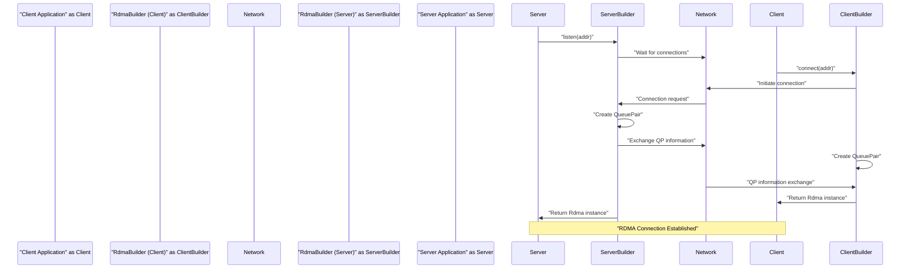

The standard connection process:

1. The server calls `listen()` on an `RdmaBuilder` to wait for incoming connections
2. The client calls `connect()` on an `RdmaBuilder` to initiate a connection
3. The builders exchange Queue Pair information over a TCP connection
4. Both sides create `Rdma` instances that can be used to perform RDMA operations

Sources: [examples/server.rs:107-108](), [examples/client.rs:135-136]()

### Connection Manager Method

For applications that need to use the RDMA Connection Manager (CM):

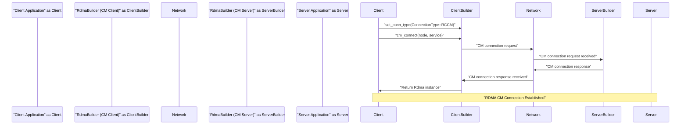

The CM connection process:
1. Set the connection type to `ConnectionType::RCCM`
2. Use `cm_connect()` with the node (IP) and service (port) to establish the connection

Sources: [examples/cm_client.rs:21-26]()

## Basic Data Transfer Patterns

The async-rdma library supports several data transfer patterns between clients and servers. Here are the fundamental patterns:

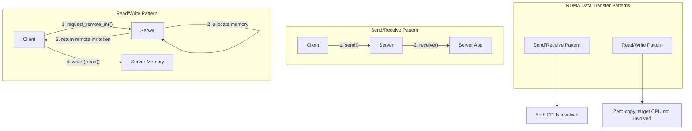

Sources: [examples/client.rs:21-29](), [examples/client.rs:74-87](), [examples/server.rs:17-24](), [examples/server.rs:44-55]()

### Send/Receive Pattern

The Send/Receive pattern involves both the sender and receiver being active participants in the data transfer:

1. The sender allocates a local memory region (LocalMr) and puts data in it
2. The sender posts a Send operation with the LocalMr
3. The receiver posts a Receive operation
4. When the data is transferred, the receiver gets a new LocalMr containing the data

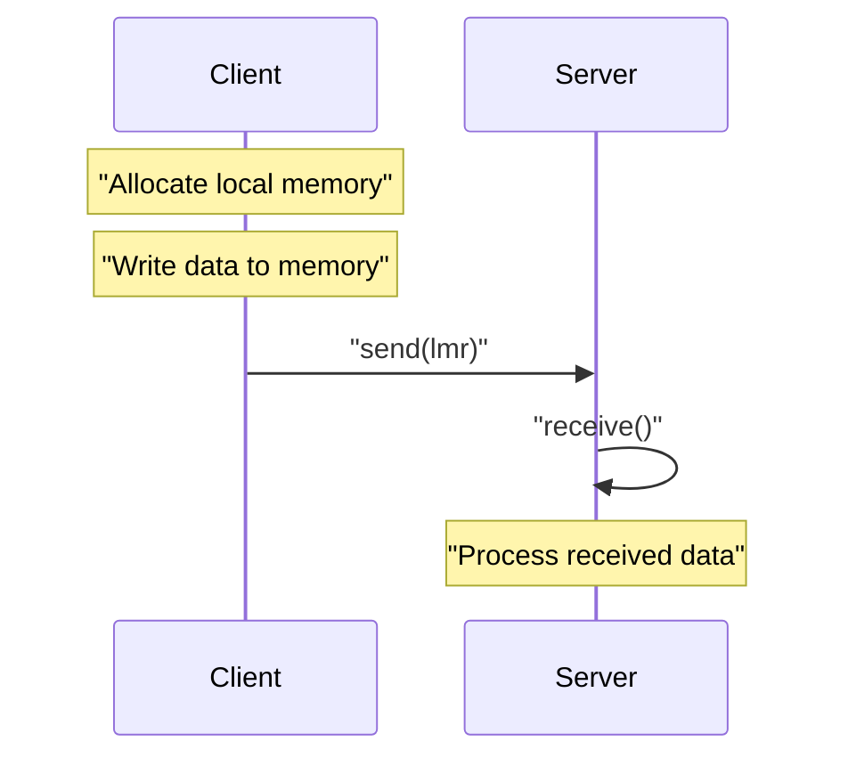

Example client code:
- Allocate local memory with `alloc_local_mr()`
- Write data to the memory region
- Send the data with `send()`

Sources: [examples/client.rs:21-29]()

Example server code:
- Receive data with `receive()`
- Access the received data with `as_slice()`

Sources: [examples/server.rs:17-24]()

### Read/Write Pattern

The Read/Write pattern allows for one-sided RDMA operations where only the initiator's CPU is involved:

1. Client requests a remote memory region from the server
2. Server allocates memory and returns a token representing the remote memory region
3. Client can directly read from or write to the remote memory without server CPU involvement

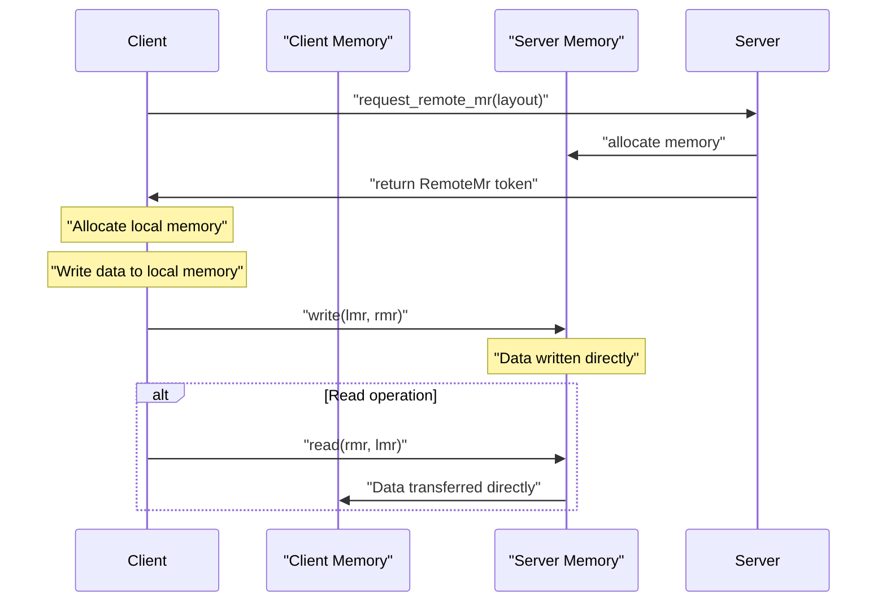

Example client code for writing to remote memory:
- Request remote memory with `request_remote_mr()`
- Allocate local memory with `alloc_local_mr()`
- Write data to the local memory region
- Write from local to remote memory with `write()`

Sources: [examples/client.rs:74-87]()

Example server code for reading from remote memory:
- Allocate local memory with `alloc_local_mr()`
- Receive remote memory region metadata with `receive_remote_mr()`
- Read from remote to local memory with `read()`

Sources: [examples/server.rs:44-55]()

## Operations with Immediate Data

The async-rdma library supports operations with immediate data, which allows sending a 32-bit value along with the data transfer:

### Send with Immediate Data

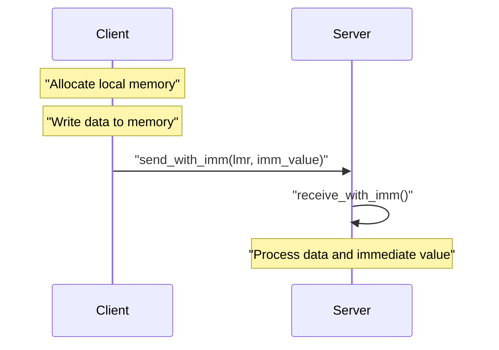

Example client code:
- Allocate and fill local memory
- Send data with immediate value using `send_with_imm()`

Sources: [examples/client.rs:32-44]()

Example server code:
- Receive data and immediate value with `receive_with_imm()`
- Process both the data and the immediate value

Sources: [examples/server.rs:27-41]()

### Write with Immediate Data

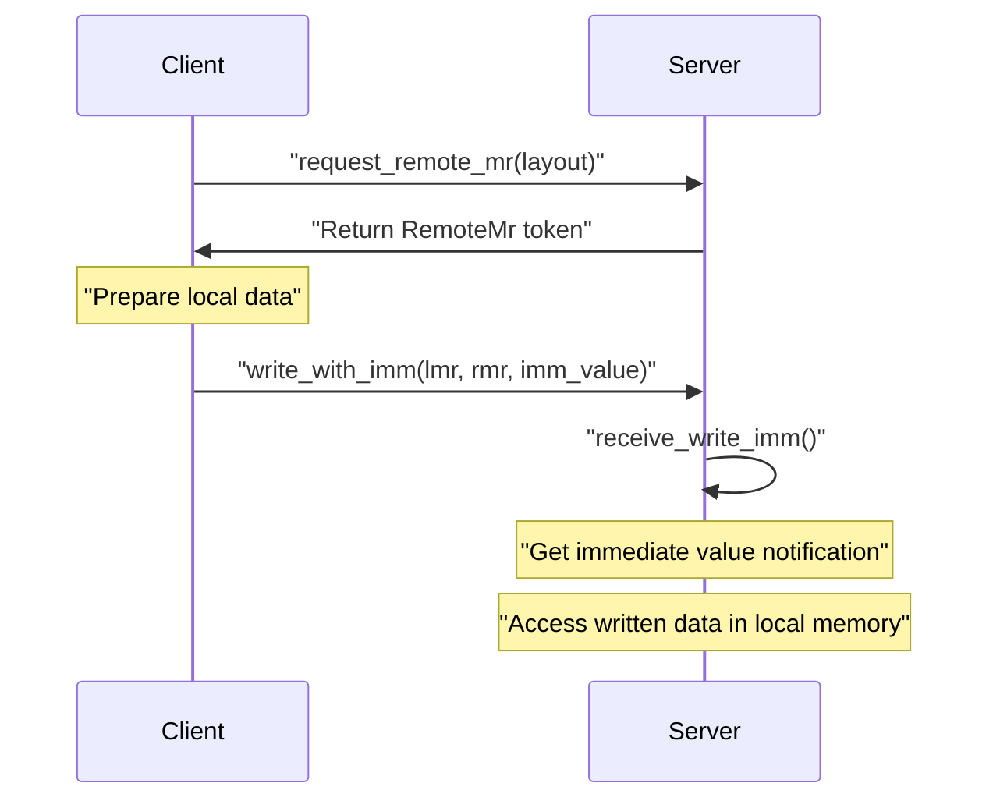

This pattern combines:
1. One-sided RDMA write to modify server memory
2. A notification to the server with an immediate value

Sources: [examples/client.rs:90-107](), [examples/server.rs:68-80]()

## Memory Management in Client-Server Communication

Understanding memory management is crucial for RDMA operations:

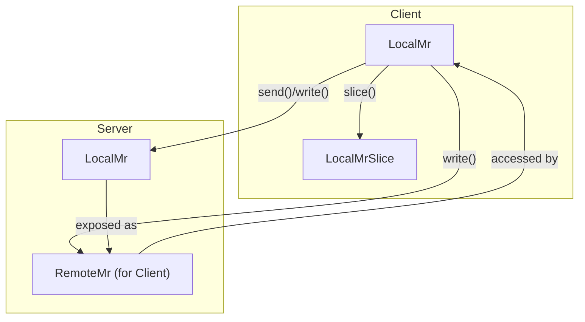

### Local Memory Regions (LocalMr)

A `LocalMr` represents memory that is registered with the RDMA device and can be used for RDMA operations:

- Allocated with `alloc_local_mr(layout)`
- Can be written to with `as_mut_slice()` or `as_mut_slice_cursor()`
- Can be read from with `as_slice()`
- Can be partially accessed with `get()` and `get_mut()`

Sources: [examples/client.rs:22-25](), [examples/client.rs:36-42]()

### Remote Memory Regions (RemoteMr)

A `RemoteMr` represents memory on a remote node that can be accessed via RDMA:

- Requested with `request_remote_mr(layout)`
- Allows direct access to memory on the remote node
- Can be written to with `write()` or read from with `read()`
- Can be partially accessed with `get()` and `get_mut()`

Sources: [examples/client.rs:76](), [examples/client.rs:82-83]()

## Advanced Operations

### Atomic Compare-and-Swap (CAS)

The async-rdma library supports atomic operations such as compare-and-swap:

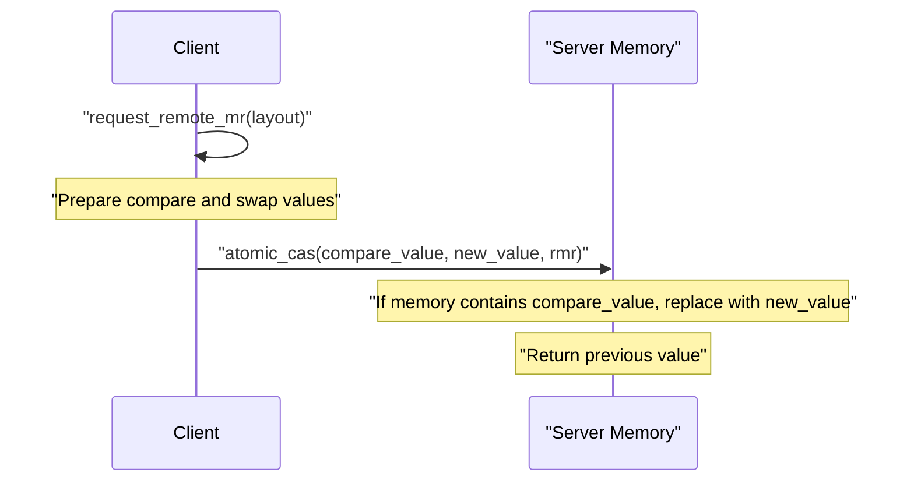

Example client code:
- Request remote memory
- Perform atomic compare-and-swap with `atomic_cas()`

Sources: [examples/client.rs:110-118]()

Example server code:
- Receive and verify memory after CAS operation

Sources: [examples/server.rs:83-91]()

## Practical Example Walkthrough

Let's examine a complete client-server communication example:

### Server Side

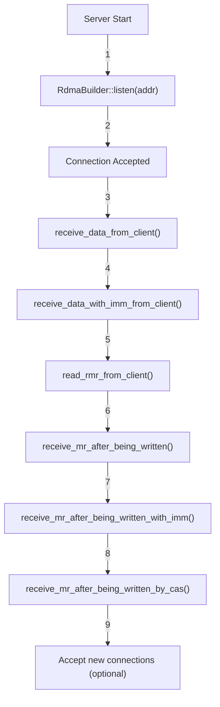

The server:
1. Creates an `RdmaBuilder` and calls `listen(addr)` to wait for connections
2. Processes various types of RDMA operations from the client
3. Can accept multiple connections using the same resources

Sources: [examples/server.rs:107-108](), [examples/server.rs:109-116](), [examples/server.rs:119-132]()

### Client Side

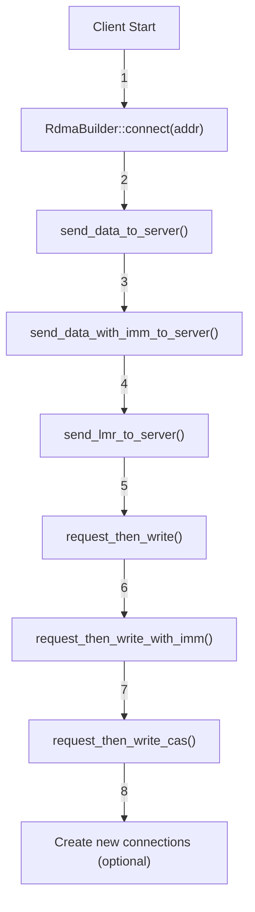

The client:
1. Creates an `RdmaBuilder` and calls `connect(addr)` to connect to the server
2. Performs various types of RDMA operations
3. Can create additional connections sharing the same resources

Sources: [examples/client.rs:135-136](), [examples/client.rs:137-142](), [examples/client.rs:146-155]()

## Running the Examples

To run the basic client-server examples:

1. Start the server:
```
cargo run --example server <server_ip> <port>
```

2. In another terminal, start the client:
```
cargo run --example client <server_ip> <port>
```

For the CM connection example:
```
cargo run --example cm_server
cargo run --example cm_client <server_ip> <port>
```

Sources: [examples/server.rs:1-10](), [examples/client.rs:1-10](), [examples/cm_client.rs:1-12]()

---

