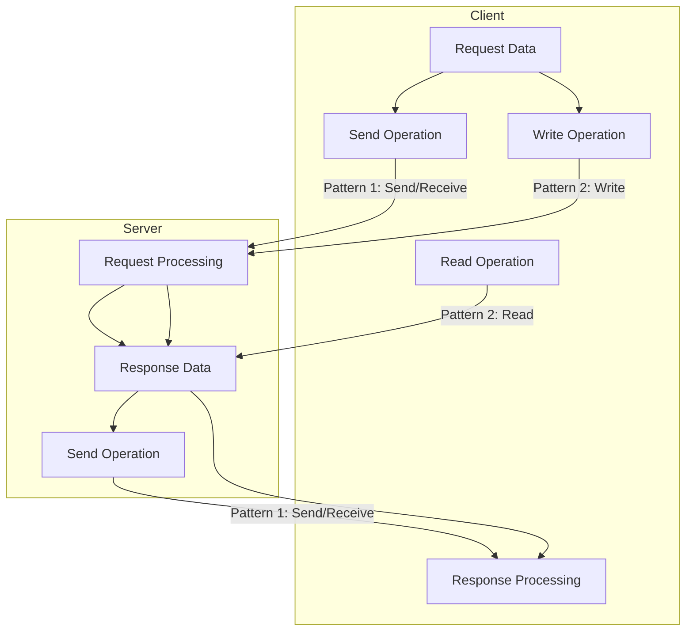
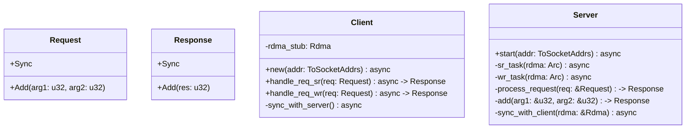
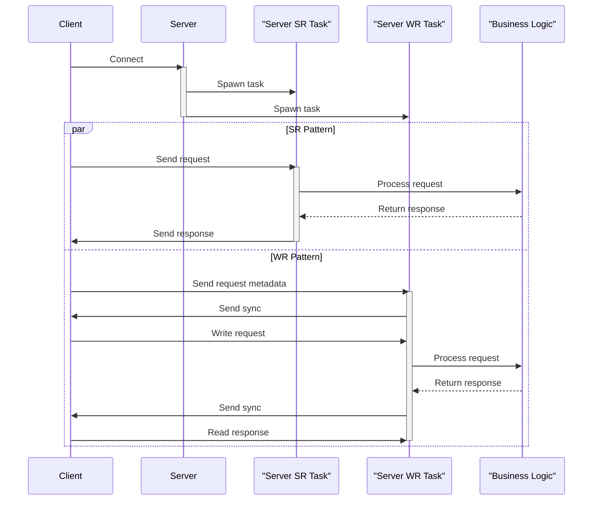
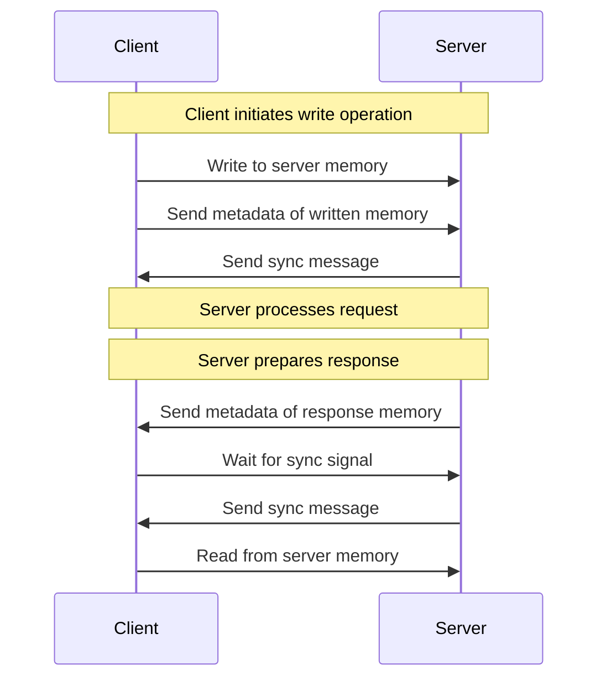
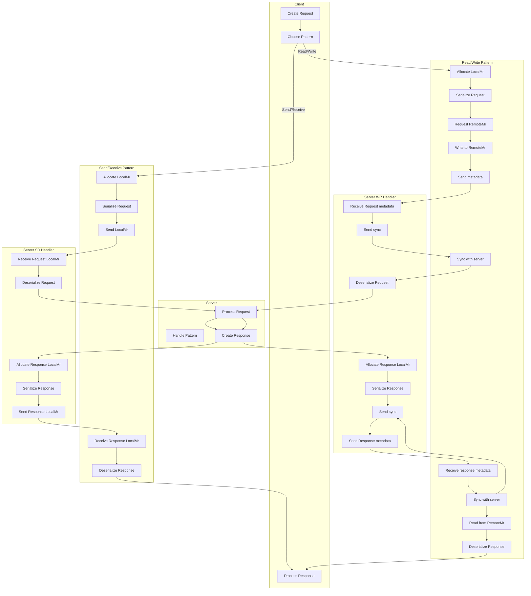

<!-- source: DeepWiki mcp.deepwiki.com · repo datenlord/async-rdma · page 5.2 RPC Pattern · fetched 2026-11-11 -->

# RPC Pattern

<details>
<summary>Relevant source files</summary>

The following files were used as context for generating this wiki page:

- [examples/rpc.rs](examples/rpc.rs)

</details>


This page details how to implement Remote Procedure Call (RPC) patterns using the async-rdma library. RPC allows a client to execute procedures on a remote server as if they were local function calls, with RDMA providing high-performance data transfer capabilities that make this pattern particularly efficient.

For information about basic client-server communication without the structured RPC approach, see [Basic Client-Server Communication](#5.1).

## Overview of RPC with RDMA

Remote Procedure Calls over RDMA combine the structured request-response model of traditional RPCs with the high-performance data transfer capabilities of RDMA. The async-rdma library enables two distinct RPC implementation patterns:

1. **Send/Receive Pattern**: Uses RDMA send and receive operations for communication, involving both client and server CPUs in data processing.
2. **Read/Write Pattern**: Uses RDMA read and write operations for direct memory access, bypassing the server CPU for data transfer.



Sources: [examples/rpc.rs:151-178](). [examples/rpc.rs:180-239]()

## RPC Data Structures

In an RPC implementation, you need to define data structures to represent requests and responses. The example demonstrates a simple API with an addition operation:



Sources: [examples/rpc.rs:14-24](). [examples/rpc.rs:27-123](). [examples/rpc.rs:134-258]()

## Server Implementation

The RPC server handles incoming client requests and provides responses. The server implementation consists of:

1. A listener component that accepts client connections
2. Task loops for processing requests using different RDMA patterns
3. Business logic for processing requests



The server implements two task loops:

1. **SR Task Loop** (`sr_task`): Handles RPC requests using RDMA send/receive operations
2. **WR Task Loop** (`wr_task`): Handles RPC requests using RDMA read/write operations

Sources: [examples/rpc.rs:27-123]()

### Server Initialization

The server is initialized with an RDMA listener that waits for client connections:

```rust
let rdma = Arc::new(RdmaBuilder::default().listen(addr).await.unwrap());
let sr_handler = tokio::spawn(Self::sr_task(rdma.clone()));
let wr_handler = tokio::spawn(Self::wr_task(rdma));
```

Sources: [examples/rpc.rs:30-37]()

### Send/Receive Task Loop

The `sr_task` method implements a loop that:

1. Receives a request from the client
2. Processes the request
3. Sends the response back to the client

This pattern involves both server and client CPUs in the data transfer process.

Sources: [examples/rpc.rs:85-110]()

### Read/Write Task Loop

The `wr_task` method implements a loop that:

1. Receives metadata about a remote memory region from the client
2. Synchronizes with the client
3. Processes the request data written by the client
4. Prepares response data for the client to read
5. Synchronizes with the client again

This pattern allows the client to directly read/write server memory, potentially improving performance.

Sources: [examples/rpc.rs:55-84]()

## Client Implementation

The client connects to the server and provides methods for executing remote procedures:

```mermaid
flowchart TD
    subgraph "Client Implementation"
        A["Create Client"] -->|"Connect to server"| B["RdmaBuilder.connect()"]
        B --> C["Client object with rdma_stub"]
        
        C --> D["Choose RPC pattern"]
        
        D -->|"Send/Receive Pattern"| E["handle_req_sr()"]
        E -->|"1. Prepare request"| E1["Allocate LocalMr"]
        E1 -->|"2. Send request"| E2["rdma_stub.send()"]
        E2 -->|"3. Receive response"| E3["rdma_stub.receive()"]
        E3 --> F["Process response"]
        
        D -->|"Read/Write Pattern"| G["handle_req_wr()"]
        G -->|"1. Prepare request"| G1["Allocate LocalMr"]
        G1 -->|"2. Request RemoteMr"| G2["request_remote_mr()"]
        G2 -->|"3. Write to RemoteMr"| G3["rdma_stub.write()"]
        G3 -->|"4. Send metadata"| G4["send_remote_mr()"]
        G4 -->|"5. Sync with server"| G5["sync_with_server()"]
        G5 -->|"6. Receive response"| G6["receive_remote_mr()"]
        G6 -->|"7. Sync with server"| G7["sync_with_server()"]
        G7 -->|"8. Read response"| G8["rdma_stub.read()"]
        G8 --> F
    end
```



Sources: [examples/rpc.rs:134-258]()

### Client Initialization

The client is initialized by connecting to the server using the RdmaBuilder:

```rust
let rdma_stub = RdmaBuilder::default()
    .connect(addr)
    .await
    .map_err(|err| println!("{}", &err))
    .unwrap();
```

Sources: [examples/rpc.rs:140-149]()

### Send/Receive Pattern Implementation

The `handle_req_sr` method implements the Send/Receive pattern:

1. Allocate a local memory region for the request
2. Serialize the request into the memory region
3. Send the memory region to the server
4. Receive the response memory region from the server
5. Deserialize the response from the memory region

This pattern is simpler but may not achieve the same performance as the Read/Write pattern.

Sources: [examples/rpc.rs:151-178]()

### Read/Write Pattern Implementation

The `handle_req_wr` method implements the Read/Write pattern:

1. Allocate a local memory region for the request
2. Serialize the request into the memory region
3. Request a remote memory region from the server
4. Write the request data to the remote memory region
5. Send metadata about the remote memory region to the server
6. Synchronize with the server
7. Receive metadata about the remote memory region for the response
8. Synchronize with the server
9. Read the response data from the remote memory region
10. Deserialize the response from the local memory region

This pattern may achieve better performance by using direct memory access but requires additional synchronization.

Sources: [examples/rpc.rs:180-239]()

## Synchronization in Read/Write Pattern

The Read/Write pattern requires synchronization between client and server because:

1. The server cannot be directly notified of RDMA read/write operations
2. The client needs to know when it's safe to read the response

Both client and server implement synchronization methods that use RDMA send/receive operations to communicate synchronization points:



Sources: [examples/rpc.rs:40-53](). [examples/rpc.rs:241-257]()

## Complete RPC Flow

The following diagram shows the complete flow of an RPC call using both patterns:



Sources: [examples/rpc.rs:14-277]()

## Practical Example

The example code demonstrates a simple RPC service with an "Add" operation that adds two integer values:

1. The client creates a request with two arguments
2. The server receives the request, adds the numbers, and returns the result
3. The client receives and processes the response

The complete example demonstrates both Send/Receive and Read/Write patterns.

Sources: [examples/rpc.rs:260-277]()

## Performance Considerations

When implementing RPC patterns with async-rdma, consider the following:

1. **Send/Receive vs. Read/Write**: 
   - Send/Receive is simpler but involves both CPUs
   - Read/Write can achieve better performance but requires synchronization

2. **Memory Management**:
   - Properly allocate and free memory regions to avoid leaks
   - Use appropriate layouts for serialized data structures

3. **Error Handling**:
   - Implement robust error handling for network failures
   - Consider timeout mechanisms for unresponsive peers

4. **Serialization**:
   - The example uses raw pointer casting, which is unsafe but efficient
   - Consider using serialization libraries for more complex data structures

Sources: [examples/rpc.rs:151-178](). [examples/rpc.rs:180-239]()

---

