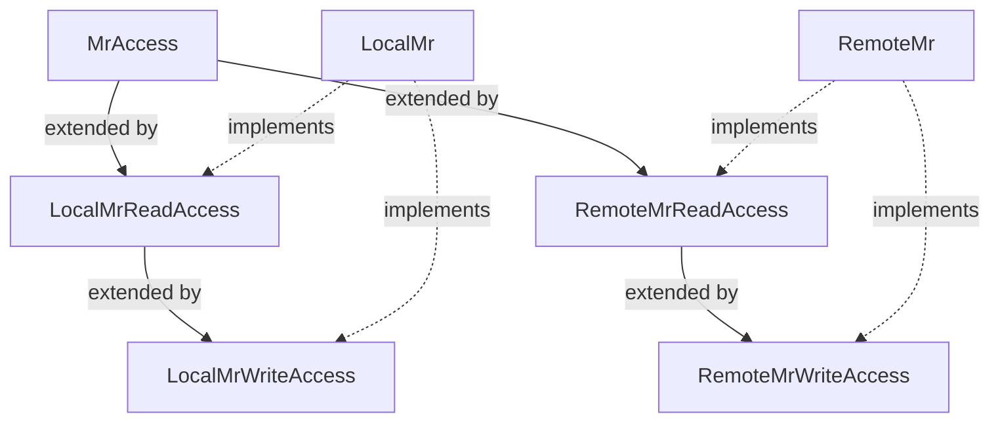
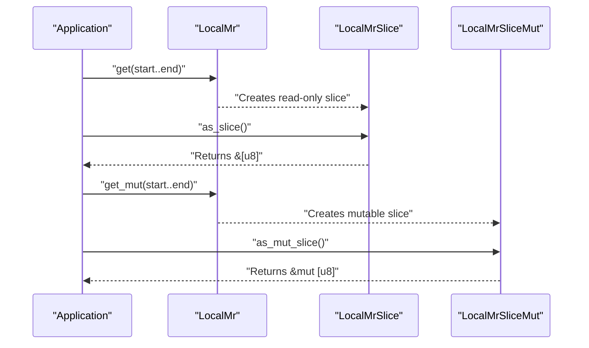
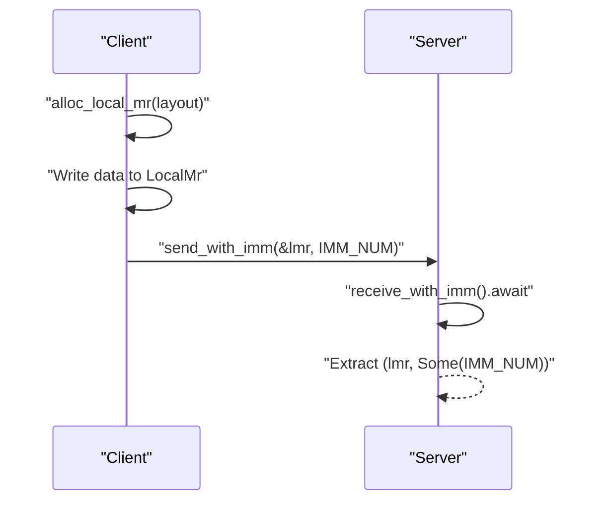
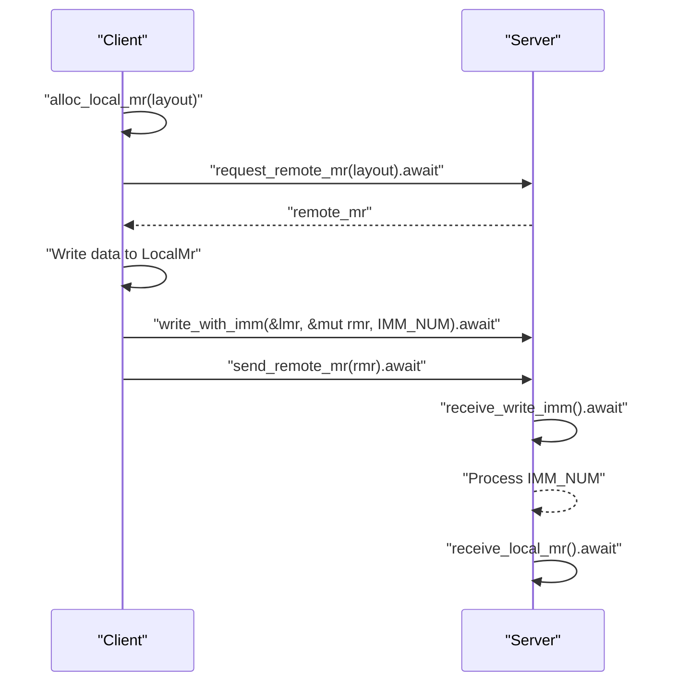
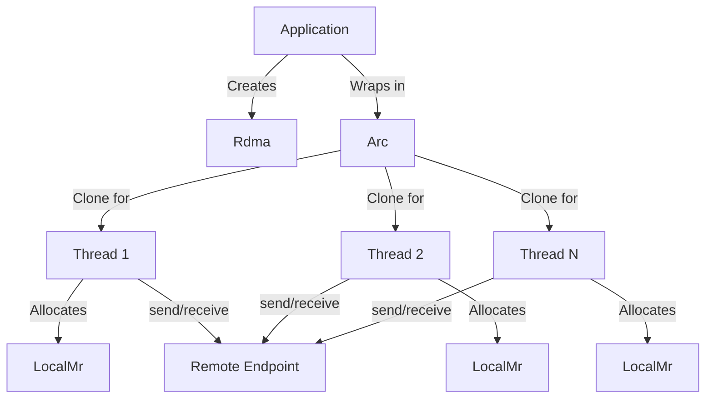

<!-- source: DeepWiki mcp.deepwiki.com · repo datenlord/async-rdma · page 5.3 Memory Region Operations · fetched 2026-11-11 -->

# Memory Region Operations

<details>
<summary>Relevant source files</summary>

The following files were used as context for generating this wiki page:

- [tests/imm.rs](tests/imm.rs)
- [tests/loop.rs](tests/loop.rs)
- [tests/mr_slice.rs](tests/mr_slice.rs)

</details>


This document details the advanced operations available for memory regions in the async-rdma library, focusing on slicing memory regions and using immediate data with RDMA operations. For basic concepts of memory management, please refer to [Memory Management](#3.2), and for the complete API reference, see [Memory Regions](#4.3).

## Memory Region Types

The async-rdma library provides two primary types of memory regions:

- **LocalMr**: A memory region registered in the local system that can be accessed directly
- **RemoteMr**: A representation of a memory region on a remote machine accessible via RDMA operations

Memory regions support various operations through a hierarchy of access traits:



Sources: `tests/loop.rs`, `tests/imm.rs`

## Memory Region Slicing

Memory region slicing allows you to create references to subsets of existing memory regions without allocating new memory. This is useful for working with specific portions of data.

### LocalMr Slicing

LocalMr supports both read-only and mutable slicing through the `get` and `get_mut` methods:



Example usage:

```
// Create a slice referencing part of the memory region
let s1 = lmr.get(0..LEN).unwrap();
assert_eq!(s1.length(), LEN);
assert_eq!(s1.addr(), lmr.addr());

// Create a slice starting from an offset
let s2_offset = 2048;
let s2 = lmr.get(s2_offset..LEN).unwrap();
assert_eq!(s2.length(), LEN - s2_offset);
assert_eq!(s2.addr(), lmr.addr() + s2_offset);

// Create a mutable slice and write to it
let mut s5 = lmr.get_mut(0..hello.len()).unwrap();
s5.as_mut_slice().copy_from_slice(hello.as_bytes());
assert_eq!(*s5.as_slice(), b"hello");
```

Sources: `tests/mr_slice.rs:12-35`

### RemoteMr Slicing

RemoteMr also supports slicing through the `get` method:

```
// Create a slice of a remote memory region
let s1 = rmr.get(0..LEN).unwrap();
assert_eq!(s1.length(), LEN);
assert_eq!(s1.addr(), rmr.addr());

// Create a slice with specific start and end points
let s3_start = 1000;
let s3_end = 4000;
let s3 = rmr.get(s3_start..s3_end).unwrap();
assert_eq!(s3.length(), s3_end - s3_start);
assert_eq!(s3.addr(), rmr.addr() + s3_start);
```

Sources: `tests/mr_slice.rs:118-136`

### Slice Boundary Validation

Both `LocalMr` and `RemoteMr` validate slice boundaries and will panic if:

1. The start index is greater than the end index
2. The range is empty (start equals end)
3. The end index exceeds the memory region's length

The test cases in `tests/mr_slice.rs` demonstrate these validation rules.

Sources: `tests/mr_slice.rs:48-219`

## Operations with Immediate Data

The async-rdma library supports operations with "immediate data" - a 32-bit value that can be sent alongside RDMA operations. This is useful for signaling the completion of operations or sending small metadata.

### Send with Immediate Data

The `send_with_imm` method sends a local memory region with an immediate value:



Example:

```
// Client side
let mut lmr = rdma.alloc_local_mr(Layout::new::<Data>())?;
// Write data to the memory region
unsafe { std::ptr::write(*lmr.as_mut_ptr() as *mut Data, Data(MSG.to_string())) };
// Send with immediate data
rdma.send_with_imm(&lmr, IMM_NUM).await?;

// Server side
let (lmr, imm) = rdma.receive_with_imm().await?;
assert_eq!(imm, Some(IMM_NUM));
```

Sources: `tests/imm.rs:12-28`

Note that `receive_with_imm()` will return `None` as the immediate value if the client used `send()` without immediate data:

```
// Client side using regular send
rdma.send(&lmr).await?;

// Server side using receive_with_imm
let (lmr, imm) = rdma.receive_with_imm().await?;
assert_eq!(imm, None);
```

Sources: `tests/imm.rs:33-36`

### Write with Immediate Data

The `write_with_imm` method performs an RDMA write to a remote memory region with an immediate value. The remote endpoint can receive the immediate value using `receive_write_imm`:



Example:

```
// Client side
let mut lmr = rdma.alloc_local_mr(Layout::new::<Data>())?;
let mut rmr = rdma.request_remote_mr(Layout::new::<Data>()).await?;
// Write data to the local memory region
unsafe { std::ptr::write(*lmr.as_mut_ptr() as *mut Data, Data(MSG.to_string())) };
// Write to remote memory with immediate data
rdma.write_with_imm(&lmr, &mut rmr, IMM_NUM).await?;
// Send the remote memory region reference back
rdma.send_remote_mr(rmr).await?;

// Server side
// Receive just the immediate data
let imm = rdma.receive_write_imm().await?;
assert_eq!(imm, IMM_NUM);
// Receive the modified local memory region
let lmr = rdma.receive_local_mr().await?;
```

Sources: `tests/imm.rs:57-77`

## Parallel Usage of Memory Regions

Memory regions can be safely used in parallel across multiple threads by wrapping the `Rdma` instance in an `Arc` (Atomic Reference Counter):



Example:

```
// Create shared Rdma instance
let rdma = Arc::new(rdma);
let mut handles = vec![];

// Spawn multiple tasks using memory regions
for _ in 0..10 {
    let rdma_clone = rdma.clone();
    handles.push(tokio::spawn(async move {
        let lm = rdma_clone.alloc_local_mr(Layout::new::<i32>()).unwrap();
        unsafe { *(*lm.as_ptr() as *mut i32) = 5 };
        rdma_clone.send(&lm).await.unwrap();
    }));
}

// Wait for all tasks to complete
for handle in handles {
    handle.await.unwrap();
}
```

Note: When performing high-frequency parallel operations, it may be necessary to introduce small delays between operations to prevent overwhelming the receiver.

Sources: `tests/loop.rs:26-46`

## Best Practices

1. **Use slices efficiently**: Rather than allocating new memory regions for each operation, use slices to work with portions of existing memory regions.

2. **Validate input ranges**: Always ensure your slice ranges are valid to avoid panics.

3. **Choose appropriate operations**:
   - Use `send/receive` when transferring ownership of data
   - Use `write/read` for direct memory access without CPU involvement on the target
   - Use immediate data when you need to signal completion or include small metadata

4. **For parallel operations**:
   - Wrap the `Rdma` instance in an `Arc` for thread safety
   - Consider adding small delays between operations for high-frequency scenarios
   - Use appropriate synchronization when multiple threads access the same memory region

Sources: `tests/mr_slice.rs`, `tests/imm.rs`, `tests/loop.rs`

---

