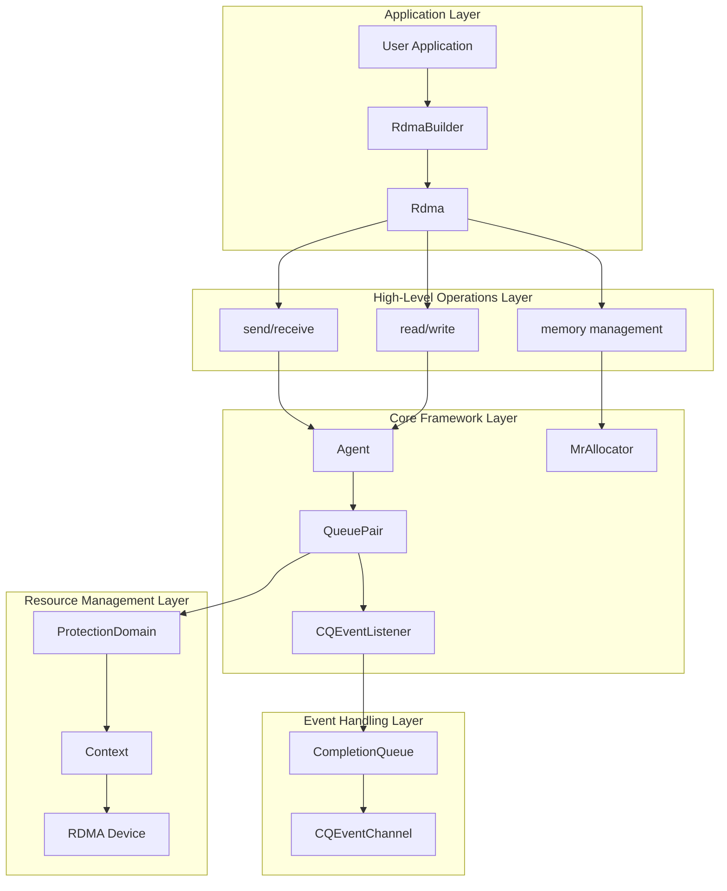
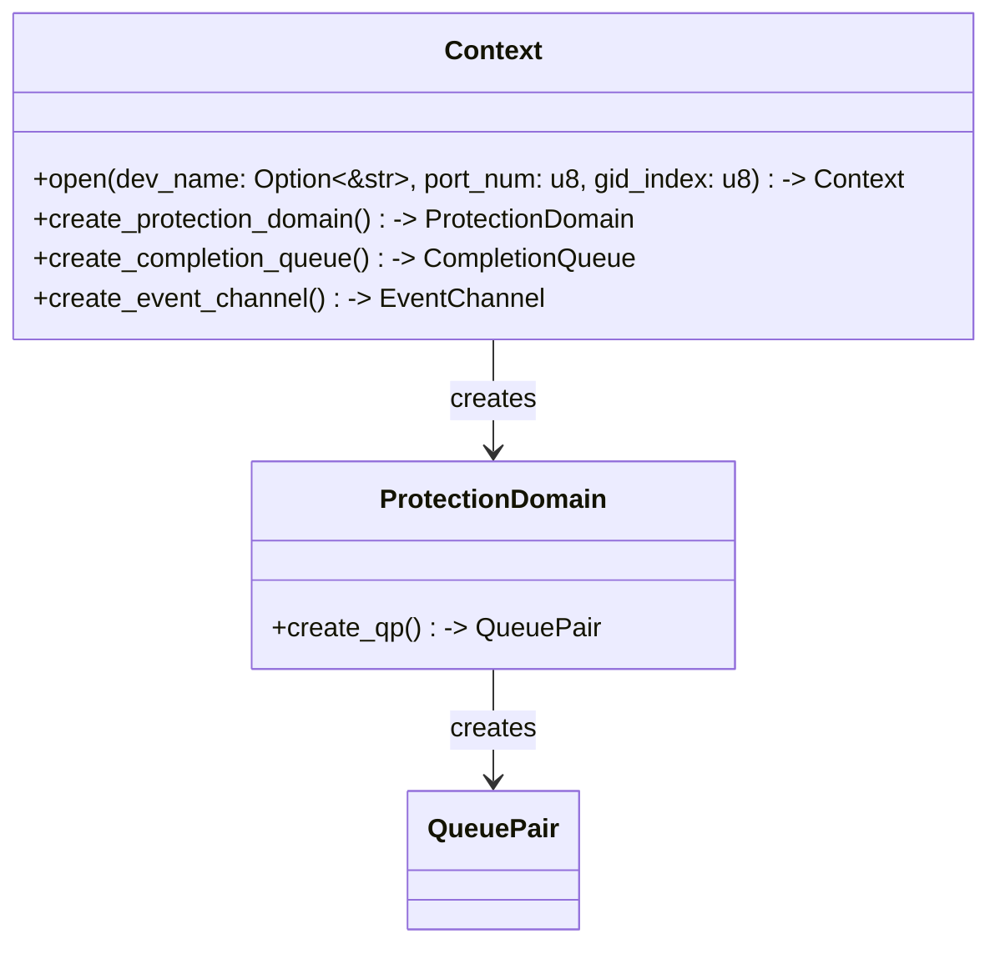
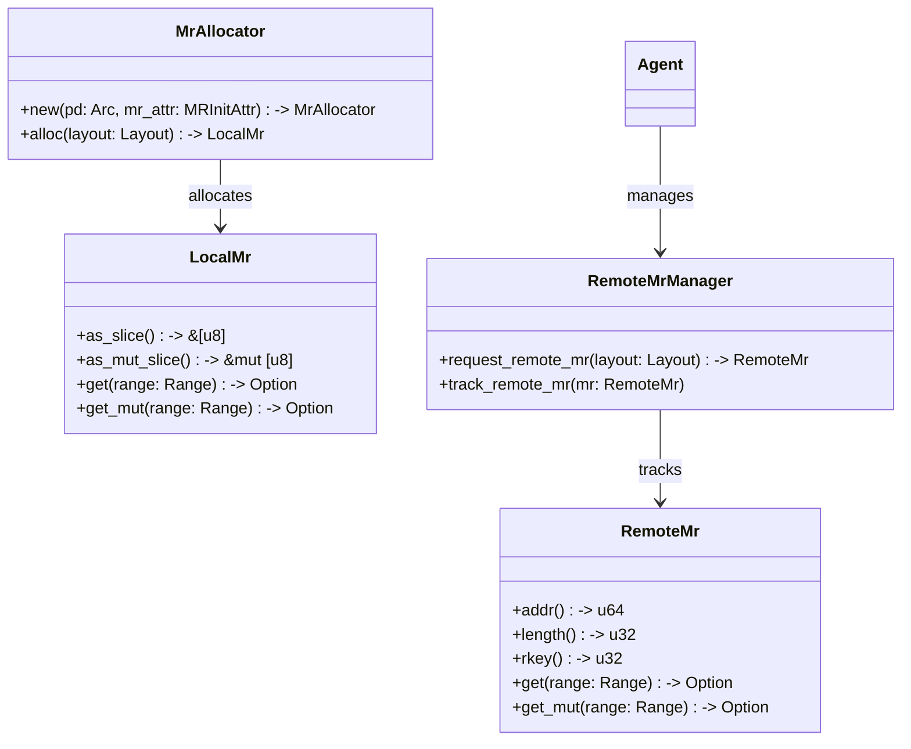
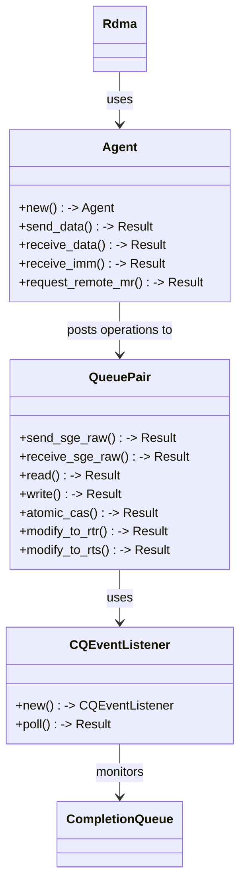
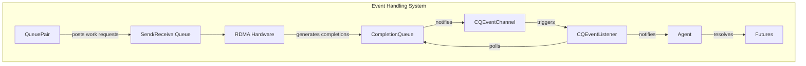
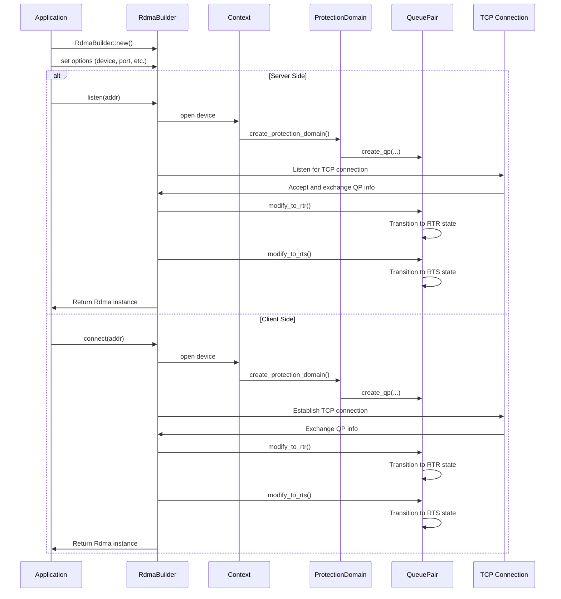
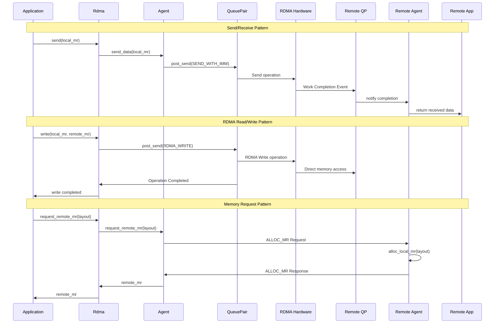
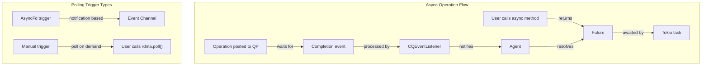
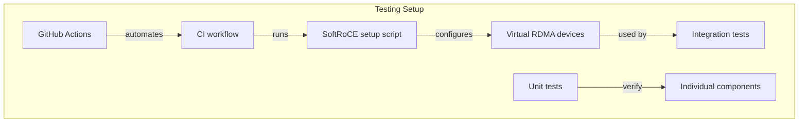

<!-- source: DeepWiki mcp.deepwiki.com · repo datenlord/async-rdma · page 6 Internals · fetched 2026-11-11 -->

# Internals

<details>
<summary>Relevant source files</summary>

The following files were used as context for generating this wiki page:

- [.github/workflows/ci.yml](.github/workflows/ci.yml)
- [src/lib.rs](src/lib.rs)

</details>


This document provides a detailed overview of the internal architecture of the async-rdma library. It is intended for developers who want to understand the library's implementation details or contribute to its development. For information about using the library's APIs, please refer to the [API Reference](#4) section.

## 1. Architecture Overview

The async-rdma library is built as a layered system that provides high-level asynchronous Rust interfaces to RDMA operations. It abstracts away much of the complexity of the low-level RDMA verbs while maintaining performance and flexibility.



Sources: [src/lib.rs:124-165]()

The architecture follows a layered approach:

1. **Application Layer**: The entry point for users, providing high-level abstractions.
2. **High-Level Operations Layer**: Implements operations like send/receive and read/write.
3. **Core Framework Layer**: Manages memory regions and communication.
4. **Resource Management Layer**: Handles RDMA resources like protection domains.
5. **Event Handling Layer**: Processes completion events asynchronously.

## 2. Core Components

### 2.1 Resource Management

#### Context and Device Management

The `Context` represents an RDMA device and provides factory methods for creating other RDMA resources.



Sources: [src/lib.rs:127-129](), [src/lib.rs:158-163]()

The `Context` is initialized when creating an `Rdma` instance through the `RdmaBuilder`. It opens the specified RDMA device and handles port and GID (Global Identifier) configuration. The `ProtectionDomain` provides security isolation for memory regions and queue pairs.

### 2.2 Memory Management System

The memory management system in async-rdma is responsible for allocating, registering, and managing memory regions for RDMA operations.



Sources: [src/lib.rs:153-157](), [src/lib.rs:178-182](), [src/lib.rs:184-185]()

The memory management system has two main parts:

1. **Local Memory Management**: `MrAllocator` handles local memory region allocation using either Jemalloc (with custom extent hooks) or a simpler raw allocation strategy.

2. **Remote Memory Management**: `RemoteMrManager` handles the lifecycle of remote memory regions, including requesting remote memory from peers and tracking timeouts.

Memory regions implement various access traits (`LocalMrReadAccess`, `LocalMrWriteAccess`, `RemoteMrReadAccess`, `RemoteMrWriteAccess`) that define the operations allowed on them.

### 2.3 Communication System

The communication system handles data transfer between RDMA peers through queue pairs.



Sources: [src/lib.rs:125-126](), [src/lib.rs:136-137](), [src/lib.rs:161]()

The communication system consists of:

1. **Queue Pair (QP)**: The core communication channel between RDMA endpoints. It handles sending and receiving operations and state transitions.

2. **Agent**: Orchestrates higher-level communication patterns. It manages memory registration, remote memory region requests, and wraps low-level send/receive operations.

3. **CQEventListener**: Asynchronously processes completion events from the completion queue. It monitors the completion queue and triggers callbacks when operations complete.

### 2.4 Event Handling



Sources: [src/lib.rs:135](), [src/lib.rs:138-139](), [src/lib.rs:144-145]()

The event handling system processes asynchronous RDMA events:

1. When operations are posted to a queue pair, they eventually complete and generate completion events.
2. These completions are placed in the completion queue (CQ).
3. The completion queue notifies the event channel.
4. The CQEventListener monitors the event channel and polls the CQ when notified.
5. The Agent is notified of completions and resolves the corresponding futures, allowing asynchronous operations to complete.

## 3. Internal Workflows

### 3.1 Connection Establishment

The connection establishment process sets up the RDMA connection between peers.



Sources: [src/lib.rs:329-1063](), [src/lib.rs:1076-1128]()

The connection establishment workflow handles:

1. **Resource Creation**: Creating the Context, ProtectionDomain, CompletionQueue, and QueuePair.
2. **Address Resolution**: Exchanging endpoint information (QP number, LID, GID) via TCP.
3. **QP State Transitions**: Moving the QP from RESET to RTR (Ready to Receive) to RTS (Ready to Send).
4. **Agent Initialization**: Setting up the Agent for handling async operations.

The library supports multiple connection methods (`RCSocket`, `RCIBV`, and optionally `RCCM` with the CM feature).

### 3.2 Memory Registration and Management

```mermaid
flowchart TD
    subgraph "Local Memory Registration"
        A["Rdma.alloc_local_mr()"] -->|calls| B["MrAllocator.alloc()"]
        B -->|allocates memory| C["Raw memory"]
        C -->|registers with RDMA device| D["LocalMr"]
    end
    
    subgraph "Remote Memory Operations"
        E["Rdma.request_remote_mr()"] -->|calls| F["Agent.request_remote_mr()"]
        F -->|sends request| G["Remote Agent"]
        G -->|allocates| H["Remote LocalMr"]
        H -->|sends token| I["RemoteMr"]
        I -->|tracked by| J["RemoteMrManager"]
    end
```



Sources: [src/lib.rs:153-157](), [src/lib.rs:184-185]()

Memory registration workflow:

1. **Local Memory**: `Rdma.alloc_local_mr()` uses the `MrAllocator` to allocate and register memory with the RDMA device, creating a `LocalMr`.

2. **Remote Memory**: `Rdma.request_remote_mr()` sends a request to the remote peer, which allocates a `LocalMr` and returns a token that is used to create a `RemoteMr` reference, tracked by the `RemoteMrManager`.

Memory regions can be sliced to provide access to specific portions without additional allocation, and they implement different access traits to control read/write operations.

### 3.3 Data Transfer Operations



Sources: [src/lib.rs:1647-1674](), [src/lib.rs:2499-2505](), [src/lib.rs:2569-2575]()

The library supports several data transfer patterns:

1. **Send/Receive**: The sender posts a send operation with data from a local memory region, and the receiver posts a receive operation to a local memory region. Both sides' CPUs are involved.

2. **RDMA Read/Write**: One side directly reads from or writes to the remote memory without involving the remote CPU, using the remote memory key (rkey).

3. **Memory Region Exchange**: Memory regions can be sent between peers to enable direct access to memory, supporting various communication patterns.

4. **Atomic Operations**: Atomic compare-and-swap operations are supported for concurrent access to shared data.

## 4. Concurrency Model

Async-rdma implements an asynchronous concurrency model using Tokio for handling asynchronous I/O operations.



Sources: [src/lib.rs:173-174](), [src/lib.rs:1042-1061]()

Key aspects of the concurrency model:

1. **Future-based API**: All RDMA operations return Futures that can be awaited.
2. **Completion Event Handling**: The `CQEventListener` monitors completion events and processes them asynchronously.
3. **Polling Mechanisms**: The library supports different polling strategies:
   - **Notification-based polling**: The default approach waits for completion channel events.
   - **Manual polling**: Users can trigger polling manually through the `Rdma.poll()` method.
4. **Timeouts**: The library implements timeouts for operations to prevent waiting indefinitely.

## 5. Error Handling

```mermaid
classDiagram
    class io::Error {
        +kind() -> ErrorKind
        +new(kind: ErrorKind, error: String) -> Error
    }
    
    class ErrorUtilities {
        +log_ret_last_os_err() -> Error
    }
    
    Rdma ..> io::Error : returns
    QueuePair ..> io::Error : returns
    Agent ..> io::Error : returns
    ErrorUtilities --> io::Error : creates
```

Sources: [src/lib.rs:139]()

Error handling in async-rdma is designed around Rust's standard `io::Error` type:

1. **Error Propagation**: The library uses the `?` operator to propagate errors through the call chain.
2. **Error Mapping**: Low-level RDMA errors are mapped to appropriate `io::ErrorKind` variants.
3. **Error Logging**: The `error_utilities` module provides helpers for logging detailed error information.
4. **Timeout Handling**: Operations can be configured with timeouts to prevent hanging on failed operations.

## 6. Testing Infrastructure

The async-rdma codebase includes a robust testing infrastructure for verifying functionality.



Sources: [.github/workflows/ci.yml:1-72]()

The testing approach includes:

1. **SoftRoCE Environment**: Tests use SoftRoCE (software implementation of RoCE) for running RDMA tests without hardware.
2. **Integration Tests**: End-to-end tests verify communication patterns between RDMA endpoints.
3. **Unit Tests**: Individual components are tested in isolation.
4. **CI Automation**: GitHub Actions workflow automatically runs tests, clippy, and formatting checks.

The test infrastructure ensures that the library works correctly across different environments and maintains compatibility as changes are made.

---

