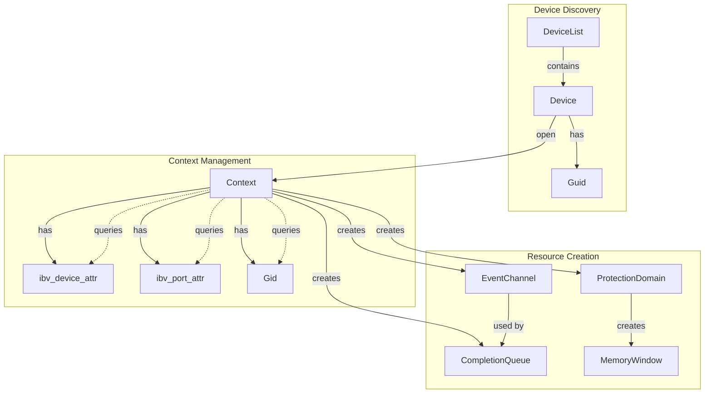
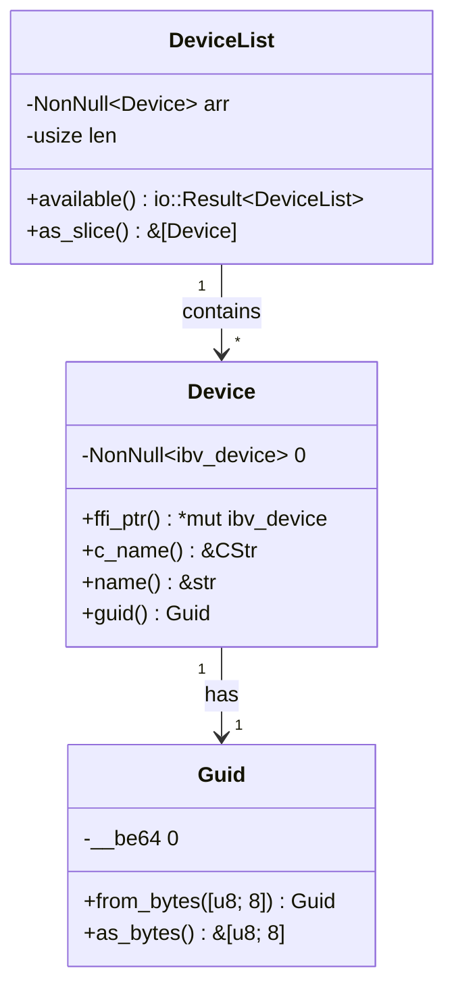
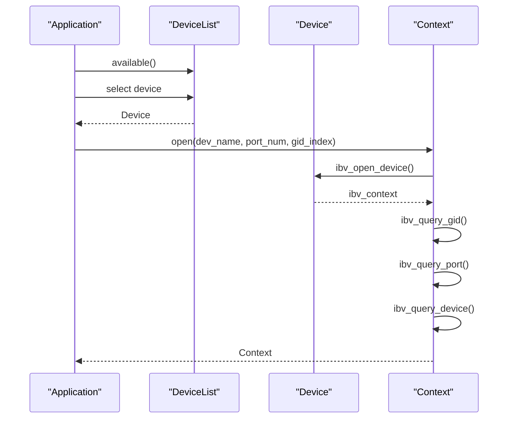
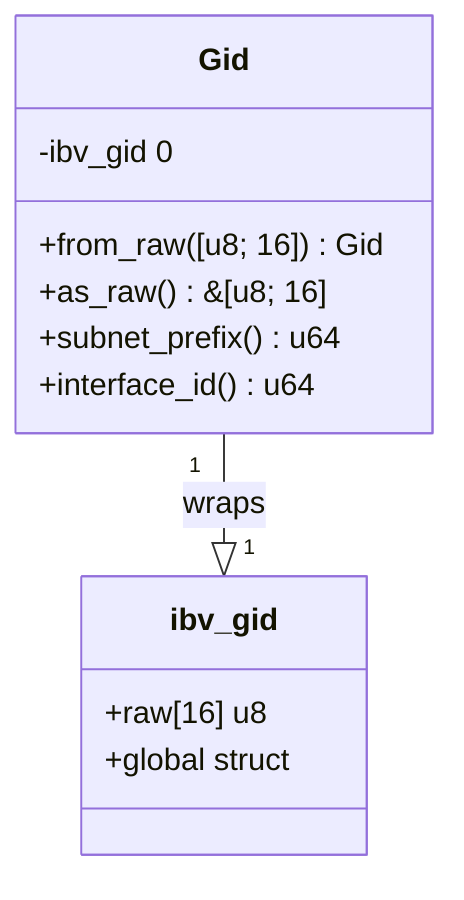
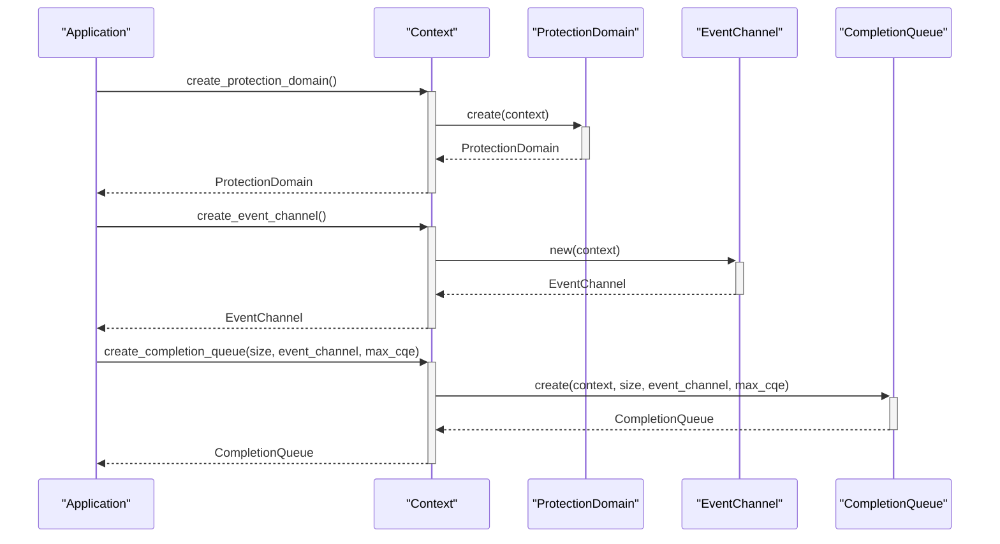
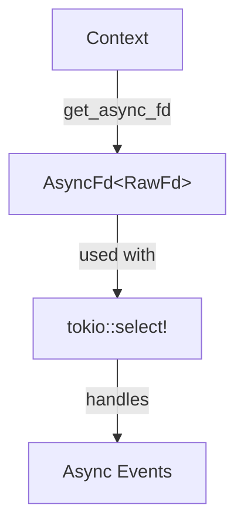
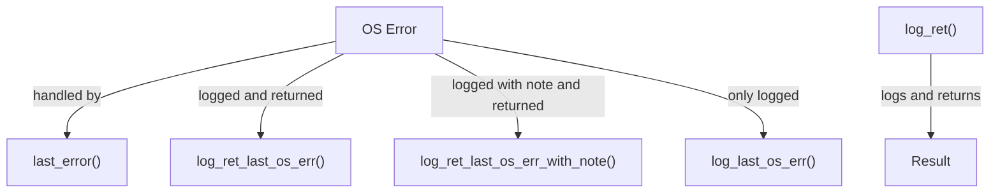
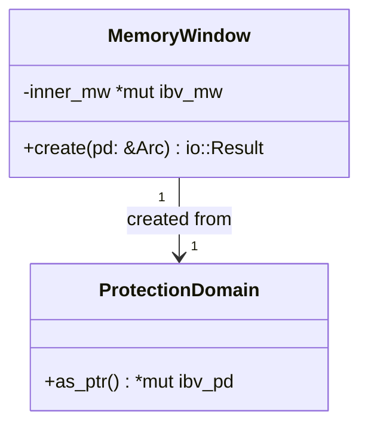
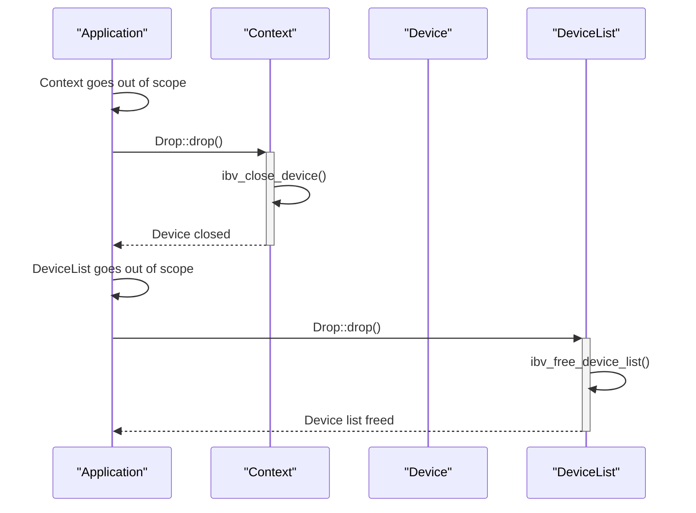

<!-- source: DeepWiki mcp.deepwiki.com · repo datenlord/async-rdma · page 6.1 Context & Device Management · fetched 2026-11-11 -->

# Context & Device Management

<details>
<summary>Relevant source files</summary>

The following files were used as context for generating this wiki page:

- [src/context.rs](src/context.rs)
- [src/device.rs](src/device.rs)
- [src/error_utilities.rs](src/error_utilities.rs)
- [src/gid.rs](src/gid.rs)
- [src/memory_window.rs](src/memory_window.rs)

</details>


This page details the internal architecture and implementations for RDMA device discovery and context management in the async-rdma library. These components provide the foundation for all RDMA operations by establishing connectivity with hardware devices and exposing their capabilities to higher-level abstractions. For information about how these components are used by applications, see [Getting Started](#2) and [Connection Management](#3.1).

## Overview

The Context & Device Management subsystem is responsible for:

1. Discovering available RDMA devices in the system
2. Opening and initializing device contexts
3. Querying device capabilities and attributes
4. Creating RDMA resources like protection domains and completion queues
5. Managing device-specific identifiers (GIDs, LIDs)

The following diagram illustrates the key components of this subsystem and their relationships:



Sources: [src/device.rs](), [src/context.rs](), [src/gid.rs](), [src/memory_window.rs]()

## Device Discovery

To use RDMA, the application must first discover the available RDMA devices in the system. The `DeviceList` struct provides functionality to enumerate and access these devices.

### DeviceList and Device



The device discovery process works as follows:

1. Call `DeviceList::available()` to get a list of RDMA devices
2. Iterate through the list to find a device by name or use the most recently added device
3. Use the selected `Device` to open a device context

Example of device discovery:

```
let dev_list = DeviceList::available()?;
let dev = match dev_name {
    Some(name) => dev_list.iter().find(|&d| d.name() == name),
    None => dev_list.get(dev_list.len().saturating_sub(1)),
}
.ok_or(io::ErrorKind::NotFound)?;
```

Sources: [src/device.rs:46-103](), [src/context.rs:58-70]()

## Context Management

The `Context` struct is the central component for RDMA device interaction. It wraps an `ibv_context` pointer and provides methods to query device capabilities and create RDMA resources.

### Context Initialization



The `Context::open` method performs several steps to initialize a device context:

1. Discovers available devices using `DeviceList::available()`
2. Selects a device based on the provided name or uses the default
3. Opens the device using `ibv_open_device()`
4. Queries the GID (Global Identifier) for the specified port and GID index
5. Queries port attributes using `ibv_query_port()`
6. Queries device attributes using `ibv_query_device()`

The resulting `Context` object contains:
- A pointer to the RDMA device context (`ibv_context`)
- Port attributes (`ibv_port_attr`)
- Device attributes (`ibv_device_attr`)
- GID information (`Gid`)

Sources: [src/context.rs:20-32](), [src/context.rs:58-115]()

### Global Identifiers (GIDs)

The `Gid` struct represents a 128-bit identifier used to identify ports in an RDMA network. It wraps the `ibv_gid` struct and provides methods to access its components.



The `Gid` structure is used within the Context to identify network endpoints for RDMA communication.

Sources: [src/gid.rs:6-93]()

## Resource Creation

The `Context` provides methods to create various RDMA resources:

1. Protection Domains (`ProtectionDomain`)
2. Event Channels (`EventChannel`)
3. Completion Queues (`CompletionQueue`)

### Creating Resources from Context

The following diagram shows how the Context is used to create RDMA resources:



These resources form the foundation for RDMA operations:

| Resource | Purpose | Created By |
|----------|---------|------------|
| ProtectionDomain | Provides security isolation for RDMA memory regions | `Context::create_protection_domain()` |
| EventChannel | Provides a channel for asynchronous event notifications | `Context::create_event_channel()` |
| CompletionQueue | Stores completion notifications for RDMA operations | `Context::create_completion_queue()` |

Sources: [src/context.rs:117-136]()

## Async Event Handling

The Context provides access to the asynchronous event file descriptor, which can be used with tokio to handle asynchronous events:



The `Context::get_async_fd()` method:

1. Gets the raw file descriptor for async events from the ibv_context
2. Sets the file descriptor to non-blocking mode
3. Wraps the descriptor in tokio's AsyncFd for use with the async runtime

Sources: [src/context.rs:148-164]()

## Error Handling

The Context & Device Management subsystem uses a set of utility functions for error handling:



These utilities ensure consistent error handling and logging throughout the Context & Device Management code.

Sources: [src/error_utilities.rs]()

## Memory Windows

The codebase includes a partial implementation of Memory Windows, which are an alternative to Memory Regions for exposing memory to remote RDMA endpoints. However, as noted in the code comments, this implementation is not complete.



When implemented, Memory Windows would provide a way to dynamically control remote access to local memory regions.

Sources: [src/memory_window.rs]()

## Cleanup and Resource Management

The Context & Device Management subsystem implements proper cleanup through Rust's Drop trait:



When a `Context` is dropped:
1. `ibv_close_device()` is called to close the device
2. Any errors are logged but not propagated

When a `DeviceList` is dropped:
1. `ibv_free_device_list()` is called to free the device list

Sources: [src/context.rs:186-195](), [src/device.rs:88-94]()

## Thread Safety

The Context & Device Management components are marked as `Send` and `Sync`, allowing them to be safely shared across threads:

```rust
unsafe impl Send for Context {}
unsafe impl Sync for Context {}

unsafe impl Send for DeviceList {}
unsafe impl Sync for DeviceList {}

unsafe impl Send for Device {}
unsafe impl Sync for Device {}
```

This is essential for the async-rdma library's ability to work with asynchronous Rust runtimes like tokio.

Sources: [src/context.rs:197-199](), [src/device.rs:27-29](), [src/device.rs:37-39]()

---

