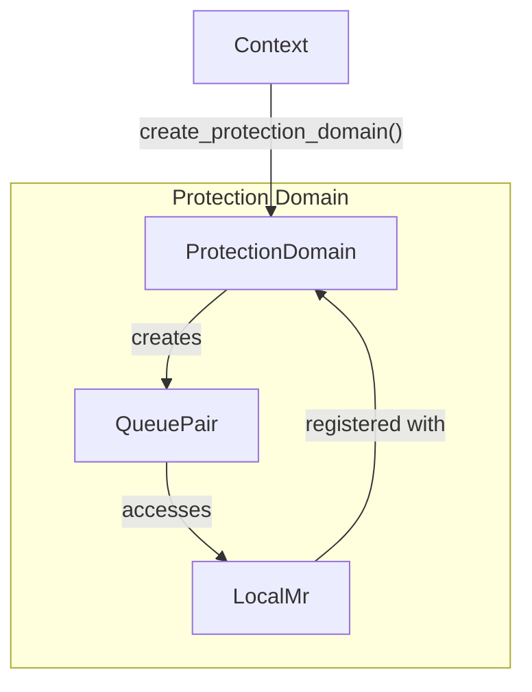
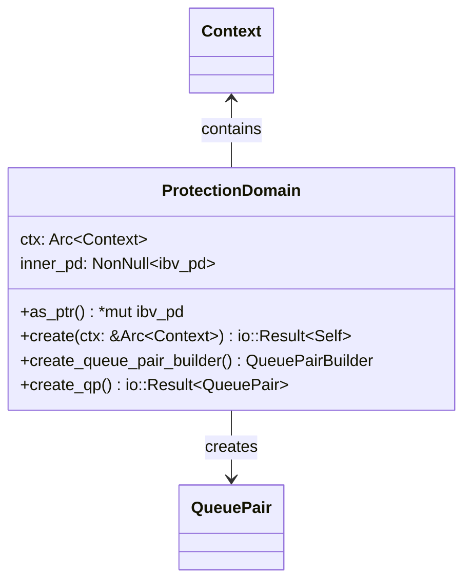
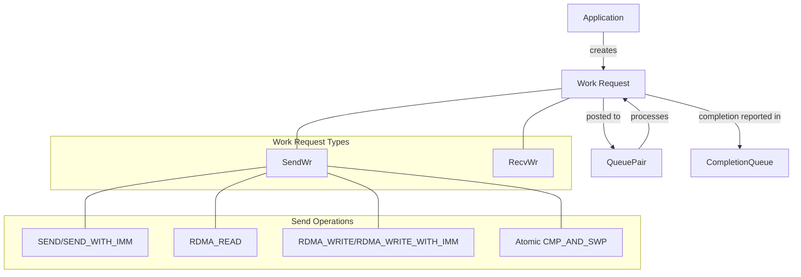
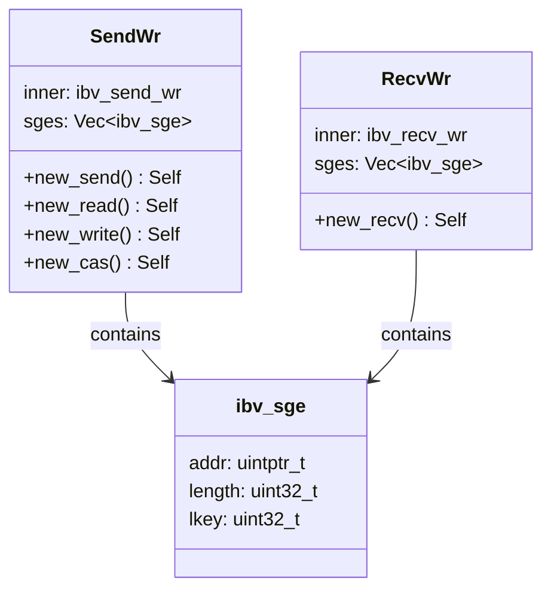
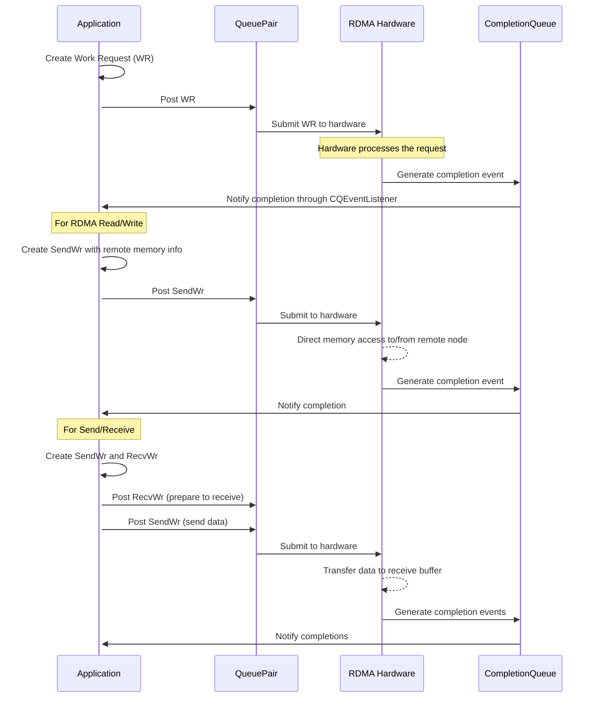
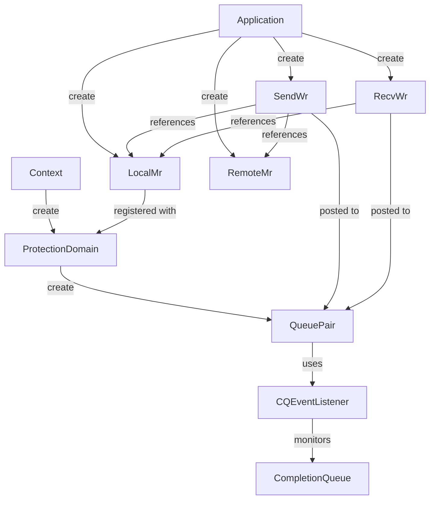

<!-- source: DeepWiki mcp.deepwiki.com · repo datenlord/async-rdma · page 6.2 Protection Domains & Work Requests · fetched 2026-11-11 -->

# Protection Domains & Work Requests

Relevant source files

The following files were used as context for generating this wiki page:

- [src/protection_domain.rs](src/protection_domain.rs)
- [src/work_request.rs](src/work_request.rs)

## Overview

This document explains how Protection Domains and Work Requests function within the async-rdma library. These components are fundamental to RDMA operations, with Protection Domains providing security isolation and Work Requests representing the operations that are submitted to the RDMA hardware.

For information about memory regions that are registered with protection domains, see [Memory Management](#3.2). For details on completion queues that process work request completions, see [Completion Queue & Event Handling](#4.6).

## Protection Domains

Protection Domains (PDs) provide security isolation for RDMA operations. They act as a security boundary that defines which memory regions and queue pairs can interact with each other. Memory regions must be registered with a protection domain, and only queue pairs associated with the same protection domain can access those memory regions.

Sources: [src/protection_domain.rs:14-42](). [src/protection_domain.rs:45-72]()

### Implementation

In async-rdma, the `ProtectionDomain` struct wraps the underlying RDMA `ibv_pd` structure and provides methods to create and manage RDMA resources within that domain.

Sources: [src/protection_domain.rs:14-19](). [src/protection_domain.rs:21-72]()

The `ProtectionDomain` provides the following key functionalities:

1. **Creation**: A protection domain is created from a device context using the `create` method.

2. **Queue Pair Creation**: Protection domains can create queue pairs, which are the communication channels for RDMA operations. This is done using either:
   - `create_queue_pair_builder()` to get a builder for customized queue pairs
   - `create_qp()` to directly create a queue pair with specified parameters

3. **Resource Cleanup**: When a protection domain is dropped, it automatically deallocates the underlying RDMA resources.

## Work Requests

Work Requests (WRs) represent operations that an application wants to execute on an RDMA device. They encapsulate the details of an operation, such as the memory locations involved, the operation type, and any additional parameters.

Sources: [src/work_request.rs:14-148](). [src/work_request.rs:155-205]()

### Types of Work Requests

In async-rdma, there are two main types of work requests:

1. **Send Work Requests (`SendWr`)**: Used for all operations that initiate an RDMA action, including:
   - Send operations: `new_send()` creates send requests, optionally with immediate data
   - RDMA Read operations: `new_read()` creates read requests to fetch data from a remote memory region
   - RDMA Write operations: `new_write()` creates write requests to store data to a remote memory region
   - Atomic operations: `new_cas()` creates Compare-and-Swap atomic operation requests

2. **Receive Work Requests (`RecvWr`)**: Used to prepare for receiving data from remote peers
   - Receive operations: `new_recv()` creates requests to prepare for receiving data

### Work Request Structure

Work requests include scatter-gather elements (SGEs) that describe the memory segments involved in the operation:

Sources: [src/work_request.rs:14-42](). [src/work_request.rs:155-184](). [src/work_request.rs:215-227]()

### Memory Access in Work Requests

Work requests utilize memory access traits to ensure proper permissions for operations:

| Trait | Purpose |
|-------|---------|
| `LocalMrReadAccess` | Ensures local memory can be read from |
| `LocalMrWriteAccess` | Ensures local memory can be written to |
| `RemoteMrReadAccess` | Ensures remote memory can be read from |
| `RemoteMrWriteAccess` | Ensures remote memory can be written to |

These traits enforce compile-time checks to prevent inappropriate memory access in RDMA operations.

Sources: [src/work_request.rs:1-7](). [src/work_request.rs:23-26](). [src/work_request.rs:63-67]()

## Work Request Flow

The following diagram illustrates how work requests flow through the RDMA system:

Sources: [src/work_request.rs:44-59](). [src/work_request.rs:92-116](). [src/work_request.rs:186-192]()

## Integration with Protection Domains

Protection domains, queue pairs, and work requests are tightly integrated:

Sources: [src/protection_domain.rs:45-72](). [src/work_request.rs:63-87](). [src/work_request.rs:92-116]()

## Practical Example

To demonstrate how protection domains and work requests work together in a typical RDMA operation:

1. A context is created for an RDMA device
2. A protection domain is created from the context
3. Memory regions are registered with the protection domain
4. Queue pairs are created within the protection domain
5. Work requests are created referencing the memory regions
6. Work requests are posted to queue pairs for execution
7. Completions are monitored via completion queues

RDMA operations require matching memory access permissions and properly constructed work requests to ensure successful data transfer while maintaining the security guarantees provided by protection domains.

---

