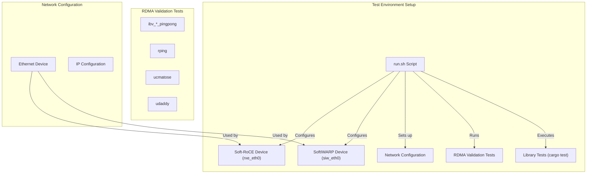
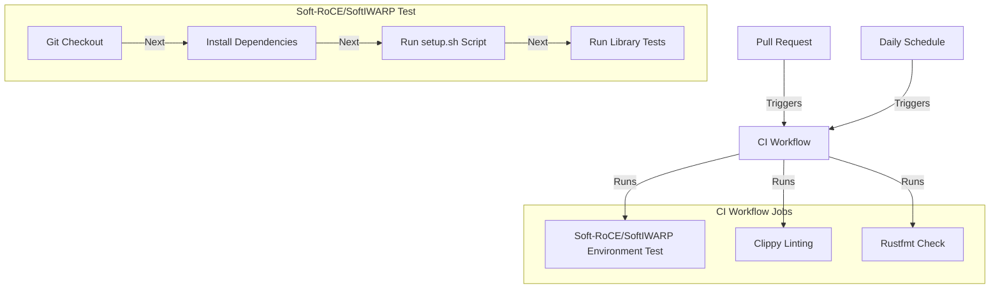
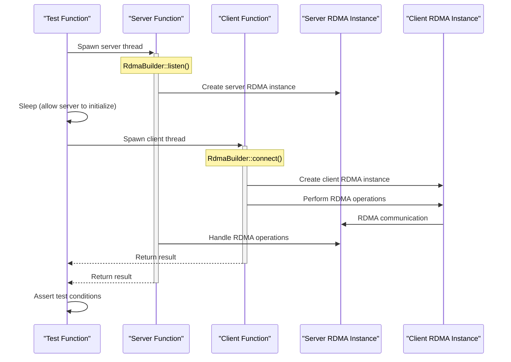
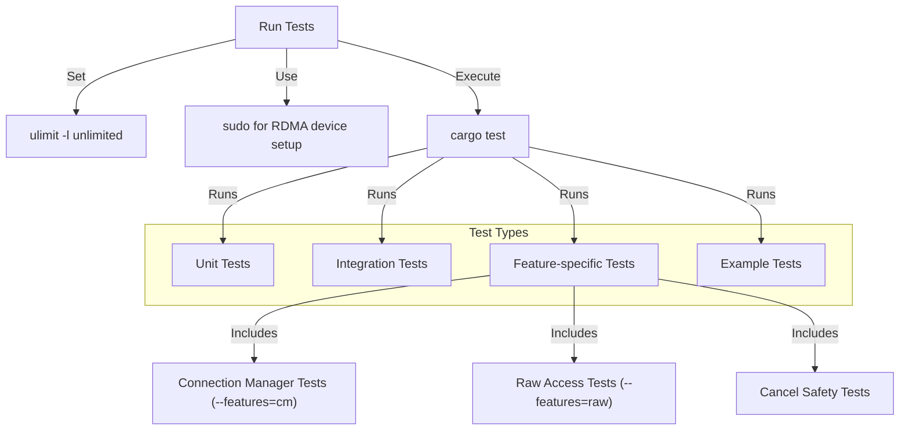

<!-- source: DeepWiki mcp.deepwiki.com · repo datenlord/async-rdma · page 6.3 Testing Infrastructure · fetched 2026-11-11 -->

# Testing Infrastructure

<details>
<summary>Relevant source files</summary>

The following files were used as context for generating this wiki page:

- [.github/workflows/ci.yml](.github/workflows/ci.yml)
- [scripts/run.sh](scripts/run.sh)
- [tests/atomic.rs](tests/atomic.rs)
- [tests/test_utilities.rs](tests/test_utilities.rs)

</details>


This document provides an overview of the testing infrastructure in the async-rdma repository, focusing on how tests are organized, executed, and configured to verify the functionality of the asynchronous RDMA operations. The testing system enables validation of both low-level RDMA operations and high-level async abstractions provided by the library.

## Test Environment Setup

The async-rdma library uses both software-based RDMA implementations for testing, specifically Soft-RoCE (RXE) and SoftIWARP (SIW). These implementations allow for testing RDMA functionality without requiring physical RDMA hardware, making it possible to run tests in CI environments.



Sources: [scripts/run.sh:1-119]()

### Prerequisites for Testing

Before running the tests, the following dependencies need to be installed:

| Dependency | Purpose |
|------------|---------|
| rdma-core | Core RDMA libraries |
| librdmacm-dev | RDMA communication manager |
| ibverbs-utils | InfiniBand utilities |
| rdmacm-utils | RDMA CM utilities |
| perftest | RDMA performance testing tools |

The setup script automatically configures the software-based RDMA devices and runs a series of validation tests to ensure the environment is properly configured.

Sources: [scripts/run.sh:1-33](), [.github/workflows/ci.yml:10-34]()

## Continuous Integration

The repository uses GitHub Actions for continuous integration testing. The CI workflow is configured to run on pull requests to the master branch and on a daily schedule.



Sources: [.github/workflows/ci.yml:1-72]()

The CI workflow performs the following tasks:
1. Sets up the Soft-RoCE and SoftIWARP test environment
2. Runs the library tests using `cargo test`
3. Performs code quality checks using Clippy and Rustfmt

## Test Utilities

The library provides a set of test utilities that simplify the writing of RDMA tests, particularly for client-server communication patterns.

```mermaid
classDiagram
    class "test_utilities" {
        +test_server_client(server_fn, client_fn)
        +get_unused_ipv4_addr()
    }
    
    class "RdmaFn~R~" {
        <<type>>
        fn(Rdma) -> R
    }
    
    class "server_wrapper" {
        -async fn(addr, f: RdmaFn~R~)
    }
    
    class "client_wrapper" {
        -async fn(addr, f: RdmaFn~R~)
    }
    
    "test_utilities" --> "server_wrapper" : uses
    "test_utilities" --> "client_wrapper" : uses
    "test_utilities" --> "RdmaFn~R~" : uses
    "server_wrapper" --> "RdmaBuilder" : creates RDMA server
    "client_wrapper" --> "RdmaBuilder" : creates RDMA client
```

Sources: [tests/test_utilities.rs:1-46]()

### Client-Server Test Helper

The `test_server_client` function provides a convenient way to test client-server communication patterns. It:

1. Creates an unused IPv4 socket address
2. Spawns a server thread using the provided server function
3. Waits a short time for the server to initialize
4. Spawns a client thread using the provided client function
5. Waits for both threads to complete

This greatly simplifies writing tests that require both RDMA endpoints.

Sources: [tests/test_utilities.rs:29-42]()

## Writing Tests

Tests in the async-rdma library are typically structured using the client-server pattern, where both endpoints are defined as separate asynchronous functions.



Sources: [tests/atomic.rs:1-100](), [tests/test_utilities.rs:29-42]()

### Example Test Case

Here's the structure of a typical test case:

1. Define server function that:
   - Accepts an `Rdma` instance
   - Performs server-side operations
   - Returns a `Result<(), io::Error>`

2. Define client function that:
   - Accepts an `Rdma` instance
   - Performs client-side operations
   - Returns a `Result<(), io::Error>`

3. Create a test function that calls `test_server_client` with the server and client functions

The atomic compare-and-swap test in [tests/atomic.rs:6-100]() demonstrates this pattern, with both success and failure test cases. The test cases verify:
- Successful atomic CAS operation
- Error handling for incorrect memory alignment
- Error handling for incorrect memory length

Sources: [tests/atomic.rs:6-100]()

## Running Tests

Tests can be run using standard Cargo commands, but due to the nature of RDMA operations, there are some special considerations.

### Privilege Requirements

RDMA operations typically require elevated privileges to:
- Configure RDMA devices
- Register memory regions
- Increase locked memory limits

The run script handles these requirements in CI by using sudo and setting the appropriate ulimit values.



Sources: [scripts/run.sh:63-78]()

### Test Commands

The main test commands used in the project are:

| Command | Purpose |
|---------|---------|
| `cargo test` | Run all standard tests |
| `cargo test --features="cm raw"` | Run tests with connection manager and raw access features |
| `cargo test --package async-rdma --test cancel_safety --features cancel_safety_test` | Run cancel safety tests |
| `cargo run --example rpc` | Run the RPC example |
| `cargo run --example server/client` | Run the server/client example |
| `cargo run --features="cm raw" --example cm_client` | Run the connection manager client example |

Sources: [scripts/run.sh:63-78]()

## Testing Different RDMA Implementations

The testing infrastructure supports validating the library against different RDMA implementations:

1. **Soft-RoCE (RXE)**: Software implementation of RoCE (RDMA over Converged Ethernet)
2. **SoftIWARP (SIW)**: Software implementation of iWARP (Internet Wide Area RDMA Protocol)

Both implementations are tested using standard RDMA test utilities like:
- `ibv_rc_pingpong`: Reliable Connection ping-pong test
- `ibv_uc_pingpong`: Unreliable Connection ping-pong test
- `ibv_ud_pingpong`: Unreliable Datagram ping-pong test
- `rping`: RDMA ping test
- `ucmatose`: RDMA connection manager test

This ensures that the library works correctly with different RDMA implementations and transport types.

Sources: [scripts/run.sh:34-118]()

## Adding New Tests

When adding new tests to the async-rdma library, developers should:

1. Use the existing test utilities in [tests/test_utilities.rs]() to simplify client-server testing
2. Structure tests with separate client and server functions
3. Consider both success and failure cases
4. Test with different RDMA features when applicable
5. Ensure tests run on both SoftIWARP and Soft-RoCE implementations

Following these guidelines ensures that tests are consistent and comprehensive across the codebase.