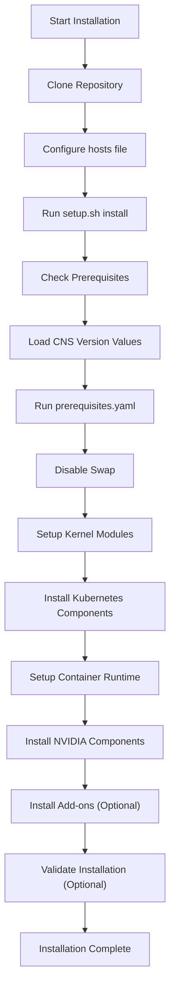
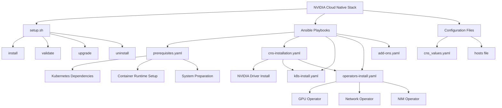
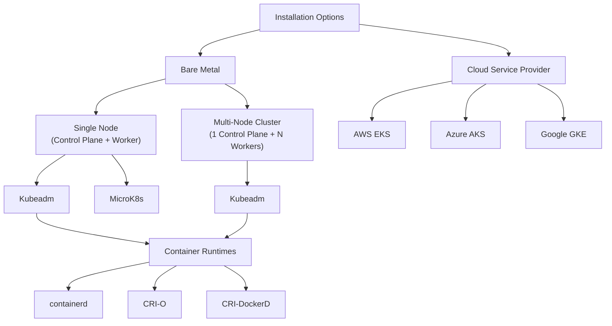

<!-- source: DeepWiki mcp.deepwiki.com · repo NVIDIA/cloud-native-stack · page 2 Installation · fetched 2026-11-11 -->

# Installation

<details>
<summary>Relevant source files</summary>

The following files were used as context for generating this wiki page:

- [README.md](README.md)
- [install-guides/readme.md](install-guides/readme.md)
- [playbooks/cns-installation.yaml](playbooks/cns-installation.yaml)
- [playbooks/prerequisites.yaml](playbooks/prerequisites.yaml)
- [playbooks/readme.md](playbooks/readme.md)
- [playbooks/setup.sh](playbooks/setup.sh)

</details>


This page provides a comprehensive guide for installing the NVIDIA Cloud Native Stack (CNS), a collection of software designed to run cloud-native workloads on NVIDIA GPUs. The installation system is the primary entry point for deploying CNS in your environment, whether on bare metal or cloud service providers.

## Purpose and Scope

This documentation covers the installation process for NVIDIA Cloud Native Stack, including:
- Prerequisites and system requirements
- Installation methods (automated with Ansible playbooks and manual guides)
- Deployment options (bare metal, cloud service providers)
- Component installation (Kubernetes, container runtimes, NVIDIA operators)
- Validation and troubleshooting

For information about configuring CNS after installation, see [Configuration](#3). For details about the specific components of CNS, see [Components](#4).

## Prerequisites

Before installing NVIDIA Cloud Native Stack, ensure your system meets these requirements:

| Requirement | Specification |
|-------------|---------------|
| Internet connectivity | Direct access with adequate bandwidth |
| Operating system | Ubuntu 22.04/24.04 LTS or RHEL 8.7/8.10 |
| DNS | Functioning DNS server |
| Network | Single interface with static IP address |
| UEFI | Secure boot disabled |
| Storage | At least 40GB capacity in root filesystem |
| Hardware | Minimum 2 CPU cores and 4GB memory |
| GPU | At least one NVIDIA GPU |
| Access | Ability to access Google repositories (for Kubernetes) |

Sources: [README.md:85-98](), [playbooks/readme.md:16-26]()

### Supported Systems

NVIDIA Cloud Native Stack supports:
- NVIDIA-Certified Systems with Mellanox CX NICs (for x86-64 servers)
- NVIDIA Qualified Systems (for ARM64 servers)
- NVIDIA Jetson Systems

**Note**: For ARM systems, the NVIDIA Network Operator is not currently supported.

Sources: [playbooks/readme.md:28-39]()

## Installation Architecture

### Installation Process Flow



### Installation Components



Sources: [playbooks/setup.sh:1-80](), [playbooks/cns-installation.yaml:1-309]()

## Installation Methods

NVIDIA Cloud Native Stack offers two installation methods:

1. **Automated installation** using Ansible playbooks
2. **Manual installation** following step-by-step guides

This page focuses on the automated installation using Ansible playbooks.

### Automated Installation with Ansible

#### Step 1: Clone the Repository

```bash
git clone https://github.com/NVIDIA/cloud-native-stack.git
cd cloud-native-stack/playbooks
```

#### Step 2: Configure the Hosts File

Update the hosts file with your master and worker node information:

```bash
nano hosts

[master]
10.110.16.178 ansible_ssh_user=nvidia ansible_ssh_pass=nvidipass ansible_sudo_pass=nvidiapass ansible_ssh_common_args='-o StrictHostKeyChecking=no'
[nodes]
10.110.16.179 ansible_ssh_user=nvidia ansible_ssh_pass=nvidiapass ansible_sudo_pass=nvidiapass ansible_ssh_common_args='-o StrictHostKeyChecking=no'
```

#### Step 3: Select CNS Version

Edit the `cns_version.yaml` file to specify which version you want to install:

```bash
nano cns_version.yaml
```

Available versions include:
- 15.0 (for Ubuntu 24.04)
- 14.1
- 13.3
- and others

#### Step 4: Run the Installation

Execute the installation using the setup.sh script:

```bash
bash setup.sh install
```

This script will:
1. Check prerequisites
2. Install Ansible if not present
3. Copy the appropriate version-specific values file
4. Launch the Ansible playbooks
5. Install Kubernetes and container runtime
6. Install NVIDIA components and operators

Sources: [README.md:100-125](), [playbooks/setup.sh:265-344](), [playbooks/readme.md:78-243]()

## Deployment Options

### Deployment Topologies



NVIDIA Cloud Native Stack supports two topologies:
- Single node with both control plane and worker functionalities
- One control plane node and any number of worker nodes

**Note**: CNS does not currently support deploying multiple control plane nodes.

Sources: [README.md:129-133]()

### Bare Metal Installation

For bare metal installations, the standard `setup.sh install` command is used. The installation automatically detects if it's running on a single machine and configures accordingly.

### Cloud Service Provider Installation

For deployment on cloud providers, use the following commands:

- **AWS EKS**:
  ```bash
  bash setup.sh install eks
  ```

- **Azure AKS**:
  ```bash
  bash setup.sh install aks
  ```

- **Google GKE**:
  ```bash
  bash setup.sh install gke
  ```

These commands will set up the necessary cloud provider tools, create a Kubernetes cluster with GPU nodes, and install the NVIDIA GPU Operator.

Sources: [playbooks/setup.sh:267-325](), [playbooks/readme.md:703-776]()

## Customization Options

### Container Runtime Selection

NVIDIA Cloud Native Stack supports three container runtimes:

1. **containerd** (default)
2. **CRI-O**
3. **CRI-dockerd**

To select a container runtime, modify the `container_runtime` value in your `cns_values_<version>.yaml` file:

```yaml
container_runtime: "containerd"
```

Sources: [playbooks/prerequisites.yaml:300-578](), [playbooks/readme.md:110-112]()

### Enable MicroK8s

To use MicroK8s instead of Kubeadm, set the `microk8s` parameter to `yes` in the CNS values file:

```yaml
microk8s: yes
```

Sources: [playbooks/readme.md:330-341](), [playbooks/cns-installation.yaml:276-277]()

### Enable Add-ons

Several add-ons can be enabled during installation:

| Add-on | Description | Configuration |
|--------|-------------|---------------|
| Storage | Local Path Provisioner and NFS Provisioner | `storage: yes` |
| Monitoring | Prometheus/Grafana with GPU metrics and Elastic Logging stack | `monitoring: yes` |
| LoadBalancer | MetalLB for load balancing | `loadbalancer: yes` |
| KServe | ML model serving platform | `kserve: yes` |
| LeaderWorkerSet | Kubernetes SIG LWS | `lws: yes` |

Sources: [playbooks/cns-installation.yaml:279-280](), [playbooks/readme.md:666-699]()

### NVIDIA Operators

By default, the installation includes:

1. **NVIDIA GPU Operator**: For managing NVIDIA GPUs in Kubernetes
2. **NVIDIA Network Operator** (optional): For managing Mellanox networking devices

You can enable/disable and customize these operators in the `cns_values_<version>.yaml` file:

```yaml
# GPU Operator Values
enable_gpu_operator: yes
gpu_driver_version: "570.124.06"
use_open_kernel_module: no
enable_mig: no

# Network Operator Values
enable_network_operator: no
enable_rdma: no
deploy_ofed: no
```

Sources: [playbooks/readme.md:136-156](), [playbooks/readme.md:164-170]()

### Confidential Computing

For confidential computing installations, use:

```bash
bash setup.sh install cc
```

This will configure the system BIOS for confidential computing, install the SNP kernel, and then reboot. After reboot, run the standard installation command:

```bash
bash setup.sh install
```

Sources: [playbooks/setup.sh:325-329](), [playbooks/readme.md:786-800]()

## Validation and Troubleshooting

### Validation

After installation, validate your NVIDIA Cloud Native Stack:

```bash
bash setup.sh validate
```

This will check:
- Kubernetes cluster status
- Node status
- Pod status
- Helm installation
- GPU Operator status
- Component versions
- NVIDIA driver and CUDA functionality

Sources: [playbooks/setup.sh:384-394](), [playbooks/readme.md:802-809]()

### Troubleshooting

For installation issues, consult the troubleshooting guide:

```bash
bash setup.sh troubleshoot
```

Or visit the [Troubleshooting page](#5.2) for common issues and solutions.

Sources: [README.md:135-137]()

## Upgrade and Uninstall

### Upgrade

To upgrade your NVIDIA Cloud Native Stack:

```bash
bash setup.sh upgrade
```

**Note**: Upgrades are only supported from the previous batch to the latest batch (e.g., 13.x to 14.x, not 13.x to 15.x).

Sources: [playbooks/readme.md:810-816](), [playbooks/setup.sh:345-355]()

### Uninstall

To uninstall NVIDIA Cloud Native Stack:

```bash
bash setup.sh uninstall
```

For cloud provider deployments:

```bash
bash setup.sh uninstall eks
bash setup.sh uninstall aks
bash setup.sh uninstall gke
```

Sources: [playbooks/setup.sh:356-383](), [playbooks/readme.md:818-825]()

## Component Matrix

The following table shows the key components in NVIDIA Cloud Native Stack 25.4.0 (latest release):

| Component | CNS v15.0 | CNS v14.1 | CNS v13.3 |
|-----------|-----------|-----------|-----------|
| OS | Ubuntu 24.04 LTS | Ubuntu 22.04 LTS | Ubuntu 22.04 LTS |
| Containerd | 2.0.3 | 2.0.3 | 1.7.27 |
| NVIDIA Container Toolkit | 1.17.5 | 1.17.5 | 1.17.5 |
| CRI-O | 1.32.1 | 1.31.5 | 1.30.10 |
| Kubernetes | 1.32.2 | 1.31.6 | 1.30.10 |
| CNI (Calico) | 3.29.2 | 3.29.2 | 3.29.2 |
| NVIDIA GPU Operator | 25.3.0 | 25.3.0 | 25.3.0 |
| NVIDIA Network Operator | 25.1.0 | 25.1.0 | 25.1.0 |
| NVIDIA Driver | 570.124.06 | 570.124.06 | 570.124.06 |
| Helm | 3.17.2 | 3.17.2 | 3.17.2 |

Sources: [README.md:38-54]()

## Conclusion

This page provided an overview of the installation process for NVIDIA Cloud Native Stack. By following these instructions, you can deploy a GPU-accelerated Kubernetes environment suitable for various workloads. For more detailed information about specific components and configurations, refer to the corresponding pages in this documentation.

---

