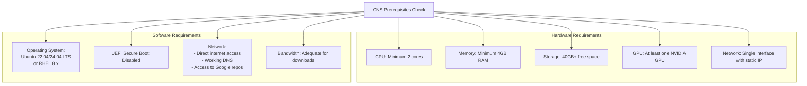
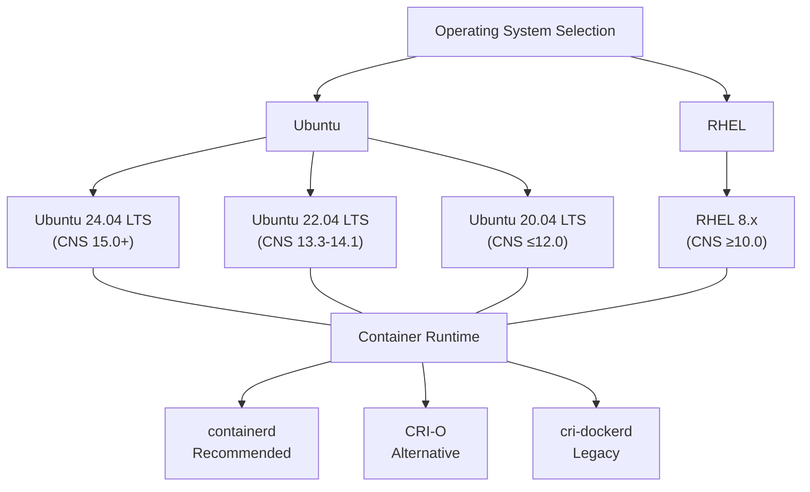
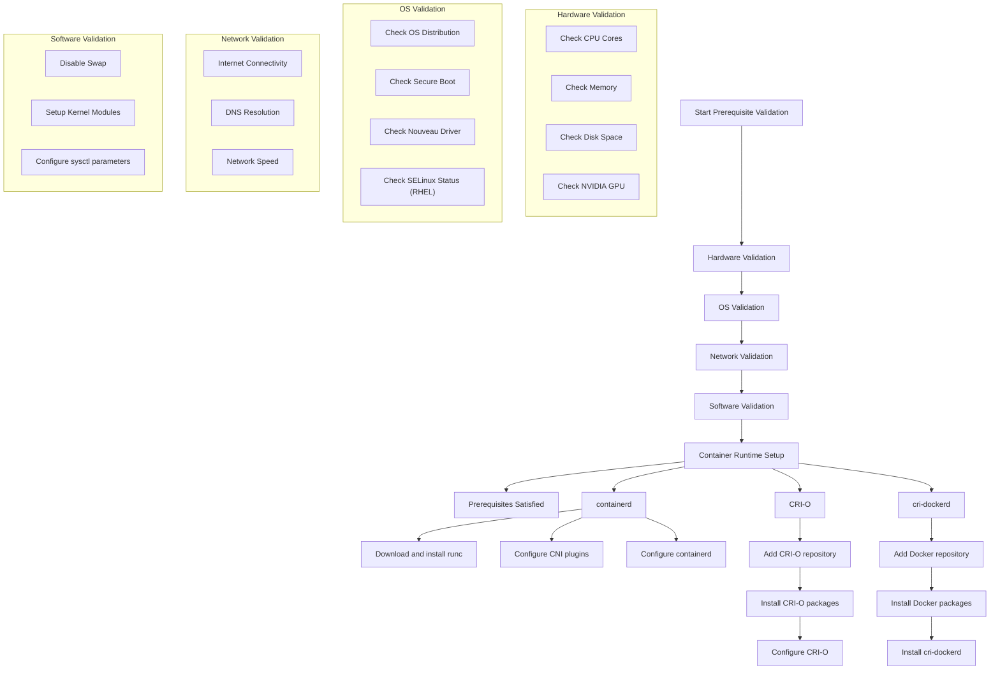

<!-- source: DeepWiki mcp.deepwiki.com · repo NVIDIA/cloud-native-stack · page 2.1 Prerequisites · fetched 2026-11-11 -->

# Prerequisites

<details>
<summary>Relevant source files</summary>

The following files were used as context for generating this wiki page:

- [README.md](README.md)
- [playbooks/cns-installation.yaml](playbooks/cns-installation.yaml)
- [playbooks/prerequisites.yaml](playbooks/prerequisites.yaml)

</details>


This page details the system requirements and prerequisites needed before installing NVIDIA Cloud Native Stack (CNS). Fulfilling these prerequisites ensures a successful installation and optimal performance of GPU-accelerated Kubernetes environments.

For information about the actual installation process after prerequisites are met, see [Installation Process](#2.2).

## System Requirements Overview

Before deploying NVIDIA Cloud Native Stack, ensure your system meets the following minimum requirements:



Sources: [README.md:85-99](), [playbooks/cns-installation.yaml:153-164]()

## Hardware Requirements

### Compute Resources

CNS requires minimum compute resources to run Kubernetes and NVIDIA components effectively:

| Resource | Minimum Requirement | Recommended |
|----------|---------------------|-------------|
| CPU | 2 cores | 4+ cores |
| Memory | 4GB RAM | 8GB+ RAM |
| Storage | 40GB free space | 100GB+ free space |
| GPU | 1 NVIDIA GPU | NVIDIA Certified System |

The prerequisites validation checks these requirements automatically:

```python
# CPU check (from cns-installation.yaml)
- name: Check Number of CPU's
  failed_when: ansible_processor_vcpus < 2
  shell: "echo 'minimum 2 CPUs required'"

# Memory check
- name: Check memory requirements
  failed_when: ansible_memtotal_mb < 4096
  shell: "echo 'minimum 4GB memory required'"

# Storage check
- name: check enough storage
  shell: df --block-size 1g / --output=avail | tail -1 | sed "s/ //g"
  register: size
  failed_when: " size.stdout | int <= 40 and ansible_architecture == 'x86_64'"
```

Sources: [playbooks/cns-installation.yaml:153-164]()

### Network Configuration

Network requirements are essential for proper CNS operation:

- System must have a single network interface configured with internet access
- Static IP address (not dynamically changing via DHCP)
- Firewall must allow required Kubernetes ports

For multi-node configurations, ensure network connectivity between all nodes.

Sources: [README.md:94-95]()

## Software Requirements

### Operating System

NVIDIA Cloud Native Stack supports the following operating systems:

| CNS Version | Supported Operating Systems |
|-------------|---------------------------|
| 15.0        | Ubuntu 24.04 LTS          |
| 14.1, 13.3  | Ubuntu 22.04 LTS          |
| ≤ 12.0      | Ubuntu 20.04 LTS, RHEL 8.x |

Note: CNS version 10.0 and later support RHEL systems. Earlier versions only support Ubuntu.



Sources: [README.md:43-45](), [playbooks/cns-installation.yaml:181-182]()

### Boot Configuration

UEFI Secure Boot must be disabled. The installation validates this requirement:

```python
# Secure boot check
- name: check secure boot
  shell: mokutil --sb-state | awk '{print $2}'
  register: secure_boot
  failed_when: "'enabled' in secure_boot.stdout"
  ignore_errors: true
```

Sources: [README.md:96](), [playbooks/cns-installation.yaml:147-151]()

### NVIDIA Driver Considerations

If you're using a system with an existing NVIDIA driver, be aware of the following:

- The nouveau driver must be disabled
- For DGX systems with RDMA or GDS enabled, existing drivers will be cleaned up
- Systems with Tegra/Jetson require specific JetPack versions

The installation process handles disabling the nouveau driver:

```python
- name: Checking Nouveau is disabled
  become: true
  shell: "lsmod | grep nouveau"
  register: nouveau_result
  failed_when: false

- name: unload nouveau
  when: nouveau_result.rc == 0
  become: true
  modprobe:
    name: nouveau
    state: absent
  ignore_errors: true
```

Sources: [playbooks/cns-installation.yaml:22-47]()

## Network Requirements

### Internet Connectivity

The CNS installation requires:

- Direct internet access (no air-gapped installations)
- Working DNS resolution
- Access to Google repositories (for Kubernetes)
- Access to NVIDIA repositories

The installation performs an internet speed test to ensure adequate bandwidth:

```python
- name: Check Internet Speed
  ignore_errors: true
  failed_when: false
  shell: /usr/bin/python3 /tmp/speedtest-cli --secure --simple
  register: speed
  async: 30

- name: Report Valid Internet Speed
  shell: echo {{ speed.stdout_lines[1] }} | awk '{print $3}'
  register: speedtest
  ignore_errors: true
  failed_when: "'Kbit/s' in speedtest.stdout"
```

Sources: [README.md:89-93](), [playbooks/cns-installation.yaml:121-146]()

## Prerequisite Validation Process

The CNS installation process automatically validates prerequisites through the `prerequisites.yaml` and `cns-installation.yaml` Ansible playbooks. Here's the validation flow:



Sources: [playbooks/prerequisites.yaml](), [playbooks/cns-installation.yaml:147-164]()

## Platform-Specific Prerequisites

### NVIDIA Certified Servers

NVIDIA Certified Servers are the recommended platform for CNS deployments, providing validated hardware configurations that ensure compatibility.

### DGX Systems

DGX systems require specific considerations:

- The installation detects DGX systems and applies appropriate configurations
- For enabling RDMA or GDS, the existing NVIDIA drivers will be uninstalled

```python
- name: check dgx
  stat:
    path: /etc/dgx-release
  register: dgx

- name: NVIDIA Driver Clean Up on DGX
  when: dgx.stat.exists == True and ansible_distribution == 'Ubuntu' and enable_rdma == true or dgx.stat.exists == True and ansible_distribution == 'Ubuntu' and enable_gds == true
  become: true
  block:
    # Driver cleanup tasks
```

Sources: [playbooks/cns-installation.yaml:183-250]()

### Jetson/Tegra Systems

Jetson/Tegra platforms have specific JetPack requirements:

- The installation detects Tegra systems and handles JetPack updates
- Different CNS versions require different JetPack versions

```python
- name: Installing Latest Nvidia Jetson JetPack
  become: true
  block:
    - name: update Tegra Release to r35.4
      shell: sed -i "s/{{ tver.stdout }}/r35.4/g" /etc/apt/sources.list.d/nvidia-l4t-apt-source.list
      become: true
    
    - name: Install New Jetapck 5.1.2
      ignore_errors: yes
      apt:
        name: nvidia-jetpack
        state: present
        force: yes
        autoremove: yes
        update_cache: yes
  when: "release == 'tegra' and cns_version == 10.2 or release == 'tegra' and cns_version == 9.3 or release == 'tegra' and cns_version == 8.5"
```

Sources: [playbooks/prerequisites.yaml:1188-1258]()

## Container Runtime Requirements

CNS supports multiple container runtimes, each with specific version requirements:

| CNS Version | Containerd | CRI-O | Container Toolkit |
|-------------|------------|-------|-------------------|
| 15.0        | 2.0.3      | 1.32.1| 1.17.5            |
| 14.1        | 2.0.3      | 1.31.5| 1.17.5            |
| 13.3        | 1.7.27     | 1.30.10| 1.17.5           |

The installation playbook handles the setup of the selected container runtime including:

1. **containerd** (Recommended)
   - Downloads and installs containerd
   - Configures systemd cgroups
   - Sets up CNI plugins

2. **CRI-O** (Alternative)
   - Adds appropriate CRI-O repositories
   - Installs CRI-O packages
   - Configures storage directories

3. **cri-dockerd** (Legacy)
   - Installs Docker CE
   - Sets up cri-dockerd as the CRI implementation

Sources: [playbooks/prerequisites.yaml:300-523](), [README.md:45-47]()

## SELinux Considerations

For RHEL systems, SELinux must be set to permissive mode:

```python
- name: Check SELinux Status on RedHat
  when: ansible_distribution == 'RedHat'
  shell: sestatus | grep -i 'Current mode' | awk '{print $3}'
  register: selinuxstatus

- name: Update SELinux Status on RHEL system
  when: ansible_distribution == 'RedHat' and selinuxstatus.stdout == 'enforcing'
  become: true
  shell: sed -i 's/^SELINUX=enforcing$/SELINUX=permissive/' /etc/selinux/config
```

Sources: [playbooks/cns-installation.yaml:89-97]()

## Troubleshooting Prerequisites

If prerequisite validation fails, check the following common issues:

1. **Secure Boot is enabled**: 
   - Access UEFI settings during boot and disable Secure Boot

2. **Insufficient storage**:
   - Free up disk space or extend the root filesystem

3. **Network connectivity issues**:
   - Ensure DNS resolution works (`nslookup google.com`)
   - Verify internet connectivity (`ping 8.8.8.8`)
   - Check access to Google repos (`curl https://packages.cloud.google.com/apt/doc/apt-key.gpg`)

4. **nouveau driver is loaded**:
   - The installation will attempt to disable it, but may require a reboot

5. **SELinux issues on RHEL**:
   - The installation will attempt to set SELinux to permissive mode

For more detailed troubleshooting, refer to the [Troubleshooting](#5.2) section.

Sources: [README.md:136-137]()

## Next Steps

After ensuring that all prerequisites are met, proceed to the [Installation Process](#2.2) to deploy NVIDIA Cloud Native Stack.

---

